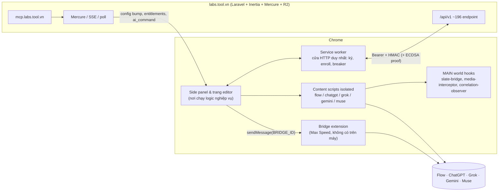

# 00. Tổng quan ToolFlow

> **Cập nhật runtime 05/11/2026:** [chương 16](16-flow-gpt-runtime-findings.md) đã thu được **82 selector Flow hiện tại**, config transport/correlation và **11 nhóm private config ChatGPT** trên gói Free. Các câu bên dưới nói chúng chưa quan sát được là giới hạn của lượt phân tích trước, không còn là blocker hiện tại. Phần giao thức **Max Speed + mã Bridge** vẫn chưa thu được. Lượt đào sâu mới chỉ tập trung Flow và ChatGPT.

> Thay thế bản teardown đầu tiên. Bản này đã sửa những chỗ bản đầu hiểu sai; chúng được liệt kê ở §0.6.

## 0.1 Một câu
ToolFlow là **RPA trong trình duyệt**. Nó không có model AI nào. Nó lái **tài khoản web của chính người dùng** trên Google Flow (Veo, Nano Banana, Omni), ChatGPT, Grok, Gemini và Muse để sinh ảnh, video **hàng loạt**. "Bộ não" vận hành (selector, timing, giao thức, quota) nằm trên **server của Tool** và được cập nhật nóng.

## 0.2 Các khối chức năng

| Khối | Người dùng thấy | Bên trong | Tài liệu |
|---|---|---|---|
| Gen | Dán N prompt, chọn provider/model/tỉ lệ, ref, bấm Tạo, nhận N file | PromptQueue (14 trạng thái), batch 6, nghỉ 5–15 s, chunk 40, auto-download | [07](07-gen-batch-queue-tasks.md) |
| Tasks | Lưu batch có tên để chạy lại | `tasks` trên server, ref xoay vòng | [07](07-gen-batch-queue-tasks.md) |
| Flow web (v1) | Mặc định | Lái DOM, vá `addEventListener` để lách `isTrusted`, bẫy file picker, theo dõi tile | [04](04-google-flow-dom-v1.md) |
| Flow **Max Speed** | Công tắc "Max Speed V2" (trả phí) | Gọi RPC nội bộ Flow qua **extension Bridge** riêng; receipt và chống gửi trùng 12 lớp | [05](05-google-flow-api-v2-max-speed.md) |
| ChatGPT/Grok/Gemini/Muse | Chọn provider khác | Adapter → Session → content script; selector từ server; cửa sổ worker song song (2) | [06](06-chatgpt-grok-gemini-muse.md) |
| Workflow | Kéo thả node, chạy pipeline nhiều AI | 13 loại node, port có kiểu, `@slug`; **server lập kế hoạch thứ tự chạy** | [08](08-workflow-builder-executor.md) |
| Motion Studio | Chuyển chuyển động từ video mẫu sang nhân vật | Cắt theo khoảng lặng, transcript qua tab ChatGPT/Gemini, gửi Flow, ghép bằng mediabunny | [09](09-motion-studio-angles-effects-video.md) |
| Angles / Effects | Đổi góc máy / áp hiệu ứng lên ảnh | Dựng prompt từ preset và gửi Flow | [09](09-motion-studio-angles-effects-video.md) |
| MCP / Telegram | Claude hoặc bot Telegram ra lệnh | Server đẩy `ai_command` qua SSE; extension chạy rồi trả `mcp/result` | [10](10-mcp-telegram-i2p-watermark-settings.md) |
| Image→Prompt, Prompt Assistant | Chuột phải ảnh → prompt | Nhờ tab ChatGPT/Gemini đọc ảnh | [10](10-mcp-telegram-i2p-watermark-settings.md) |
| Xoá watermark | "No Watermark" | Đảo alpha-blend bằng alpha map từ server, kiểm NCC rồi hoàn tác nếu chưa sạch; video dùng WebCodecs | [10](10-mcp-telegram-i2p-watermark-settings.md) |
| Tài khoản / license | Đăng nhập, gói, giới hạn thiết bị | Bearer + HMAC enrollment + ECDSA device proof + lease 300 s + execution token | [02](02-xac-thuc-thiet-bi-license.md) |

## 0.3 Kiến trúc 1 hình

Chi tiết context và khoảng 250 message action: [01](01-kien-truc-va-messaging.md). Catalog API và realtime: [03](03-backend-api-va-realtime.md). Dữ liệu và storage: [11](11-du-lieu-va-luu-tru.md). Giao diện: [12](12-giao-dien.md).

## 0.4 Năm điều cốt lõi
1. **Extension chỉ là "tay chân".** Selector DOM (ChatGPT 44 key, Gemini 58, Grok 52, Muse 23; Flow khoảng 95 key), mẫu lỗi, timing, tên RPC của Flow v2, alpha map watermark, prompt của Motion đều **do server cấp** (protected config, lease 300 s). Google hay OpenAI đổi UI thì Tool sửa config, không cần phát hành bản extension mới.
2. **Chống gửi trùng là thiết kế trung tâm.** Ở mọi đường (DOM, API, worker, Motion), trạng thái "chưa gửi" được tách khỏi "đã gửi hoặc không rõ". Hễ có thể đã gửi thì **không bao giờ gửi lại** (`commit_boundary`, `flowApiAccepted`, click-grant một lần, receipt theo `commandId`). Lý do: mỗi lượt sinh đều tốn credit thật.
3. **Chịu được MV3.** Lease, epoch, journal và outbox trong IndexedDB, checkpoint `storage.session`, alarm khôi phục. Service worker hay tab chết bất kỳ lúc nào cũng khôi phục được.
4. **Quota thật nằm ở server.** `execution/request` cấp `execution_token` hai pha. Workflow phải xin **kế hoạch chạy** từ `workflows/{id}/execute`. Hạn mức MCP và Telegram cũng chỉ có ở server.
5. **Logic nghiệp vụ chạy trong trang extension** (side panel hoặc editor), không chạy trong service worker. Đóng side panel thì MCP, Telegram và hàng đợi dừng.

## 0.5 Gói và giá (props Inertia trang `/upgrade`, 05/11/2026)
| Gói | Tháng | Năm | Điểm chính |
|---|---|---|---|
| Free | 0 | 0 | Quota ngày nhỏ (Flow 20 lượt, ChatGPT/Grok 10, Gemini 15, Muse 5), 5 prompt/batch, 2 workflow × 5 node, 1 thiết bị, chỉ có polling |
| AutoFlow Pro | 69.000 ₫ | 690.000 ₫ | Flow + ChatGPT + Muse không giới hạn, 100 prompt/batch, Max Speed, xoá watermark ảnh Flow |
| AutoGrok Pro | 59.000 ₫ | 590.000 ₫ | Grok + ChatGPT không giới hạn |
| Premium | 89.000 ₫ | 890.000 ₫ | Tất cả, 300 prompt/batch, Motion Studio, MCP, Workflow AI Agent |

## 0.6 Sửa lại so với bản đầu
| Bản đầu viết | Thực tế |
|---|---|
| Ký request = HMAC | **Hai cơ chế**: HMAC-SHA256 `ts:METHOD:/api/v1/path:sha256(body)` (không ký query) cho request thường; **ECDSA P-256 device proof** (`X-Tool-Device-*`) chỉ cho `extension-config/*`, `extension-device-key/*`, `extension-devices/*` |
| `flow-v2-correlation-observer` phục vụ Max Speed | Phục vụ **đường web (DOM)**. Có 3 thứ cùng tên "v2": driver UI `flow_v2`, Flow API driver v2 (Bridge) và nhãn UI "Max Speed V2" |
| 9 node | **13 loại node** có executor; `transform/condition/merge/output` chỉ có khai báo |
| Thứ tự chạy workflow do client tính | **Server trả `steps[{node_id, level_index, parallel_allowed}]`**; client không có topo sort dự phòng |
| ~115 endpoint | **~196** dòng endpoint |
| Leader SSE qua BroadcastChannel | Hai lớp; nhánh side panel thực tế chạy bằng `chrome.storage.local` |
| Endpoint config `providers/*` | Đường thật của protected config là `extension-config/*` |

## 0.7 Phương pháp và giới hạn
- **Tĩnh:** đọc 363 file (code chỉ bundle esbuild, không obfuscate). REA 6.8.0 chạy trên 20 module lõi (Evidence `ev_973f8b78…`, [rea-summary.json](rea-summary.json)). 10 nhánh phân tích song song, mỗi nhánh một mảng.
- **Dữ liệu:** dump LevelDB `chrome.storage.local` thật, đã che secret, nằm ở [_work/storage/](_work/storage/).
- **Runtime:** bản sao profile chạy Chrome 156 qua CDP: chụp UI, ghi request tới tool.vn. **Không** mở Flow và **không** generate.
- **Không quan sát được:**
  - Code extension Bridge.
  - Giá trị protected config chỉ nằm trong RAM: `protocol.rpc.*` của Flow v2, selector Flow, `error_patterns` của ChatGPT/Grok/Gemini, config watermark, prompt Motion.
  - Hành vi phía server.
- Nhãn trong mọi tài liệu: **[QS]** quan sát · **[SL]** suy luận · **[?]** chưa rõ.
