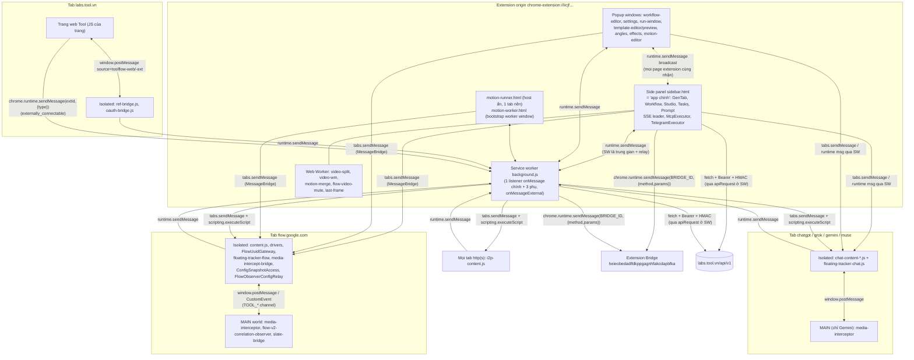
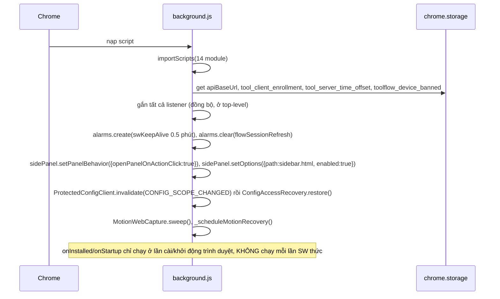
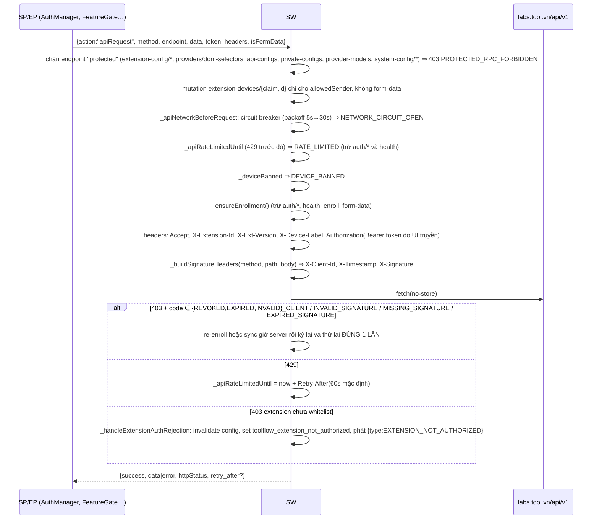
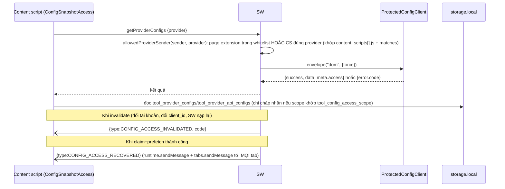
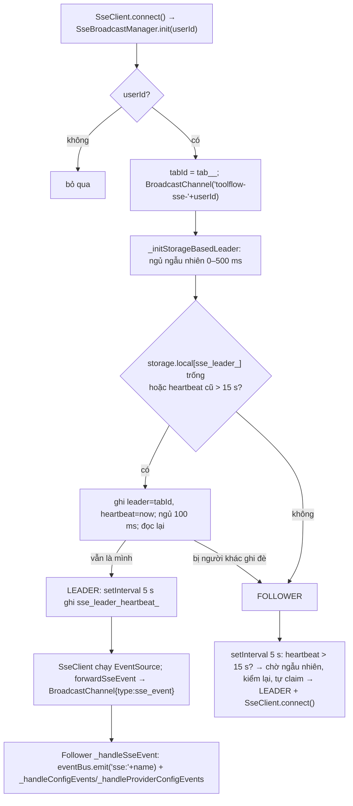
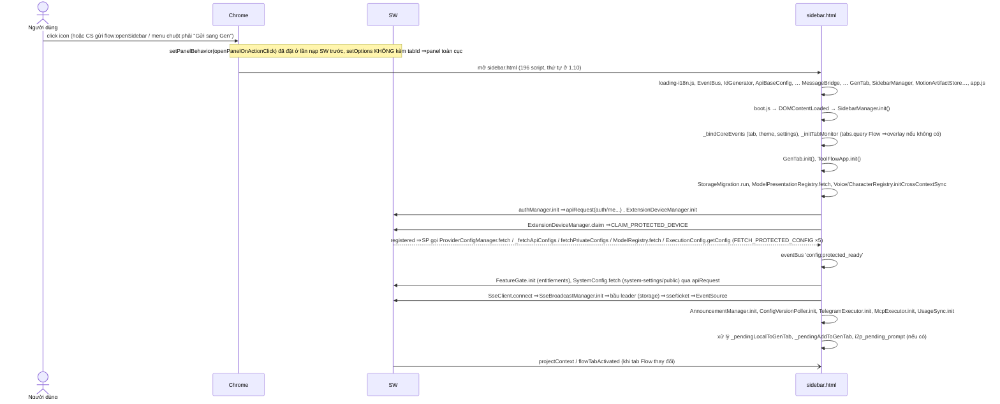
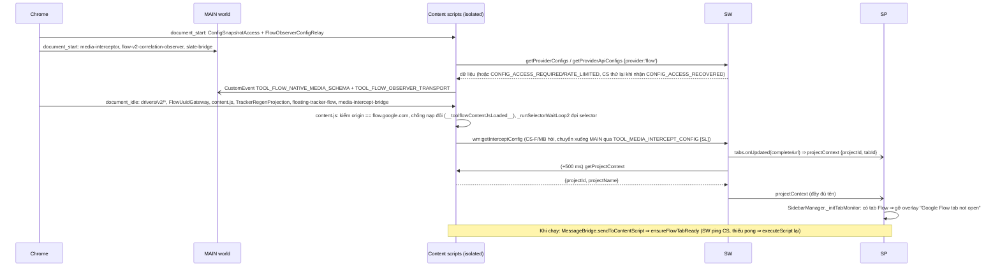
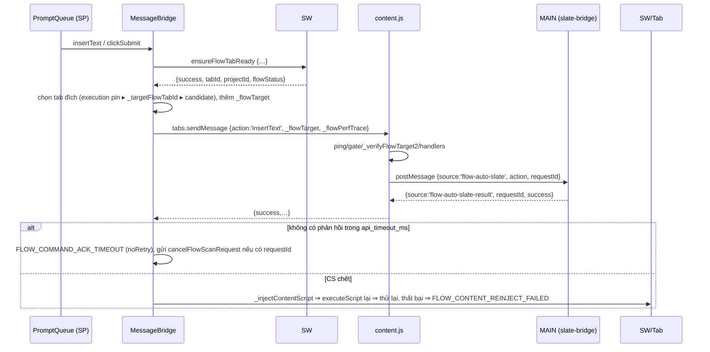

# 1. Kiến trúc runtime và hệ thống message

Extension ToolFlow v1.3.138 (MV3) gồm một service worker (SW) duy nhất, một side panel (`sidebar.html`) chứa gần như toàn bộ logic nghiệp vụ, nhiều trang extension phụ mở bằng popup window (workflow editor, settings, run-window, motion…), content script (isolated và MAIN world) trên Flow, ChatGPT, Grok, Gemini, Muse, và một extension thứ hai (Bridge) chỉ có mặt khi người dùng cài riêng.
Mọi thành phần nói chuyện với nhau bằng `chrome.runtime.sendMessage` / `chrome.tabs.sendMessage` với quy ước `{action: "ns:verb", ...}` (không có `onConnect`, không có Port nội bộ), cộng thêm `window.postMessage` / `CustomEvent` giữa isolated world và MAIN world, `BroadcastChannel`, và `chrome.storage` (local + session) như bus trạng thái.
Tài liệu này mô tả sơ đồ execution context, từng listener của SW, bảng đầy đủ các message action (SW nhận khoảng 250 action, cộng các action SW phát đi và action các context khác tự nhận), vòng đời khi mở side panel và khi mở tab Flow, và hạ tầng client dùng chung.

Nguồn: `/home/nthieuu/.config/google-chrome/Profile 1/Extensions/iicjfgdnngmpfocfanpiammedafmomin/1.3.138_0/` (chỉ đọc, phân tích tĩnh; `background.js` được prettier-format ở scratch để đọc, offset `@N` trong tài liệu là **ký tự trong file gốc** chưa format).
Quy ước độ tin cậy: **[QS]** quan sát trực tiếp trong code/data · **[SL]** suy luận · **[?]** chưa rõ. Không có token, secret, email, IP nào được ghi ở đây.

---

## 1.1 Bản đồ file

| file | kích thước | vai trò |
|---|---|---|
| `manifest.json` | 6.356 B | MV3; permissions, 12 nhóm content_scripts, side_panel, commands, DNR, `externally_connectable` |
| `background.js` | 521.791 B | Service worker. 4 `onMessage`, 1 `onMessageExternal`, alarms, contextMenus, downloads, tabs/windows/storage listener; `importScripts` 14 module |
| `rules/flow-media-headers.json` | 399 B | 1 rule DNR: xoá header `cross-origin-resource-policy` ở `||flow.google.com/asb/` |
| `sidebar.html` | 256.097 B | Side panel, 196 thẻ `<script src>` (không inline), CSS kèm theo |
| `settings.html` | 148.815 B | Popup settings (580×850), 36 script |
| `workflow-editor.html` | 9.514 B | Popup editor workflow (Drawflow), 123 script |
| `workflow-template-editor.html` | 7.262 B | Editor template workflow (admin/creator) |
| `run-window.html` | 11.743 B | Cửa sổ chạy workflow riêng (520×720) do `runWorkflow` ngoài mở |
| `motion-editor.html` / `motion-runner.html` / `motion-worker.html` | 35.097 / 6.159 / 116 B | Motion Studio: editor; **host runner ẩn**; trang bootstrap trống cho worker window |
| `angles-editor.html`, `effects-editor.html`, `template-preview.html` | 5.191 / 3.604 / 9.299 B | Editor Angles, Effects, xem trước template |
| `web-loading.html` | 1.016 B | Trang spinner hiển thị tức thì khi mở popup "web spaces" trước khi điều hướng sang `labs.tool.vn` |
| `boot.js` | 102 B | `DOMContentLoaded → SidebarManager.init()`; script **cuối cùng** của `sidebar.html` |
| `loading-i18n.js` | 827 B | Đọc `af_locale` từ storage, đặt chữ "Đang tải…" (vi/en/ja/th) cho overlay loading |
| `content.js` | 619.490 B | Content script chính trên Flow (isolated). Bảng `handlers` ≈ 112 action @469602 |
| `floating-tracker-flow.js` / `floating-tracker-chat.js` | 436.257 / 26.660 B | Tracker nổi trong trang Flow / trang chat |
| `chat-content-{chatgpt,grok,gemini,muse}.js` | 148.340 / 106.735 / 103.342 / 59.407 B | Content script điều khiển DOM từng provider |
| `media-interceptor.js` | 15.661 B | **MAIN world**: hook fetch/XHR/blob để bắt media, xoá watermark |
| `media-intercept-bridge.js` | 8.609 B | Isolated: cầu `postMessage` ↔ SW cho `media-interceptor` |
| `flow-v2-correlation-observer.js` | 67.942 B | **MAIN world**: ghép request Flow với attempt (receipt) |
| `slate-bridge.js` | 13.374 B | **MAIN world**: gọi handler React/Slate của Flow |
| `oauth-bridge.js`, `ref-bridge.js` | 2.649 / 2.625 B | Isolated trên `labs.tool.vn`: nhận token OAuth; relay "Use template" / affiliate ref / trạng thái node |
| `i2p-content.js` | 41.833 B | Isolated trên mọi http/https: "Image → Prompt" |
| `src/core/EventBus.js` | 638 B | Pub/sub trong một context (`window.eventBus`) |
| `src/core/MessageBridge.js` | 124.860 B | Client của sidebar/editor để ra lệnh cho tab Flow/provider qua SW và `tabs.sendMessage` |
| `src/core/SidebarManager.js` | 11.703 B | Tab chrome của sidebar, theme, overlay "chưa mở Flow", đồng bộ settings → DOM |
| `src/core/ProviderTabLock.js` | 3.667 B | Mutex theo provider + kích hoạt tab provider |
| `src/core/SseBroadcastManager.js` | 15.954 B | Leader election cho kết nối SSE giữa các trang extension |
| `src/core/ExecutionLock.js` | 3.947 B | Khoá thực thi toàn cục (prompts/task/workflow/angles/effects/queue) + broadcast qua SW |
| `src/core/BlobUrlManager.js`, `IdGenerator.js` | 1.275 / 352 B | Quản lý `blob:` URL; sinh id `prefix_ts_uuid8` |
| `src/core/DomSelectorHelper.js`, `ValidationRules.js` | 4.230 / 5.815 B | Truy vấn DOM theo danh sách selector nhiều tầng; luật validate từ server |
| `src/core/ProtectedConfigClient.js` | 29.221 B | (SW) lõi cấp phát config bảo vệ; whitelist `allowedSender` |
| `src/core/ConfigSnapshotAccess.js`, `FlowObserverConfigRelay.js` | 11.418 / 1.501 B | (content script) đọc config qua SW, đẩy xuống MAIN world bằng `CustomEvent` |
| `src/core/ProviderWorkerRegistry.js`, `LegacyProviderResultWake.js`, `MotionRunnerHostRegistry.js` | 41.016 / 7.735 / 10.214 B | (SW) cửa sổ worker provider, đánh thức tab kết quả, host runner của Motion |

> Các thành phần khác (ProtectedConfigClient chi tiết, DeviceKeyStore, ký HMAC, workflow engine…) thuộc tài liệu của mảng khác; ở đây chỉ nêu giao diện message.

---

## 1.2 Manifest

### 1.2.1 Điểm chính [QS]

| mục | giá trị |
|---|---|
| `permissions` | `activeTab, storage, unlimitedStorage, sidePanel, scripting, tabs, downloads, notifications, alarms, contextMenus, declarativeNetRequestWithHostAccess, clipboardWrite` |
| `host_permissions` | danh sách cụ thể (labs.google, flow.google.com, chatgpt, gemini, muse.ai, grok/x.ai, labs.tool.vn, storage.googleapis.com, flow-content.google, pinterest, youtube, tiktok, facebook, unsplash, etsy, pixabay, amazon…) **và** `<all_urls>` |
| `background` | `service_worker: background.js` (không `type: module`, dùng `importScripts`) |
| `action` | chỉ có `default_title: "Open ToolFlow"`, **không có popup**; click icon mở side panel nhờ `setPanelBehavior` |
| `side_panel` | `default_path: sidebar.html` |
| `commands` | `generate` (Alt+G, "Generate with current prompt"), `toggle-sidebar` (Alt+S) |
| `declarative_net_request` | rule resource `flow_media_headers` bật sẵn; `declarativeNetRequestWithHostAccess` |
| `externally_connectable` | `matches: ["*://labs.tool.vn/*"]` (không khai `ids` ⇒ extension khác **không** gửi được; extension Bridge được gọi **từ** ToolFlow, không phải ngược lại) |
| `content_security_policy.extension_pages` | `script-src 'self'; object-src 'self'; frame-src https://*.tool.vn;` (không `unsafe-eval`, không `unsafe-inline`; không giới hạn `connect-src`) |
| `key` | có (cố định ID `iicjfgdnngmpfocfanpiammedafmomin`) |
| `update_url` | Chrome Web Store |

### 1.2.2 Content scripts

| # | `matches` | `world` | `run_at` | file |
|---|---|---|---|---|
| 1 | `flow.google.com/*` | isolated | `document_start` | `ConfigSnapshotAccess`, `FlowObserverConfigRelay` |
| 2 | `flow.google.com/*` | isolated | `document_idle` | `ConfigSnapshotAccess`, `FlowObserverConfigRelay`, `FlowPageDriver`, `FlowDriverRegistry`, 6 file `drivers/v2/*`, `FlowV2Driver`, `FlowUuidGateway`, **`content.js`**, `TrackerRegenProjection`, `floating-tracker-flow.js`, `media-intercept-bridge.js` |
| 3 | `flow.google.com/*` | **MAIN** | `document_start` | `media-interceptor.js`, `flow-v2-correlation-observer.js` |
| 4 | `flow.google.com/*` | **MAIN** | `document_start` | `slate-bridge.js` |
| 5 | `labs.tool.vn/auth/google/success*` | isolated | idle | `oauth-bridge.js` |
| 6 | `labs.tool.vn/*` | isolated | idle | `ref-bridge.js` |
| 7 | `chatgpt.com/*` | isolated | idle | `ConfigSnapshotAccess`, `floating-tracker-chat`, `chat-content-chatgpt` |
| 8 | `grok.com`, `*.grok.com` | isolated | idle | …`chat-content-grok` |
| 9 | `gemini.google.com/*` | isolated | idle | …`chat-content-gemini`, `media-intercept-bridge` |
| 10 | `muse.ai`, `*.muse.ai` | isolated | idle | …`chat-content-muse` |
| 11 | `gemini.google.com/*` | **MAIN** | `document_start` | `media-interceptor.js` |
| 12 | `http(s)://*/*` (loại trừ accounts.google, oauth.googleusercontent, stripe, checkout.link, lemonsqueezy, paypal, polar.sh, sepay.vn), `all_frames: false` | isolated | idle | `i2p-content.js` |

Nhận xét:
- Hai file `ConfigSnapshotAccess` + `FlowObserverConfigRelay` chạy ở `document_start` **trước** MAIN world để config selector/transport có sẵn khi `flow-v2-correlation-observer` cần [SL, theo thứ tự run_at].
- Nhóm 2 là danh sách duy nhất, và `background.js` giữ **bản sao** trong `FLOW_CONTENT_SCRIPT_FILES` @15104 để tự inject lại (xem 1.4.4). Hai danh sách phải khớp tay [QS].
- Chỉ **một** content script chạy trên *mọi* trang web (`i2p-content.js`), nhưng chỉ phản hồi `i2p:*`; không có hook nào khác ở trang bên thứ ba [QS].

### 1.2.3 `web_accessible_resources`

- Cho `https://labs.google/*` và `https://flow.google.com/*`: `sidebar.html`, `workflow-editor.html`, `workflow-template-editor.html`, `angles-editor.html`, `effects-editor.html`, `settings.html`, các `*-init.js`, `settings-*`, `src/**/*.js`, `src/**/*.css`, `lib/*`, vài icon.
- Cho mọi `http(s)://*/*`: chỉ `icons/icon-48.png`, `icons/icon-128.png`.
- **Hệ quả [SL]:** bất kỳ script nào trong trang `flow.google.com` đều có thể `fetch("chrome-extension://<id>/sidebar.html")` để dò sự có mặt của extension (fingerprint). `sidebar.html` còn cho phép nhúng iframe vào Flow (dấu vết thiết kế cũ: id `flow-auto-sidebar-root`, `iframe` không còn tạo trong code hiện tại — `createElement("iframe")` không xuất hiện).

### 1.2.4 DNR

```json
{"id":1,"priority":1,"action":{"type":"modifyHeaders","responseHeaders":[{"header":"cross-origin-resource-policy","operation":"remove"}]},
 "condition":{"urlFilter":"||flow.google.com/asb/","resourceTypes":["image","media","xmlhttprequest"]}}
```
Mục đích: cho phép trang extension/content script tải ảnh/video Flow cross-origin mà không bị CORP chặn. Không có rule động (`declarativeNetRequest` không được gọi trong `background.js`) [QS].

### 1.2.5 Phím tắt (`commands`) thực chất làm gì [QS]

`background.js` @441896:
```js
chrome.commands?.onCommand?.addListener((command)=>{ chrome.tabs.query({active:true,currentWindow:true},(tabs)=>{ if(tabs[0]) chrome.tabs.sendMessage(tabs[0].id,{action:"command",command}) }) })
```
- SW chỉ **chuyển tiếp** `{action:"command", command}` tới tab đang active, không xử lý gì thêm và không bắt lỗi `lastError` khi tab đó không có content script.
- Bên nhận duy nhất là `content.js › handlers.command` (@~469602, chạy trên `flow.google.com`): chỉ xử lý `command === "generate"` bằng `document.getElementById("startBtn")?.click()`. Nhưng `#startBtn` là phần tử của **`sidebar.html`** (Gen tab), không nằm trong DOM của trang Flow ⇒ **Alt+G trên trang Flow thực tế không làm gì** [QS code, SL kết luận]. Đây là di sản từ thời sidebar được inject vào trang.
- `toggle-sidebar` (Alt+S): **không có handler nào** ở bất kỳ context nào (grep `toggle-sidebar` chỉ thấy trong manifest) ⇒ phím tắt chết [QS].
- Trên tab không phải Flow, `tabs.sendMessage` không có callback ⇒ lỗi "Receiving end does not exist" bị nuốt thành unhandled rejection trong SW (vô hại) [SL].

---

## 1.3 Sơ đồ execution context



### 1.3.1 Vai trò từng context [QS trừ khi ghi]

| context | tồn tại khi nào | vai trò | tài nguyên chính |
|---|---|---|---|
| **SW** | do Chrome đánh thức; giữ sống bởi alarm 30 s | Proxy HTTP có ký (`apiRequest`), nguồn config bảo vệ, quản lý cửa sổ/tab/sidePanel, tải file + đổi tên, xoá watermark ảnh, cache lịch sử tracker, điều phối worker provider, relay broadcast | `chrome.storage.local/session`, IndexedDB (DeviceKeyStore, ProviderWebQueueStore), `fetch` |
| **SP** (`sidebar.html`) | khi người dùng mở panel; đóng panel ⇒ context bị huỷ | **Toàn bộ nghiệp vụ**: PromptQueue, WorkflowExecutor, GenBatchScheduler, McpExecutor/TelegramExecutor, SSE, thư viện ảnh | `window.*` singletons, `chrome.storage`, IndexedDB |
| **EP** | mở bằng `chrome.windows.create` type `popup` | Chạy cùng bộ script lõi như SP (workflow-editor nạp 123 script gồm `WorkflowExecutor`, `PromptQueue`, `MessageBridge`…), nên **có thể tự thực thi workflow** mà không cần SP | như SP |
| **motion-runner.html** | tab nền do SW tạo (`MotionRunnerHostRegistry.ensure`, `tabs.create({active:false})`) | Host chạy Motion batch độc lập với side panel/editor, sống qua việc đóng editor | như SP, nhận `motionRunner:*Host` |
| **motion-worker.html** | URL bootstrap `?creation=<uuid>` của window worker provider (Motion) | Trang trống; SW dùng intent trong `storage.session` để xác nhận window là của mình rồi điều hướng sang provider | — |
| **CS-F** | mỗi tab `flow.google.com` | Điều khiển DOM/RPC Flow, tracker nổi, đọc config; chỉ phản hồi trên origin `https://flow.google.com` (nếu khác ⇒ trả `FLOW_LEGACY_GENERATION_DISABLED`) | DOM, `chrome.storage` (đọc config) |
| **MAIN** | cùng tab Flow | Hook `fetch`/XHR/`addEventListener`, đọc state React/Slate; **không có quyền `chrome.*`** | `window` của trang |
| **CS-C** | mỗi tab provider | Điều khiển DOM chat, tracker | DOM |
| **CS-W** | `labs.tool.vn` | Cầu cho trang web Tool (clone template, OAuth, affiliate) | — |
| **Bridge** | extension riêng (không có trên máy phân tích) | Thực thi RPC nội bộ Flow trong ngữ cảnh trang (`flow_v2_*`); nhận qua `runtime.sendMessage(BRIDGE_ID,…)` hoặc Port `runtime.connect(BRIDGE_ID)` | — |

### 1.3.2 Năm kênh giao tiếp

| kênh | giữa | cách dùng | ghi chú |
|---|---|---|---|
| **A. `runtime.sendMessage`** (không `tabId`) | bất kỳ page/CS ↔ SW; page ↔ page | request/response (callback hoặc Promise); **broadcast** tới mọi page extension đang mở | Người nhận trả `true` để giữ `sendResponse`. Không có Port nội bộ nên SW **không** giữ kết nối sống |
| **B. `tabs.sendMessage(tabId,…)`** | SP/EP/SW → CS | lệnh có `_flowTarget` (projectId, origin, driverKey) để CS tự kiểm "đúng tab" | `MessageBridge._sendFlowMessage` thêm timeout + `cancelFlowScanRequest` |
| **C. `scripting.executeScript`** | SW (hoặc `MessageBridge`) → tab | inject lại file, hoặc chạy `func` trong **MAIN** | xem 1.4.5 |
| **D. `window.postMessage` / `CustomEvent`** | isolated ↔ MAIN | nhận diện bằng `channel`/`source`/tên event `TOOL_*` | xem 1.6 |
| **E. `chrome.storage` + `BroadcastChannel`** | mọi context | `storage.onChanged` như bus; `BroadcastChannel("toolflow-sse-<userId>")` chuyển SSE event giữa trang extension | xem 1.5 |

Ngoài ra: `runtime.sendMessage(extId, msg)` từ trang web `labs.tool.vn` (đi vào `onMessageExternal`), và `runtime.sendMessage(BRIDGE_ID, …)` ra Bridge.

---

## 1.4 Service worker `background.js`

### 1.4.1 Nạp module và trạng thái

- Dòng đầu `importScripts(...)` (14 module): `DeviceKeyStore`, `ProtectedConfigClient`, `ConfigAccessRecovery`, `ProviderWorkerRegistry`, `FlowUuidGateway`, `FlowUuidRefreshCoordinator`, `MotionRunnerHostRegistry`, `MotionRunnerRecovery`, `MotionWebCapture`, `WorkflowMuseVideoStore`, `LegacyProviderResultWake`, `ProviderWebQueueStore`, `MotionArtifactStore`, `MotionRunJournal`, `MotionTranscriptOutbox`. Riêng `WatermarkRemover`, `TrackerRegenProjection`, `FlowApiDownloadRetry` nằm trong `try/catch` (thiếu thì chỉ cảnh báo, tính năng tương ứng tắt).
- Không có offscreen document, không `new Worker` trong SW, không `registerContentScripts`, không `declarativeNetRequest` API, không `webNavigation`, không `action.onClicked` (đã dùng `openPanelOnActionClick`), không `runtime.onConnect` [QS].
- Trạng thái trong biến module (mất khi SW ngủ): `settingsWindowId`, `workflowWindowId`, `editingWorkflowId`, `_runWindowId`, cache config, `_deviceBanned`, `_cachedEnrollment`, vòng đệm `_ftCacheWriteChain`, `_pendingDownloadRenames`… Cái nào cần sống qua lần ngủ thì được ghi `chrome.storage.session` (`_persistWindowIds` @47413 ghi 6 id cửa sổ; `af_pending_download_renames`; `targetFlowTabId/targetFlowContext`; `grokOperation:<tabId>:*`; `provider_legacy_result_wake_<tabId>`; `_provider_urls_cache`; `_regenSlotRoot`…) hoặc `storage.local` (`af_auth`, `tool_client_enrollment`, `toolflow_device_banned`, `tool_flow_tracker_snapshots`…).

### 1.4.2 Danh sách listener

| API | vị trí | việc |
|---|---|---|
| `runtime.onMessage` #1 | @11225 | `flowUuid*` (8 action), kiểm `sender.id` và URL page |
| `runtime.onMessage` #2 | @19147 | `EXTENSION_AUTH_RETRY` / `DEVICE_BAN_RETRY` (key `type`, không phải `action`) |
| `runtime.onMessage` #3 | @196594 | **listener chính ≈ 250 action** (238 literal đếm tự động + các action nằm trong mảng `.includes`; bảng 1.7) |
| `runtime.onMessage` #4 | @514567 | `FETCH_CONFIGS_IF_NEEDED` |
| `runtime.onMessageExternal` | @137814 | 20 `type` từ `labs.tool.vn` (1.8) |
| `runtime.onInstalled` | @512853 | auto-inject lại CS, xoá cờ not-authorized, xoá cache config khi `install`, mở tab Flow khi `install`, dựng context menu |
| `runtime.onStartup` | @514235 | prune lịch sử tracker, inject `ref-bridge`, enrollment + prefetch config, `_selfHealProbe`, dựng context menu |
| `runtime.onSuspend` | @48054 | đóng mọi popup window; `fetch(.../executions/<id>/complete, {keepalive:true})` với `status:"stopped", reason:"sw_suspend"` để nhả execution token |
| `commands.onCommand` | @441896 | chuyển tiếp xuống tab active (1.2.5) |
| `contextMenus.onClicked` | @497594 | Image→Prompt (1.4.7) |
| `alarms.onAlarm` ×4 | @71787… | 4 consumer (1.4.6) |
| `downloads.onDeterminingFilename`, `onCreated` ×2 | @71173… | ép tên file / thay thế download gốc của Gemini/Grok (1.4.8) |
| `tabs.onRemoved` ×4, `tabs.onUpdated` ×2+, `tabs.onActivated` ×2 | rải rác | dọn trạng thái tab, broadcast `projectContext`/`flowTabActivated` (1.4.9) |
| `windows.onRemoved` ×2, `windows.onFocusChanged` | @162352 | dọn id popup; log focus worker |
| `storage.onChanged` ×9 | rải rác | `af_auth`/enrollment ⇒ reset scope config; `af_settings`/`af_system_settings` ⇒ đồng bộ Bridge, menu i18n; `af_execution_config`… |
| `setInterval(_selfHealProbe, 60 s)` | @18807 | gọi lại `/entitlements` nếu cờ `toolflow_extension_not_authorized` còn |

### 1.4.3 Giữ SW sống [QS]

- `chrome.alarms.create("swKeepAlive", {periodInMinutes: 0.5})` @74220. Mỗi 30 s: `_zoomGuardWatchdog()`, `_pruneExpiredFlowRecoveryJournal()`, `_pruneExpiredTrackerHistory()`. Báo thức này vừa bảo trì vừa đánh thức SW; Chrome không cho SW sống vĩnh viễn nên mọi trạng thái quan trọng đều ghi storage.
- `_MOTION_RECOVERY_ALARM = "motionRunnerRecovery"` (đặt lại 30 s nếu còn việc chờ), `_CONFIG_RECOVERY_ALARM = "toolConfigAccessRecovery"` (đặt `when:`; <25 s thì kèm `setTimeout`), `motionWebCaptureCleanup` (sweep), và alarm **theo tab** tên `provider_legacy_result_wake_<tabId>` (30 s lần đầu, 60 s lần sau, tối đa 10 phút hoặc 30 phút với Flow).
- `chrome.alarms.clear("flowSessionRefresh")` chạy mỗi khi SW nạp: dọn alarm của phiên bản cũ [SL].
- Không dùng offscreen document hay Port để keepalive. Tab mở sẵn (SP, motion-runner) liên lạc liên tục cũng giữ SW dậy [SL].

### 1.4.4 Thứ tự khi SW khởi động (mỗi lần được đánh thức)


`ProtectedConfigClient.invalidate("CONFIG_SCOPE_CHANGED")` được gọi mỗi lần SW nạp (`const _protectedBootPromise` @519187) ⇒ lease config trong RAM bị bỏ và phải xin lại; đây là lý do mọi `getProvider*Configs` có nhánh "chờ ready/retry" [QS].

### 1.4.5 `chrome.scripting.executeScript` (đầy đủ)

| mục đích | `world` | file/func | nơi gọi |
|---|---|---|---|
| inject lại bộ content script Flow | isolated | `FLOW_CONTENT_SCRIPT_FILES` (16 file) | `_autoInjectContentScripts`, `ensureFlowTabReady`, `MessageBridge._injectContentScript` |
| inject lại `slate-bridge.js`, `media-interceptor.js` | **MAIN** | file | cùng nơi trên; `refreshFlowUploadBridge` |
| probe / sửa `flow-v2-correlation-observer` | **MAIN** | `func` đọc `window.__toolFlowV2CorrelationObserver.health()`; nếu `observerRevision !== 44` hoặc thiếu hook ⇒ inject lại file | `ensureFlowCorrelationObserver` @115896 |
| dò an toàn trước khi refresh UUID | MAIN | `func` đọc state mutation của trang | `_verifyFlowUuidControlledSafety` |
| Muse: probe phiên, đọc video theo chunk 512 KB, chụp poster, bấm play | MAIN | `func` + `args` (selector từ config server) | `muse:*` |
| ChatGPT/Gemini/Grok: `injectScript`, `checkLogin`, `activateImageMode`, `setRatio`, `fetchImage`, `fetchMedia` | isolated (mặc định) hoặc MAIN khi URL là `blob:` (@18183 `world: url.startsWith("blob:") ? "MAIN":"ISOLATED"`) | `func` | các handler `chatgpt:*`, `gemini:*`, `grok:*` |
| `clickCreateNewProject`, `startCropOnActiveTab`, `i2p:checkProviders`, `flow:uploadMenuFocus` | isolated | `func` | handler cùng tên |
| `ref-bridge.js` vào tab `labs.tool.vn` đã mở | isolated | file | `_injectRefBridgeIntoExistingLabsTabs` |
| `i2p-content.js` khi bấm menu chuột phải | isolated | file | `contextMenus.onClicked` |

### 1.4.6 Alarm

| tên | tạo ở | consumer |
|---|---|---|
| `swKeepAlive` | top-level SW | bảo trì 30 s |
| `motionRunnerRecovery` | `_scheduleMotionRecovery` | `_motionWakeRecovery()` khôi phục batch Motion sau khi SW chết |
| `toolConfigAccessRecovery` | `ConfigAccessRecovery.configure({schedule})` | `ConfigAccessRecovery.run()` thử lại tải config với backoff |
| `motionWebCaptureCleanup` | `MotionWebCapture` | `sweep()` |
| `provider_legacy_result_wake_<tabId>` | `LegacyProviderResultWake.begin` | `onAlarm` ⇒ `_reveal`/`_pulseFlow`: đưa tab provider/Flow lên trước khi nó bị Chrome "đóng băng" ở nền |

### 1.4.7 Context menu (Image → Prompt)

`_i2pSetupContextMenu` gọi `removeAll` rồi tạo 5 mục: cha (`contexts:["image"]`, tiêu đề theo `af_system_settings.app_name`), "Phân tích ảnh", "Chọn vùng", "Gửi sang Gen" (đều `image`), và "Chọn vùng" cho `page/frame/selection/link`; `documentUrlPatterns = I2P_SITE_PATTERNS`. Tiêu đề đổi theo `af_locale` qua `storage.onChanged` (`contextMenus.update`).
`onClicked`: "Gửi sang Gen" ⇒ `sidePanel.open({tabId})` rồi `_sendImageToGenTab(srcUrl)` (ghi `_pendingLocalToGenTab` rồi phát `drainLocalToGenTab`). Hai mục kia ⇒ `executeScript(i2p-content.js)` rồi `tabs.sendMessage(tab.id, {action:"i2p:showCard"|"i2p:regionMode"})`.

### 1.4.8 Download

- `downloads.onDeterminingFilename`: nếu `MotionWebCapture` hoặc bảng `_pendingDownloadRenames` khớp thì `suggest({filename, conflictAction:"overwrite"|…})` ⇒ ép đường dẫn/tên theo template.
- `downloads.onCreated` (Grok): gắn `downloadId` vào job đổi tên. `onCreated` (Gemini): với download native của Gemini, tạo download **thay thế** (URL gốc hoặc `data:` đã xoá watermark), rồi `cancel`+`removeFile`+`erase` bản gốc; lỗi thì giữ bản gốc.
- Luồng chủ động: CS/SP gọi `prepareDownloadRename` ⇒ `awaitPreparedDownload` (+ `cancelDownloadRename`, `cancelPreparedDownload`) hoặc `chromeDownload` / `removeWatermarkAndDownload` ⇒ `chrome.downloads.download`. Kết quả báo lại CS bằng `preparedDownloadCompleted`.

### 1.4.9 Tab / window lifecycle

- **tabs.onUpdated** (trong khối `if (chrome.sidePanel)`): với URL Flow, khi `status==="complete"` hoặc đổi `url`, gọi `describeFlowTab(tab)` ⇒ khử trùng bằng key `supported|routePrefix|projectId` ⇒ `runtime.sendMessage({action:"projectContext", projectId, projectError, invalidFlowRoute, tabId, fromTabUpdate:true})` ⇒ sau 500 ms `tabs.sendMessage(tabId,{action:"getProjectContext"})` để lấy tên project, phát `projectContext` lần hai. Nếu URL không còn là route Flow hợp lệ thì xoá `targetFlowTabId/targetFlowContext` khỏi `storage.session`.
- **tabs.onActivated**: nếu tab thuộc origin Flow ⇒ `flowTabActivated {tabId,url,invalidFlowRoute}`.
- **tabs.onRemoved** (4 listener): dọn `_museTrackerSnapshotsByTab/_chatgpt…/_grok…`, khoá `grokOperation:<tabId>:*`, `targetFlowTabId`; phát `chatgpt:tabClosed`, `grok:tabClosed`; `ProviderWorkerRegistry.handleMotionTabRemoved`, `_motionHostClosed`; xoá `_lastNotifiedProjectByTab`.
- **tabs.onUpdated** (Grok): `status==="complete"` trên `grok.com` ⇒ `grok:navigatedBroadcast`.
- **windows.onRemoved**: gỡ id khỏi `_extensionPopupWindows`, xoá `_webSpacesWindowId`, `_templatePreviewWindowId`, `_settingsWindowId`, `_workflowWindowId`, `_runWindowId`… trong `storage.session`.
- Cửa sổ popup do SW tạo (qua `_calcWindowPosition`): settings (580×850, singleton, hash `#tab`), workflow editor, template editor/preview, angles, effects, run-window (520×720; ghi `_pendingRunWorkflow` vào `storage.local` rồi gửi `loadRunWorkflow` nếu đã có cửa sổ), web-spaces (`web-loading.html` rồi điều hướng sang `labs.tool.vn`). Mỗi loại là singleton: kiểm `windows.get(id)` (biến RAM, rồi `storage.session`) trước khi tạo.

### 1.4.10 `apiRequest` (proxy HTTP có ký) [QS] — @~202000 (trong listener chính)


Token đăng nhập **do UI truyền vào mỗi lần**; SW không tự đọc `af_auth` để gắn `Authorization` (chỉ đọc `apiBaseUrl` từ đó). Hai endpoint `mcp/executor-heartbeat` và `sse/subscribe-token` có timeout riêng `af_system_settings.api_timeout_ms` (60 000 ms trong storage mẫu; thiếu ⇒ lỗi `API_TIMEOUT_CONFIG_UNAVAILABLE`, không dùng mặc định).

### 1.4.11 Config bảo vệ và `CONFIG_ACCESS_*`


- `ProtectedConfigClient.allowedSender` chấp nhận đúng 11 trang: `sidebar, settings, workflow-editor, workflow-template-editor, template-preview, angles-editor, effects-editor, motion-editor, motion-runner, run-window, web-loading` (`.html`). Content script **không** vào được `FETCH_PROTECTED_CONFIG`, chỉ vào được `getProvider{Configs,ApiConfigs,PrivateConfigs}` của đúng provider (private chỉ cho `chatgpt`, `grok`, `gemini`) [QS].
- `ROTATE_DEVICE_KEY` chạy luôn; `REPLACE_DEVICE_IDENTITY` thực chất là nhánh `else` yêu cầu `sender.url` là `/settings.html` và `message.confirmed === true` [QS].

---

## 1.5 Hạ tầng client dùng chung

### 1.5.1 `EventBus` (`window.eventBus`) [QS]
Pub/sub **trong một context**: `on(ev, cb)` trả hàm huỷ, `off`, `emit` (sao chép mảng handler rồi gọi từng cái trong `try/catch`), `once`. Không liên thông giữa các context; muốn liên thông phải đi qua `runtime.sendMessage` (SW relay) hoặc `BroadcastChannel`. Tên event quan trọng: `execution:lock_changed`, `execution:tracker_update`, `auth:login|logout`, `config:protected_ready`, `sse:<tên>`, `broadcast:became_leader|follower|role_changed`, `queue:stop_all`, `tasks:stop_all`.

### 1.5.2 `MessageBridge` (`window.MessageBridge`, class `_MessageBridge`)
Mặt tiền duy nhất của SP/EP để điều khiển tab Flow/provider.
- **`sendToContentScript(action, data, control)`** (@21073): `tabs.query` theo `ProviderConfigManager.getTabQueryPatterns("flow")`; chọn tab đích (ưu tiên tab đã *pin* theo `executionId` — `_getExecutionTarget`, TTL 30 phút, lưu `storage.session` — rồi `window._targetFlowTabId`, rồi `_selectFlowCandidate`); đính `_flowTarget` ({projectId, origin, driverKey, routePrefix}) để CS xác minh; gọi `_sendFlowMessage` (`Promise.race` giữa `tabs.sendMessage`, timeout `api_timeout_ms` (+ `flow_ref_scan_timeout_ms` cho scan, + `data.timeout` cho `waitForNewTiles`) và `AbortSignal`). Lỗi định danh: `FLOW_COMMAND_ACK_TIMEOUT`, `FLOW_CONTENT_NO_RESPONSE`, `FLOW_EXECUTION_TARGET_CHANGED`, `FLOW_COMMAND_TIMEOUT_CONFIG_UNAVAILABLE` (đều `noRetry`). Nếu hết thời gian của scan thì gửi thêm `cancelFlowScanRequest`.
- **Re-inject:** khi CS không phản hồi, `_injectContentScript` chạy `executeScript(files…)` + hai script MAIN; thất bại ⇒ `FLOW_CONTENT_REINJECT_FAILED`.
- API bọc theo từng lệnh CS: `insertText`, `clearEditor`, `clickSubmit`, `addFileToPrompt`, `getCurrentTileIds`, `waitForNewTiles`, `stopExecution`/`pause`/`resume`, `scanFlowImages`, `getThumbnailsByIds`, `resolveVideoPlaybackUrl`, `uploadFilesToFlow` (hàng đợi `_uploadFlowQueue`, chia lô ≤ 40 MB, panel pause/cancel), `armFlowCorrelation`/`snapshotFlowCorrelation`, `syncFlowVoices/Characters`, `prepareFlowForGen`… (119 phương thức `static`).
- Provider khác: `chatGPTFetchImage`, `grokFetchImage`, `grokMaterializeMedia`, `museCaptureVideoPoster`, `museCreateRuntimeVideoUrl`, `musePlayNative`, `grokAbort`/`chatgptAbort`/`geminiAbort`, `revealHiddenWorkflowProvider`/`revealHiddenSidebarProvider` (gọi `provider:revealLegacyFor*`).
- **Heartbeat** `beginFlowMonitorHeartbeat` mỗi 8 s (`_FLOW_HEARTBEAT_INTERVAL_MS`) gọi `ensureFlowTabActive` để tab Flow không bị Chrome giảm tốc/đóng băng khi chạy nền; `_startProviderTabHeartbeat` tương tự cho provider.
- Trạng thái: `_executionTargets` (Map), `_uploadControls`, `_apiUploadResults`, `_flowPerfSequence`.

### 1.5.3 `SidebarManager` [QS]
Static class chạy sau `boot.js` (`DOMContentLoaded`). `init()` ⇒ `_bindCoreEvents()` ⇒ `GenTab.init()` ⇒ `ToolFlowApp.init()`.
- Chuyển tab (`.toolflow-tab[data-tab]`), lưu `af_active_sidebar_tab`, khôi phục khi mở lại; sub-tab history/queue.
- Theme sáng/tối/system: ghi `af_settings.theme`, và nghe `storage.onChanged(af_settings)` để áp lại cũng như cập nhật `workflowExecutor.settings` từ `ExecutionConfig`.
- `_initTabMonitor`: nghe `tabs.onCreated/onUpdated/onRemoved` (chạy **trong SP**, cần quyền `tabs`) và gọi `tabs.query` theo pattern Flow; nếu **không có tab Flow** ⇒ `_toggleFlowOverlay(true)` dựng overlay "Google Flow tab not open" với nút mở Flow (`openOrActivateTab`) và nút Login/Register.
- `SYNC_MAP_LIVE` / `SYNC_MAP_RESPECTFUL`: đồng bộ giá trị `af_settings` vào input; `respectful` bỏ qua input người dùng đã sửa (`dataset.userSet`).
- Nút "Settings" ⇒ `{action:"openSettings"}`.

### 1.5.4 `ProviderTabLock` [QS]
Mutex theo provider trong **một context** (Map `_locks` + `_epoch`): `acquire(provider, label, {signal, timeoutMs})` xếp hàng chờ khoá cũ, rồi nếu `_currentActiveTab !== provider` thì gửi `ensureFlowTabActive` / `chatgpt:ensureActive` / `gemini:ensureActive` / `grok:ensureActive` và ngủ `_switchSettleMs = 300`. Trả hàm `release`. `reset()` tăng `_epoch` làm mọi người đang chờ nhận `PROVIDER_LOCK_CANCELLED`; hết hạn ⇒ `PROVIDER_LOCK_TIMEOUT` (`noRetry`). **Không liên thông giữa SP và popup** (mỗi context một Map) — chống đụng độ giữa các context dựa vào `ExecutionLock` + `ProviderWorkerRegistry` ở SW [SL].

### 1.5.5 `ExecutionLock` [QS]
Khoá "ai đang chạy" (`prompts|task|workflow|angles|effects|queue`) trong một context. `acquire` thất bại khi owner khác (trừ khi `PromptQueue.isEnabled()` — khi đó luôn cho qua). Mỗi lần đổi: `eventBus.emit("execution:lock_changed")` **và** `runtime.sendMessage({action:"execution:lock_broadcast", state, _originId})`, SW chỉ re-broadcast (`runtime.sendMessage(message)`), các context khác nhận ở `src/app.js` (`execution:lock_broadcast` → cập nhật UI). `broadcastTracker` tương tự với `execution:tracker_broadcast`. `stopCurrent()` gọi cơ chế dừng tương ứng owner rồi `forceRelease()` sau 500 ms. `_contextId` ngẫu nhiên giúp bỏ qua echo của chính mình. **Giới hạn:** lock không được hợp nhất giữa các context; các context khác chỉ "thấy" qua broadcast, không có trọng tài trung tâm [SL].

### 1.5.6 `SseBroadcastManager` (leader election SSE) [QS]
Mục tiêu: chỉ một trang extension giữ kết nối SSE (`SseClient`), các trang còn lại nhận event.

- **Thực tế có hai lớp:** (1) *bầu leader* hoàn toàn bằng `chrome.storage.local` với keys `sse_leader_<userId>`, `sse_leader_heartbeat_<userId>` (storage mẫu: `sse_leader_16510` = một tabId, heartbeat là epoch ms); (2) `BroadcastChannel("toolflow-sse-<userId>")` chỉ để chuyển event `sse_event`/`sse_status` từ leader sang follower.
- Nhánh bầu bằng BroadcastChannel (`_startElection`, `_electLeader`, `tab_announce`, `leader_heartbeat`, `leader_claim`…, dùng `broadcast_heartbeat_ms=5000`, `broadcast_leader_timeout_ms=10000`, `broadcast_election_delay_ms=2000` từ `af_system_settings`) **không bao giờ được gọi từ `init()`** (grep: `_startElection` không có caller) — chỉ còn `leader_resign` ⇒ `_requestNewLeader` là sống [QS]. Vì vậy 3 config `broadcast_*` của server hầu như vô tác dụng; ngưỡng thực là hằng số **15 s / 5 s** trong code [QS].
- `isSidepanel = location.href.includes("sidebar.html")` chỉ rẽ nhánh log; cả hai nhánh đều đi `_initStorageBasedLeader`.
- Điểm yếu: bầu bằng `storage.local` có cửa sổ race (ghi → ngủ 100 ms → đọc), không dùng `Web Locks`; chấp nhận được vì hai bên cùng đọc lại. Nếu leader chết đột ngột, tối đa ~15 s không ai kết nối SSE [SL]. `getRole()` trả LEADER khi `_useFallback` mà `_role` chưa có ⇒ lỗi bầu cử dẫn đến **nhiều leader** [SL].

### 1.5.7 Các tiện ích nhỏ
- **`BlobUrlManager`** (`window.BlobUrlManager`): Map `url → {imageId, createdAt}`; `create(blob, imageId)`, `revoke`, `revokeByImageId`, `cleanup(maxAge=5 phút)` chạy `setInterval` 5 phút; `unload` ⇒ `revokeAll`. Mục đích tránh rò `blob:` URL trong SP sống lâu.
- **`IdGenerator.next(prefix)`** ⇒ `prefix_<Date.now()>_<8 hex đầu của randomUUID>` (fallback `Math.random`).
- **`utils.js`** (507 B): `debounce`, `sleep`, và các hàm rỗng `sendProgress/updateGlobalProgress/…` (di sản).
- **`DomSelectorHelper`**: `querySelector(root, selectors[], {textMatch, provider, key})` thử từng selector theo tầng, bắt lỗi selector hỏng; không thấy gì ⇒ `ProviderConfigManager.reportFailure(provider,key,list)` ⇒ SW `reportSelectorFailure` (POST báo server các selector đã thử). Có biến thể `query/queryAll/queryAttribute` lấy cấu hình từ `ProviderConfigManager.get(provider,key)` và `querySync` dùng `_DEFAULTS` nội bộ.
- **`ValidationRules`**: `fetch()` (TTL 1 giờ, header `X-Extension-Id`), lưu `af_validation_rules`, `handleSseUpdate` khi server đẩy `validation_rules_updated`; getter `get/getInt/getList` và bản `safe*`; `hydrateFromStorage` khi offline.

---

## 1.6 Kênh phụ giữa isolated và MAIN world

| kênh | hướng | payload | nơi dùng |
|---|---|---|---|
| `window.postMessage({source:"flow-auto-slate", action, requestId, slateSelector,…})` ↔ `{source:"flow-auto-slate-result"}` | CS-F ↔ MAIN | gọi handler React/Slate | `slate-bridge.js` (12 `postMessage`), `content.js` @~5270 |
| `postMessage({channel:"TOOL_MEDIA_INTERCEPT", id, base64, mime, url})` / `…_RESULT` / `…_CONFIG` / `…_STATE` / `…_DONE` / `…_FALLBACK` | MAIN ↔ `media-intercept-bridge.js` | MAIN gửi media, bridge hỏi SW `wm:canRemove` ⇒ `removeWatermark` / `wm:cleanVideo`, trả base64 sạch. Bridge có **vé** `TOOL_WM_ORIGIN_TICKET` TTL 90 s ("bản gốc/bản sạch" cho lượt này). Xác thực `d.id`≤160 ký tự, mime ∈ png/jpeg/webp/mp4, `ev.source===window` |
| `TOOL_MEDIA_DOWNLOAD_CONTEXT` / `_ACK` | CS ↔ MAIN | ngữ cảnh lượt tải để ghép tên | `media-interceptor.js` |
| `TOOL_MOTION_CAPTURE_BIND` / `_BIND_ACK` / `_READ` / `_READ_RESULT` / `_RELEASE` | CS-F ↔ MAIN | `nonce` UUID; CS kiểm `_isAllowedFlowMediaUrl2`, rồi gửi SW `motion:webCaptureControl {kind:"blob"}` | `content.js` @~10731 |
| `CustomEvent TOOL_FLOW_V2_CORRELATION_ARM` / `_DISARM` / `_RECEIPT` | CS-F ↔ MAIN | gắn attempt vào request Flow, nhận receipt | `flow-v2-correlation-observer.js` |
| `CustomEvent TOOL_FLOW_V2_MEDIA_IDENTITIES(_READ)`, `…_MEDIA_CATALOG_STATUS(_READ)` | MAIN → CS-F | danh mục media đã quan sát | `content.js` @1281… |
| `CustomEvent TOOL_FLOW_NATIVE_MEDIA_SCHEMA(_READ)`, `TOOL_FLOW_OBSERVER_TRANSPORT(_READ)` | `FlowObserverConfigRelay` → MAIN | schema media + đường dẫn transport lấy từ `tool_provider_api_configs.data.flow.configs` | `FlowObserverConfigRelay.js` |
| `window.postMessage({source:"toolflow-oauth-success"})` | trang `labs.tool.vn/auth/google/success` → `oauth-bridge` | token/linked ⇒ SW `oauth:success` / `oauth:linked` (có dự phòng: `?token=` trên URL, `meta[name=toolflow-auth-token]` thử lại 10 lần × 300 ms) |
| `window.postMessage({source:"toolflow-web", type: ping\|useWorkflowTemplate\|openTemplatePreview})` ↔ `{source:"toolflow-ext", type: pong\|useTemplateAck\|wf:node_status}` | trang Tool ↔ `ref-bridge` | `ref-bridge` kiểm `event.source===window && event.origin===location.origin`, rồi relay ⇒ SW |

Mọi kênh MAIN đều là kênh **không xác thực** (trang Flow cũng ghi được vào `window`); phần bảo vệ nằm ở chỗ CS kiểm nonce/URL whitelist trước khi tin payload [SL].

---

## 1.7 Bảng message

**Chú giải ngữ cảnh gửi/nhận:** `SW` service worker · `SP` side panel · `EP` trang extension khác (workflow-editor, motion-editor, settings, run-window, angles/effects, template-*) · `UI` = SP hoặc EP (cùng bộ script lõi) · `CS-F` content script Flow (`content.js`, `floating-tracker-flow.js`) · `CS-C` `chat-content-*` · `CS-I` `i2p-content` · `CS-W` `ref-bridge`/`oauth-bridge` · `MB` `media-intercept-bridge` · `Sess` các lớp `ChatGPTSession/GrokSession/GeminiSession/MuseSession` (SP/EP).
Nhãn cuối cột "gửi từ": **[?]** = không tìm thấy literal `action:"…"` ở nơi gọi (có thể gọi qua hàm `_sendToBackground(action, …)` dựng động). Tất cả bảng 1.7.1–1.7.24 là action mà **SW nhận** (`runtime.onMessage`), trả lời bằng `sendResponse`; "xử lý ở" là `SW` trừ khi ghi khác.

### 1.7.1 Config bảo vệ, enrollment, thiết bị (SW whitelist `allowedSender`)

| action | gửi từ | xử lý ở | mục đích |
|---|---|---|---|
| `FETCH_PROTECTED_CONFIG` | UI (`RequestSigner`, `ProviderConfigManager`) | SW | `ProtectedConfigClient.envelope(operation,{provider,keys,profileKey,promptVariant,revision,force})` |
| `PROTECTED_CONFIG_STATUS` | UI (`ExtensionDeviceManager`, `RequestSigner`, settings) | SW | Trạng thái lease/ready, kể cả `RATE_LIMITED`, `ENROLLMENT_REQUIRED`, `retryAfterMs` |
| `RETRY_PROTECTED_CONFIG` | UI (`ConfigAccessUI`) | SW | Chạy lại claim + prefetch (`ConfigAccessRecovery.run`) |
| `CLAIM_PROTECTED_DEVICE` | UI (`ExtensionDeviceManager`) | SW | Đăng ký/giữ ghế thiết bị; thành công ⇒ `_notifyProtectedConfigReady` |
| `ROTATE_DEVICE_KEY` | [?] | SW | Xoay khoá ECDSA |
| `REPLACE_DEVICE_IDENTITY` | UI (`ConfigAccessUI`) | SW | Thay danh tính (chỉ từ `settings.html`, `confirmed:true`) |
| `ensureEnrollment` | UI (`RequestSigner`) | SW | Đảm bảo có `client_id/secret` (`_ensureEnrollment`) |
| `FETCH_CONFIGS_IF_NEEDED` | [?] | SW (listener #4) | `_prefetchAllConfigs()` |
| `EXTENSION_AUTH_RETRY`, `DEVICE_BAN_RETRY` (khoá `type`) | SP (`app.js`) | SW (listener #2) | Chạy `_selfHealProbe` + `_deviceBanRecoveryProbe` |
| `updateProviderUrlsCache` | `MuseSession` | SW | Ghi `_provider_urls_cache` (storage.session) từ `api` config |
| `getProviderConfigs` / `getProviderApiConfigs` | CS-F, CS-C, `ConfigSnapshotAccess` | SW | Selector DOM / cấu hình API của một provider (`allowedProviderSender`) |
| `getProviderPrivateConfigs` | `ConfigSnapshotAccess` | SW | Config riêng; chỉ `chatgpt|grok|gemini` |
| `reportSelectorFailure` | [?] (từ `ProviderConfigManager.reportFailure`) | SW | POST `{provider,key,tried_selectors}` lên server |
| `providerConfigUpdated`, `providerApiConfigUpdated` | SW (tự gọi sau SSE) | SW rồi CS | Broadcast tới mọi tab; nếu key là `watermark_removal(_video)` thì `_wmInvalidate` |

### 1.7.2 Proxy HTTP và xác thực

| action | gửi từ | xử lý ở | mục đích |
|---|---|---|---|
| `apiRequest` | UI (AuthManager, FeatureGate, ExecutionGate, Notification*, BackendSync, ConfigVersionPoller…) | SW | Proxy HTTP có ký HMAC, circuit breaker, retry 403 một lần (1.4.10) |
| `oauth:success` | CS-W (`oauth-bridge`) | SW | Nhận token Google; kiểm `sender.tab.url` chứa `/auth/google/success`; lưu auth, đóng tab, phát `auth:oauthLogin` |
| `oauth:linked` | CS-W | SW → UI | Báo liên kết Google xong ⇒ `auth:googleLinked` |
| `payment:success`, `payment:cancelled` | [?] / SW | SW → SP | Đổi thành `payment:completed` / `payment:cancelled` cho SP |
| `affiliate:setRef` | CS-W (`ref-bridge`) | SW | Lưu mã giới thiệu `tf_ref` (90 ngày) |

### 1.7.3 Watermark

| action | gửi từ | xử lý ở | mục đích |
|---|---|---|---|
| `removeWatermark` | MB, `WatermarkClient`, `WatermarkToolModal` | SW | Ảnh: `_removeWatermarkFromSource` (alpha-map server) |
| `removeWatermarkAndDownload` | CS-F, UI (DownloadHelper, EditorExecutor) | SW | Xoá watermark + `downloads.download` + đổi tên |
| `getWatermarkConfig` | UI | SW | Cấu hình xoá watermark (có kiểm quyền `_wmGateAllowed`) |
| `wm:canRemove` | MB | SW | `{allowed, reason}` cho từng lượt |
| `wm:getInterceptConfig` | CS-F, MB | SW | Cấu hình bắt media (host, kích thước…) |
| `wm:cleanVideo` | MB (từ MAIN) | **SP** (`app.js`, vì SW không có DOM/Worker) | Xoá watermark video bằng `VideoWmClient` + worker; trả `base64` |
| `wm:videoProgress` | SP | UI | Tiến độ làm sạch video |
| `wm:downloadPhase` | CS-F | SP (`DownloadHelper`) | Pha "cleaning" khi tải qua interceptor |
| `wm:interceptConfigChanged` | SW | MB | Báo config thay đổi |

> Hệ quả [QS]: nếu SP không mở, `wm:cleanVideo` không có người nhận; `media-intercept-bridge.js` in "hãy MỞ SIDEBAR rồi tải lại" khi thấy lỗi `Receiving end does not exist`.

### 1.7.4 Lịch sử/tracker nổi của Flow (`ft:*`, cache `tool_flow_tracker_snapshots`)

Mọi `ft:*` (trừ `cacheSnapshot`, `getProjectHistory`) xoá hàng đợi snapshot đang chờ rồi ghi qua chuỗi tuần tự `_ftCacheWriteChain` để tránh ghi đè.

| action | gửi từ | xử lý ở | mục đích |
|---|---|---|---|
| `ft:cacheSnapshot` | CS-F | SW | Xếp hàng snapshot tracker (`_enqueueTrackerSnapshot`) |
| `ft:getProjectHistory` | CS-F, `GenBatchListModal` | SW | Đọc lịch sử theo project (loại bản hết hạn) |
| `ft:removeHistoryJob`, `ft:removeHistoryItem` | CS-F, GenBatchListModal, McpExecutor | SW | Xoá job/item (từ chối nếu item đang bận `_ftCachedJobIsBusy`) |
| `ft:updateHistoryPrompt`, `ft:updateHistoryItem` | CS-F / GenBatchListModal | SW | Sửa prompt/trạng thái item (`_ftUpdateGenBatchItem`) |
| `ft:clearProjectHistory` | CS-F, SP, GenBatchListModal | SW | Xoá cả lịch sử project |
| `ft:recoveryPatch` | `FlowApiAdapter`, `FlowApiV2CheckpointStore` | SW | Vá bản ghi phục hồi (journal) cho API v2 |
| `ft:stopCachedJob` | CS-F, `PromptQueue` | SW | Dừng job trong cache (`_ftPersistRecoveryStop`) |
| `ft:historyProtection` | [?] (không thấy người gửi) | CS-F (`content.js`) | Handler có sẵn: bảo vệ lịch sử theo `getCurrentProjectId` |

### 1.7.5 Mở cửa sổ/side panel/editor

| action | gửi từ | xử lý ở | mục đích |
|---|---|---|---|
| `openSettings` | UI (nhiều) | SW | `openSettingsWindow(tab)`; singleton |
| `openUpgradeModal` / `openLoginModal` | UI / [?] | SW → UI | Phát `showUpgradeModal` / `showLoginOverlay` |
| `openUpgradeSidePanel` / `openLoginSidePanel` | `settings-orders.js` / `ConfigAccessUI`, `ConfigSnapshotAccess` | SW | `sidePanel.open({windowId})` rồi `storage.session.toolflow_pending_upgrade_modal`/login |
| `flow:openSidebar` | CS-F (`content.js`, `floating-tracker-flow`) | SW | `sidePanel.open({tabId: sender.tab.id})` (cần user gesture truyền qua message) |
| `openSidePanel` | [?] | SW | Tìm/tạo tab Flow rồi `sidePanel.open`, tuỳ chọn đóng Settings, hiện login |
| `openSidePanelForTemplateUse` | `template-preview-init` | SW | Mở panel trên `tabId` + `_pendingTemplateImport` |
| `openWorkflowEditor` | `WorkflowTab` | SW | `openWorkflowWindow` (kiểm `_isFlowProjectReadyBg`) |
| `openTemplateEditor`, `openWorkflowTemplatePreview` | `WorkflowTemplateList`, `MyTemplatesList` | SW | Editor/preview template |
| `openWorkflowTemplatePreviewById` | CS-W (`ref-bridge`) | SW | Lấy template từ API (có ký) rồi mở preview |
| `importWorkflowTemplate`, `cloneWorkflowTemplate` | [?], CS-W / `WorkflowEditor` | SW → SP | Ghi `_pendingTemplateImport`, đóng preview, SP nhận `cloneWorkflowTemplate` |
| `openAnglesEditor`, `openEffectsEditor` | SP | SW | Ghi `_pendingAnglesProject`/`_pendingEffectsProject` rồi mở window |
| `openMotionStudioEditor` | settings, `MotionStudioList` | SW | `windows.create(motion-editor.html?…)`, chỉ cho `allowedSender` |
| `openWebSpaces` | `WorkflowList`, `WorkflowTemplateList` | SW | Popup `web-loading.html` ⇒ `labs.tool.vn` (ký URL) |
| `getEditingWorkflowId`, `updateEditingWorkflowId` | `WorkflowList`, `WorkflowEditor` | SW | Workflow đang sửa (RAM + `_editingWorkflowId`) |
| `getSettingsWindowId`, `settingsAction` | [?] | SW | Id cửa sổ settings; chuyển `payload` xuống tab Flow |
| `focusWorkflowWindow` | `EditorExecutor` | SW | Đưa cửa sổ editor lên trước |
| `setBadge`, `showNotification` | `NotificationManager` | SW | `action.setBadgeText` (nền `#cdff01`); `notifications.create` |
| `sendWebhook` | `NotificationManager` | SW | POST tới URL qua `_isAllowedUrl` |

### 1.7.6 Relay giữa các page extension (SW chỉ chuyển tiếp `runtime.sendMessage(message)`)

| action | gửi từ | xử lý ở | mục đích |
|---|---|---|---|
| `executionStatusUpdate` | WorkflowEditor | SW → mọi page | Trạng thái chạy workflow |
| `workflowSaved`, `workflowDeleted` | WorkflowEditor / StorageManager | SW → mọi page | Đồng bộ danh sách; `workflowDeleted` xoá `editingWorkflowId` nếu trùng |
| `workflowExecutionEvent` | CS-F, SW, McpExecutor, PromptQueue, WorkflowExecutor, Video merge, Editor/List | SW → `tabs.sendMessage` + page; cờ `_bg_relayed` chống lặp | Sự kiện `node:*`, `execution:*`; cũng relay `wfNodeStatusRelay` sang tab `labs.tool.vn` |
| `retry:status` | CS-F | SW → page | Trạng thái retry của tracker |
| `execution:lock_broadcast`, `execution:tracker_broadcast` | `ExecutionLock` | SW → page | Khoá/tracker liên-context (1.5.5) |
| `queueImageToGenTab`, `addImageToGenTab` | CS-F | SW → SP | Thêm ảnh tham chiếu vào Gen; nếu SP đóng, ghi `_pendingAddToGenTab` |
| `pq:stopAll`, `pq:stopJob`, `pq:pauseJob`, `pq:resumeJob`, `pq:regenItem`, `pq:regenBatch`, `pq:regenOptions`, `pq:regenPreflight`, `pq:addBatchReferences`, `pq:clearTrackerHistory`, `pq:removeTrackerItem`, `pq:updateTrackerPrompt` | CS-F/CS-C (floating tracker), `PipelineFooter`, `ExecutionTracker`, WorkflowEditor | SW → SP | Đổi tên thành `queue:stop_all`, `queue:stop_job`, … rồi `runtime.sendMessage` tới SP (nơi có `PromptQueue`); phản hồi lại cho tracker |

### 1.7.7 Tab Flow: mở, trạng thái, kích hoạt

| action | gửi từ | xử lý ở | mục đích |
|---|---|---|---|
| `ping` | UI, `ImmediateUploader`, `MessageBridge` | SW | `{ok:true}` |
| `checkFlowTabOpen`, `ensureFlowTabReady` | UI (PromptQueue, McpExecutor, ProjectHelper…) | SW | Tìm tab Flow, đảm bảo CS sống (ping; inject lại; `ensureFlowCorrelationObserver`; `prepareFlowProjectEditorTab`), trả `_buildFlowStatus` |
| `ensureFlowTabActive` | CS-F, các Execution* | SW | `tabs.update(active)` + `windows.update(focused)` |
| `activateFlowTabForExecution` | CS-F, UI | SW | Kích hoạt tab Flow trước khi chạy |
| `restorePreviousTab` | `ImmediateUploader` | SW | Trả focus về tab trước |
| `queryProviderTabs` | UI | SW | Liệt kê tab của provider (Flow có nhóm trùng) |
| `closeExtraProviderTabs`, `closeFlowProjectTab` | UI | SW | Đóng tab dư (giữ tab đích) |
| `openFlowTab`, `openOrActivateTab`, `openProviderTab`, `openFlowTabForLogin` | UI, ScreenCapture, SidebarManager | SW | Mở/kích hoạt tab theo `urlPattern`/`createUrl` |
| `navigateToProject`, `clickCreateNewProject`, `getFlowProjectContext` | UI (app, ProjectHelper, McpExecutor) | SW | Điều hướng tab Flow; bấm nút tạo project qua `executeScript`; lấy `projectId/projectName` |
| `ensureFlowCorrelationObserver` | `MessageBridge` | SW | Kiểm/sửa observer MAIN (revision 44) |
| `workflowOwnerDocument` | WorkflowExecutor | SW | Trả `sender.documentId` (khoá chủ sở hữu) |
| `refreshFlowUploadBridge` | CS-F | SW | Inject lại `slate-bridge.js` MAIN (kiểm sender là tab Flow frame 0) |
| `flow:uploadMenuFocus`, `flow:viewportSettleClock` | CS-F, MessageBridge | SW | Đưa tab lên để mở menu upload; đồng hồ ổn định viewport |
| `flow:workflowUploadWake` | [?] | SW | Đã **retired**: trả `FLOW_UPLOAD_WAKE_RETIRED` |
| `uploadToFlow` | `ImagePickerModal`; external `uploadToFlow` | SW | `doUploadToFlow` |
| `getBrowserZoom`, `setBrowserZoom`, `zoomGuard:begin|beat|end|recover` | CS-F | SW | Giữ zoom 100 % khi tự động hoá; ghi `af_zoom_guard`, watchdog 30 s |
| `captureScreen`, `requestCapturePermission`, `startCropOnActiveTab` | `ScreenCapture` | SW | `tabs.captureVisibleTab`, xin quyền, overlay crop |

### 1.7.8 `flowUuid*` (listener #1, chỉ cho extension pages hoặc đúng tab Flow)

| action | gửi từ | xử lý ở | mục đích |
|---|---|---|---|
| `flowUuidGatewayRefresh` | `FlowUuidGateway` (UI) | SW | `_requestFlowUuidRefresh` ⇒ `FlowUuidRefreshCoordinator.observeRefresh` (làm mới danh tính UUID khi an toàn) |
| `flowUuidControlledBegin` / `Finish` / `Status` / `Safety` | FlowUuidGateway (UI) | SW | Phiên "controlled refresh": mở/đóng/xem trạng thái/kiểm an toàn; `Safety` dò MAIN bằng `executeScript` |
| `flowUuidControlledBoundary` | CS-F (`content.js`) | SW | Kiểm `sender.tab.id === expectedFlowTarget.tabId` và `frameId===0`, so khớp project/origin/driver |
| `flowUuidApiStop` | `FlowUuidGateway` | SW | Ghi điểm dừng an toàn (`jobId` regex `^[A-Za-z0-9_.:-]{1,160}$`, tối đa 32 project, 256 operation) |
| `flowUuidContextProbeReply` | `FlowUuidGateway` (khác context) | SW | Trả lời probe "context này có bận không" |
| `flowUuidContextProbe` | SW | UI (`FlowUuidGateway` listener) | Hỏi mọi context extension xem có đang chạy phiên Flow không |

### 1.7.9 Tải về/đổi tên/media Flow

| action | gửi từ | xử lý ở | mục đích |
|---|---|---|---|
| `chromeDownload` | CS-F, UI (EditorExecutor, WorkflowExecutor, DownloadHelper, Motion…) | SW | `downloads.download` (chỉ URL an toàn / `data:` media), tuỳ chọn `waitForComplete` |
| `prepareDownloadRename`, `awaitPreparedDownload`, `cancelDownloadRename`, `cancelPreparedDownload` | CS-F, `MessageBridge`, WorkflowEditor | SW | Hẹn tên file trước khi Chrome tạo download (`_pendingDownloadRenames`, lưu `af_pending_download_renames`) |
| `preparedDownloadCompleted` | SW | CS-F | Kết quả tải |
| `flowApiUpscaleForDownload`, `flowApiResolveMediaForDownload`, `flowApiDownloadPreflight` | CS-F (`floating-tracker-flow`), WorkflowExecutor | SW | Dùng Bridge (`flow_*`, `flow_v2_*`) để upscale/resolve media; kiểm quyền + driver |
| `fetchBlob`, `checkImageUrl` | UI, CS-F | SW | `fetch` trong SW với whitelist `_isAllowedUrl`/`_isAllowedFlowAsbRedirectUrl`, giới hạn byte |
| `fetchImageAsBase64`, `creator:fetchImage` | UI (ImagePicker, Motion, Creator…) | SW | Lấy ảnh Flow/URL thành base64 (qua tab Flow nếu cần cookie) |
| `workflow:videoCapture`, `motion:webCaptureControl`, `motion:storeFlowVideo` | WorkflowVideoMerge; CS-F; `MotionFlowDownload` | SW | Bắt video bằng `MotionWebCapture` (blob) và lưu `MotionArtifactStore`; kiểm `af_auth`, target Flow |

### 1.7.10 Image→Prompt và Prompt Assistant (`i2p:*`, `pa:*`)

| action | gửi từ | xử lý ở | mục đích |
|---|---|---|---|
| `i2p:getConfig`, `i2p:invalidateConfig` | CS-I; SP (`app.js` sau SSE) | SW | Cấu hình AI-tools (cache + epoch) |
| `i2p:checkAccess` | CS-I | SW | `_featureAllowed("i2p_enabled")` |
| `i2p:checkProviders` | CS-I, PromptAssistantModal, Motion* | SW | Dò tab ChatGPT/Gemini đã login (executeScript) |
| `i2p:fetchImage`, `i2p:captureRegion` | CS-I | SW | Tải/cắt ảnh (OffscreenCanvas, `maxPx` 1536) |
| `i2p:analyze`, `i2p:cancel` | CS-I, PromptAssistantModal | SW → CS-C | Gửi `provider:textTask` tới tab ChatGPT/Gemini, có retry khi readiness/submit-lost |
| `i2p:sendImageToGen`, `i2p:genOnFlow`, `i2p:openApp` | CS-I | SW | Mở panel và đẩy ảnh/prompt sang Gen (`_dispatchLocalImageToGen`, `i2p:setGenPrompt`) |
| `i2p:openProviderLogin` | CS-I, PromptAssistantModal, MotionEditor | SW | Mở trang đăng nhập provider |
| `i2p:showCard`, `i2p:regionMode` | SW | CS-I | Hiện thẻ kết quả / chế độ chọn vùng |
| `pa:getConfig`, `pa:getFormats`, `pa:invalidateFormats` | PromptAssistantModal; SseClient | SW | Cấu hình/định dạng Prompt Assistant (cache) |
| `pa:activateTab`, `pa:generate` | PromptAssistantModal | SW | Kích hoạt tab provider; chạy tác vụ text (`_featureAllowed("prompt_assistant_enabled")`) |

### 1.7.11 Provider web worker (cửa sổ nền cho ChatGPT/Gemini/Muse)

| action | gửi từ | xử lý ở | mục đích |
|---|---|---|---|
| `providerWorker:create`, `verify`, `list`, `close`, `assignPrompt`, `returnToSourceIfWorkerFocused`, `activateForSubmit`, `restoreFocus` | `ProviderWebScheduler` (UI) | SW (`ProviderWorkerRegistry`) | Vòng đời cửa sổ worker (tạo `windows.create` minimized/normal, `focused:false`), chủ sở hữu theo `userId/epoch`; chỉ `isProviderWorkerUiSender()` |
| `providerWorker:prepareWorkflowLayout` / `restoreWorkflowLayout` / `prepareMainLayout` / `restoreMainLayout` | `WorkflowExecutor`, `ProviderWebScheduler` | SW | Sắp xếp cửa sổ editor + worker |
| `providerWorker:trackerUpdate` | UI/CS-C | SW | Cập nhật tracker của worker |
| `providerWeb:inputFocus` / `inputFinished` | CS-C | SW | Cấp/trả focus cho tab worker khi gõ (`focusForSend`/`restoreFocus`) |
| `providerWeb:prepStage` | CS-C (ChatGPT) | SW | Báo giai đoạn chuẩn bị của attempt |
| `providerWeb:beforeSend` | CS-C | SW | **Cổng trước khi bấm gửi**: kiểm lease/attempt (`ProviderWebQueueStore.grantClick`, `markIntent`), cho phép click đúng một lần |
| `providerWeb:sendObserved` | CS-C | SW | Ghi nhận đã thấy request gửi (`markSendObserved`) |
| `providerWeb:revealResult` | CS-C | SW | Đưa tab lên để lấy kết quả |
| `providerWeb:changed` | SW | UI | Báo hàng đợi provider đổi |
| `provider:legacyResultWake`, `provider:legacyInputFocus`, `provider:revealLegacyResult`, `provider:revealLegacyForWorkflow`, `provider:revealLegacyForSidebar` | CS-C; `MessageBridge` | SW (`LegacyProviderResultWake`, alarm theo tab) | Chế độ cũ (tab thường): đánh thức/đưa tab provider lên khi tab bị che |
| `motionWorker:create`, `close`, `releaseLayout`, `reconcile`, `beforeSend`, `focus`, `restoreFocus`, `verify` | `MotionTranscriptWorkerDriver`, `MotionRunnerHost`, `MotionProject*`, CS-C | SW | Worker provider riêng cho transcript của Motion |
| `motionWorker:submitted`, `provider:textTask` | SW | CS-C | Báo đã gửi / giao tác vụ text |

### 1.7.12 Motion Studio

| action | gửi từ | xử lý ở | mục đích |
|---|---|---|---|
| `motionRunner:ensure` | UI | SW | `MotionRunnerHostRegistry.ensure`: tạo/tái sử dụng tab `motion-runner.html` |
| `motionRunner:start|resume|pause|stop|resetFrame|startBatch|resumeBatch|pauseBatch|stopBatch` | `sidebar.html`, `motion-editor.html` (chỉ hai trang này) | SW → host | Điều khiển; SW chuyển thành `motionRunner:*Host` gửi tới host |
| `motionRunner:closeIdle` | UI | SW | Đóng host rảnh |
| `motionRunner:quiesce`, `unquiesce`, `recoveryState`, `startProject`, `pauseProject`, `resetFrameHost`, `startBatchHost`, `resumeBatchHost`, `pauseBatchHost`, `stopBatchHost` | SW | `motion-runner.html` (`MotionRunnerHost`) | Lệnh tới host |
| `motionRunner:transcribe` | `MotionTranscriptBatchRunner` | SW | Transcript qua provider |
| `motion:cancelTranscript`, `motion:cleanupTranscript` | MotionEditor, MotionProjectExecution | SW | Huỷ/dọn tác vụ transcript (`MotionTranscriptOutbox`, `MotionRunJournal`) |

### 1.7.13 Muse (tab thường)

| action | gửi từ | xử lý ở | mục đích |
|---|---|---|---|
| `muse:findOrCreateTab`, `ensureActive`, `injectScript`, `navigateNewChat`, `newChat`, `deleteCurrentChat`, `checkLogin`, `abort`, `checkSession` | `MuseSession`, CS-C (muse) | SW (+ CS-C Muse) | Quản lý tab/phiên Muse (probe MAIN bằng `func`) |
| `muse:submitAndWait` | `MessageBridge`/`MuseAdapter` | SW → CS-C | Gửi prompt và chờ; log `muse:trace` |
| `muse:downloadVideo`, `downloadImage` | [?] | SW → CS-C | Tải native, chờ `_waitForMuseDownload` |
| `muse:readVideoChunk`, `fetchVideoForFlow`, `captureVideoPoster`, `playVideo` | MessageBridge, WorkflowExecutor, WorkflowVideoMerge | SW | Đọc video theo chunk 512 KB / base64 / poster / phát native (selector từ config, thiếu ⇒ `MUSE_VIDEO_SELECTOR_CONFIG_MISSING`) |
| `muse:trace`, `muse:broadcastTracker`, `muse:getTrackerSnapshot` | CS-C, GenTab | SW | Log, tracker theo tab (`ProviderWorkerRegistry.trackerForTab`) |

### 1.7.14 ChatGPT

| action | gửi từ | xử lý ở | mục đích |
|---|---|---|---|
| `chatgpt:findOrCreateTab`, `ensureActive`, `injectScript`, `checkWorkerEditorReady`, `checkLogin`, `activateImageMode`, `setRatio`, `fetchImage`, `closeTab`, `getTabInfo`, `navigated` | `ChatGPTSession`, `ProviderTabLock`, `MessageBridge`, CS-C | SW | Tạo/chọn tab, inject CS, dò login/chế độ ảnh, chọn tỉ lệ (selector từ config), lấy ảnh (`executeScript`), đóng tab |
| `chatgpt:deleteConversationWithReloadFallback`, `chatgpt:completeDeferredCleanup` | `MotionTranscriptWorkerDriver`, CS-I/PromptAssistant | SW | Xoá hội thoại, có reload dự phòng |
| `chatgpt:broadcastTracker`, `getTrackerSnapshot` | CS-C | SW | Tracker theo tab (`_chatgptTrackerSnapshotsByTab`) |
| `chatgpt:tabClosed`, `chatgpt:error`, `chatgpt:navigatedBroadcast` | SW / CS-C | `ChatGPTSession` (UI) | Thông báo tab đóng/đổi |
| `chatgpt:ensureChatMode`, `chatgpt:submitAndWait`, `chatgpt:abort`, `chatgpt:deleteLastMessage` | `MessageBridge`/SW | CS-C | Lệnh DOM trong tab ChatGPT |

### 1.7.15 Gemini

| action | gửi từ | xử lý ở | mục đích |
|---|---|---|---|
| `gemini:findOrCreateTab`, `ensureActive`, `injectScript`, `checkLogin`, `checkEditorReady`, `getTabInfo`, `closeTab` | `GeminiSession`, `ProviderTabLock`, CS-C | SW | Như ChatGPT |
| `gemini:ping`, `gemini:submitAndWait`, `gemini:fetchMedia`, `gemini:downloadImageNative`, `gemini:downloadVideoNative`, `gemini:abort`, `gemini:deleteCurrentConversation`, `workflow:geminiTrackerUpdate` | SW/`GeminiSession` | CS-C (gemini) | Lệnh DOM; tải native bị SW bắt lại ở `downloads.onCreated` |
| `gemini:tabClosed`, `gemini:error`, `gemini:navigatedBroadcast`, `gemini:mediaProgress` | SW / CS-C | `GeminiSession`, GenTab | Sự kiện |

### 1.7.16 Grok

| action | gửi từ | xử lý ở | mục đích |
|---|---|---|---|
| `grok:findOrCreateTab`, `ensureActive`, `restoreFocus`, `injectScript`, `checkLogin`, `closeTab`, `getTabInfo`, `navigated` | `GrokSession`, app.js, CS-C | SW | Như ChatGPT, thêm trả focus cửa sổ (`_grokFocusReturnWindowId`) |
| `grok:applySettings`, `grok:setRatio` | `GrokSession` | SW → CS-C (`grok:applySettingsInline`) | Áp tỉ lệ/cài đặt |
| `grok:fetchImage`, `grok:fetchMedia`, `creator:fetchImage` | MessageBridge, VideoFrameExtractor | SW | Lấy media (`trySwFetch` rồi `executeScript` trong tab) |
| `grok:submitAndWait`, `grok:operationCheckpoint` | MessageBridge; CS-C | SW (→CS-C); `storage.session` `grokOperation:<tabId>:*` | Gửi và chờ; điểm kiểm thao tác sống qua SW ngủ |
| `grok:broadcastTracker`, `grok:getTrackerSnapshot`, `grok:tabClosed`, `grok:navigatedBroadcast`, `grok:gen_progress` | CS-C / SW | `GrokSession`, SP | Tracker/sự kiện |
| `cloudflare:challenge` | CS-C (Grok) | SW → SP | Báo thách thức Cloudflare ⇒ SP hiện thông báo để người dùng xử lý |

### 1.7.17 Broadcast SW → trang/CS không có handler ở SW

| action / type | phát từ | nhận ở | mục đích |
|---|---|---|---|
| `projectContext`, `flowTabActivated` | SW (`tabs.onUpdated/onActivated`) | SP | Project hiện tại thay đổi / tab Flow được chọn |
| `getProjectContext` | SW | CS-F | Hỏi tên project |
| `showUpgradeModal`, `showLoginOverlay` | SW | SP | Hiện modal nâng cấp/đăng nhập |
| `loadRunWorkflow`, `loadWorkflowInEditor`, `loadTemplateInEditor`, `loadTemplatePreview` | SW | run-window / editor / preview | Nạp dữ liệu vào cửa sổ đã mở (dữ liệu "pending" nằm ở `storage.local`) |
| `workflowEditorClosed`, `settingsClosed`, `templateEditorClosed`, `workflowTemplateImportRequested`, `workflowEditorVisibility` | SW | SP / WorkflowList / CS-F | Sự kiện cửa sổ |
| `drainLocalToGenTab`, `i2p:setGenPrompt` | SW | SP | Rút `_pendingLocalToGenTab` / điền prompt |
| `genBatch:changed`, `providerWeb:changed` | SW | SP | Đổi hàng đợi |
| `wfNodeStatusRelay` | SW | CS-W (`ref-bridge`) → trang web | Trạng thái node cho trang Tool |
| `command` | SW | CS-F | Phím tắt (1.2.5) |
| `zoomGuard:revoked` | SW | CS-F | Khôi phục zoom xong |
| `workflow:single_node`, `workflow:stop_single_node`, `queue:stop_*` | SW (từ external) | `WorkflowExecutor` (SP/editor) | Chạy/dừng một node |
| `{type:"EXTENSION_NOT_AUTHORIZED" / "EXTENSION_AUTHORIZED" / "DEVICE_BANNED" / "DEVICE_UNBANNED" / "API_NETWORK_STATE" / "CONFIG_ACCESS_INVALIDATED" / "CONFIG_ACCESS_RECOVERED"}` | SW | SP (overlay), CS (clone overlay, config), `ConfigAccessUI`, `RequestSigner` | Trạng thái cấp quyền/mạng; khoá `type` thay vì `action` |
| `sseRelay:entitlements_changed`, `sseRelay:system_settings_changed`, `sseRelay:force_logout`, `sseRelay:tool_config_updated` | SP (leader SSE, `app.js`) | settings, workflow-editor, run-window, motion-editor, motion-runner | Chuyển event SSE cho các trang extension khác (không qua BroadcastChannel) |

### 1.7.18 Action mà các context khác tự nhận (không đi qua SW)

**Content script Flow (`content.js › handlers`, ≈112 action):** `getFlowDriverContext`, `getProjectContext`, `scanFlowProjects`, `openFlowProject`, `enumerateFlowTiles`, `flowPreflight`, `runAutoPrompt`, `applySettings`, `prepareFlowForGen`, `stabilizeFlowResultViewport`, `getEditor`, `insertText`, `clearEditor`, `clickSubmit`, `addFileToPrompt`, `getCurrentTileIds`, `waitForNewTiles`, `cancelFlowScanRequest`, `cancelFlowScans`, `stopExecution`, `resetStop`, `pauseExecution`, `resumeExecution`, `getRunningState`, `getFailedPrompts`, `clearFailedPrompts`, `resolveVideoPlaybackUrl`, `getThumbnailsByIds`, `correctStaleFileIds`, `findTileByFileName`, `prepareFlowForScan`, `applyFlowPageSettings`, `scanFlowImages`, `uploadFilesToFlow`, `cancelFlowUpload`, `downloadTileMedia`, `cancelTileMediaDownload`, `extractTileIdentifiers`, `scanGalleryTiles`, `scanFlowTiles`, `downloadImage`, `getDownloadCounter`, `flowUuidGatewayRead`, `lookupFlowMediaCatalog`, `checkTilesExist`, `checkFilesExist`, `ensureFlowTilesLoaded`, `beginFlowZoomSession`, `endFlowZoomSession`, `zoomGuard:revoked`, `fetchImageAsBase64`, `fetchVideoAsBase64`, `showCaptchaOverlay`, `hideCaptchaOverlay`, `getFlowErrorState`, `startCropSelection`, `cancelCropSelection`, `flowCorrelationArm|Wait|Snapshot|Disarm`, `motionWebCaptureRead|Release`, `genBatchDownloadItem|Status`, `genBatchBatchAction`, `workflowEditorVisibility`, `command`, `pq:*` (`getPreTileSnapshot`, `addRefImages`, `verifyRefAttachments`, `removeExistingRefImages`, `verifySlateModel`, `trackerUpdate`, `recoveryTrace`, `trackerHide`, `chunkStatus`, `pauseExecution`, `apiAuthStatus`, `showBlocker`, `hideBlocker`, `clearRetryTracking`), `detectTileStatus`, `retryFailedTilesViaButton`, `legacyTrackerUpdate`, `ft:historyProtection`, `autoReloadFlow`, `cancelFlowIdentityRefresh`, `getFlowReloadPendingCount`, `getPendingTileCount`, `checkContentScriptAlive`, `getTileStatuses`, `scanNewTiles`, `waitUserSubmit`, `confirmWaitUserSubmit`, `cancelWaitUserSubmit`, `providerConfigUpdated`, `providerApiConfigUpdated`, `scrapeFlowVoices`, `selectFlowVoice`, `scrapeFlowCharacters`, `selectFlowCharacter`, `addVoiceInline`, `addCharacterInline`, `countInlineChips`, `checkFlowAgentMode`, `disableFlowAgentMode`, `checkFlowChatAgentPanel`, `closeFlowChatAgentPanel`, `checkFlowAgentInstructionDialog`, `doneFlowAgentInstructionDialog`, và riêng `ping` (trả `{pong, contentRevision, loadedAt, …describeUrl}`) xử lý trước. Cổng vào (@460893): (1) `ping`; (2) nếu URL không phải editor project và action không thuộc `pageActions` (23 action) ⇒ `FLOW_PROJECT_REQUIRED`; (3) `_verifyFlowTarget2(message._flowTarget)` so với `FlowDriverRegistry.describeUrl(location.href)` ⇒ `UNSUPPORTED_FLOW_ORIGIN` / `target_changed`; (4) action bảo vệ bởi gate v2 ⇒ `FLOW_V2_*` nếu config thiếu; (5) chạy `handlers[action]()` trong `Promise.resolve().then`, nhận `flowScanRequestId` để huỷ.
**CS-C:** ChatGPT — `chatgpt:checkWorkerEditorReady|ensureChatMode|submitAndWait|abort|deleteLastMessage`, `providerWeb:prepStage`, `provider:legacyResultWake|textTask`, `motionWorker:beforeSend|submitted`, `pq:trackerUpdate`, `providerConfigUpdated`. Gemini — `gemini:ping|checkEditorReady|submitAndWait|fetchMedia|downloadImageNative|downloadVideoNative|abort|deleteCurrentConversation`, `workflow:geminiTrackerUpdate`, cùng nhóm chung. Grok — `grok:submitAndWait|downloadNative|abort|applySettingsInline|checkStatus`. Muse — `muse:checkLogin|abort|newChat|deleteCurrentChat|downloadVideo|downloadImage|captureVideoPoster|playVideo|submitAndWait`, `providerApiConfigUpdated`. Cả bốn còn nhận `EXTENSION_NOT_AUTHORIZED/AUTHORIZED` (khoá `type`) để bật/tắt overlay "clone detected".
**Khác:** `i2p-content` (`i2p:showCard`, `i2p:regionMode`); `media-intercept-bridge` (`wm:interceptConfigChanged`); `ref-bridge` (`wfNodeStatusRelay`); `MotionRunnerHost` (`motionRunner:*Host` ở trên); `WorkflowExecutor` (`workflow:single_node`, `workflow:stop_single_node`, `queue:stop_job`, `queue:stop_all`); `FlowUuidGateway` (`flowUuidContextProbe`); `ChatGPT/Gemini/GrokSession` (`<p>:tabClosed|error|navigatedBroadcast`); `GenTab` (`promptProgress`, `execution:tracker_update`, `promptExecutionComplete`, `gemini:mediaProgress`); `WorkflowList`/`workflow-editor-init` (`execution:started|completed|stop`, `node:*`, `workflow:reset`, `workflowDeleted`); `run-window-init` (`loadRunWorkflow`, `execution:stop|force_stop`, `captcha:userAction`); `MotionEditor` (`motionProjectDeleted`, `sseRelay:*`); SP (`src/app.js`, 6 listener: `contentLog`, `settingsSaved`, `queue:*`, `flowTabActivated`, `projectContext`, `project:changed`, `flowHomepageProjectsChanged`, `wm:cleanVideo`, `wm:videoProgress`, `auth:oauthLogin|login`, `payment:completed|cancelled`, `executionStatusUpdate`, `workflowEditorClosed`, `settingsClosed`, `showUpgradeModal`, `showLoginOverlay`, `cloneWorkflowTemplate`, `cloneSharedWorkflow`, `editWorkflowTemplate`, `templateCreated|Updated`, `workflowClonedFromShared`, `workflow:open_editor`, `grok:gen_progress`, `execution:lock_broadcast|lock_changed|tracker_broadcast|tracker_update|api_unusual_activity|flow_cookie_recovery|stop|force_stopped`, `pq:state_broadcast`, `queue:external_state`, `captcha:userAction`, `addImageToGenTab`, `drainLocalToGenTab`, `i2p:setGenPrompt`, `API_NETWORK_STATE`, `EXTENSION_*`, `DEVICE_*`).

---

## 1.8 `onMessageExternal` (trang web Tool → extension)

@137814. Kiểm `sender.origin || sender.url` khớp `^https://labs\.tool\.vn([/:]|$)` (HTTPS bắt buộc), sai ⇒ `{ok:false,error:"BAD_ORIGIN"}`. Khoá phân biệt là `type`.

| type | mục đích | ghi chú |
|---|---|---|
| `ping` | `{ok, installed:true, version, capabilities:[…]}` để trang web nhận diện extension | `capabilities` gồm 20 tên; **`singleNodeSessions` được quảng bá nhưng không có handler** ⇒ rơi vào `UNKNOWN_TYPE` [QS] |
| `closeWindow` | đóng cửa sổ chứa tab gọi (`sender.tab.windowId`) | dùng để tự đóng popup preview |
| `openTemplatePreview` | tải template (`workflow-templates/{id}` hoặc `creator-templates/{id}/public`, ký bằng `_signedFetch`, kèm Bearer nếu có) rồi `openTemplatePreviewWindow`; lưu `tf_ref` (90 ngày) nếu `refCode` hợp lệ | `kind:"official"` hoặc cộng đồng |
| `fetchMedia` | `fetch` tối đa 12 URL, ≤ 48 MB tổng, 20 s mỗi URL, `credentials:"include"`, chỉ `https` và host trong whitelist (labs.google, flow.google.com, googleusercontent, storage.googleapis, flow-content.google, chatgpt, oaiusercontent, openai, grok, x.ai) | trả base64 theo URL |
| `rescanWorkflowMedia` | quét lại media Flow theo `fileIds` + `ownerRecords` | dùng tab Flow đang mở |
| `resolveFlowApiMedia` | `FlowApiAdapter`/Bridge resolve media UUID (v1/v2) | validate UUID |
| `providerStatus` | tình trạng 4 provider (Flow có `flowReadiness:"confirm"`) từ `_readOperationalSnapshot` | |
| `listFlowCharacters`, `listFlowVoices`, `syncFlowCharacters`, `syncFlowVoices` | danh sách nhân vật/giọng, đồng bộ từ Flow | |
| `downloadWorkflowMedia` | tải media workflow (cần tab Flow project editor) | `NO_PROJECT_OPEN` nếu thiếu |
| `runWorkflow`, `runNode` | nếu `af_running_workflow` còn sống (heartbeat < 5 phút): `runNode` trên cùng workflow ở chế độ `single_nodes` ⇒ `workflow:single_node` tới executor đang chạy; ngược lại `BUSY`; còn không ⇒ `openRunWindow(wfId,nodeId,{manualSubmitMode,onlyNodeIds})` | trả `accepted` |
| `stopNode`, `stopWorkflow` | `runtime.sendMessage({action:"workflowExecutionEvent", event:"execution:stop"|"execution:force_stop", data:{wf_id}})` | |
| `workflowStatus` | `{running, wf_id, wf_name, started_at, execution_mode, single_node_states}` đọc từ `af_running_workflow` | |
| `currentProject` | project của tab Flow đang chọn | |
| `listFlowLibrary` | thư viện media của project (qua tab đích trong `targetFlowTabId`) | |
| `uploadToFlow` | `doUploadToFlow(message,{externalMcpUpload:true})` | nhánh MCP |
| khác | `{ok:false,error:"UNKNOWN_TYPE"}` | |

> Không có `onConnect` nên trang web không giữ Port được; mọi tương tác là request/response một lần.

---

## 1.9 Vòng đời

### 1.9.1 Mở side panel


Ghi chú:
- Đóng panel ⇒ huỷ context: `SseBroadcastManager._cleanupStorageLeader` chạy trên `beforeunload` (xoá khoá leader nếu mình là leader). `McpExecutor`/`TelegramExecutor` **chỉ sống khi SP (hoặc một trang tải đủ script) đang mở**; đây là lý do lệnh MCP/Telegram cần panel mở [SL từ vị trí `init()`].
- Mở panel từ CS (`flow:openSidebar`) đi qua `sidePanel.open({tabId})` ngay trong handler của message để còn "user gesture" của lần click gốc; nếu gesture hết hạn, Chrome từ chối ⇒ `{ok:false}` [SL].
- Trường hợp cài mới: `onInstalled(install)` xoá cache config cũ và `tabs.create` mở `PROVIDER_URLS.flow.createUrl`.

### 1.9.2 Mở tab Flow


- **Cài/cập nhật extension khi tab Flow đang mở:** content_scripts khai báo chỉ nạp ở lần tải trang tiếp theo ⇒ `onInstalled` gọi `_autoInjectContentScripts`: `tabs.sendMessage(ping)` mỗi tab Flow; không có `pong`/`driverKey` ⇒ `executeScript(FLOW_CONTENT_SCRIPT_FILES)` + MAIN `media-interceptor.js` + `slate-bridge.js`; có `pong` nhưng `contentRevision !== "flow-content-<version>-r136"` ⇒ chỉ cảnh báo, **chờ người dùng refresh thủ công** (không nạp đè) [QS]. Hằng số `TOOLFLOW_CONTENT_SCHEMA = 136`, `FLOW_CORRELATION_OBSERVER_REVISION = 44` cần tăng tay mỗi lần đổi CS/observer [QS].
- **Route hợp lệ:** `describeFlowTab(tab)` (SW) và `FlowDriverRegistry.describeUrl` (CS) cùng quyết định "route Flow được hỗ trợ + projectId"; route lạ ⇒ `invalidFlowRoute:true`, xoá target đã pin.
- **Cookie/captcha, zoom:** CS yêu cầu SW `zoomGuard:*` để ép zoom 100 % và khôi phục (SW dùng `tabs.setZoom`, watchdog theo alarm).
- **ChatGPT/Grok/Gemini/Muse:** không có bước "ping để inject lại" tự động; `*:findOrCreateTab` → `*:injectScript` (executeScript file `chat-content-*.js`) → `*:checkLogin`/`*:checkEditorReady` mỗi lần cần dùng.

### 1.9.3 Lệnh điển hình từ SP tới tab Flow



---

## 1.10 Thứ tự nạp script từng trang HTML

Tất cả thẻ `<script>` đều là `src` (không inline) do CSP `script-src 'self'`; không dùng `type=module`, `defer`, `async` ⇒ **nạp tuần tự theo thứ tự thẻ** và mọi module gán vào `window`.

### 1.10.1 `sidebar.html` (196 script, theo nhóm; thứ tự giữ nguyên)
1. `loading-i18n.js`, `clone-detected-i18n.js`, `lib/drawflow.min.js`, `lib/html2canvas.min.js`.
2. Nền tảng: `utils`, `IdGenerator`, `EventBus`, `ApiBaseConfig`, `ServerHealthCheck`, `ExecutionConfig`, `StorageMigration`, `errors/ConfigRequiredError`, `errors/ConfigErrorHandler`, `RequestSigner`, `ConfigAccessUI`, `ProviderConfigManager`.
3. Driver Flow: `flow/FlowPageDriver`, `FlowDriverRegistry`, `drivers/v2/*` (6), `FlowV2Driver`.
4. Registry: `ProviderMeta`, `ModelRegistry`, `ModelPresentationRegistry`, `VoiceRegistry`, `VoiceSelectModal`, `VoicePicker`, `CharacterRegistry`, `CharacterSelectModal`, `CharacterPicker`, `LocationCache`, `DomSelectorHelper`, `SystemConfig`, `ExtensionUpdateNotice`, `ValidationRules`, `LocalStorage`.
5. Tài khoản/quyền: `AuthManager`, `ExtensionDeviceManager`, `FeatureGate`, `WatermarkClient`, `ConfigVersionPoller`, `TrialGate`, `ExecutionGate`, `errors/QuotaErrorHandler`, `RequestCoalescer`, `ApiStorage`, `StorageManager`.
6. Dữ liệu: `BlobUrlManager`, `ThumbnailCache`, `PendingUploadStore`, `WorkflowMuseVideoStore`, `TileCache`, `TileResolver`, `AlbumStore`, `ImageStore`, `ImageNameRegistry`, `MentionParser`, `FileUploader`, `MediaRegistry`.
7. Realtime: **`SseBroadcastManager`, `SseClient`**, `UsageSync`, **`TelegramExecutor`, `McpExecutor`**, `I18n`, `Notification{Manager,Bell,Panel,Modal}`, `RetryHelper`, **`ExecutionLock`**, `FlowV2CorrelationProtocol/Broker`, `flow-api/FlowApiTelemetry`.
8. Thực thi: `QueueItem`, `Job`, `EditorExecutor`, `TileMonitor`, `DownloadExecutor`, `FlowWebRecovery`, `RefImageAssignment`, `PromptQueue`, `ExecutionTracker`, `TrackerRegenProjection`, `PipelineFooter`, `QueueMonitor`, `VideoFrameExtractor`, `WorkflowSingleNodeSession`, `MotionMergeTask`, `MotionResolutionPolicy`, `WorkflowVideoMerge`, `WorkflowExecutor`, `AnnouncementManager`, `BatchQueue`, `GenBatchQueueStore`, `LocalStorageUsage`, `ProviderWebQueueStore`, `ProviderWebScheduler`, `ProviderWebBatchView`, `GenBatchScheduler/DraftBuilder/Admission/ListModal`.
9. Cầu: `FlowUuidGateway`, **`MessageBridge`**, **`ProviderTabLock`**, `ChatGPTSession`, `ChatGPTConfig`, `GrokSession`, `MuseSession`, `GrokConfig`, `GeminiSession`, 6 `providers/*Adapter` + `ProviderRegistry`, **`BridgeClient`**, `FlowApiAdapter`, 6 file `flow-api/*`, `FlowBridgeStatusDot`, `ImmediateUploader`, `capture/ScreenCapture`, `queue/QueuePanel`.
10. UI chung: `SmartTooltip`, `MentionMenu/Chips`, `ProviderBrandIcons`, `ProviderTabScroll`, `CustomDialog`, `FlowCookieRecovery`, `vendor/mediabunny.js`, `VideoWatermarkRemover`, `VideoWmClient`, `WatermarkToolModal`, `VideoSplitTool`, `ImagePickerModal`, `StyleSelectModal`, `DownloadHelper`, `ProjectHelper`, `PlanContentRenderer`.
11. Tab: albums, photos, settings/StorageSettings, history, snippets, templates, `MyPromptsTab`, multi-task (`TaskList`, `TaskModal`, `MultiTaskTab`), workflow (`NodeTemplates`, `DiagramCanvas`, `WorkflowExportHelper`, `WorkflowList`, `WorkflowTemplateList`, `WorkflowMediaModal`, `SaveTemplateModal`, creator, `Share*`, `SharedWorkflowOverlay`, `WorkflowEditor`, `WorkflowTab`), `PromptAssistantModal`, **`GenTab`**, **`SidebarManager`**, Motion (`MotionArtifactStore`, `MotionRunJournal`, `MotionBatch*`, `MotionBulk*`, `MotionStudioList`…).
12. **`src/app.js`** rồi **`boot.js`** (cuối cùng). `boot.js` đăng ký `DOMContentLoaded`, nên toàn bộ `window.*` đã tồn tại khi `SidebarManager.init()` chạy.

### 1.10.2 Các trang khác (rút gọn: những script quyết định hành vi)

| trang | số script | đặc điểm thứ tự |
|---|---|---|
| `settings.html` | 36 | Bộ nhỏ: `I18n`, `ApiBaseConfig`, `SystemConfig`, `BridgeClient`, `RequestSigner`, `ConfigAccessUI`, `ProviderConfigManager`, `FlowApiAdapter`, `AuthManager`, `settings-orders.js`, `ExtensionDeviceManager`, flow-api, `FlowUuidGateway`, `MessageBridge`, `SseBroadcastManager`, `SseClient`, … **`settings-page.js` cuối** |
| `workflow-editor.html` | 123 | Cùng lõi với SP (gồm `PromptQueue`, `WorkflowExecutor`, `MessageBridge`, `ProviderTabLock`, `SseClient`…) nhưng **không** nạp `McpExecutor`, `GenTab`, `SidebarManager`; thêm `WorkflowHistory`; **`workflow-editor-init.js` cuối** |
| `workflow-template-editor.html` | 113 | Giống workflow-editor, thêm `CreatorTemplatePublish`; `workflow-template-editor-init.js` cuối |
| `run-window.html` | 98 | Không có `DiagramCanvas`/`WorkflowEditor`; có `WorkflowExecutor`, `PromptQueue`, `SseClient`; `run-window-init.js` cuối (nghe `loadRunWorkflow`, `execution:stop`) |
| `motion-editor.html` | 78 | `EventBus` đầu tiên (không `utils`/`IdGenerator`), `MessageBridge`, `BridgeClient`, `FlowApi*`, `PromptQueue`, `Motion*`, **`MotionEditor.js` cuối** |
| `motion-runner.html` | 98 | Như motion-editor + `MotionRunnerRecovery`, `MotionTranscript*`, `MotionProject*`, `MotionBatchCoordinator`, `MotionRunnerRuntime`, `MotionTranscriptBatchRunner`, **`MotionRunnerHost.js` cuối** |
| `angles-editor.html`, `effects-editor.html`, `template-preview.html` | 81 / 55 / 18 | Lõi tối thiểu + `AngleEditor/AngleExecution` hay `EffectsEditor/EffectsExecution`; `*-init.js` cuối |
| `motion-worker.html`, `web-loading.html` | 0 | Không script |

Điểm cần nhớ: `MessageBridge` luôn nạp **sau** `FlowDriverRegistry` + `FlowUuidGateway` và **trước** các `*Session`/`*Adapter`; `SseBroadcastManager` luôn **trước** `SseClient`; `EventBus` luôn nằm rất sớm (trừ `MessageBridge` các trang không có `utils.js`).

---

## 1.11 Bảng liên quan

### 1.11.1 `chrome.storage` do tầng này dùng

| key | vùng | chủ ghi | dùng để |
|---|---|---|---|
| `af_auth` | local | UI (`AuthManager`) | Token + user; SW đọc để kiểm (`MotionRunner`, `workflow:videoCapture`) và `storage.onChanged` ⇒ reset scope config |
| `tool_client_enrollment`, `tool_device_fp`, `tool_server_time_offset`, `_toolEnrollmentRetryUntil`(session) | local/session | SW | Enrollment, giờ lệch server |
| `toolflow_extension_not_authorized`, `toolflow_device_banned` | local | SW | Cờ chặn ⇒ overlay |
| `tool_provider_configs`, `tool_provider_api_configs`, `tool_provider_models`, `tool_provider_dom_selectors`, `af_execution_config`, `af_chatgpt_config`, `af_grok_config`, `_toolConfigsReady`, `tool_config_access_scope`, `tool_config_access_recovery`(session) | local/session | SW (`ProtectedConfigClient`) | Config bảo vệ + sidecar scope |
| `af_settings`, `af_system_settings`, `af_entitlements`, `af_locale`, `af_api_url`, `apiBaseUrl` | local | UI | Cài đặt, hạn mức, base URL |
| `af_active_sidebar_tab` | local | SidebarManager | Nhớ tab |
| `sse_leader_<userId>`, `sse_leader_heartbeat_<userId>` | local | SseBroadcastManager | Bầu leader |
| `tool_flow_tracker_snapshots` | local | SW (`ft:*`) | Lịch sử tracker Flow |
| `toolflow_gen_batches`, `tool_flow_api_checkpoints_v1/_v2_schema1` | local | GenBatch/FlowApi | Lô và checkpoint |
| `af_running_workflow` | local | WorkflowExecutor | Cờ "đang chạy" + heartbeat (đọc bởi `workflowStatus`/`runWorkflow`) |
| `_pendingRunWorkflow`, `_pendingWorkflow`, `_pendingTemplate`, `_pendingTemplateImport`, `_pendingTemplatePreview`, `_pendingAnglesProject`, `_pendingEffectsProject`, `_pendingLocalToGenTab`, `_pendingAddToGenTab`, `i2p_pending_prompt` | local | SW → trang | "Hộp thư" truyền dữ liệu cho cửa sổ vừa mở (race-free vì cửa sổ có thể chưa nạp xong) |
| `_settingsWindowId`, `_workflowWindowId`, `_editingWorkflowId`, `_templateWindowId`, `_anglesWindowId`, `_effectsWindowId`, `_runWindowId`, `_webSpacesWindowId`, `_templatePreviewWindowId` | session | SW | Id cửa sổ sống qua SW ngủ |
| `targetFlowTabId`, `targetFlowContext`, `grokOperation:<tabId>:*`, `provider_legacy_result_wake_<tabId>`, `_provider_urls_cache`, `_regenSlotRoot`, `af_zoom_guard`, `af_pending_download_renames`, `toolflow_pending_upgrade_modal` | session/local | SW | Trạng thái điều phối tab |

### 1.11.2 Config server chi phối tầng này (`af_system_settings`)

| key | giá trị mẫu | nơi dùng |
|---|---|---|
| `api_timeout_ms` | 60000 | `MessageBridge` (ack timeout), SW (`mcp/executor-heartbeat`, `sse/subscribe-token`), `BridgeClient` |
| `flow_ref_scan_timeout_ms` | 60000 | `sendToContentScript` (ngân sách scan) |
| `bridge_min_version` | 1.3.38 | `BridgeClient` (kiểm phiên bản Bridge) |
| `broadcast_heartbeat_ms`, `broadcast_leader_timeout_ms`, `broadcast_election_delay_ms` | 5000 / 10000 / 2000 | `SseBroadcastManager` (nhánh BroadcastChannel; gần như không chạy, 1.5.6) |
| `sse_heartbeat_timeout_ms`, `sse_max_delay_ms`, `sse_max_retries`, `sse_stable_threshold_ms` | 45000 / 30000 / 15 / 10000 | `SseClient` |
| `flow_api_driver` (`v1|v2|v2_canary|auto|disabled`) | — | SW `_syncFlowApiMaintenanceSetting` ⇒ Bridge `set_flow_api_maintenance`; `flowApiDownloadPreflight` |
| `app_name` | — | Tiêu đề context menu |

### 1.11.3 Bridge extension (`heieobedadlfdkppgagnhfakcdapbfka`)

- Hai chỗ gọi: SW (`_flowDownloadBridgeRequest[Once]` @445364 — `ping`, `get_status`, `flow_resolve_media`, `flow_v2_resolve_media`, `flow_v2_poll_operations`, `flow_upscale_*`, `flow_v2_upscale_*`, `flow_v2_health`, `set_flow_api_maintenance`) và `BridgeClient` (SP/EP, `_sendRaw` → `runtime.sendMessage(BRIDGE_ID,{method,params})`, kèm `commandExpiresAt` cho `flow_v2_*`). Có `BridgeClient.stream()` mở Port `runtime.connect(BRIDGE_ID)` với `{reqId, method, params}` và `progress`.
- Lỗi `chrome.runtime.lastError` ⇒ gói thành `{ok:false, error:"BRIDGE_NOT_INSTALLED"}`; đọc/upscale được bọc `FlowApiDownloadRetry.execute` (đọc: poll; mutation: không retry mù), `onRetry` gọi `flow_v2_health`.
- Bridge **không** gọi ngược vào ToolFlow (`externally_connectable` chỉ cho `labs.tool.vn`); mọi dữ liệu từ Bridge là response/Port message.

---

## 1.12 Điểm đáng học / Điểm yếu

**Đáng học**
- **Trung tâm quyền ở SW, ngoại vi "câm":** content script không có token, không tự `fetch` API Tool; `apiRequest` có lưới phòng thủ nhiều lớp (circuit breaker, rate-limit toàn cục, ban, enrollment, thử lại 403 đúng một lần, chặn endpoint "protected") và phân biệt người gọi bằng URL page whitelist (`allowedSender`) hoặc đúng content script của provider.
- **Mọi lệnh Flow có `_flowTarget`:** CS tự xác minh "đây có phải tab/project mà người ra lệnh nhắm tới" ⇒ chống chạy nhầm khi nhiều tab; kèm pin theo `executionId` 30 phút.
- **Cổng `providerWeb:beforeSend` / `grantClick`:** việc bấm "gửi" ở provider phải xin phép SW và chỉ được một lần, gắn với attempt/epoch ⇒ chống gửi trùng khi retry (quan hệ với `ProviderWebQueueStore`).
- **Trạng thái sống qua SW ngủ:** window id, pin tab, checkpoint Grok, alarm theo tab, journal khôi phục Motion, đều ghi `storage.session`/IndexedDB và có alarm khôi phục.
- **Tách MAIN/isolated sạch:** MAIN không có `chrome.*`; kênh `TOOL_*` có nonce, `ev.source===window`, kiểm độ dài/mime/URL ở phía isolated.
- **Dùng `storage.onChanged` làm bus trạng thái** (theme, scope config, settings) ⇒ không phải duy trì Port.

**Điểm yếu / rủi ro**
- **Phím tắt chết:** Alt+G click `#startBtn` không tồn tại trên trang Flow; Alt+S không có handler [QS]. Có thể là nợ kỹ thuật hoặc cố ý giữ để Chrome đăng ký command.
- **`capabilities` nói dối:** `ping` quảng bá `singleNodeSessions` nhưng không có handler [QS].
- **Logic nghiệp vụ nằm ở context mong manh:** MCP/Telegram/PromptQueue chạy trong trang extension; đóng side panel (hoặc không có popup nào) là dừng; SW không thể thay thế vì không có DOM/Worker (`wm:cleanVideo` cần SP).
- **Không có kênh sống (Port) SP↔SW:** mọi thứ qua `sendMessage` + `storage`, nên phát hiện "đối tác chết" phải dùng timeout (`FLOW_COMMAND_ACK_TIMEOUT`) và heartbeat 8 s [SL].
- **Hai danh sách content script phải đồng bộ tay** (`manifest.json` và `FLOW_CONTENT_SCRIPT_FILES`) cộng hai hằng số revision (`TOOLFLOW_CONTENT_SCHEMA`, `FLOW_CORRELATION_OBSERVER_REVISION`); sai lệch ⇒ "chờ refresh thủ công".
- **Mã chết:** nhánh bầu leader bằng BroadcastChannel không bao giờ chạy; 3 key `broadcast_*` do server cấp không có tác dụng; `flow:workflowUploadWake` đã retired nhưng vẫn trả lỗi; `utils.js` toàn hàm rỗng.
- **Bề mặt nhận diện:** `web_accessible_resources` cho `flow.google.com` làm lộ ID extension; `<all_urls>` + `i2p-content.js` trên mọi trang rộng hơn mức cần cho tính năng thực tế.
- **`ExecutionLock` / `ProviderTabLock` chỉ có hiệu lực trong từng context:** hai popup + SP có thể cùng nghĩ mình giữ khoá; ngăn chặn thực sự dựa vào `ProviderWorkerRegistry`, `ProviderWebQueueStore` (SW/IndexedDB) và gate server (`execution/request`).
- **Race nhỏ ở bầu leader** (ghi → chờ 100 ms → đọc) và `getRole()` mặc định LEADER ở chế độ fallback ⇒ có thể >1 trang giữ SSE (tốn ghế/quota) [SL].
- **`reportSelectorFailure` chưa thấy người gọi literal** — nếu thật sự không dùng thì cơ chế tự báo selector hỏng bị tắt [?].

---

## 1.13 Câu hỏi mở

1. Ai gửi `reportSelectorFailure`, `ROTATE_DEVICE_KEY`, `openSidePanel`, `payment:success`, `settingsAction`, `getSettingsWindowId`, `uploadToFlow` (nhánh nội bộ), `FETCH_CONFIGS_IF_NEEDED`, `importWorkflowTemplate`? Grep không thấy literal `action:"…"` — có thể dựng động (`_sendToBackground(action)`), hoặc đã bỏ **[?]**.
2. `payment:success` / `payment:cancelled` do trang web (qua `ref-bridge`?) hay một bridge khác gửi? Không thấy trong `ref-bridge.js` **[?]**.
3. Bridge extension nhận thêm những `method` nào ngoài danh sách đã thấy trong code ToolFlow, và nó có `externally_connectable` ngược lại cho ToolFlow hay chỉ theo ID? (không có trên máy) **[?]**.
4. `sidebar.html` nằm trong `web_accessible_resources` của `flow.google.com` — còn dùng cho iframe/overlay nào không, hay chỉ là di sản? **[?]**.
5. Alt+G / Alt+S: có kế hoạch nối lại không? (Phiên bản sau có thể thêm handler ở SW `sidePanel.open`; Chrome cho phép `sidePanel.open` trong handler của command **[SL]**.)
6. `McpExecutor`/`TelegramExecutor` có thật sự chỉ chạy trong SP, hay `run-window`/`workflow-editor` cũng nhận lệnh khi SP đóng? (`workflow-editor.html` không nạp `McpExecutor`; `TelegramExecutor` có) **[?]**.
7. Khi SW bị Chrome kết thúc giữa một `apiRequest`, người gọi nhận gì? Không có cơ chế retry ở lớp `sendMessage` (cần đối chiếu với `RetryHelper` ở UI) **[?]**.
