# 2. Xác thực, thiết bị, license và quota

Mảng này quyết định "ai được dùng ToolFlow, trên máy nào, được dùng bao nhiêu". Nó gồm năm lớp xếp chồng: (1) đăng nhập bằng Bearer token; (2) **enrollment** của cài đặt extension (`client_id` + secret HMAC); (3) **khoá thiết bị ECDSA P-256** không export được (contract `device-v1`) cùng cơ chế "ghế" (seat) giới hạn số thiết bị; (4) **lease** truy cập protected config có TTL ngắn; (5) **entitlement** (tính năng/quota theo gói) và **execution token** để xin phép từng lượt chạy. Telemetry (`UsageSync`) chạy song song nhưng không nằm trong đường kiểm soát quyền.

Phạm vi kiểm tra: phân tích tĩnh bản 1.3.138 và dữ liệu `chrome.storage.local` của tài khoản Free đã che. Không chạy extension, không gọi API, không in token/secret.

> Lưu ý ngay từ đầu, vì khác với giả định thường gặp: **chữ ký request thường là HMAC-SHA256** (secret từ `/enroll`), còn **ECDSA chỉ dùng cho "device proof"** trên các endpoint `extension-config/*`, `extension-device-key/*` và `extension-devices/*`. Hai cơ chế khác nhau, header khác nhau (mục 3 và 4).

## 2.1 Bản đồ file

| file | kích thước | vai trò |
|---|---|---|
| `src/core/AuthManager.js` | 19 326 | `window.authManager`: login/register/Google OAuth/refresh/logout/verify email; mọi gọi API qua `chrome.runtime.sendMessage({action:"apiRequest"})` |
| `oauth-bridge.js` | 2 649 | Content script trên `labs.tool.vn/auth/google/success*`, chuyển token Google OAuth về background |
| `src/core/RequestSigner.js` | 10 169 | Phía UI: `headers()` (HMAC), `fetchProtected()` (RPC sang background), `invalidateProtected()`, lắng nghe SSE để làm mới quyền |
| `src/core/DeviceKeyStore.js` | 6 338 | IndexedDB `toolflow_device_identity`: sinh/lưu khoá ECDSA P-256 non-extractable, `reconcile`, xoay khoá, thay danh tính |
| `src/core/ProtectedConfigClient.js` | 29 221 | **Lõi background**: context/owner, `request()` có device proof, `ensureKey`, `claim`, `ready()` (lease), `fetchConfig`, `rotate`, `replaceIdentity` |
| `src/core/ConfigSnapshotAccess.js` | 11 418 | Phía content script/trang: đọc snapshot trong storage chỉ khi scope khớp lease; giữ dữ liệu "private" trong RAM |
| `src/core/ConfigAccessRecovery.js` | 6 282 | Nhật ký phục hồi (`tool_config_access_recovery`, storage.session): backoff, alarm, tối đa 3 lần |
| `src/core/ConfigAccessUI.js` | 12 151 | Phân nhóm mã lỗi → modal/overlay (login, key, device, blocked, service) |
| `src/core/errors/ConfigRequiredError.js` | 1 220 | Lỗi có `code`, `httpStatus`, `accessDenied`, `nonBlocking` |
| `src/core/errors/ConfigErrorHandler.js` | 10 474 | Quyết định hiện overlay nào khi thiếu config |
| `src/core/errors/QuotaErrorHandler.js` | 2 613 | Danh sách mã lỗi quota + thông điệp |
| `src/core/ExtensionDeviceManager.js` | 14 401 | Tự `claim` ghế thiết bị sau login/restore/SSE, modal "đạt giới hạn thiết bị" cho phép gỡ thiết bị cũ |
| `src/core/FeatureGate.js` | 35 359 | Entitlement (`freeDefaults`, cache 30 phút, SSE), `canUse`/`checkQuota`, `trackUsage`, pending-flag cho chế độ anonymous |
| `src/core/TrialGate.js` | 2 972 | Shim đã deprecated, chuyển hết sang `featureGate` |
| `src/core/ExecutionGate.js` | 16 086 | Xin phép lượt chạy (`execution/request`), `complete`, `cancel`, `claimQueueAdmission`, hộp thoại từ chối |
| `src/core/ExecutionConfig.js` | 12 588 | Cấu hình thực thi (queue/timing/flow_recovery/parallel) lấy qua protected config `execution` |
| `src/core/UsageSync.js` | 14 001 | Telemetry: heartbeat, events, sync-daily, session-end, fingerprint |
| `src/core/LocalStorageUsage.js` | 10 893 | **Không phải telemetry**: đo dung lượng IndexedDB cục bộ (batch/workflow) cho trang Cài đặt; xem 2.9 |
| `clone-detected-i18n.js` | 2 244 | Dịch 4 ngôn ngữ cho overlay "Extension không hợp lệ" |
| `src/app.js` (đoạn `toolflow-clone-detected-overlay`, `sse:*`, banner verify email) | — | Overlay clone, xử lý SSE `entitlements_changed`/`session_replaced`/`force_logout` |
| `background.js` (các đoạn `_doEnrollment`, `_buildSignatureHeaders`, `_signedFetch`, `apiRequest`, RPC protected) | 521 791 | Enrollment, ký HMAC, proxy API, handler RPC protected, xử lý `REQUEST_REJECTED`/`DEVICE_BANNED` |

## 2.2 Mô hình bảo vệ trong một hình

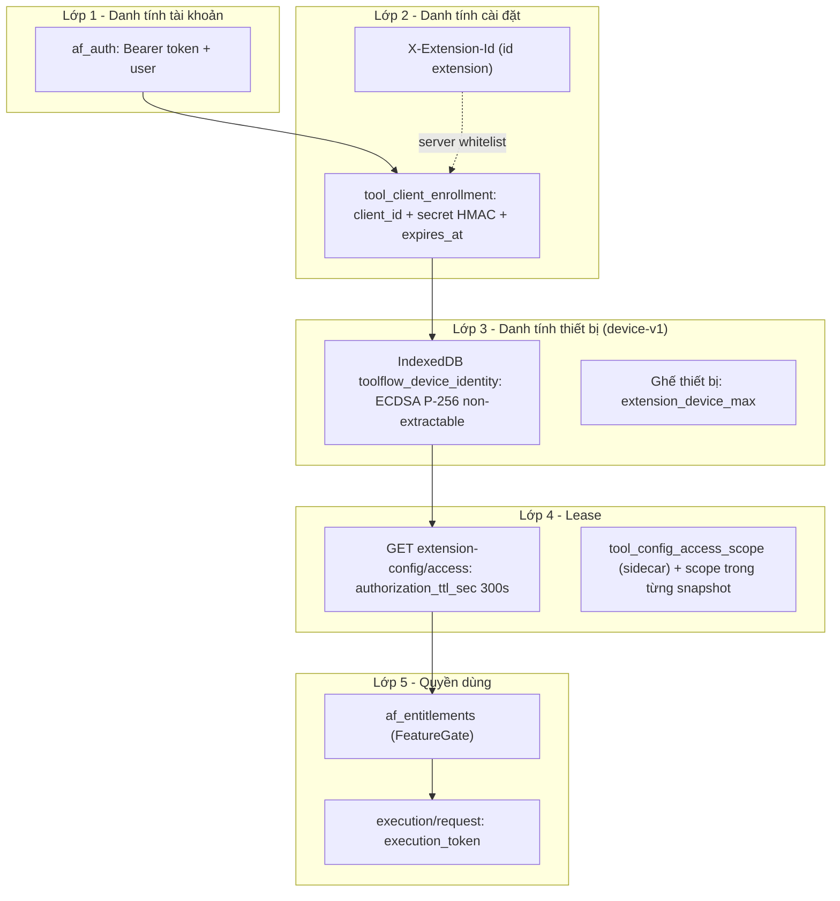

Cách đọc: request thường (entitlements, execution, usage…) chỉ cần lớp 1 + lớp 2. Chỉ **config bảo vệ** (selector, API config, config private của provider, model, execution config, ai-tools) và **thao tác ghế** mới cần lớp 3 + 4. [QS] `ProtectedConfigClient.prepare()` chỉ gắn device proof khi truyền `record`; `apiRequest` chung trong background chỉ gọi `_buildSignatureHeaders` (HMAC).

## 2.3 Luồng đăng nhập (email/mật khẩu)

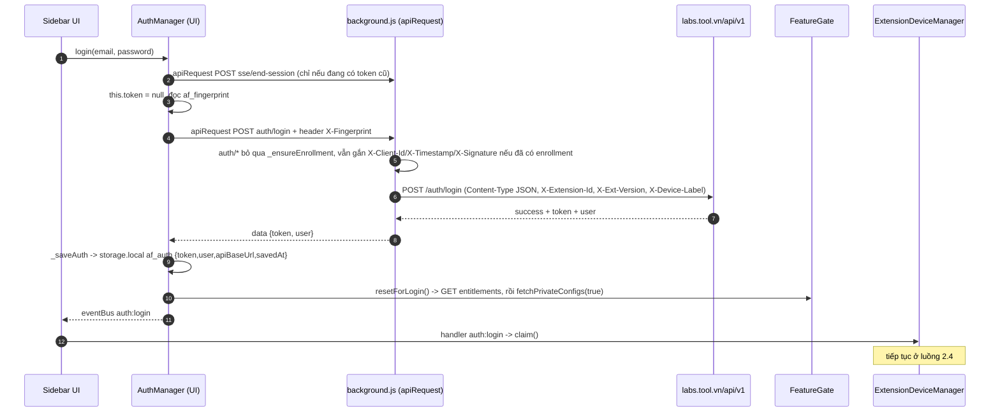

Chi tiết quan trọng:

- **Token chỉ một loại.** Không có refresh token riêng: `refreshToken()` gọi `POST auth/refresh` bằng chính Bearer hiện tại và nhận token mới. [QS] `AuthManager › refreshToken`.
- **Khi 401** (không phải `auth/login`, `auth/refresh`, `sse/end-session`): `_apiCall` tự `refreshToken()` một lần rồi gọi lại (`_isRetry=true`). Refresh thất bại bằng 401/`UNAUTHENTICATED` mới đặt `_sessionInvalid=true`, `_clearAuth()` và phát `auth:logout {reason:"token_expired"}`. Các lỗi khác (429, mạng, `REQUEST_REJECTED`) **giữ session**. Trong cửa sổ popup (`workflow-editor`, `angles-editor`, `effects-editor`, `settings`) thì không xoá auth để khỏi ảnh hưởng side panel.
- **Khôi phục phiên (`init`)**: đọc `af_auth`; nếu không phải cửa sổ popup thì `fetchUser()` (`GET auth/me`); lỗi → thử `refreshToken()`; 429 hoặc `REQUEST_REJECTED`/`EXTENSION_NOT_AUTHORIZED` → giữ session, chờ overlay tự chữa; 401 → đăng xuất. Thành công phát `auth:restored` (cũng kích `claim`).
- **Rate limit phía client**: 429 ở `auth/*` đặt cooldown tối đa 120 s; endpoint khác tối đa 30 s có jitter ±20 %. Trong cooldown, endpoint không phải `auth/` bị từ chối ngay với `RATE_LIMITED`.
- **`X-Fingerprint`** (UUID ngẫu nhiên `af_fingerprint`, ≥ 32 ký tự) gắn vào login/register để server nối tài khoản với lịch sử dùng thử ẩn danh. Không phải định danh thiết bị bảo mật (xem 2.12).
- **`_clearAuth()`** xoá `af_auth, af_tasks, af_workflows, af_nodes, af_edges, af_user_prompts, af_addon_prompts, af_settings, af_settings_owner, af_daily_stats`; trước đó lưu bản sao `af_settings` vào `af_settings_pending_resync` (kèm `user_id`) để đẩy lại nếu cùng người đăng nhập lại.

### Đăng ký, quên mật khẩu, verify email

| Hàm | Endpoint | Ghi chú |
|---|---|---|
| `register(name,email,password,passwordConfirmation)` | `POST auth/register` | Gắn `ref_code` từ `tf_ref` nếu chưa hết hạn; nếu response có `token` thì đăng nhập luôn (`_saveAuth` + `resetForLogin`) |
| `forgotPassword(email)` | `POST auth/forgot-password` | |
| `resendVerification()` | `POST auth/resend-verification` | Cần đang đăng nhập; nút "gửi lại" trong banner `app.js` |
| `resendVerificationByEmail(email)` | `POST auth/resend-verification-public` | Không cần token |
| `changeUnverifiedEmail(email,password,newEmail)` | `PATCH auth/unverified/email` | |
| `deleteUnverifiedAccount(email,password)` | `DELETE auth/unverified/account` | Nếu đang có token thì `_clearAuth` + `auth:logout {reason:"self_delete"}` |
| `fetchUser()` | `GET auth/me` | Đổi `plan_slug` → phát `plan:changed` |

Banner verify email (`src/app.js`): chỉ hiện khi `SystemConfig.email_verification_required !== false` **và** `user.email_verified === false` **và** chưa tắt. [QS] Trong dữ liệu thật `email_verification_required = false` → banner không bao giờ hiện với tài khoản này; `share_require_email_verified = true` nghĩa là việc *chia sẻ* vẫn cần email đã xác minh (server áp dụng).

### Đăng nhập Google OAuth

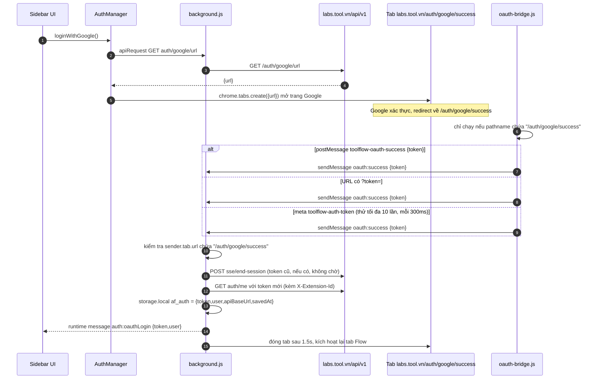

- Liên kết tài khoản: `getLinkGoogleUrl()` (`GET auth/google/link-url`) → trang success phát `oauth:linked` → background phát `auth:googleLinked`; `linkGoogle(googleToken)` (`POST auth/google/link`), `unlinkGoogle()` (`POST auth/google/unlink`).
- Điểm đáng chú ý: token được tìm ở **3 nơi** (postMessage, query string, meta tag) và có cờ `tokenForwarded` chống gửi hai lần. Token xuất hiện trong URL (`?token=`) nghĩa là có thể nằm trong lịch sử trình duyệt. [QS] `oauth-bridge.js`.
- Background kiểm `senderUrl.includes("/auth/google/success")` (so khớp chuỗi con, không so origin). Content script chỉ được nạp ở `*://labs.tool.vn/auth/google/success*` nên thực tế vẫn bị khoá theo manifest. [QS]

### Đăng xuất, thay thế phiên (session_replaced), buộc đăng xuất

| Sự kiện | Nguồn | Hành vi client |
|---|---|---|
| `logout()` | người dùng | Ngắt SSE → `POST sse/end-session` → `POST auth/logout` (lỗi thì bỏ qua) → `featureGate.resetForLogout()` (về `freeDefaults`, tải entitlement ẩn danh) → `_clearAuth()` → `_sessionInvalid=true` → `auth:logout` |
| SSE `session_replaced` | server, khi tài khoản đăng nhập nơi khác | `src/app.js`: chỉ log `device_info` và **`SseClient.disconnect()`**; **không** đăng xuất. Sự kiện đến trong 3 s đầu sau khi vừa connect bị coi là cũ và bỏ qua (`SseClient`). Các request tiếp theo sẽ tự gặp 401 nếu token đã bị vô hiệu |
| SSE `force_logout` | admin thu hồi | Relay `sseRelay:force_logout`, ngắt SSE, `authManager.logout(reason || "admin_revoked")` |
| `login()` khi đã có token | người dùng | gọi `sse/end-session` cho phiên cũ trước khi đăng nhập |

## 2.4 Enrollment, claim thiết bị và lấy access lease

Có hai danh tính độc lập: **enrollment** (cài đặt extension, gắn secret HMAC, tồn tại trước cả khi đăng nhập) và **khoá thiết bị** (gắn user + ghế, chỉ có sau đăng nhập).

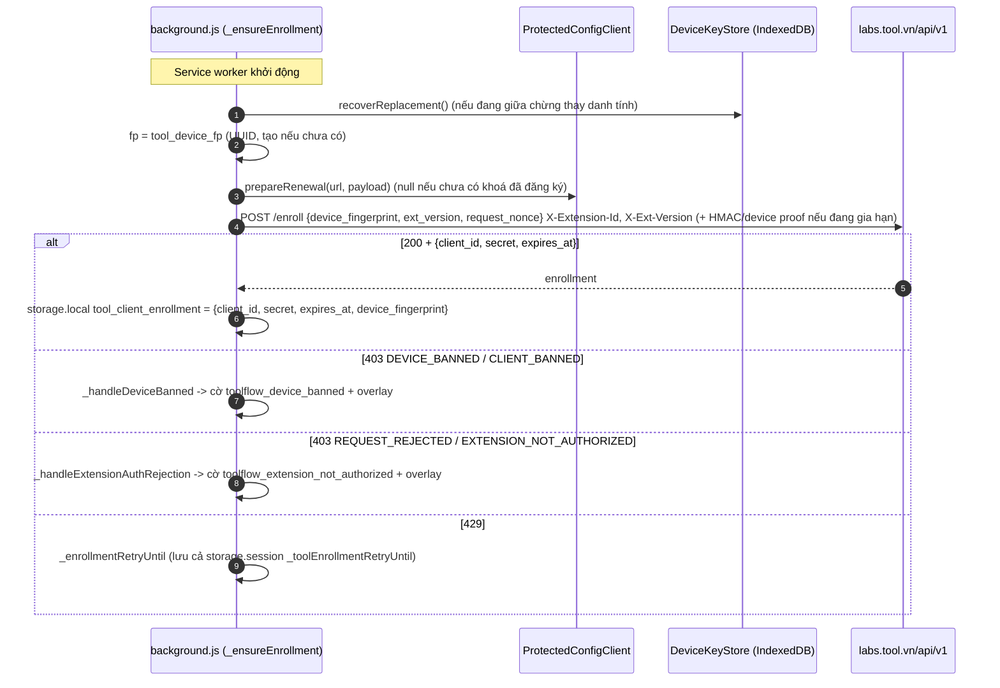

Enrollment được coi là còn hạn nếu `expires_at` > hiện tại **+ 24 giờ**; dưới ngưỡng này `_ensureEnrollment` gọi `/enroll` lại (gia hạn). Nếu server trả 429 mà enrollment cũ chưa hết hạn thật thì vẫn dùng bản cũ. Một flight duy nhất (`_enrollmentPromise`), timeout 15 s. [QS] `background.js › _isEnrollmentValid`, `_doEnrollment`, `_ensureEnrollment`.

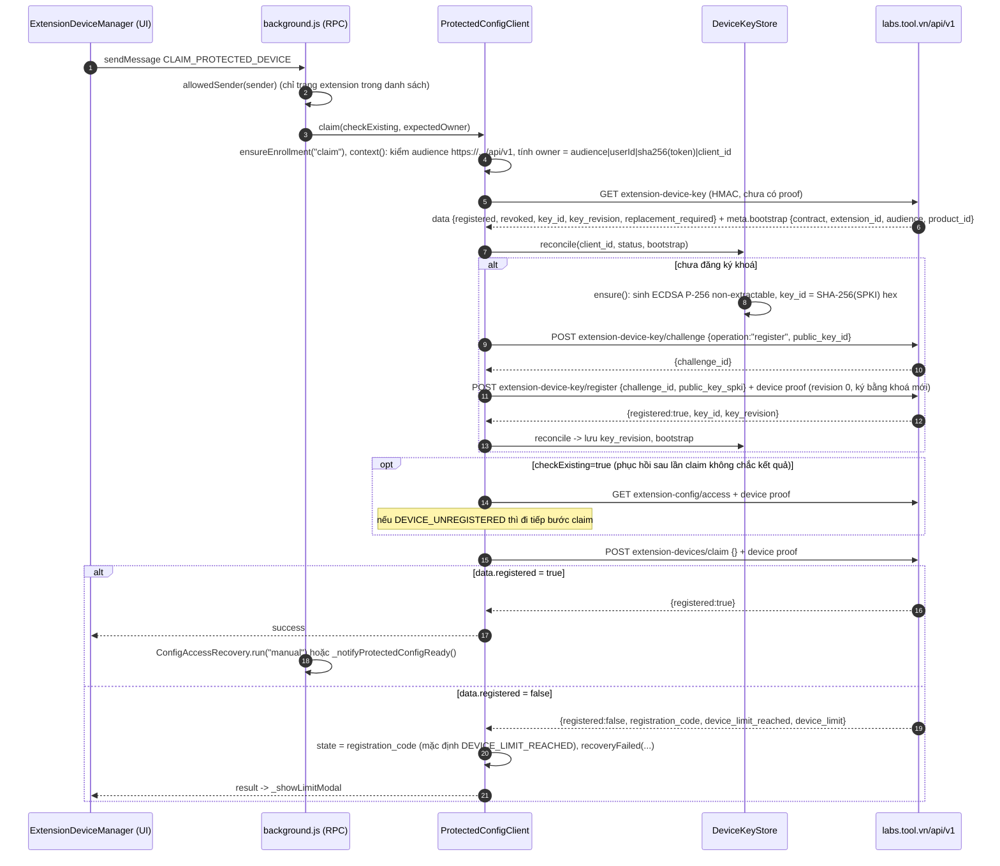

Sau khi ghế được cấp, `ready()` lấy **lease**:

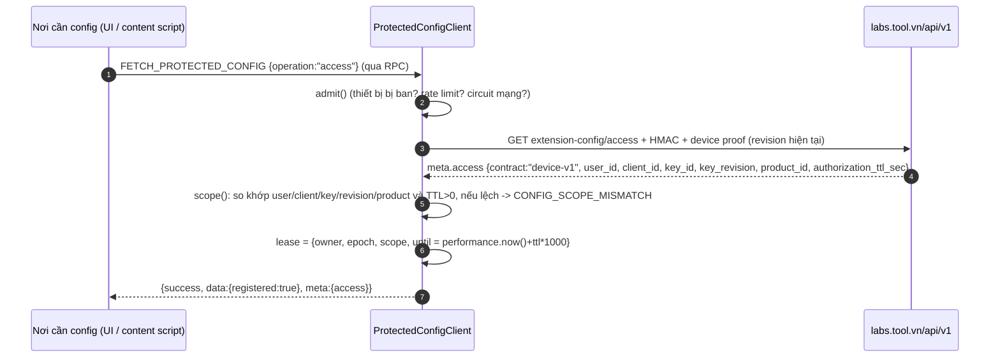

- **TTL thật = 300 s** (`authorization_ttl_sec: 300` trong `tool_config_access_scope.json`). Lease chỉ nằm trong RAM của service worker (dùng `performance.now()`); sidecar `tool_config_access_scope` trên đĩa chứa bản scope để các trang kiểm tra chéo.
- Khi trả lời người tiêu thụ, `consumerEnvelope` gắn `authorization_ttl_sec` = thời gian còn lại; nếu còn dưới 10 s thì làm mới lease trước (`ready(true)`), và từ chối (`CONFIG_SCOPE_CHANGED`) nếu khoá/owner đổi giữa chừng.
- Dữ liệu thật: `contract = "device-v1"`, `key_revision = 1`, `product_id = 1`, `auth_epoch = 76` (bộ đếm epoch nội bộ), `user_id` trùng `af_entitlements.user_id`. Các trường `client_id`, `key_id`, `token_hash` đã bị che.

### Khởi động lại và phục hồi

Khi service worker nạp: `ProtectedConfigClient.invalidate("CONFIG_SCOPE_CHANGED")` rồi `ConfigAccessRecovery.restore()`; `_ensureEnrollment()` chạy ngầm; `_claimAndPrefetchAtStartup()` thử `claim` → `_prefetchAllConfigs()` (dom, api, private, models, execution, aiTools song song) → `markReady()` ghi `_toolConfigsReady` chỉ khi cả hai snapshot dom/api cùng `auth_epoch`, `token_hash`, `client_id`. Ghi xong phát `CONFIG_ACCESS_RECOVERED` tới mọi tab.

### Xoay khoá và thay danh tính

| Thao tác | Điều kiện | Bước |
|---|---|---|
| `ROTATE_DEVICE_KEY` → `rotate()` | khoá hiện tại đã đăng ký (`key_revision ≥ 1`) | sinh khoá `pending_rotation` → `POST extension-device-key/challenge {operation:"rotate"}` → `POST extension-device-key/rotate` ký bởi **cả khoá cũ** (`X-Tool-Device-Signature`) **và khoá mới** (`X-Tool-New-Key-Signature`) → `reconcile` → `invalidate("KEY_REVISION_CHANGED")`. Lần sau `reconcile` thấy `pending_rotation.key_id == status.key_id` thì "promote" khoá mới |
| `REPLACE_DEVICE_IDENTITY` → `replaceIdentity()` | chỉ từ `settings.html`, người dùng xác nhận (`confirmed:true`); bị chặn nếu trạng thái là `CLIENT_BANNED, DEVICE_BANNED, ACCOUNT_DISABLED, ACCOUNT_BLOCKED, DEVICE_KEY_REVOKED, REQUEST_REJECTED, EXTENSION_NOT_AUTHORIZED` | `GET extension-device-key` (revoked → `DEVICE_KEY_REVOKED`) → `stageReplacement` (khoá mới + fingerprint mới) → `POST /enroll` (không ký) lấy enrollment mới → `commitReplacement` (ghi `current`, xoá `pending_*`) → `invalidate("DEVICE_IDENTITY_REPLACED")` → `recoverReplacement` ghi enrollment mới vào `storage.local`. Nếu mất phản hồi giữa chừng: `REPLACEMENT_RESPONSE_LOST` (409), cho phép `retryOrphan` |

## 2.5 Ký một request

### Chữ ký HMAC (mọi request qua `apiRequest`, trừ `enroll`, `health`, form-data)

```
timestamp   = floor((Date.now() + serverTimeOffsetMs) / 1000)          // giây
bodyHash    = sha256_hex(bodyString || "")                              // UTF-8, rỗng với GET
path        = "/" + pathname.replace(/^\/+/, "")                        // chỉ pathname, KHÔNG có query
message     = `${timestamp}:${METHOD_UPPER}:${path}:${bodyHash}`
X-Signature = hex( HMAC_SHA256( key = UTF-8(enrollment.secret), message ) )
```

Header được thêm bởi background: `X-Client-Id`, `X-Timestamp`, `X-Signature`, cộng `X-Extension-Id`, `X-Ext-Version`, `X-Device-Label` ("Google Chrome - Linux" kiểu `<trình duyệt> - <HĐH>` suy ra từ User-Agent), `Authorization: Bearer <token>` nếu có, `Accept`, `Content-Type`. [QS] `background.js › _buildSignatureHeaders`, `apiRequest`; bản trùng lặp ở `RequestSigner.headers`.

Điểm cần biết:

- `path` là **`pathname` của URL đầy đủ**, nên có tiền tố `/api/v1/...` (ví dụ `/api/v1/entitlements`), không phải tên endpoint tương đối.
- **Query string không nằm trong chữ ký HMAC.** Query chỉ được bảo vệ ở device proof (`pathname+search`). [QS]
- **Đồng hồ**: `serverTimeOffsetMs` = `Date` của response − `Date.now()`, cập nhật khi lệch > 5 s và lưu ở `tool_server_time_offset` (giá trị thật: 5142 ms). `EXPIRED_SIGNATURE` → đồng bộ giờ rồi ký lại một lần.
- Body được ký **đúng chuỗi JSON** gửi đi; `fetchOptions.body = JSON.stringify(data)` rồi mới ký, nên không có sai khác canonical hoá.
- Chỉ ký khi `!isFormData`. Upload form-data **không có** `X-Signature` nhưng vẫn có `Bearer` + `X-Extension-Id`. Nếu không phải endpoint `auth/*` mà thiếu `X-Client-Id/X-Signature` → ném `SIGNATURE_UNAVAILABLE` (503); riêng `auth/*` vẫn đi tiếp không chữ ký.

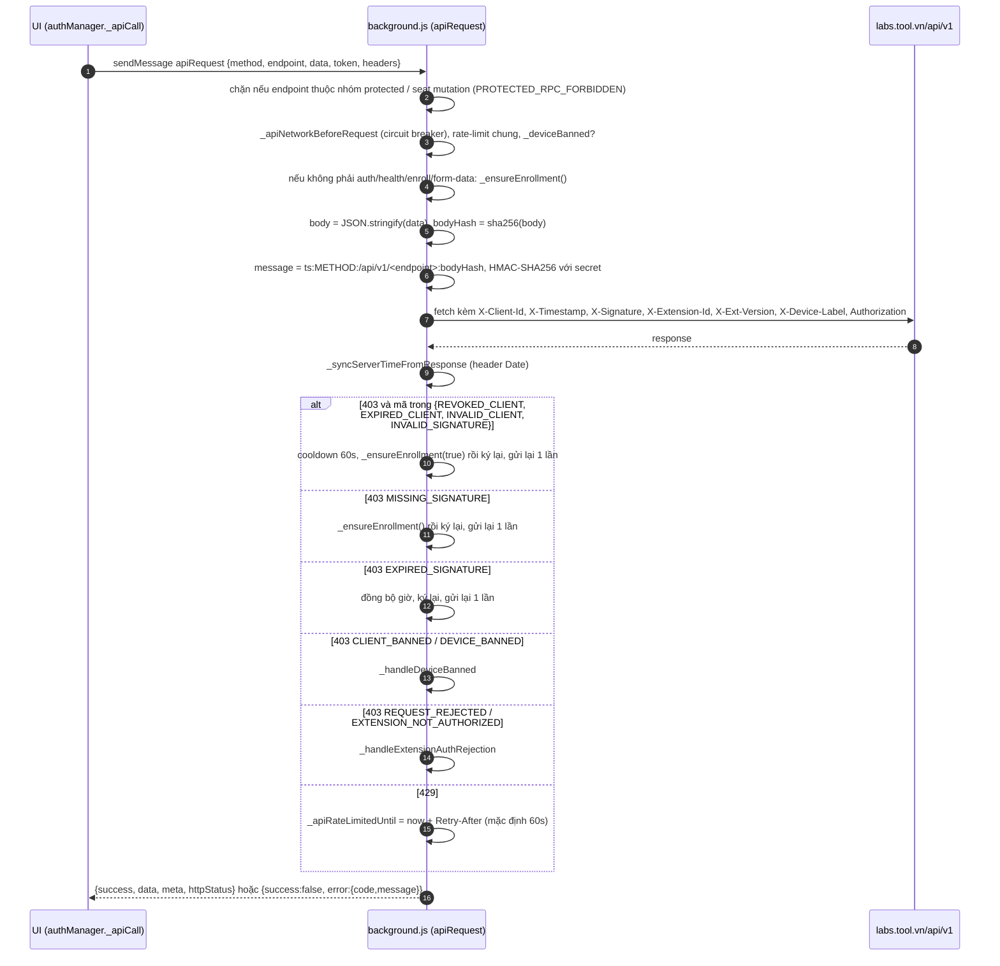

### Device proof (ECDSA, contract `device-v1`)

Dùng cho: `extension-config/*`, `extension-device-key/*`, `extension-devices/claim`, `PATCH|DELETE extension-devices/{id}`, và `POST /enroll` khi gia hạn (`prepareRenewal`). Thông điệp là 14 trường nối bằng `\n` (bất kỳ trường nào chứa CR/LF → `INVALID_DEVICE_PROOF`):

```
device-v1
<audience>                       // https://labs.tool.vn/api/v1 (bắt buộc https, đường dẫn đúng /api/v1, không query/hash/userinfo)
<chrome.runtime.id>
<product_id>                     // từ bootstrap, số nguyên >= 1
<client_id>
<key_id>                         // SHA-256 hex của SPKI
<key_revision>
<ext_version>                    // manifest.version
<sha256_hex(Bearer token)>       // tokenHash; rỗng-băm khi gọi không token
<X-Timestamp>                    // chính timestamp của chữ ký HMAC
<nonce>                          // 16 byte ngẫu nhiên, hex
<METHOD>
<pathname + search>
<sha256_hex(body)>               // body của non-GET có thêm request_nonce = nonce
```

`X-Tool-Device-Signature` = base64url (không padding) của chữ ký **ECDSA P-256/SHA-256 dạng raw r‖s 64 byte** (`crypto.subtle.sign` trả định dạng IEEE P1363). Header proof: `X-Tool-Device-Proof: device-v1`, `X-Tool-Device-Key-Id`, `X-Tool-Device-Key-Revision`, `X-Tool-Device-Nonce`, `X-Tool-Device-Signature`; khi xoay khoá thêm `X-Tool-New-Key-Signature`; riêng `providers/api-configs` thêm `X-Tool-Private-Providers: 1`. [QS] `ProtectedConfigClient › prepare`, `DeviceKeyStore.sign`.

Server được kỳ vọng kiểm: HMAC hợp lệ, `X-Client-Id` khớp, proof khớp khoá đã đăng ký, nonce chưa dùng (client có nhánh `REPLAY_DETECTED`/`EXPIRED_DEVICE_PROOF` → thử lại GET một lần). [SL] Phía server không quan sát được.

## 2.6 Lấy protected config

Chỉ trang trong danh sách (`sidebar, settings, workflow-editor, workflow-template-editor, template-preview, angles-editor, effects-editor, motion-editor, motion-runner, run-window, web-loading`) hoặc content script của đúng provider (`content.js` cho flow, `chat-content-<provider>.js`, so khớp URL với `matches` trong manifest) mới gọi được RPC. Mọi nơi khác nhận `PROTECTED_RPC_FORBIDDEN` (403). Request tới `/extension-config/*`, `/extension-device-key*` qua `apiRequest` chung cũng bị chặn cùng mã. [QS] `allowedSender`, `allowedProviderSender`, handler `apiRequest`.

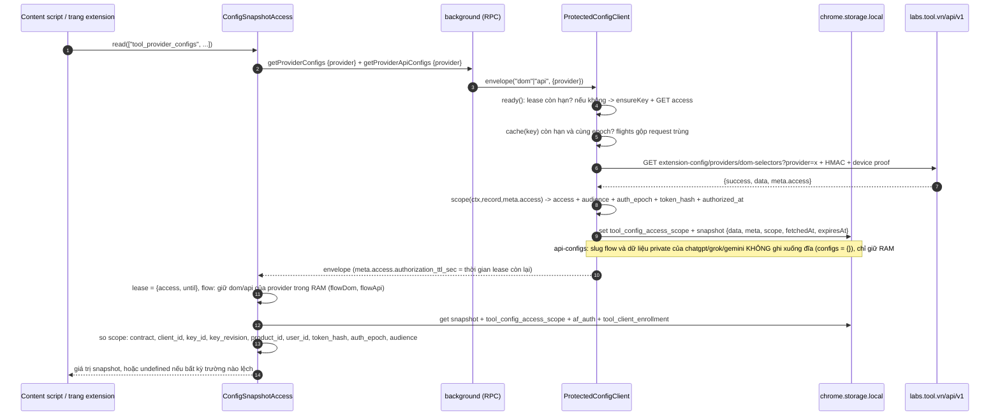

| operation | endpoint (sau `/api/v1/extension-config/`) | khoá cache storage | TTL cache trong client |
|---|---|---|---|
| `dom` | `providers/dom-selectors` | `tool_provider_configs` | 1 giờ |
| `api` | `providers/api-configs` | `tool_provider_api_configs` | 1 giờ |
| `private` | `providers/private-configs` | (chỉ RAM; URL provider đưa vào `_privateProviderUrlsCache`) | 1 giờ |
| `models` | `provider-models` | `tool_provider_models` | 1 giờ |
| `execution` | `system-config/execution` | `af_execution_config` | **5 phút** |
| `aiTools` | `system-config/ai-tools` | — | **30 giây** |
| `motionTool` | `tools/private-configs?tool_key=motion_studio[&prompt_variant=legacy\|timeline][&profile_key=...][&revision=n]` | — | 1 giờ |
| `access` | `access` | `tool_config_access_scope` | theo lease (300 s) |

Chi tiết cơ chế:

- **Tham số kiểm chặt**: `provider` khớp `^[a-z0-9_-]{1,50}$`, `keys` khớp `^[a-z0-9_]+$` và tổng ≤ 2000 ký tự, `profile_key` khớp `^[a-z0-9_]{1,64}$`; sai → `INVALID_CONFIG_QUERY` (422), `operation` lạ → `INVALID_CONFIG_OPERATION` (422). 422 và `RATE_LIMITED` **không** làm mất lease; mọi lỗi khác gọi `invalidate()` (xoá toàn bộ snapshot).
- **`invalidate(code)`**: tăng `epoch`, huỷ lease/identity/cache, **abort mọi fetch đang bay**, `storage.remove(snapshotKeys)` + `session._provider_urls_cache`, rồi phát `CONFIG_ACCESS_INVALIDATED` tới mọi tab. `snapshotKeys` gồm các khoá cache, `tool_provider_dom_selectors`, `_toolConfigsReady`, `af_chatgpt_config`, `af_grok_config`, `tool_config_access_scope`. Gọi ở: login/logout (owner đổi), đổi token, đổi `client_id`, lỗi fetch, xoay khoá, thay danh tính.
- **Owner**: `audience|userId|sha256(token)|client_id`. `context()` thấy owner khác với `identity` đã nhớ → `invalidate("CONFIG_SCOPE_CHANGED")`. Mọi `await` quan trọng đều có `assertCurrent(ctx)` để một flow cũ không ghi đè dữ liệu của phiên mới.
- **`force`**: gộp qua `forcedFlights`; làm mới `api`/`private` tăng `privateEpoch` để loại các kết quả cũ đang bay.
- **Retry nội bộ**: GET gặp 5xx hoặc timeout 15 s thử lại **một lần** sau 2 s (`CONFIG_CONTRACT_UNAVAILABLE` với `service_reason: DB_QUERY_FAILED` cũng thế). 403 `EXPIRED_SIGNATURE`/`EXPIRED_DEVICE_PROOF`/`REPLAY_DETECTED` trên GET thử lại một lần. `redirect: "error"` và `cache: "no-store"` cho mọi request.
- **Phía UI (`RequestSigner.fetchProtected`)**: 401 → `authManager.refreshToken()` rồi gọi lại một lần (nhớ token đã bị từ chối để không lặp). Thành công mà `meta.access.contract !== "device-v1"` hoặc epoch/token đổi trong lúc chờ → `CONFIG_SCOPE_CHANGED`. Lỗi `RATE_LIMITED` mà lease vẫn còn hiệu lực → `nonBlocking` (không hiện overlay).
- **Làm mới theo sự kiện**: `sse:entitlements_changed` → `refreshProtectedPermissions()` (force `access`, xoá config private, tải lại `ProviderConfigManager`/`ModelRegistry`/`ModelPresentationRegistry`); `sse:connected` sau khi từng `disconnected` → thăm dò (mỗi 60 s) rồi làm mới; `chrome.storage.onChanged` đổi `af_auth` hoặc `tool_client_enrollment.client_id` hoặc sidecar bị xoá → `invalidateProtected()`.

### Phía đọc: `ConfigSnapshotAccess.read` (content script)

Với các khoá nằm trong `protectedKeys` (`tool_provider_configs, tool_provider_api_configs, tool_provider_models, tool_provider_dom_selectors, _toolConfigsReady, af_chatgpt_config, af_grok_config, af_execution_config`), hàm yêu cầu `ensure()` thành công (lease còn hạn) **và** đối chiếu scope của snapshot với lease. Chỉ cần lệch một trường là trả `undefined`. Nó còn kiểm tra token/owner **không đổi trong lúc đọc** (đọc hai lần, so `af_auth.token`, `user.id`, `apiBaseUrl`, `client_id`, `auth_epoch`, `token_hash`). Với `flow`, dữ liệu DOM/API của provider được giữ trong RAM (`flowDom`/`flowApi`) và gộp vào kết quả. `privateApi(provider)` chỉ phục vụ `chatgpt|grok|gemini`.

Mã chẩn đoán `readReason` (dùng cho log, theo thứ tự kiểm tra): `ENSURE_NOT_READY, EPOCH_CHANGED, OWNER_CHANGED_DURING_READ, LEASE_MISSING, LEASE_EXPIRED, SIDECAR_CONTRACT_MISMATCH, SIDECAR_CLIENT_MISMATCH, SIDECAR_KEY_MISMATCH, SIDECAR_REVISION_MISMATCH, SIDECAR_PRODUCT_MISMATCH, AUTH_USER_MISMATCH, TOKEN_HASH_MISMATCH, ENROLLMENT_CLIENT_MISMATCH`, sau đó `SNAPSHOT_MISSING, SNAPSHOT_{CONTRACT,CLIENT,KEY,REVISION,USER,PRODUCT,TOKEN,EPOCH,AUDIENCE}_MISMATCH, FLOW_RAM_ROW_MISSING`, và nhóm `ensureReason`: `PROVIDER_NOT_STARTED, RETRY_BACKOFF (1 s), DOM_RPC_FAILED, API_RPC_FAILED, LEASE_TTL_INVALID, DOM_API_ACCESS_MISMATCH, FLOW_RPC_ROW_MISSING, ENSURE_EXCEPTION, INVALIDATED, NOT_STARTED`.

## 2.7 Xin phép một lượt chạy và trả quota

Mỗi lần chạy (batch Generate, task, workflow, angles, effects, từng provider trong workflow, MCP, Telegram) phải có `execution_token` do server cấp. Quota **do server trừ**; client chỉ hiển thị và đồng bộ.

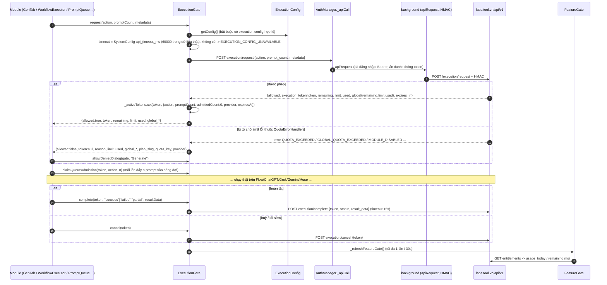

Các điểm quan trọng:

- **`allowed` đòi hỏi token.** `allowed = !!token && success !== false && data.allowed không thuộc {false,0,"0"}`. Server cho phép mà không trả token → `reason: EXECUTION_TOKEN_MISSING`, coi như bị chặn; `WorkflowExecutor` ném `WORKFLOW_EXECUTION_TOKEN_MISSING`. Không có đường "fallback cho phép": `_fallbackCheck` luôn trả `EXECUTION_AUTHORIZATION_UNAVAILABLE`. [QS]
- **Các `action`** quan sát được: `generate`, `task_run`, `workflow_run`, `angles_run`, `effects_run`, `chatgpt_run`, `gemini_run`, `grok_run` và `execAction` do `McpExecutor`/`TelegramExecutor`/`PromptQueue` tính. `metadata` gồm `owner`, `label`, `provider`, `media_type`, `has_ref`, `ref_count`, `workflow_id`, `node_count`, `max_retries`.
- **`claimQueueAdmission`** kiểm cục bộ trước khi đẩy vào hàng đợi: token phải đang theo dõi (`not_tracked`), cùng `action` (`action_mismatch`), chưa hết hạn với `generate`/`task_run` (`expired`) → nếu không ném `EXECUTION_TOKEN_INVALID` (`noRetry`). Với `generate`/`task_run`, tổng `admittedCount` không được vượt `promptCount` đã xin → `EXECUTION_BATCH_MISMATCH`.
- **Timeout & token mồ côi**: `execution/request` dùng `api_timeout_ms`; nếu phản hồi đến *sau* khi đã timeout (`EXECUTION_REQUEST_TIMEOUT`) mà có token hợp lệ thì tự `cancel` để trả lại phần đã giữ chỗ. `complete`/`cancel` dùng 15 s, lỗi chỉ log (trừ khi `waitForSettlement`).
- **Dọn dẹp**: `cancelAll({exceptTokens})` bỏ qua token đang được worker nền ghim (`pinOwnedWorker`). Khi `window` unload, mỗi token chưa hoàn tất bị `fetch(...execution/cancel, {keepalive:true})` với Bearer + `X-Extension-Id` (**không có HMAC**), rơi về `sendBeacon`.
- **Hộp thoại từ chối** (`showDeniedDialog`): `GLOBAL_QUOTA_EXCEEDED` (hết quota prompt/ngày, hoặc còn ít hơn số prompt yêu cầu), `QUOTA_EXCEEDED`/`PROVIDER_QUOTA_EXCEEDED`, `BATCH_LIMIT_EXCEEDED`, `WORKFLOW_NODE_LIMIT_EXCEEDED`, `MODULE_DISABLED`/`FEATURE_LOCKED`, `OFFLINE_CACHE_STALE`/`OFFLINE_NO_QUOTA_INFO` (có nút Thử lại). Nút nâng cấp hiện nếu `show_upgrade_ui !== false` (thật: `true`), nếu không thì nút liên hệ `upgrade_contact_url`.
- **Quota prompt toàn cục** (`prompt_submit_max`) áp dụng chung cho Generate/Task/Workflow/Angles/Effects (theo chuỗi i18n "Global quota applies to all features"); client cảnh báo ở 10 % còn lại (`checkGlobalQuotaWarning`, sự kiện `quota:warning`/`quota:exhausted`).

### Hai lớp kiểm quota trong FeatureGate

| Lớp | Hàm | Nguồn số liệu | Quyền quyết định |
|---|---|---|---|
| UI sớm | `canUse(key)`, `checkQuota(key)`, `canRunTaskAsync()`, `canSubmitPrompts(n)`, `checkPromptBatchLimit(n)` | `entitlements[key].value` và `usage_today` trong cache | Chỉ gợi ý/chặn UI, **không có hiệu lực pháp lý** |
| Cổng thật | `ExecutionGate.request` | Server | Quyết định cuối; cấp/không cấp token |

`canUse` cho quota: `-1`/`"unlimited"` → luôn true; ngược lại `usage_today < limit`. Đã đăng nhập thì `usage` = `feature.usage_today` từ server; ẩn danh thì `af_local_usage` (đặt lại theo ngày UTC `_usage_date`). Sau mỗi lượt chạy (đã đăng nhập), `recordXRun()` chỉ cộng `af_daily_stats` rồi `refresh()` để lấy số liệu server; chỉ riêng tạo task/workflow mới `trackUsage → POST usage/track {feature_key, action, quantity}` (cộng lạc quan vào cache trước).

## 2.8 Entitlement và gói Free

### Vòng đời

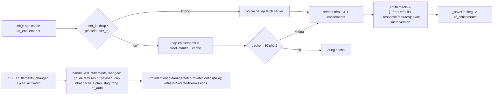

- `_getFeature(key)`: trả `entitlements[key]` nếu có; nếu chưa từng tải server (`_serverFetched=false`) thì dùng `freeDefaults`; nếu đã tải server mà thiếu key → `null` → `canUse` = false.
- `freeDefaults` gồm **39 khoá** (xem cột "Default" bên dưới). Chúng là *giá trị rơi về khi chưa có dữ liệu server hoặc server không gửi key đó*, không phải bảng giá của gói Free thật. [QS] Ví dụ: `gen_run_max` mặc định `-1` (không giới hạn) nhưng server gói Free trả `20`; `tasks_enabled` mặc định `false` nhưng gói Free thật bật `1`.
- Hợp nhất `{...freeDefaults, ...features}` nghĩa là server *thêm/ghi đè* chứ không *xoá* default: key vắng mặt trong response vẫn giữ default.
- Ẩn danh: `GET entitlements` không token; `plan` rơi về `{slug:"trial", name:"Trial"}`. `isFreePlan()` coi `free`, `trial` hoặc không có plan là Free; `isPremium()` = đã đăng nhập và slug không thuộc `free|trial`. `canCreateTaskAsync`/`canCreateWorkflowAsync` trả **false khi chưa đăng nhập** (cần login).
- Cache hiển thị: `lastFetch` (ms epoch), `plan {slug:"free", name:"Free", expires_at:null}` trong dữ liệu thật, `user_id`.

### Bảng entitlement (78 khoá, tài khoản Free thật)

Cột **Default** lấy từ `FeatureGate._freeDefaults` (`—` = không có default, nghĩa là khoá chỉ xuất hiện khi server gửi). Cột **Giá trị thực** lấy từ `af_entitlements.json`; kiểu quota luôn kèm `limit`=giá trị, `usage_today=0` (dữ liệu chụp đầu ngày), `has_override=false` cho cả 78 khoá. Cột cuối là nơi code client tham chiếu khoá đó (tìm theo chuỗi trong toàn bộ JS, bỏ thư viện `vendor`/`lib`); các khoá dựng bằng template (`` `${provider}_enabled` ``…) được ghi riêng.

Quy ước giá trị boolean: `"1"` bật; `"0"`, `null`, `false` tắt (`canUse`). Quota `-1`/`"unlimited"` là không giới hạn.

| key | kiểu | nhóm | Default | Giá trị thực | tính năng kiểm tra |
|---|---|---|---|---|---|
| `addon_prompt_enabled` | boolean | core | — | `0` | GenTab, StyleSelectModal |
| `addon_prompt_max` | quota | core | — | `0` | GenTab, StyleSelectModal |
| `agent_bot_enabled` | boolean | agent | — | `1` | [?] không thấy tham chiếu trong client — chỉ server/chỉ hiển thị |
| `ai_agent_enabled` | boolean | chat_ai | — | `0` | WorkflowEditor, WorkflowExecutor, FeatureGate |
| `angles_enabled` | boolean | advanced | `true` | `1` | `isModuleEnabled(module)` (app.js: angles/effects/module overlay) |
| `angles_run_max` | quota | advanced | `1` | `5` | AngleEditor, FeatureGate |
| `api_rate_limit_per_minute` | quota | limits | `200` | `3000` | FeatureGate |
| `auto_download` | boolean | core | `false` | `1` | settings, workflow-editor-init, app.js, CreatorTemplatePublish, SaveTemplateModal +14 |
| `chatgpt_enabled` | boolean | chat_ai | `false` | `1` | app.js, WorkflowEditor, GenTab, WorkflowExecutor, ChatGPTAdapter +1 |
| `chatgpt_mcp_enabled` | boolean | mcp | — | `null` | McpExecutor `${provider}_mcp_enabled` |
| `chatgpt_ref_images` | boolean | chat_ai | — | `1` | `canUseProviderRefImages`, background `${provider}_ref_images` |
| `chatgpt_run_max` | quota | chat_ai | `0` | `10` | app.js, GenTab, FeatureGate; server (ExecutionGate `*_run` token; client không tự kiểm) |
| `effects_enabled` | boolean | advanced | `true` | `1` | `isModuleEnabled(module)` (app.js: angles/effects/module overlay) |
| `effects_run_max` | quota | advanced | `1` | `5` | EffectsEditor |
| `extension_device_max` | quota | limits | — | `1` | ExtensionDeviceManager |
| `flow_api_enabled` | boolean | core | `false` | `null` | settings, background, app.js, WorkflowEditor, GenTab +13 |
| `gemini_enabled` | boolean | chat_ai | — | `1` | app.js, WorkflowEditor, GenTab, WorkflowExecutor, GeminiAdapter +1 |
| `gemini_mcp_enabled` | boolean | mcp | — | `0` | McpExecutor `${provider}_mcp_enabled` |
| `gemini_ref_images` | boolean | chat_ai | — | `1` | `canUseProviderRefImages`, background `${provider}_ref_images` |
| `gemini_run_max` | quota | chat_ai | — | `15` | GenTab; server (ExecutionGate `*_run` token; client không tự kiểm) |
| `gen_batch_queue_max` | quota | core | — | `3` | [?] không thấy tham chiếu trong client — chỉ server/chỉ hiển thị |
| `gen_enabled` | boolean | core | `true` | `1` | app.js, WorkflowEditor, GenTab, McpExecutor, FlowAdapter +1 |
| `gen_run_max` | quota | core | `-1` | `20` | app.js, GenTab, FeatureGate |
| `grok_enabled` | boolean | grok | `false` | `1` | app.js, WorkflowEditor, GenTab, WorkflowExecutor, GrokAdapter +1 |
| `grok_mcp_enabled` | boolean | mcp | — | `null` | McpExecutor `${provider}_mcp_enabled` |
| `grok_run_max` | quota | grok | `0` | `10` | app.js, GenTab, FeatureGate; server (ExecutionGate `*_run` token; client không tự kiểm) |
| `grok_telegram_enabled` | boolean | telegram | — | `0` | [?] không thấy tham chiếu trong client — chỉ server/chỉ hiển thị |
| `grok_telegram_rate_day` | quota | telegram | — | `0` | [?] không thấy tham chiếu trong client — chỉ server/chỉ hiển thị |
| `grok_telegram_rate_hour` | quota | telegram | — | `0` | [?] không thấy tham chiếu trong client — chỉ server/chỉ hiển thị |
| `history_enabled` | boolean | core | `true` | `1` | FeatureGate |
| `history_max` | quota | core | — | `20` | [?] không thấy tham chiếu trong client — chỉ server/chỉ hiển thị |
| `i2p_enabled` | boolean | chat_ai | — | `1` | background |
| `image_remove_watermark_enabled` | boolean | advanced | `false` | `1` | settings, background, app.js, WorkflowEditor, GenTab +2 |
| `mcp_enabled` | boolean | mcp | — | `null` | settings, GenTab, McpExecutor |
| `mcp_max_tokens` | quota | mcp | — | `null` | [?] không thấy tham chiếu trong client — chỉ server/chỉ hiển thị |
| `mcp_queue_max` | quota | mcp | — | `null` | [?] không thấy tham chiếu trong client — chỉ server/chỉ hiển thị |
| `mcp_rate_day` | quota | mcp | — | `null` | [?] không thấy tham chiếu trong client — chỉ server/chỉ hiển thị |
| `mcp_rate_hour` | quota | mcp | — | `null` | [?] không thấy tham chiếu trong client — chỉ server/chỉ hiển thị |
| `mcp_workflow_create_rate_day` | quota | mcp | — | `null` | [?] không thấy tham chiếu trong client — chỉ server/chỉ hiển thị |
| `mcp_workflow_enabled` | boolean | mcp | — | `null` | [?] không thấy tham chiếu trong client — chỉ server/chỉ hiển thị |
| `motion_tool_enabled` | boolean | advanced | — | `null` | background, MotionEditor, MotionStudioList |
| `motion_tool_max` | quota | advanced | — | `null` | [?] không thấy tham chiếu trong client — chỉ server/chỉ hiển thị |
| `muse_enabled` | boolean | muse | `false` | `1` | WorkflowEditor, GenTab, WorkflowExecutor, MuseAdapter, TaskModal |
| `muse_mcp_enabled` | boolean | muse | `false` | `null` | McpExecutor `${provider}_mcp_enabled` |
| `muse_ref_images` | boolean | chat_ai | — | `1` | `canUseProviderRefImages`, background `${provider}_ref_images` |
| `muse_run_max` | quota | muse | `0` | `5` | GenTab, FeatureGate; server (ExecutionGate `*_run` token; client không tự kiểm) |
| `pipeline_queue_enabled` | boolean | advanced | `false` | `1` | settings, app.js, PromptQueue |
| `premium_templates` | boolean | core | — | `null` | StyleSelectModal, PromptAssistantModal, FeatureGate |
| `priority_support` | boolean | — | `false` | `false` | [?] không thấy tham chiếu trong client — chỉ server/chỉ hiển thị |
| `prompt_assistant_enabled` | boolean | chat_ai | — | `1` | background, PromptAssistantModal |
| `prompt_enhancer_enabled` | boolean | chat_ai | — | `0` | [?] không thấy tham chiếu trong client — chỉ server/chỉ hiển thị |
| `prompt_node_enabled` | boolean | chat_ai | — | `1` | WorkflowEditor, WorkflowExecutor |
| `prompt_submit_max` | quota | core | `20` | `100` | app.js, GenTab, AngleEditor, EffectsEditor, FeatureGate |
| `prompt_templates_enabled` | boolean | core | `false` | `1` | app.js, FeatureGate |
| `prompts_per_batch` | quota | core | `4` | `5` | GenTab, FeatureGate |
| `ref_images` | boolean | core | `true` | `1` | background, FeatureGate |
| `retry_on_fail` | boolean | core | `false` | `1` | settings, app.js, CreatorTemplatePublish, SaveTemplateModal, WorkflowEditor +9 |
| `snippets_max` | quota | core | `-1` | `10` | app.js, FeatureGate |
| `tasks_enabled` | boolean | core | `false` | `1` | `isModuleEnabled(module)` (app.js: angles/effects/module overlay) |
| `tasks_max` | quota | core | `2` | `2` | app.js, FeatureGate, TaskList, TaskModal |
| `tasks_run_max` | quota | core | `1` | `15` | GenTab, FeatureGate, TaskList, TaskModal |
| `telegram_custom_bot` | boolean | telegram | — | `0` | [?] không thấy tham chiếu trong client — chỉ server/chỉ hiển thị |
| `telegram_enabled` | boolean | telegram | — | `0` | settings, WorkflowEditor, WorkflowExecutor |
| `telegram_queue_max` | quota | telegram | — | `0` | [?] không thấy tham chiếu trong client — chỉ server/chỉ hiển thị |
| `telegram_rate_day` | quota | telegram | — | `0` | [?] không thấy tham chiếu trong client — chỉ server/chỉ hiển thị |
| `telegram_rate_hour` | quota | telegram | — | `0` | [?] không thấy tham chiếu trong client — chỉ server/chỉ hiển thị |
| `telegram_ref_image` | boolean | telegram | — | `0` | [?] không thấy tham chiếu trong client — chỉ server/chỉ hiển thị |
| `telegram_workflow` | boolean | telegram | — | `0` | WorkflowEditor, WorkflowExecutor |
| `video_remove_watermark_enabled` | boolean | advanced | `false` | `null` | settings, background, app.js, WorkflowEditor, GenTab +1 |
| `workflow_execution_history_max` | quota | limits | — | `20` | [?] không thấy tham chiếu trong client — chỉ server/chỉ hiển thị |
| `workflow_export` | boolean | core | `false` | `null` | WorkflowList, WorkflowEditor |
| `workflow_import` | boolean | core | `false` | `null` | WorkflowList |
| `workflow_share_enabled` | boolean | core | `false` | `null` | WorkflowList, WorkflowEditor |
| `workflow_templates_enabled` | boolean | core | `false` | `1` | WorkflowTab |
| `workflows_enabled` | boolean | core | `false` | `1` | WorkflowTemplateList, WorkflowTab, WorkflowEditor |
| `workflows_max` | quota | core | `1` | `2` | app.js, WorkflowTemplateList, WorkflowList, WorkflowEditor, NotificationModal +1 |
| `workflows_nodes_max` | quota | core | `5` | `5` | workflow-editor-init, WorkflowTemplateList, DiagramCanvas, WorkflowList, WorkflowEditor +3 |
| `workflows_run_max` | quota | core | `1` | `10` | WorkflowTab, WorkflowList, WorkflowEditor, FeatureGate |

Nhận xét trên dữ liệu thật:

- **Bật cho Free**: Generate (Flow) 20 lượt/ngày, tối đa 100 prompt/ngày (`prompt_submit_max`), 5 prompt/batch, ChatGPT 10/ngày, Gemini 15/ngày, Grok 10/ngày, Muse 5/ngày, Angles 5/ngày, Effects 5/ngày, Task 2 (chạy 15/ngày), Workflow 2 (≤ 5 node, chạy 10/ngày), 10 snippet, lịch sử 20 bản ghi, 3 batch Flow xếp hàng/project; **1 thiết bị** (`extension_device_max`).
- **Tắt hoặc `null`** (đóng): `flow_api_enabled`, `video_remove_watermark_enabled`, `workflow_export/import/share_enabled`, toàn bộ nhóm `mcp_*`, `motion_tool_*`, `premium_templates`, `muse_mcp_enabled`, `chatgpt_mcp_enabled`, `grok_mcp_enabled`; `0`: `addon_prompt_*`, `ai_agent_enabled`, `gemini_mcp_enabled`, nhóm `telegram_*`, `grok_telegram_*`, `prompt_enhancer_enabled`.
- **Giá trị `null` (không phải `"0"`)** xuất hiện với 18 khoá (vd. `flow_api_enabled`, `mcp_enabled`, `motion_tool_enabled`): server không gửi giá trị; `canUse` coi là tắt. [QS]
- `priority_support` có giá trị boolean thật `false` (khác chuỗi `"0"`) và không có `name/category`: là default nội bộ giữ nguyên, server không trả. [QS]
- Quota "chạy theo provider" (`chatgpt_run_max`, `gemini_run_max`, `grok_run_max`, `muse_run_max`) được server áp thông qua `execution/request` (action `*_run`); client chỉ đọc để hiển thị. [SL]
- Không thấy tham chiếu client cho một số quota (`history_max`, `gen_batch_queue_max`, `workflow_execution_history_max`…): có thể được server áp trực tiếp hoặc đọc qua chuỗi khoá động. [?]

### Cấu hình thực thi (`af_execution_config`) — quyền "chạy thế nào"

Không phải entitlement mà là protected config, nhưng cùng cơ chế lease. `ExecutionConfig._isValidPayload` đòi một trong `workflow/queue/timing/flow_recovery/parallel` và `flow_recovery.captcha_recovery_mode ∈ {pause_resume, normal_error, stop_batch}`; thiếu → `ConfigRequiredError("execution_config","response_invalid")`. Mọi getter (`getQueueConfig`, `getTimingConfig`...) ném `ConfigRequiredError("…","cache_empty")` nếu chưa có cache (không có giá trị mặc định cứng) và tự kích tải nền; bản `safeGet*` nuốt lỗi đó. Cache RAM 5 phút; SSE `system_settings_changed` với `group|section == "execution"` → `refreshAfterSse()`; xoá khoá `af_execution_config` khỏi storage → `invalidateProtected()`. Dữ liệu thật có 7 nhóm: `flow_api, flow_recovery, history, parallel, queue, timing, workflow`. Provider-web song song: `provider_web_max_concurrent_workers` phải là số nguyên 1–4, timeout khởi động 10 000–120 000 ms (ngoài khoảng → 60 000), danh sách provider ⊂ `{muse, grok, chatgpt, gemini}`; sai → `ConfigRequiredError("provider_web_workers","missing_or_invalid:<field>")`.

## 2.9 Giới hạn số thiết bị (`ExtensionDeviceManager`)

- **Khi nào claim**: `auth:login`, `auth:restored`, lúc `init` nếu đã đăng nhập, `sse:entitlements_changed` nếu `features.extension_device_max` tăng (`_isLimitIncrease`: `-1` = không giới hạn; chỉ tăng mới claim), và thăm dò khi `focus`/`visibilitychange` (cách nhau ≥ 15 s) hoặc SSE `system_settings_changed` với `section:"security"` & `device_seat_capacity_changed:true`.
- **Chỉ thăm dò lại khi bị chặn đúng ba mã**: `DEVICE_UNREGISTERED`, `EXTENSION_DEVICE_LIMIT_REACHED`, `EXTENSION_DEVICE_LIMIT_UNCONFIGURED` (đọc `PROTECTED_CONFIG_STATUS`).
- **Modal "Đã đạt giới hạn N thiết bị"** (`_showLimitModal`, một lần mỗi user): `GET extension-devices` → liệt kê thiết bị chưa bị thu hồi và không phải `current`; nhấn gỡ → `DELETE extension-devices/{id}` (qua `prepareMutation`, có device proof); nếu `replacement_registered === true` thì `claim()` lại, thành công thì hiển thị "đã kích hoạt". Tự kiểm tra ghế trống mỗi 15 s khi modal mở. Nếu không còn thiết bị gỡ được: "Hãy liên hệ hỗ trợ".
- **Mutation ghế** (`POST extension-devices/claim`, `PATCH|DELETE extension-devices/{id}`) chỉ cho trang extension nằm trong danh sách và không được là form-data; đi qua `ProtectedConfigClient.prepareMutation` (ép `ensureKey`, mọi request đều có device proof). Tên gọi thiết bị hiển thị: header `X-Device-Label` (`<trình duyệt> - <HĐH>`).
- Dữ liệu thật: `extension_device_max = 1`, `usage_today = 0` (`remaining 1`).

## 2.10 Phát hiện clone và các cờ chặn

Định nghĩa "clone" ở đây = **extension không được server chấp nhận** (không nằm trong whitelist `X-Extension-Id`) hoặc **thiết bị bị ban**. Không có kiểm tra toàn vẹn mã nguồn hay chữ ký gói ở phía client. [QS]

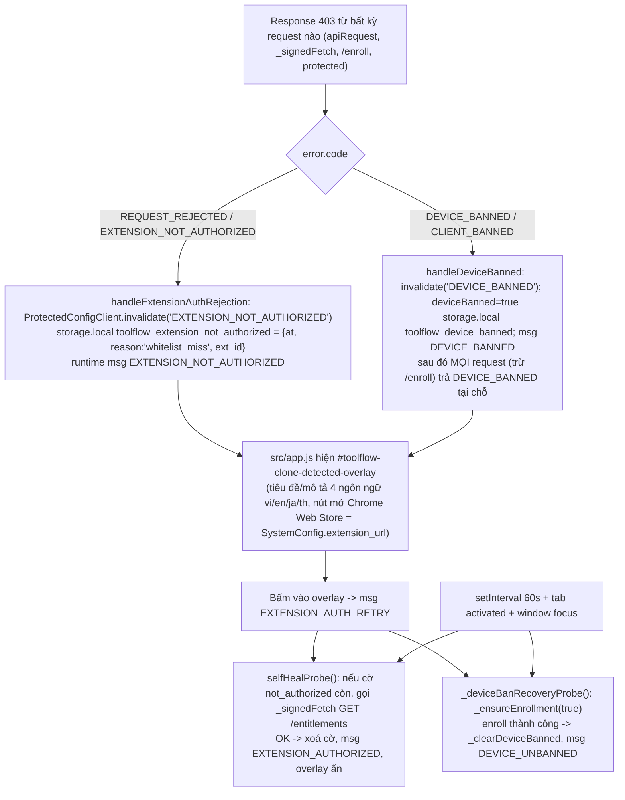

- **Khi nào overlay bật**: ngay lúc nhận message, hoặc 800 ms sau khi trang mở nếu một trong hai cờ đã có trong storage; ẩn khi cả hai cờ biến mất. `EXTENSION_AUTHORIZED`/`DEVICE_UNBANNED` còn đặt `authManager._sessionInvalid=false`, làm mới `SystemConfig` và `featureGate`.
- Với `REQUEST_REJECTED` trong `AuthManager.init`, session **được giữ** ("đợi overlay tự chữa"), tránh đăng xuất oan khi server tạm chặn.
- **Thông điệp**: "Phiên bản extension này không có quyền truy cập API Tool Flow. Vui lòng cài lại từ Chrome Web Store" [QS] `clone-detected-i18n.js`.
- Cơ chế này **chỉ làm UI chặn**. Việc chặn thật xảy ra ở server (không cấp config, không cấp token). Xoá cờ `toolflow_extension_not_authorized` bằng tay chỉ ẩn overlay; request kế tiếp lại bị từ chối và đặt lại cờ.

## 2.11 Bảng mã lỗi và cách client phục hồi

Nhóm hiển thị của `ConfigAccessUI._accessGroup` (mặc định `service`):

| Nhóm | Mã khớp | UI |
|---|---|---|
| `pending` | `CONFIG_SCOPE_CHANGED`, `CONFIG_ACCESS_INVALIDATED` | Không hiện gì (đang đổi phiên, chờ tải lại) |
| `login` | `AUTH_REQUIRED` | Chỉ ở workflow-editor / template-editor: hộp thoại "Đăng nhập" → mở side panel (`openLoginSidePanel`) |
| `key` | `KEY_MISSING, KEY_MISMATCH, CLIENT_RESET_REQUIRES_REPLACEMENT, REPLACEMENT_RESPONSE_LOST` | Trong `settings.html`: nút **Thay danh tính** (`REPLACE_DEVICE_IDENTITY`); nơi khác: nút mở Cài đặt |
| `device` | regex `DEVICE_(UNREGISTERED\|LIMIT\|REVOKED)` hoặc `EXTENSION_DEVICE_(LIMIT\|REVOKED)` | Trong Cài đặt: chuyển sang tab "Thiết bị"; ngoài Cài đặt: `EXTENSION_DEVICE_LIMIT_REACHED` tự `claim()` mở modal, `DEVICE_UNREGISTERED` im lặng chờ phục hồi, mã khác hiện modal + nút "Thiết bị" |
| `blocked` | regex `BANNED\|BLOCKED\|DISABLED\|KEY_REVOKED\|NOT_AUTHORIZED` | Modal lỗi có hướng dẫn liên hệ |
| `service` | mọi mã còn lại | Overlay "Mất kết nối server" + nút Thử lại (`RETRY_PROTECTED_CONFIG`) |

### Mã lỗi xác thực / thiết bị / config

| Mã | Phát sinh ở | Ý nghĩa | Phục hồi của client |
|---|---|---|---|
| `AUTH_REQUIRED` (401) | `context()`; `PROTECTED_CONFIG_STATUS` khi chưa có token | Chưa đăng nhập | Dừng; hiện hộp thoại đăng nhập; sau `auth:login` tự claim |
| `UNAUTHENTICATED` (401) | `AuthManager._apiCall` | Refresh token không thành | `_sessionInvalid=true`, `_clearAuth()`, `auth:logout{token_expired}` |
| `ENROLLMENT_REQUIRED` | `RequestSigner.headers`, `_signedFetch`, `diagnoseRenewalFailure` | Không có/không gia hạn được enrollment | `ensureEnrollment` rồi thử lại; `RETRY_PROTECTED_CONFIG` chạy enroll → claim → `ConfigAccessRecovery.run` |
| `API_AUDIENCE_MISMATCH` | `context()`, `validateBootstrap`, `prepare` | `apiBaseUrl` không phải `https://…/api/v1` sạch, hoặc bootstrap lệch audience/extension_id/product_id | Không tự phục hồi (lỗi cấu hình). Nhóm service |
| `KEY_MISSING` | `DeviceKeyStore.ensure/reconcile/sign` | Server nói khoá đã đăng ký nhưng IndexedDB không có khoá riêng (hoặc `extractable`/sai type) | Người dùng bấm **Thay danh tính** (cấp enrollment + khoá mới), rồi `claim` lại |
| `KEY_MISMATCH` | `DeviceKeyStore` | `client_id` hoặc `key_id` cục bộ khác server | Như trên |
| `LOCAL_KEY_UNAVAILABLE` | IndexedDB lỗi/blocked | Không đọc/ghi được kho khoá | Bị coi **không retry** (tiền tố `LOCAL_`); `ConfigAccessRecovery` chuyển `blocked`; người dùng bấm thử lại (trigger `manual` đặt lại `pending`) |
| `LOCAL_STORAGE_UNAVAILABLE` | `chrome.storage` lỗi | Không đọc/ghi storage | `ConfigSnapshotAccess` tự `invalidate`; `manual` retry được |
| `CLIENT_RESET_REQUIRES_REPLACEMENT` | `ensureKey` khi `replacement_required` | Server yêu cầu thay danh tính (client bị reset) | Hộp thoại xác nhận → `REPLACE_DEVICE_IDENTITY` |
| `REPLACEMENT_RESPONSE_LOST` (409) | `replaceOnce` | Đã gửi `/enroll` thay thế nhưng mất phản hồi | Nút "Thử lại thay thế" → `retryOrphan:true` |
| `DEVICE_KEY_REVOKED` | `reconcile`, `replaceOnce` | Khoá bị thu hồi | Không thay được (`replaceOnce` từ chối); nhóm blocked |
| `CONFIG_SCOPE_CHANGED` | rất nhiều nơi | Owner/epoch đổi giữa chừng, hoặc `key_revision` cục bộ > server (`reconcile`) | Huỷ flow cũ, **không** ghi nhật ký lỗi; flow mới chạy lại. Trong `ConfigAccessRecovery.failed` bị bỏ qua |
| `CONFIG_SCOPE_MISMATCH` | `scope()` | `meta.access` không khớp user/client/key/revision/product hoặc TTL ≤ 0 | `invalidate`, nhóm service; thử lại bằng nút |
| `CONFIG_ACCESS_INVALIDATED`, `KEY_REVISION_CHANGED`, `DEVICE_IDENTITY_REPLACED` | `invalidate()` | Mã trạng thái sau xoay khoá/thay danh tính/xoá cache | Lease và snapshot bị xoá; tự tải lại ở lần `ready()` kế |
| `DEVICE_UNREGISTERED` (403) | `extension-config/access` | Khoá hợp lệ nhưng thiết bị chưa có ghế | `needsClaim=true` → `POST extension-devices/claim`; `ConfigAccessRecovery` (chặn tới khi claim thành công) |
| `EXTENSION_DEVICE_LIMIT_REACHED` / `…_UNCONFIGURED` / `DEVICE_LIMIT_REACHED` | `claim` (registration_code) | Hết ghế / server chưa cấu hình ghế | Modal gỡ thiết bị cũ; thăm dò lại khi focus (≥ 15 s), khi SSE security đổi sức chứa, khi `extension_device_max` tăng |
| `DEVICE_BANNED`, `CLIENT_BANNED` (403) | mọi request | Thiết bị bị ban | Cờ `toolflow_device_banned`, chặn **toàn bộ** request, overlay; thăm dò `_ensureEnrollment(true)` khi đổi tab/focus để tự gỡ |
| `REQUEST_REJECTED`, `EXTENSION_NOT_AUTHORIZED` (403) | mọi request | Extension ID không được whitelist / bị chặn chung | Cờ `…not_authorized`, overlay clone, thăm dò 60 s |
| `ACCOUNT_DISABLED`, `ACCOUNT_BLOCKED` | server | Tài khoản bị khoá | Tiền tố `ACCOUNT_` = **permanent** (không retry); `replaceOnce` từ chối |
| `INVALID_DEVICE_PROOF` | `prepare()` | Có CR/LF trong trường proof | Không retry |
| `INVALID_SIGNATURE`, `INVALID_CLIENT`, `REVOKED_CLIENT`, `EXPIRED_CLIENT` (403) | server | HMAC/enrollment bị từ chối | `_ensureEnrollment(true)` (tái enroll) + ký lại, 1 lần, cooldown 60 s |
| `MISSING_SIGNATURE` (403) | server / `_signedFetch` | Thiếu chữ ký | `_ensureEnrollment()` + ký lại 1 lần |
| `EXPIRED_SIGNATURE` (403) | server | Lệch đồng hồ | Đồng bộ `Date`, ký lại 1 lần |
| `EXPIRED_DEVICE_PROOF`, `REPLAY_DETECTED` (403, GET) | server | Proof quá hạn / nonce lặp | Thử lại GET 1 lần (nonce+timestamp mới) |
| `SIGNATURE_UNAVAILABLE` (503, nội bộ) | `apiRequest`, `_signedFetch` | Không có enrollment để ký | Dừng, báo lỗi; sẽ ok sau khi `ensureEnrollment` |
| `RATE_LIMITED` (429) | server / cooldown cục bộ | Quá tải | `Retry-After` (mặc định 60 s); nếu lease còn hạn thì **giữ lease** và `nonBlocking`. `ConfigAccessRecovery` coi là retryable |
| `NETWORK_ERROR`, `REQUEST_TIMEOUT` (503) | `request()` | Mạng/timeout 15 s | Retryable; GET thử lại 1 lần với timeout; circuit breaker mạng |
| `NETWORK_CIRCUIT_OPEN` | `_apiNetworkBeforeRequest` | Breaker đã mở sau nhiều lỗi mạng | Chờ `retryAfterMs` |
| `HTTP_SERVICE_UNAVAILABLE`, `CONFIG_CONTRACT_UNAVAILABLE`, `PROOF_STORE_UNAVAILABLE`, `CONFIG_FETCH_FAILED`, `CONFIG_RESPONSE_INVALID`, `CONFIG_BROKER_UNAVAILABLE` | server/RPC | Lỗi dịch vụ hoặc phản hồi sai định dạng | Retryable (trừ `LEGACY_CONTRACT_STATE_UNAVAILABLE` là permanent). Backoff `2000·2^n·(1+rand·0.2)` ms, tối đa **3 lần**, hẹn bằng `chrome.alarms` (`toolConfigAccessRecovery`); sự kiện `online` đặt lại bộ đếm (≥ 30 s/lần); nút Thử lại = `manual` |
| `PROTECTED_RPC_FORBIDDEN` (403) | handler RPC / `apiRequest` | Người gọi không nằm trong danh sách | Không phục hồi (lỗi lập trình/tấn công) |
| `INVALID_CONFIG_OPERATION`, `INVALID_CONFIG_QUERY` (422) | `fetchConfig` | Tham số sai | Không invalidate lease; sửa lời gọi |
| `CONFIG_REQUIRED: <key> (<context>)` | `ConfigRequiredError` | Thiếu một config bắt buộc ở client (`cache_empty`, `missing_or_invalid:…`, `response_invalid`) | `ConfigErrorHandler.handle`: `accessDenied` → sự kiện `config:access_required` → `ConfigAccessUI.show`; `nonBlocking` → bỏ qua; còn lại → overlay "Cần kết nối server" + Retry (tải lại ProviderConfigManager/ModelRegistry/ValidationRules rồi `location.reload()`) |

`ConfigRequiredError.accessDenied` được đặt khi `httpStatus ∈ {401,403,404,409}` hoặc `code ∈ {KEY_MISSING, KEY_MISMATCH, LOCAL_KEY_UNAVAILABLE, LOCAL_STORAGE_UNAVAILABLE, CONFIG_CONTRACT_UNAVAILABLE, PROOF_STORE_UNAVAILABLE, LEGACY_CONTRACT_STATE_UNAVAILABLE, CONFIG_SCOPE_CHANGED, CONFIG_BROKER_UNAVAILABLE}`. [QS] `RequestSigner.fetchProtected`.

`ConfigAccessRecovery.retryable(failure)`: **không retry** nếu mã bắt đầu bằng `KEY_`, `LOCAL_`, `DEVICE_KEY_`, `CLIENT_`, `ACCOUNT_`, `EXTENSION_DEVICE_`, `INVALID_DEVICE_`, hoặc thuộc `{REQUEST_REJECTED, EXTENSION_NOT_AUTHORIZED, LEGACY_CONTRACT_STATE_UNAVAILABLE}`; **retry** nếu `failure.retryable===true` hoặc mã thuộc `{NETWORK_ERROR, REQUEST_TIMEOUT, HTTP_SERVICE_UNAVAILABLE, RATE_LIMITED, NETWORK_CIRCUIT_OPEN, PROOF_STORE_UNAVAILABLE, CONFIG_CONTRACT_UNAVAILABLE}`. Nhật ký lưu ở `storage.session["tool_config_access_recovery"]` (mất khi đóng trình duyệt).

### Mã lỗi quota / thực thi

| Mã | Nguồn | Xử lý |
|---|---|---|
| `QUOTA_EXCEEDED`, `PROVIDER_QUOTA_EXCEEDED` | `execution/request` | `allowed:false`; hộp thoại "Đạt giới hạn sử dụng" (limit/used, tên provider) |
| `GLOBAL_QUOTA_EXCEEDED` | idem | Hộp thoại "Hết quota prompt hôm nay" hoặc "Không đủ quota" khi số prompt > số còn lại |
| `MODULE_DISABLED`, `FEATURE_LOCKED` | idem | Hộp thoại "Tính năng bị khoá" + nâng cấp/liên hệ |
| `BATCH_LIMIT_EXCEEDED` | idem | Thông báo số prompt/batch tối đa |
| `WORKFLOW_NODE_LIMIT_EXCEEDED` | idem | Thông báo số node tối đa |
| `PLAN_CONFIGURATION_MISSING` | idem | Thuộc `QUOTA_ERROR_CODES` (server chưa cấu hình gói) → bị coi là từ chối quota; hộp thoại chung "Action not allowed" |
| `EXECUTION_TOKEN_MISSING` | `ExecutionGate.request` | Server không cấp token → coi như từ chối |
| `EXECUTION_REQUEST_TIMEOUT` | `ExecutionGate._apiCall` | Quá `api_timeout_ms`; token đến muộn sẽ bị `cancel` |
| `EXECUTION_CONFIG_UNAVAILABLE` | `ExecutionGate.request` | Thiếu `api_timeout_ms` trong `SystemConfig`; ném lỗi, không chạy |
| `EXECUTION_AUTHORIZATION_UNAVAILABLE` | `_fallbackCheck` | Không có đường nội bộ cho phép; luôn từ chối |
| `EXECUTION_TOKEN_INVALID`, `EXECUTION_BATCH_MISMATCH` | `claimQueueAdmission` | Lỗi nội bộ giữa token và hàng đợi (`noRetry` với loại đầu) |
| `OFFLINE_CACHE_STALE`, `OFFLINE_NO_QUOTA_INFO` | (chỉ trong `showDeniedDialog`) | Hộp thoại "Mất kết nối server" + Retry. Không thấy nơi nào tạo ra hai mã này ở bản 1.3.138. [?] |

## 2.12 Telemetry (`UsageSync`)

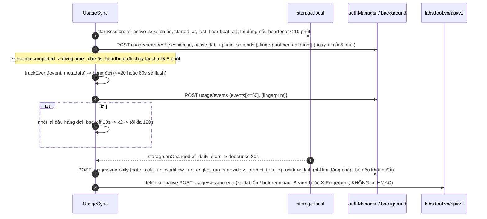

- **Đã đăng nhập** → `authManager._apiCall` (Bearer + HMAC qua background). **Ẩn danh** → `apiRequest` kèm header `X-Fingerprint` và thêm `fingerprint` vào body; fingerprint là `af_fingerprint` (UUID v4, tạo khi chưa có).
- **Thống kê ngày** `af_daily_stats` do `FeatureGate._incrementDailyStat` cộng dồn theo `_date` UTC và `_user_id` (đổi ngày/đổi user thì đặt lại về 0): `flow|chatgpt|gemini|grok _prompt_total`, `…_fail`, `task_run`, `workflow_run`, `angles_run`. Chỉ gửi khi chuỗi JSON thay đổi; 429 → backoff 10 s nhân đôi tối đa 120 s; khoảng cách giữa hai lần thử ≥ 10 s.
- **Danh mục sự kiện** (`EVENT_SCHEMAS`, tên → khoá metadata cho phép; khoá lạ chỉ bị `console.warn`, không bị lọc): `gen_start, gen_complete, task_run_start/complete, workflow_start/complete, workflow_run_start/complete, angles_run, effects_run, chatgpt_run, grok_run, download, login{method}, logout, template_use{template_id}, chat_send{model}, pa_generate{provider}, flow_api_lifecycle` (rất nhiều khoá, phần lớn là băm: `item_hash, attempt_hash, operation_hash, media_hash, project_hash, job_hash` — dữ liệu được băm trước khi gửi). [QS]
- Telemetry **không** nằm trong đường kiểm soát quyền: server dùng `usage/heartbeat`, `events`, `sync-daily` để đo/ghi nhận, còn quota thật nằm ở `execution/*`. [SL]
- **`LocalStorageUsage` không gửi gì lên server.** Nó đo dung lượng IndexedDB cục bộ (`toolflow_provider_web_batches`, `toolflow_gen_batches`, `toolflow_workflow_muse_videos`, `autoflow_pro/workflow_paste_blobs`) theo vùng `batch`/`workflow`/`other` để trang Cài đặt hiển thị và dọn (`clearProviderZone`, `clearOtherProviderRun`), có chặn xoá khi run chưa `SETTLED`, outbox lịch sử chưa xuất bản hoặc lease người dùng còn hiệu lực. Lỗi: `STORAGE_ZONE_RUN_ACTIVE`, `STORAGE_ZONE_HISTORY_PENDING`, `STORAGE_PROVIDER_RUN_ACTIVE`, `STORAGE_PROVIDER_HISTORY_PENDING`.

## 2.13 Bảng message/action, storage key, config key

### Message / action

| Hướng | Tên | Nội dung | Người xử lý |
|---|---|---|---|
| UI → BG | `apiRequest` | `{method, endpoint, data, token, headers, isFormData, formDataFields}` | Proxy API có HMAC; **chặn** `extension-config/*`, `extension-device-key*`, 6 đường cấu hình cũ, và seat mutation từ nơi không được phép |
| UI → BG | `ensureEnrollment` | — | `_ensureEnrollment()` → `{ok}` (chỉ `sender.id === runtime.id`) |
| UI → BG | `FETCH_PROTECTED_CONFIG` | `{operation, provider?, keys?, profileKey?, promptVariant?, revision?, force?}` | `ProtectedConfigClient.envelope` |
| UI → BG | `PROTECTED_CONFIG_STATUS` | — | `{ready, code, retryable, retryAfterMs, httpStatus, scope}`; có thay thế mã bằng lỗi enrollment hoặc `AUTH_REQUIRED` khi phù hợp |
| UI → BG | `CLAIM_PROTECTED_DEVICE` | — | `ProtectedConfigClient.claim()` rồi chạy recovery/thông báo ready |
| UI → BG | `ROTATE_DEVICE_KEY` | — | `rotate()` |
| UI → BG | `REPLACE_DEVICE_IDENTITY` | `{confirmed:true, retryOrphan}` | Chỉ từ `settings.html` |
| UI → BG | `RETRY_PROTECTED_CONFIG` | `{trigger: "manual"\|"online"}` | enroll → (đăng nhập?) claim → `ConfigAccessRecovery.run` |
| UI → BG | `getProviderConfigs`, `getProviderApiConfigs`, `getProviderPrivateConfigs` | `{provider}` | Bọc `envelope("dom"/"api"/"private")` (người gọi kiểm `allowedProviderSender`) |
| CS → BG | `oauth:success` / `oauth:linked` | `{token}` / `{linked}` | Kiểm `sender.tab.url`, lưu `af_auth` |
| BG → mọi nơi | `CONFIG_ACCESS_INVALIDATED` | `{code, retryable, auth_epoch}` | `RequestSigner.invalidateProtected`, `ConfigSnapshotAccess.invalidate`, `ConfigAccessUI.show` |
| BG → mọi nơi | `CONFIG_ACCESS_RECOVERED` | — | `ConfigAccessUI.recovered()`, gỡ overlay lỗi |
| BG → UI | `EXTENSION_NOT_AUTHORIZED`, `DEVICE_BANNED`, `EXTENSION_AUTHORIZED`, `DEVICE_UNBANNED` | — | Overlay clone |
| UI → BG | `EXTENSION_AUTH_RETRY` (và `DEVICE_BAN_RETRY`) | — | `_selfHealProbe` + `_deviceBanRecoveryProbe` |
| BG → UI | `auth:oauthLogin`, `auth:googleLinked` | `{token,user}` | Sidebar cập nhật AuthManager |
| UI → BG | `openLoginSidePanel`, `openSettings{tab?}` | — | Dùng bởi `ConfigAccessUI` |
| SSE → UI | `entitlements_changed`, `plan_activated`, `session_replaced`, `force_logout`, `system_settings_changed`, `sse:connected/disconnected` | — | `FeatureGate`, `RequestSigner`, `ExtensionDeviceManager`, `app.js` |

### Storage key (chrome.storage.local trừ khi ghi khác)

| Key | Nội dung | Ai ghi |
|---|---|---|
| `af_auth` | `{token, user{…}, apiBaseUrl, savedAt}` (plaintext) | AuthManager, background (OAuth), app.js (cập nhật plan) |
| `af_entitlements` | `{entitlements, plan, lastFetch, user_id}` | FeatureGate |
| `af_local_usage` | `{_usage_date, <feature>: n}` — đếm cục bộ khi ẩn danh | FeatureGate |
| `af_daily_stats` | bộ đếm ngày gửi `usage/sync-daily` | FeatureGate, UsageSync |
| `af_fingerprint` | UUID ẩn danh/đăng nhập (header `X-Fingerprint`) | UsageSync |
| `af_active_session` | `{id, started_at, last_heartbeat_at}` | UsageSync |
| `tool_device_fp` | UUID gửi lên `/enroll` | background |
| `tool_client_enrollment` | `{client_id, secret, expires_at, device_fingerprint}` — **secret HMAC plaintext** | background |
| `tool_server_time_offset` | ms lệch giờ (thật: 5142) | background |
| `tool_config_access_scope` | sidecar scope (11 trường, xem 2.4) | ProtectedConfigClient |
| `tool_provider_configs`, `tool_provider_api_configs`, `tool_provider_models`, `af_execution_config`, `_toolConfigsReady`, `tool_provider_dom_selectors`, `af_chatgpt_config`, `af_grok_config` | snapshot có `scope`; ba khoá cuối bị xoá khi quét | ProtectedConfigClient |
| `toolflow_extension_not_authorized`, `toolflow_device_banned` | cờ `{at, reason, ext_id}` | background |
| `af_settings_pending_resync` | bản sao settings trước khi `_clearAuth` | AuthManager |
| `tf_ref` | `{code, expires}` mã giới thiệu | landing → register |
| `chrome.storage.session`: `_toolEnrollmentRetryUntil`, `tool_config_access_recovery`, `_provider_urls_cache` | trạng thái tạm | background |
| IndexedDB `toolflow_device_identity` › store `keys` | bản ghi `current`, `pending_rotation`, `pending_replacement`: `{id, client_id, privateKey(CryptoKey non-extractable), publicKey, public_key_spki, key_id, key_revision, bootstrap, [enrollment, device_fingerprint, request_sent]}` | DeviceKeyStore |

### Config key server liên quan

| Key | Giá trị thật | Dùng ở |
|---|---|---|
| `api_timeout_ms` | 60000 | `ExecutionGate.request` (bắt buộc, không có thì dừng) |
| `email_verification_required` | `false` | Banner verify email |
| `share_require_email_verified` | `true` | Chia sẻ workflow |
| `show_upgrade_ui` / `upgrade_contact_url` | `true` / link Telegram | Hộp thoại từ chối quota |
| `extension_url` | URL Chrome Web Store | Nút trên overlay clone |
| `bridge_min_version` | `1.3.38` | Extension Bridge (ngoài phạm vi) |
| `execution.*` (protected) | 7 nhóm | `ExecutionConfig` |
| SSE `system_settings_changed{section:"security", device_seat_capacity_changed:true}` | — | Thăm dò lại ghế |

## 2.14 Đánh giá mô hình bảo vệ

### Điểm mạnh

1. **Phân tầng rõ.** Tách định danh tài khoản (Bearer), cài đặt (HMAC) và thiết bị (ECDSA); config nhạy cảm đòi cả ba cộng lease ngắn hạn. [QS]
2. **Proof ràng buộc ngữ cảnh rất chặt**: audience, extension id, product, client, key id, revision, version, hash của token, timestamp, nonce, method, path+query, hash body. Một proof không dùng lại được cho request, người dùng hay máy chủ khác; nonce chống replay. [QS]
3. **Khoá ECDSA non-extractable** (`generateKey(..., false, …)`); mọi nhánh kiểm `privateKey.extractable`/`type`. Khoá riêng không đi qua JS. Có quy trình đăng ký bằng challenge, xoay khoá ký bởi hai khoá, thay danh tính có trạng thái phục hồi giữa chừng (`pending_*`, `request_sent`). [QS]
4. **Dữ liệu nhạy cảm không nằm trên đĩa nếu có thể**: `slug flow` và config private của `chatgpt/grok/gemini` chỉ ở RAM (`configs:{}` khi ghi storage; `privateApi()` lấy qua RPC); `scrubPreviousProviderSnapshots` dọn dữ liệu cũ khi nâng cấp. [QS]
5. **Snapshot gắn scope và bị loại ngay khi đổi owner**: token, user, client, key, revision, audience, epoch; đọc hai lần để phát hiện đổi giữa chừng; `invalidate` abort cả request đang bay. Chống "trộn dữ liệu giữa hai tài khoản". [QS]
6. **Quota do server quyết định** bằng `execution_token` có `expires_in`, có `complete/cancel` hoàn trả, có chống token mồ côi khi timeout muộn. Không có đường client cho phép offline (`_fallbackCheck` luôn từ chối). [QS]
7. **Ràng buộc chặt phía client**: audience phải `https` + đúng `/api/v1`; `redirect:"error"`; sender allow-list cho RPC nhạy cảm; whitelist theo extension ID phía server (`REQUEST_REJECTED`); ghế thiết bị theo gói (`extension_device_max`).
8. **Phục hồi có kỷ luật**: single-flight ở mọi nơi, backoff có jitter, tối đa 3 lần, alarm sống qua việc ngủ của service worker, phân loại rõ lỗi vĩnh viễn và tạm thời, không đăng xuất oan khi 429/mạng/`REQUEST_REJECTED`.

### Điểm yếu và giới hạn

1. **Secret HMAC lưu plaintext** trong `chrome.storage.local` (`tool_client_enrollment.secret`); ai có quyền đọc profile hoặc chạy được code trong ngữ cảnh extension lấy được nó. [QS] (cũng ghi ở tài liệu 11).
2. **`/enroll` không xác thực người dùng**: chỉ cần `device_fingerprint` (UUID tự tạo) + `X-Extension-Id` (header tự đặt). Ai biết ID công khai của extension có thể xin `client_id/secret` hợp lệ. [QS code, SL về server] Phần chặn thực sự là whitelist ID phía server và các lớp thiết bị/ghế.
3. **Extension ID không bí mật và có thể dựng lại.** `manifest.json` chứa trường `key`; một bản sao tải thủ công dùng cùng `key` sẽ có cùng ID, nên whitelist theo ID không phân biệt được bản sửa đổi. [QS manifest, SL kết luận]
4. **Chỉ config bảo vệ mới gắn khoá thiết bị.** Các endpoint còn lại (`entitlements`, `execution/*`, `usage/*`, `workflows/*`…) chỉ cần Bearer + HMAC. Một client tự viết có secret HMAC hợp lệ gọi được `execution/request` mà không cần khoá ECDSA. [QS: `prepare()` chỉ gắn proof khi có `record`]
5. **Thực thi diễn ra hoàn toàn trên máy người dùng.** Việc tự động hoá Flow/ChatGPT/Grok/Gemini nằm ở content script chạy trên trình duyệt; `ExecutionGate`, `FeatureGate.canUse` là mã client có thể bị vá để bỏ qua. Cái server thực sự giữ được là: cấu hình bí mật (selector, API config), đồng bộ dữ liệu (workflow/task trên server) và số liệu quota/telemetry. [SL] Do đó mô hình bảo vệ này mạnh ở **bảo vệ config và quản lý tài khoản/thiết bị**, yếu ở **cưỡng chế việc chạy**.
6. **Cache trên đĩa vẫn đọc được bằng DevTools**: `af_entitlements` (sửa được để bật UI), `tool_provider_configs`/`tool_provider_models`/`af_execution_config` (đã có trong dump, tức người dùng đọc được selector DOM). Lease 300 s chỉ hạn chế dữ liệu "private" nằm RAM, không hạn chế bản đã ghi.
7. **Cờ clone chỉ là UI.** Xoá `toolflow_extension_not_authorized` ẩn overlay nhưng không đổi quyết định server; nhưng cũng không có phát hiện nào ngoài danh sách ID/ban. Không có kiểm chứng toàn vẹn mã (hash tệp, chữ ký bundle) hay remote attestation. [QS]
8. **HMAC không phủ query string và các request không có HMAC.** `X-Signature` chỉ phủ `pathname` + body (query chỉ được proof ECDSA phủ). Upload form-data không có chữ ký; `execution/cancel` khi unload, `usage/session-end`, `usage/events` lúc `beforeunload` gửi trực tiếp chỉ với Bearer + `X-Extension-Id`. Hậu quả thực tế nhỏ (hành vi hạ cấp), nhưng tạo bề mặt không đồng nhất. [QS]
9. **Token OAuth đi qua URL** (`?token=`) và `postMessage`/meta tag; lưu plaintext `af_auth`. Không có refresh token tách biệt: token bị lộ vẫn làm mới được (`auth/refresh` dùng chính token đó). [QS]
10. **Fingerprint yếu.** `af_fingerprint` và `tool_device_fp` đều là UUID ngẫu nhiên lưu trong storage → xoá dữ liệu extension là có danh tính mới (nên chống lạm dụng dùng thử bằng fingerprint rất dễ vượt; ghế thiết bị và IP mới là lớp thật). [SL]
11. **Đồng hồ**: dựa vào header `Date` của server để hiệu chỉnh; MITM hoặc proxy sửa `Date` làm lệch chữ ký (tự khắc phục qua `EXPIRED_SIGNATURE`).
12. **Mã chết/không nhất quán**: `RequestSigner.headers` và `background._buildSignatureHeaders` trùng logic; `TrialGate` chỉ là shim; hai mã `OFFLINE_*` chỉ có ở hộp thoại, không thấy nơi phát. Ít rủi ro nhưng dễ lệch nhau khi sửa.

### Điểm đáng học

- Mô hình **"lease + sidecar scope + epoch + owner string"** để không bao giờ phục vụ dữ liệu của phiên cũ: đơn giản, kiểm được, dùng lại được cho extension bất kỳ có config nhạy cảm.
- Tách **claim ghế** khỏi **lấy lease**; có nhật ký phục hồi dạng journal (`pending/blocked/needsClaim/uncertainClaim`) để xử lý trường hợp "gửi claim nhưng không chắc có thành công".
- **Giữ dữ liệu nhạy nhất trong RAM** và chỉ cấp qua RPC có kiểm tra người gọi.
- **Execution token hai pha** (reserve → complete/cancel) với trường hợp phản hồi đến muộn được dọn tự động.

## 2.15 Câu hỏi mở

1. **Server kiểm tra gì với `/enroll`?** Client gửi `device_fingerprint`, `ext_version`, `request_nonce`, `X-Extension-Id`. Giới hạn số enrollment trên IP/tài khoản/fingerprint là bao nhiêu? [?]
2. **Khi nào `client_id` hết hạn?** `expires_at` có trong code nhưng nội dung enrollment thật đã bị che; chu kỳ gia hạn thực tế (và việc gia hạn có thực sự cần device proof, `prepareRenewal`) chưa quan sát được. [?]
3. **`session_replaced`** chỉ ngắt SSE ở client; token cũ có bị server vô hiệu ngay không (nghĩa là mô hình "một phiên SSE một tài khoản" hay "một token một phiên")? Cần xem phản hồi server. [?]
4. **Server có buộc device proof cho `execution/*`?** Client không gắn; nếu server cũng không buộc thì quota chỉ dựa vào HMAC+Bearer. [?]
5. **`OFFLINE_CACHE_STALE`, `OFFLINE_NO_QUOTA_INFO`** có còn được tạo ở nhánh nào không (bản cũ hỗ trợ chạy offline theo cache quota)? Không tìm thấy nơi phát trong 1.3.138. [?]
6. **`PLAN_CONFIGURATION_MISSING`** nằm trong `QUOTA_ERROR_CODES` nhưng `showDeniedDialog` không có nhánh riêng → rơi vào hộp thoại chung. Có chủ ý? [?]
7. **Cách `usage_today` được đặt lại** (múi giờ server hay UTC): client dùng ngày UTC cho `af_daily_stats` và `af_local_usage`, còn server của `usage_today` không quan sát được. [?]
8. **`product_id`** (thật = 1) là gì? Có sản phẩm khác dùng chung hạ tầng (vd. Extension Bridge `heieobedadlfdkppgagnhfakcdapbfka`, không có trên máy) không? [?]
9. **Phần phía server của contract `device-v1`** (kiểm nonce, thời hạn proof, quy tắc `replacement_required`) chỉ suy luận từ mã lỗi client. [SL]
