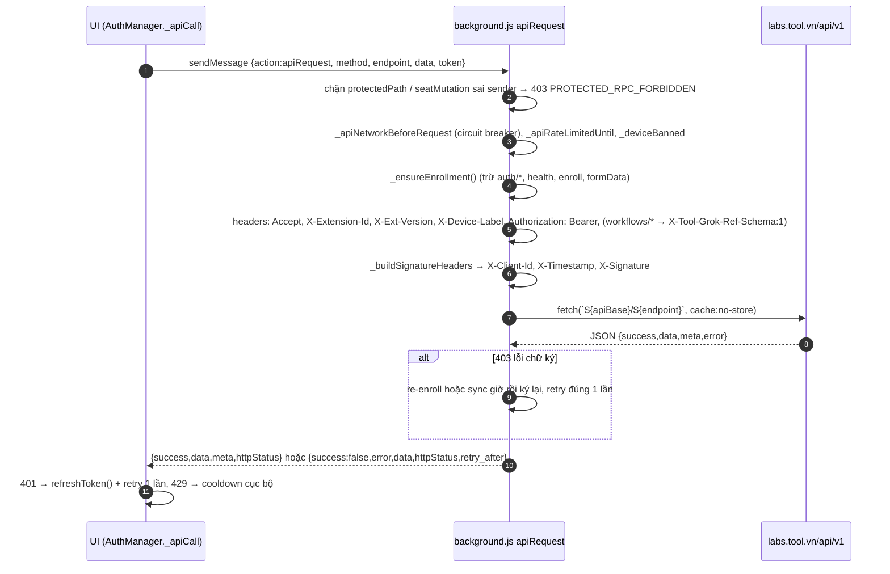
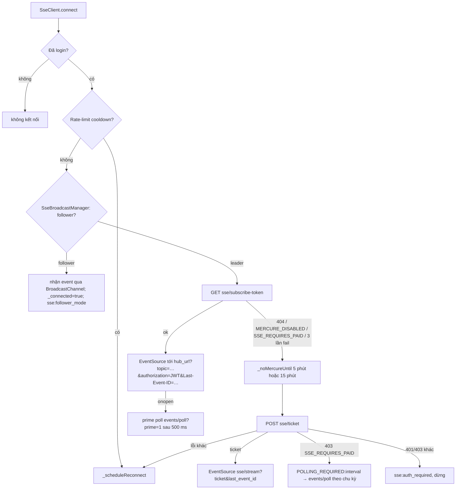
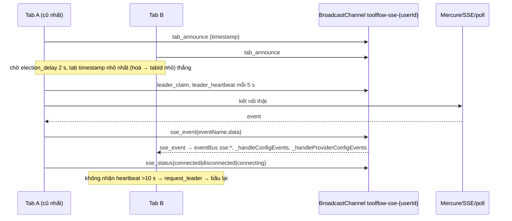
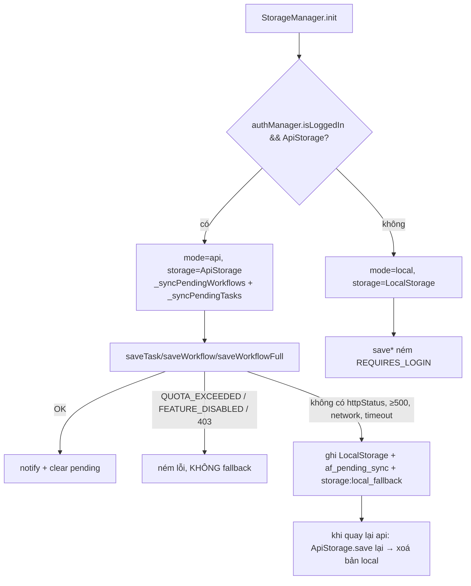
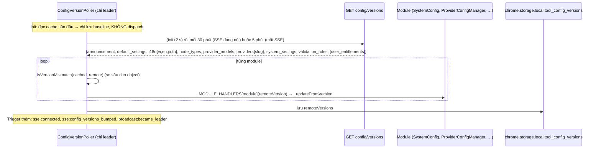

# 3. Backend API, realtime, đồng bộ dữ liệu và config công khai

Tài liệu này mô tả toàn bộ giao tiếp giữa ToolFlow v1.3.138 và backend `https://labs.tool.vn/api/v1`. Phạm vi gồm: catalog endpoint theo domain (gồm cả các endpoint dựng động hoặc gọi `fetch` trực tiếp trong `background.js`), kênh realtime (Mercure, SSE legacy, polling, leader/follower), đồng bộ và lưu trữ (`StorageManager` local/api, coalescer, retry, health), config công khai kèm cơ chế version/cache, suy luận stack backend, và bảng giá/FAQ lấy từ trang công khai của `labs.tool.vn`.

Phương pháp: phân tích tĩnh mã đã bundle (không obfuscate), đối chiếu với dữ liệu `chrome.storage.local` thật của tài khoản Free (`_work/storage/*.json`). Không gọi API nào của Tool; chỉ đọc các trang HTML công khai (`/`, `/upgrade`, `/guide`, `/workflows`, `/prompts`, `/affiliate`, `/terms`, `/privacy`) và gói JS Vite công khai của website. Token, secret, email, IP không được ghi vào tài liệu.

Kết quả kiểm kê: **khoảng 200 cặp method+path (196 dòng trong bảng 3.3, một số dòng gộp 2 method)** (đã chuẩn hoá `${…}` thành `{…}`), nhiều hơn mốc ~115 của báo cáo tổng quan do bổ sung (a) nhóm Motion Studio có sub-resource động, (b) các fetch trực tiếp trong `background.js`, (c) các endpoint chỉ khai báo bằng hằng số (`config/versions`, `location/me`), (d) nhóm `notifications`, `plans`, `projects`, `admin/*`, `creator-templates`, `shared-workflows`.

Nhãn độ tin cậy: **[QS]** quan sát trực tiếp trong code/data · **[SL]** suy luận · **[?]** chưa rõ.

---

## 3.1 Bản đồ file

Đường dẫn tương đối so với thư mục extension `1.3.138_0/`.

| File | Kích thước | Vai trò |
|---|---:|---|
| `background.js` | 521.791 | Service worker. Proxy `apiRequest`, ký HMAC, enrollment, circuit breaker mạng, broker `FETCH_PROTECTED_CONFIG`, các `_signedFetch` trực tiếp |
| `src/core/ApiBaseConfig.js` | 528 | Hằng `DEFAULT = https://labs.tool.vn/api/v1`; `getWebBase()` cắt `/api/vN` |
| `src/core/AuthManager.js` | 19.326 | `_apiCall` (cửa duy nhất UI → background), login/refresh/logout, cooldown 429, tự refresh khi 401 |
| `src/core/RequestSigner.js` | 10.169 | Phía trang: `headers()` ký HMAC cho fetch trực tiếp, `fetchProtected()`, `refreshProtectedPermissions()` |
| `src/core/ProtectedConfigClient.js` | 29.221 | (Chạy trong SW) broker config bảo vệ `device-v1`: `extension-device-key*`, `extension-config/*`, `enroll` |
| `src/core/DeviceKeyStore.js` | 6.338 | Khoá ECDSA P-256 của thiết bị trong IndexedDB `toolflow_device_identity` |
| `src/core/SseClient.js` | 27.606 | Realtime: Mercure → SSE legacy → polling; dispatch event |
| `src/core/SseBroadcastManager.js` | 15.954 | Bầu leader/follower giữa các tab, forward event qua BroadcastChannel |
| `src/core/StorageManager.js` | 27.811 | Facade dữ liệu user (tasks/workflows/nodes/edges), chọn `local` hay `api`, hàng đợi `af_pending_sync` |
| `src/core/ApiStorage.js` | 19.440 | Triển khai REST cho tasks/workflows (retry 2 lần, coalescer) |
| `src/core/LocalStorage.js` | 8.539 | Triển khai `chrome.storage.local` cho tasks/workflows (fallback khi mất mạng) |
| `src/core/StorageMigration.js` | 4.736 | Dọn key cũ/không có scope `device-v1`, dọn field settings lỗi thời |
| `src/core/BackendSync.js` | 3.577 | Đẩy kết quả node/task lên `results/sync` |
| `src/core/RequestCoalescer.js` | 8.848 | Gộp GET trùng giữa các trang (BroadcastChannel, cửa sổ 500 ms) |
| `src/core/RetryHelper.js` | 2.973 | Retry cho thao tác UI (`execute`) và `recoverMediaTextOnly` |
| `src/core/ServerHealthCheck.js` | 2.316 | `GET health`, overlay offline |
| `src/core/SystemConfig.js` | 11.911 | `system-settings/public`, TTL 1 giờ, SSE/storage sync |
| `src/core/ConfigVersionPoller.js` | 7.776 | `GET config/versions`, so version từng module rồi dispatch refresh |
| `src/core/ProviderConfigManager.js` | 30.715 | Config provider (DOM selector, api-config, private-config) qua broker bảo vệ; có fallback URL bootstrap |
| `src/core/ProviderMeta.js` | 6.711 | `GET providers` (danh sách provider công khai) |
| `src/core/ModelRegistry.js` | 9.781 | `provider-models` (bảo vệ), cache 4 giờ |
| `src/core/ModelPresentationRegistry.js` | 3.219 | `provider-models/presentation` (bản trình bày an toàn cho UI) |
| `src/core/ValidationRules.js` | 5.815 | `validation-rules` |
| `src/core/VoiceRegistry.js` | 11.579 | `provider-voices?provider=` |
| `src/core/I18n.js` | 12.697 | `i18n/{locale}`, `default-settings`, `location/me` |
| `src/core/LocationCache.js` | 5.315 | `location/me` (cache 24 giờ, tiền tệ) |
| `src/core/AnnouncementManager.js` | 7.878 | `announcement` + SSE `announcement_changed` |
| `src/core/ExtensionUpdateNotice.js` | 3.958 | So `toolflow_version` (SystemConfig) với version cài đặt |
| `src/core/FeatureGate.js` | 35.359 | `entitlements` + `usage/track`, `_freeDefaults` |
| `src/core/ExecutionGate.js` | 16.086 | `execution/request|complete|cancel|…` (cấp `execution_token`) |
| `src/core/UsageSync.js` | 14.001 | `usage/events|heartbeat|sync-daily|session-end` |

---

## 3.2 Tầng giao vận: mọi request đi qua đâu

### 3.2.1 Ba đường gọi API

| Đường | Dùng bởi | Xác thực | Ghi chú |
|---|---|---|---|
| **A. Proxy `apiRequest`** | Gần như toàn bộ UI (`AuthManager._apiCall`, `ApiStorage._call`, `ExecutionGate`, …) | Bearer (nếu có `token`) + HMAC | Content script/side panel gọi `chrome.runtime.sendMessage({action:"apiRequest",method,endpoint,data,token,headers,isFormData,formDataFields})`; SW đóng vai trò HTTP client duy nhất [QS] |
| **B. `fetch` trực tiếp từ trang** | `SystemConfig`, `ValidationRules`, `I18n`, `AnnouncementManager`, `LocationCache`, `ProviderMeta`, `ModelPresentationRegistry`, `VoiceRegistry`, `ServerHealthCheck` | HMAC từ `RequestSigner.headers()` (+ Bearer ở vài chỗ); `ServerHealthCheck` không gắn gì | Để tránh vòng chờ proxy khi khởi động; header `X-Extension-Id` thêm tay [QS] |
| **C. `_signedFetch` trong SW** | `background.js` (motion, provider-web, templates preview, `auth/web-ticket`, `analytics/selector-failure`, `pa-content-formats`, `entitlements`…) | HMAC (+ Bearer lấy từ `af_auth`) | `_signedFetch` chặn các đường dẫn config bảo vệ và chuyển cho `ProtectedConfigClient.envelope()` thay vì fetch thường [QS] |
| **D. Broker bảo vệ** | `RequestSigner.fetchProtected(op)` → message `FETCH_PROTECTED_CONFIG` | HMAC + Bearer + **device proof** (`X-Tool-Device-*`, ECDSA) | Xem 3.2.4 |

Quy ước nhãn cột Auth trong catalog: **B+H** = Bearer + HMAC qua proxy; **H** = chỉ HMAC (không token); **P** = broker bảo vệ `device-v1`; **D** = device proof cho thao tác "seat"; **—** = không ký.

### 3.2.2 Sơ đồ proxy `apiRequest`

### 3.2.3 Chữ ký HMAC (header `X-Client-Id`, `X-Timestamp`, `X-Signature`) [QS]

- Chuỗi ký: `` `${timestamp}:${METHOD}:${/path}:${sha256hex(body)}` ``, trong đó `path` là `new URL(url).pathname` (có tiền tố `/api/v1/...`), `timestamp = floor((Date.now()+offset)/1000)`.
- Khoá: `enrollment.secret` (HMAC-SHA256, xuất hex). Enrollment lưu ở `tool_client_enrollment` = `{client_id, secret, expires_at, device_fingerprint}`; fingerprint ở `tool_device_fp`.
- `offset` = `Date` header của response − giờ máy; lưu `tool_server_time_offset` (mẫu: 5142 ms), chỉ cập nhật khi lệch > 5 s.
- Enrollment: `POST /enroll` body `{device_fingerprint, ext_version, request_nonce}` → `{client_id, secret, expires_at}`. Có device proof nếu đã có khoá (`prepareRenewal`). 429 ghi `Retry-After` vào `chrome.storage.session` (`_tool…RETRY_KEY`).
- Mã lỗi 403 và cách xử lý (trong proxy):

| Mã | Xử lý |
|---|---|
| `REVOKED_CLIENT`, `EXPIRED_CLIENT`, `INVALID_CLIENT`, `INVALID_SIGNATURE` | re-enroll (cooldown 60 s, chống storm) rồi ký lại, retry 1 lần |
| `MISSING_SIGNATURE` | `_ensureEnrollment()` rồi retry 1 lần |
| `EXPIRED_SIGNATURE` | đồng bộ giờ từ header `Date`, ký lại, retry 1 lần |
| `CLIENT_BANNED`, `DEVICE_BANNED` | `_handleDeviceBanned()`; mọi request sau trả `DEVICE_BANNED` tại chỗ |
| `REQUEST_REJECTED`, `EXTENSION_NOT_AUTHORIZED` | `_handleExtensionAuthRejection()` → invalidate config bảo vệ, `_selfHealProbe` dò `GET entitlements` |

- Request **không** ký: `enroll` (ký riêng), `health`, và mọi request `isFormData` (upload multipart) — các upload này chỉ có Bearer [QS]. `auth/*` vẫn cố ký nhưng không bắt buộc có chữ ký.

### 3.2.4 Config bảo vệ `device-v1` [QS]

`ProtectedConfigClient` (chạy trong SW) ánh xạ "operation" sang đường dẫn `extension-config/<path>`:

| Operation | Đường dẫn thật | Cache key storage |
|---|---|---|
| `dom` | `extension-config/providers/dom-selectors` | `tool_provider_configs` |
| `api` | `extension-config/providers/api-configs` (thêm header `X-Tool-Private-Providers: 1`) | `tool_provider_api_configs` |
| `private` | `extension-config/providers/private-configs` | (RAM; TTL 1 giờ) |
| `models` | `extension-config/provider-models` | `tool_provider_models` |
| `execution` | `extension-config/system-config/execution` | `af_execution_config` |
| `aiTools` | `extension-config/system-config/ai-tools` | — |
| `motionTool` | `extension-config/tools/private-configs` | — |
| `access` | `extension-config/access` | `tool_config_access_scope` |

Quy trình: `extension-device-key` (GET trạng thái) → `extension-device-key/challenge` (POST) → `extension-device-key/register` (POST) → `extension-devices/claim` (POST, giữ "seat") → `extension-config/access` (GET, trả scope). Khi xoay khoá: `extension-device-key/rotate`. Mọi call kèm: Bearer, `X-Client-Id/X-Timestamp/X-Signature`, và `X-Tool-Device-Proof: device-v1`, `X-Tool-Device-Key-Id`, `…-Key-Revision`, `…-Nonce`, `…-Signature` (ECDSA P-256 ký chuỗi nối `\n` gồm `device-v1`, audience, extension id, product_id, client_id, key_id, revision, ext_version, tokenHash, timestamp, nonce, …). Fetch dùng `redirect:"error"`, `cache:"no-store"`, timeout 15 s; GET lỗi 5xx được retry 1 lần sau 2 s; 403 `EXPIRED_SIGNATURE|EXPIRED_DEVICE_PROOF|REPLAY_DETECTED` retry 1 lần [QS].

Proxy `apiRequest` **từ chối** (403 `PROTECTED_RPC_FORBIDDEN`) mọi endpoint bắt đầu bằng `extension-config/`, `extension-device-key`, và các đường dẫn "cũ" `providers/dom-selectors`, `providers/api-configs`, `providers/private-configs`, `provider-models`, `system-config/execution`, `system-config/ai-tools`; thao tác `POST extension-devices/claim` và `PATCH|DELETE extension-devices/{id}` chỉ cho sender được phép (`allowedSender`). Nghĩa là UI không thể tự đọc config bảo vệ, chỉ lấy qua broker [QS].

`tool_config_access_scope` mẫu: `{audience, auth_epoch:76, authorization_ttl_sec:300, contract:"device-v1", key_revision:1, product_id:1, user_id, client_id, key_id, token_hash}` (các trường nhận diện đã che trong dữ liệu mẫu). `StorageMigration.removeUnscopedOperationalConfig` xoá mọi snapshot không có `scope.contract === "device-v1"` [QS].

### 3.2.5 Phong bì response và xử lý lỗi chung

- Envelope chuẩn: `{success:boolean, data, meta?, error?:{code,message,details?,exception?}, errors?}`. Proxy trả lại `{success, data, meta, httpStatus}` hoặc `{success:false, error, data:{...body.data, errors}, httpStatus}`; `AuthManager._apiCall` biến thành `resolve(data)` (hoặc `{data, meta}` khi có `meta`) hoặc `reject(Error)` với `code`, `httpStatus`, `serverData`, `details` [QS].
- `health` trả `{status:"ok"}` (không có `success`) và được coi là ok khi HTTP 200 [QS].
- Body không phải JSON → `PARSE_ERROR`/`HTTP_SERVICE_UNAVAILABLE`/`RATE_LIMITED` kèm thông điệp tiếng Việt, có phân biệt HTML (WAF/Cloudflare-like) [QS].
- **429**: proxy ghi `_apiRateLimitedUntil = now + Retry-After(mặc định 60 s)`; từ lúc đó mọi request không phải `auth/*`/`health` bị từ chối tại chỗ với `RATE_LIMITED`. `AuthManager` có cooldown riêng: non-auth ≤ 30 s (±20% jitter), auth ≤ 120 s; phát `api:rate_limited`. SSE/poll kiểm tra `_rateLimitedUntil` trước khi kết nối [QS].
- **401**: `AuthManager._apiCall` gọi `refreshToken()` (`POST auth/refresh`) rồi gọi lại 1 lần (trừ `auth/login`, `auth/refresh`, `sse/end-session`); thất bại → `_clearAuth()` + phát `auth:logout {reason:"token_expired"}`; cửa sổ popup editor chỉ reject, không logout [QS].
- **Circuit breaker mạng** (SW): ≥3 lỗi mạng trong cửa sổ 30 s → mở mạch, backoff `5 s·2^n` tối đa 30 s; `health` và `auth/*` được phép thăm dò; phát `API_NETWORK_STATE`; khi phục hồi gọi `ConfigAccessRecovery.run("online")` [QS].
- Timeout: bình thường không đặt; riêng `mcp/executor-heartbeat` và `sse/subscribe-token` dùng `af_system_settings.api_timeout_ms` (mẫu 60000) và **fail đóng** (`API_TIMEOUT_CONFIG_UNAVAILABLE` 503) nếu chưa có config [QS].

---

## 3.3 Catalog API theo domain

Mọi đường dẫn tính từ `https://labs.tool.vn/api/v1/`. Cột "Caller" theo dạng `file › hàm`. Nội dung body/response được suy ra từ code client; trường nào chỉ thấy là `data` không rõ cấu trúc ghi [?].

### 3.3.1 Xác thực và tài khoản

| Method | Path | Caller | Body / tham số | Response client dùng | Auth |
|---|---|---|---|---|---|
| POST | `auth/login` | AuthManager › login | `{email,password}`; header `X-Fingerprint` nếu có | `{token,user}` → lưu `af_auth` | H (không bắt buộc ký) |
| POST | `auth/register` | AuthManager › register | `regBody` (name/email/password/ref…), header | `{token,user}` hoặc yêu cầu xác thực email | H |
| POST | `auth/refresh` | AuthManager › refreshToken | không | `{token,user?}` | B+H |
| POST | `auth/logout` | AuthManager › logout; settings-page | không | — | B+H |
| GET | `auth/me` | AuthManager › fetchUser; settings-page; background (fetch thẳng) | — | `user` (có `plan_slug`) | B+H |
| GET | `auth/google/url` | AuthManager › loginWithGoogle | — | URL OAuth | H |
| GET | `auth/google/link-url` | AuthManager › getLinkGoogleUrl; settings-page | — | URL liên kết | B+H |
| POST | `auth/google/link` | AuthManager › linkGoogle | `{google_token}` | — | B+H |
| POST | `auth/google/unlink` | AuthManager › unlinkGoogle | — | — | B+H |
| POST | `auth/forgot-password` | AuthManager › forgotPassword | `{email}` | — | H |
| POST | `auth/resend-verification` | AuthManager › resendVerification | — | — | B+H |
| POST | `auth/resend-verification-public` | AuthManager › resendVerificationByEmail | `{email}` | — | H |
| DELETE | `auth/unverified/account` | AuthManager › deleteUnverifiedAccount | `{email,password}` | — | H |
| PATCH | `auth/unverified/email` | AuthManager › changeUnverifiedEmail | `{email,password,new_email}` | — | H |
| PATCH | `auth/me/preferred-currency` | LocationCache › setPreferredCurrency | `{currency}` | — | B+H |
| POST | `auth/web-ticket` | background (`_signedFetch`) | `{}` | `data.ticket` gắn vào URL mở web `/app/spaces/{wfId}` | B+H |
| GET | `location/me` | LocationCache; I18n › _fetchGeoCountry | — | `{country_code,locale,currency,auto_currency}` | H |
| GET | `access` | RequestSigner › refreshProtectedPermissions → broker (`extension-config/access`) | — | scope, granted | P |

Ghi chú: các trang web có route tương ứng (`/login`, `/register`) dùng Inertia, không đi qua API này.

### 3.3.2 Enrollment, thiết bị, config bảo vệ

| Method | Path | Caller | Body / tham số | Response client dùng | Auth |
|---|---|---|---|---|---|
| POST | `enroll` | background › _doEnrollment | `{device_fingerprint, ext_version, request_nonce}` | `{client_id, secret, expires_at}` | HMAC cũ/ device proof (không Bearer) |
| GET | `extension-device-key` | ProtectedConfigClient | — | trạng thái khoá | P |
| POST | `extension-device-key/challenge` | ProtectedConfigClient | — | challenge | P |
| POST | `extension-device-key/register` | ProtectedConfigClient | khoá công khai + chữ ký | `bootstrap{contract,product_id,…}` | P |
| POST | `extension-device-key/rotate` | ProtectedConfigClient › rotateOnce | khoá mới + `X-Tool-New-Key-Signature` | — | P |
| GET | `extension-config/access` | ProtectedConfigClient | — | `{contract:"device-v1", user_id, client_id, key_id, key_revision, auth_epoch, authorization_ttl_sec}` | P |
| GET | `extension-config/providers/dom-selectors` | broker op `dom` | tuỳ chọn `provider` | `data{slug:{…selectors}}`, `meta.access` | P |
| GET | `extension-config/providers/api-configs` | broker op `api` | — | `data{slug:{config_version,configs,meta,name,status}}` | P |
| GET | `extension-config/providers/private-configs` | broker op `private`; `_signedFetch` (watermark, flow v2) | `?keys=a,b` (ví dụ `watermark_removal,watermark_removal_video`, `flow_api_v2_protocol|models|schema|state_mapping|runtime|error_mapping`) | `data{slug:{configs}}`, `meta.granted[]` | P |
| GET | `extension-config/provider-models` | broker op `models` | — | mảng model (`config` có thể là chuỗi JSON) | P |
| GET | `extension-config/system-config/execution` | ExecutionConfig › _fetchFromServer | — | object config chạy | P |
| GET | `extension-config/system-config/ai-tools` | broker op `aiTools` | — | [?] | P |
| GET | `extension-config/tools/private-configs` | broker op `motionTool` | — | cấu hình Motion Studio | P |
| GET | `extension-devices` | ExtensionDeviceManager; settings-page | — | mảng thiết bị (`current`, `revoked_at`, label) | B+H |
| POST | `extension-devices/claim` | ExtensionDeviceManager › claim | `{}` | `{registered:true…}` | D |
| PATCH | `extension-devices/{id}` | settings-page | `{label}` | — | D |
| DELETE | `extension-devices/{id}` | ExtensionDeviceManager; settings-page | — | `{replacement_registered}` | D |
| POST | `analytics/selector-failure` | background › reportSelectorFailure | `{provider,key,tried_selectors,timestamp}` (fire-and-forget) | — | H |

Lưu ý [QS]: `ExtensionDeviceManager` dùng `GET extension-devices` qua proxy bình thường, còn `claim`/`PATCH`/`DELETE` bắt buộc device proof; `entitlements.extension_device_max` (Free = 1) quyết định số "seat".

### 3.3.3 Config công khai và version

| Method | Path | Caller | Tham số | Response client dùng | Auth |
|---|---|---|---|---|---|
| GET | `health` | ServerHealthCheck; app.js › confirmApiProxyRecovery | — | HTTP 200 / `{status:"ok"}` | — |
| GET | `config/versions` | ConfigVersionPoller | — | map version từng module (xem 3.6) | B+H |
| GET | `system-settings/public` | SystemConfig › _fetchOnce | — | `data{…settings}`, `meta.version` | H + Bearer |
| GET | `default-settings` | I18n; StorageSettings; settings-page | — | `data.language` + mặc định settings user | H |
| GET | `validation-rules` | ValidationRules › _doFetch | — | `data{prompt_max_length,…}`, `meta.version` | H |
| GET | `i18n/{locale}` | I18n › _fetchServerTranslations | `locale ∈ vi,en,ja,th` | `data{flatKey:string}`, `version` | H |
| GET | `providers` | ProviderMeta › fetch | — | `data[{slug,name,status,base_url,icon,sort_order,config_version,updated_at}]` | H |
| GET | `provider-models/presentation` | ModelPresentationRegistry › fetch | — | `data[model…]` (không có `config` bảo vệ) | B+H |
| GET | `provider-voices` | VoiceRegistry | `?provider=slug` | danh sách giọng | H |
| GET | `announcement` | AnnouncementManager › _fetchAnnouncement | — | `data{version,content,short_message,display_mode}` | H |
| GET | `workflow-node-types` | NodeTemplates | — | mảng loại node (port, default, `required_plan`, `required_feature_key`, `version`) | B+H |
| GET | `pa-content-formats` | background (`_signedFetch`, cache 60 s) | — | mảng định dạng Prompt Assistant | H (+Bearer) |
| GET | `angle-presets` | AngleEditor › _loadPresets | — | mảng preset | B+H |
| GET | `image-effects` | EffectsEditor › _fetchEffectsFromAPI | — | mảng effect (có fallback hardcode) | B+H |
| GET | `addon-prompts` | GenTab; TaskModal | — | mảng style prompt (cache `af_addon_prompts`) | B+H |
| GET | `plans` | app.js › fetchPlans; settings-page; editor init | `?extension=flow&include_internal=1` | mảng gói (xem 3.9) | B+H |
| GET | `payment-settings/providers` | app.js › fetchActiveProviders | — | `{providers,labels,behavior}` | B+H |

### 3.3.4 Quota, thực thi, usage

| Method | Path | Caller | Body | Response client dùng | Auth |
|---|---|---|---|---|---|
| GET | `entitlements` | FeatureGate; background | — | `{features, plan}`, `meta.version` | B+H |
| POST | `usage/track` | FeatureGate | `{feature_key,action,quantity}` | — | B+H |
| POST | `usage/events` | UsageSync › flush (lô ≤ 50) | `{events[]}` (+ `fingerprint` nếu chưa login) | ok | B+H |
| POST | `usage/heartbeat` | UsageSync | payload phiên | — | B+H |
| POST | `usage/sync-daily` | UsageSync | thống kê ngày (`af_local_usage`) | — | B+H |
| POST | `usage/session-end` | UsageSync | — | — | B+H |
| POST | `execution/request` | ExecutionGate › request | `{action,prompt_count,metadata}` | `execution_token`, `allowed`, `remaining/limit/used`, `global{…}` | B+H |
| POST | `execution/complete` | ExecutionGate; Motion* | `{token,status,request_nonce[,result_data]}` | — | B+H |
| POST | `execution/cancel` | ExecutionGate › cancel | `{token}` | — | B+H |
| POST | `execution/settlement` | ProviderWebScheduler; Motion | `{token,request_nonce}` | — | B+H |
| POST | `execution/provider-web/reserve` | ProviderWebScheduler; MotionTranscriptReservation | `{run_id,source,provider,media_type,…}` | `reservation{token,…}` | B+H |
| POST | `execution/provider-web/intent` | ProviderWebScheduler; background (`_signedFetch`) | `{run_id,token,item_id,attempt_id,prompt_index,request_nonce[,retry_previous_attempt_id,retry_reason]}` | receipt `success` | B+H |
| POST | `execution/{complete|settlement|provider-web/reserve}` | ProviderWebScheduler › `_api(path,payload)` | payload (timeout 30 s) | như trên | B+H |
| POST | `executions/start` | WorkflowExecutor | `{wf_id,wf_name,total_nodes,executor_context}` | `execution_id` (server) | B+H |
| PATCH | `executions/{id}/heartbeat` | WorkflowExecutor › heartbeatServer | payload tiến độ | — | B+H |
| POST | `executions/{id}/complete` | WorkflowExecutor; background (`onSuspend`) | `{status,summary,completed_nodes}` | — | B+H; bản `onSuspend` là `fetch` trần, `keepalive`, `credentials:include`, chỉ `X-Extension-Id` [QS] |
| POST | `workflows/{wfId}/execute` | WorkflowExecutor | `{settings_override, only_node_ids?}` | kết quả khởi chạy | B+H |
| POST | `history` | GenerationHistory | bản ghi lịch sử | — | B+H |
| POST | `history/provider-web` | ProviderWebScheduler | `{…historyWirePayload,version}` | — | B+H |
| PATCH | `history/{id}/favorite` | GenerationHistory | — | — | B+H |
| DELETE | `history/{id}` | GenerationHistory › deleteRecord | — | — | B+H |
| POST | `results/sync` | BackendSync | `{type:"workflow_node"|"task", node_id|task_id, wf_id, file_ids[], image_urls[], node_name|task_name, media_type}` | — | B+H |
| GET/PUT | `settings` | StorageSettings; settings-page | PUT `{settings_json}` | `settings_json` (bản đã lọc field) | B+H |
| GET | `webhook-settings` | NotificationManager | — | URL webhook | B+H |

### 3.3.5 Dữ liệu user: tasks, workflows, projects, prompts, albums

| Method | Path | Caller | Body / tham số | Response client dùng | Auth |
|---|---|---|---|---|---|
| GET | `tasks` | ApiStorage › getTasks | `?page&per_page&search&project_id` | mảng hoặc `{data,meta}` | B+H |
| POST | `tasks` | ApiStorage › saveTask | `taskData` | task đã lưu | B+H |
| GET | `tasks/{id}` | ApiStorage › getTask | — | task | B+H |
| PUT | `tasks/{id}` | ApiStorage › saveTask | `taskData` | task | B+H |
| PATCH | `tasks/{id}/status` | ApiStorage › updateTaskStatus | `{status,result_file_ids,…}` | — | B+H |
| DELETE | `tasks/{id}` | ApiStorage › deleteTask | — | — | B+H |
| GET | `workflows` | ApiStorage › getWorkflows (+ coalescer) | `?page&per_page&project_id…` | `{data,meta{current_page,last_page}}` | B+H |
| POST | `workflows` | ApiStorage; background (tạo wf `"Workflow mới"`) | `{wf_id,wf_name,…}` | workflow | B+H |
| GET | `workflows/{id}` | ApiStorage › getWorkflow | — | workflow | B+H |
| PUT | `workflows/{id}` | ApiStorage › saveWorkflow | workflow (có thể chỉ `{wf_id,status,…}`) | workflow | B+H |
| DELETE | `workflows/{id}` | ApiStorage › deleteWorkflow | — | — | B+H |
| POST | `workflows/bulk-save` | ApiStorage › saveWorkflowFull | `{…workflow,nodes[],edges[],settings_json,platform:"flow",created_source?,project_id?,project_name?}` | `{wf_id,nodes[]}` (kèm ref thumbnails) | B+H |
| GET | `workflows/{id}/nodes` | ApiStorage › getNodes (`skipCoalesce`) | — | mảng node | B+H |
| POST | `workflows/{id}/nodes` | ApiStorage › saveNode | node (đã `_prepareNodeMediaForPersistence`) | node | B+H |
| PUT | `workflows/{id}/nodes/{nodeId}` | ApiStorage › saveNode | node | node | B+H |
| PATCH | `workflows/{id}/nodes/{nodeId}/status` | ApiStorage › updateNodeStatus | `{status,result…}` | — | B+H |
| DELETE | `workflows/{id}/nodes/{nodeId}` | ApiStorage › deleteNode | — | — | B+H |
| GET | `workflows/{id}/edges` | ApiStorage › getEdges | — | mảng edge | B+H |
| POST | `workflows/{id}/edges` | ApiStorage › saveEdge | edge | edge | B+H |
| DELETE | `workflows/{id}/edges/{edgeId}` | ApiStorage › deleteEdge | — | — | B+H |
| POST | `workflows/{id}/reset` | ApiStorage › resetWorkflow | — | — | B+H |
| POST | `workflows/{id}/shares` | ShareWorkflowModal › _submitShare | `{recipient_email,note}` | share | B+H |
| GET | `workflows/shared-with-me` | WorkflowList | — | mảng workflow được chia sẻ | B+H |
| POST | `workflow-shares/{token|id}/accept` | SharedWorkflowOverlay; NotificationModal | — | — | B+H |
| POST | `workflow-shares/{id}/reject` | SharedWorkflowOverlay; NotificationModal | — | — | B+H |
| POST | `shared-workflows/{wfId}/clone` | WorkflowEditor; WorkflowList; NotificationModal | `{project_id}` | workflow mới | B+H |
| GET | `projects/names` | ProjectHelper › fetchProjectNamesFromApi | — | map `project_id → name` (cache `af_projects`) | B+H |
| POST | `projects/sync` | ProjectHelper › syncCurrentProject | `{project_id,project_name}` | — | B+H |
| GET | `prompts` | UserPromptsManager › loadPrompts | `?page&per_page` | `{data,meta}` | B+H |
| POST | `prompts` | UserPromptsManager › savePrompt | payload | prompt | B+H |
| PUT | `prompts/{id}` | UserPromptsManager | payload | prompt | B+H |
| DELETE | `prompts/{id}` | UserPromptsManager › deletePrompt | — | — | B+H |
| POST | `addon-prompts` | StyleSelectModal | `{name,content}` | style | B+H |
| PUT/DELETE | `addon-prompts/{id}` | StyleSelectModal | `{name,content}` / — | — | B+H |
| POST | `admin/media/upload` | SaveTemplateModal | multipart `{file,type:"ref_image"}` | `data.url` | Bearer (formData, không HMAC) |
| GET | `admin/media/list` | WorkflowMediaModal | `?type&page&per_page=20` | danh sách media thư viện | B+H |

### 3.3.6 Template, cộng đồng, creator

| Method | Path | Caller | Body | Response client dùng | Auth |
|---|---|---|---|---|---|
| GET | `templates/categories` | TemplatesTab | — | mảng danh mục | B+H |
| POST | `templates/{id}/rate` | TemplatesTab | `{rating}` | — | B+H |
| POST | `templates/{id}/use` | TemplatesTab; GenTab › _psmUseTemplate | — | nội dung template (tăng `use_count`) | B+H |
| GET | `workflow-templates/categories` | WorkflowTemplateList; SaveTemplateModal; WorkflowEditor | — | mảng | B+H |
| GET | `workflow-templates/{id}` | WorkflowTemplateList; background (preview `kind:"official"`) | — | template (`_signedFetch`, không Bearer) | H / B+H |
| POST | `workflow-templates/{id}/use` | WorkflowTemplateList | — | — | B+H |
| POST | `workflow-templates/{id}/rate` | WorkflowTemplateList | `{rating}` | — | B+H |
| POST | `workflow-templates/{id}/clone` | WorkflowTemplateList | `{project_id}` | workflow | B+H |
| POST | `admin/workflow-templates` | SaveTemplateModal | templateData | template | B+H (cần quyền admin phía server) |
| GET | `admin/workflow-templates/{id}` | workflow-template-editor-init | — | template | B+H |
| PUT | `admin/workflow-templates/{id}` | WorkflowEditor | templatePayload | template | B+H |
| DELETE | `admin/workflow-templates/{id}` | WorkflowTemplateList | — | — | B+H |
| GET | `creator-templates` | MyTemplatesList | `?page&per_page=20` | `{data,meta}` | B+H |
| POST | `creator-templates` | CreatorTemplatePublish › _submit | templateData | template | B+H |
| PUT | `creator-templates/{id}` | CreatorTemplatePublish › _submitUpdate | data | template | B+H |
| DELETE | `creator-templates/{id}` | MyTemplatesList | — | — | B+H |
| GET | `creator-templates/{id}/edit` | MyTemplatesList | — | dữ liệu sửa | B+H |
| GET | `creator-templates/{id}/preview` | MyTemplatesList | — | bản xem trước | B+H |
| GET | `creator-templates/{id}/public` | background (preview `kind:"creator"`) | — | template công khai | H |
| POST | `creator-templates/{id}/republish` | MyTemplatesList | — | — | B+H |
| POST | `creator-templates/{id}/unpublish` | MyTemplatesList | — | — | B+H |
| POST | `creator-templates/media` | CreatorTemplatePublish › _postMediaWithRetry (tối đa 4 lần) | multipart `{file,type:"ref_image"}` | `data.url` | Bearer (formData) |
| GET | `affiliate/creator-profile` | MyTemplatesList; CreatorTemplatePublish | — | hồ sơ creator/liên kết | B+H |

### 3.3.7 Motion Studio (`tools/motion-studio/projects…`)

Tất cả đều B+H qua `window.authManager._apiCall` hoặc hàm `api(method,path,body)` trong runner, hoặc `_signedFetch` ở background (chỉ GET `projects/{id}`).

| Method | Path | Caller | Body / tham số | Ghi chú |
|---|---|---|---|---|
| GET | `tools/motion-studio/projects` | MotionStudioList | `?per_page=30&page=N`, `?include_deleted=1&per_page=100`, `?per_page=1` | danh sách, phân trang |
| POST | `tools/motion-studio/projects` | MotionBulkCreator; MotionStudioList › create | `{name, flow_project_id, bulk_create_id, item_id, voi…}` | tạo project |
| GET | `tools/motion-studio/projects/quota` | MotionBulkCreator › checkQuota | — | quota (`motion_tool_max`) |
| GET | `tools/motion-studio/projects/batch-snapshot` | MotionRunnerHost | `?flow_project_id=` | snapshot batch |
| GET | `tools/motion-studio/projects/bulk-item` | MotionBulkCreator | `?{query}` | kiểm tra item bulk |
| GET | `tools/motion-studio/projects/{id}` | MotionRunnerRuntime; MotionBatchPreflight; MotionProjectRecovery; MotionStudioList; background | — | project + `revision`, `data_json` |
| PATCH | `tools/motion-studio/projects/{id}` | MotionStudioList | `{revision,name}` | đổi tên (optimistic lock bằng `revision`) |
| DELETE | `tools/motion-studio/projects/{id}` | MotionStudioList › remove | — | xoá mềm (`include_deleted`) |
| PATCH | `…/{id}/batch-enabled` | MotionStudioList | `{revision,batch_enabled}` | bật/tắt batch |
| POST | `…/{id}/finalize` | MotionProjectFinalize | `{revision,source_revision,artifact_revision…}` | chốt |
| POST | `…/{id}/rerun` | MotionStudioList; MotionTranscriptBatchRunner | `{scope:"transcript",revision,source_revision,…}` | chạy lại |
| POST | `…/{id}/reset` | MotionEditor; MotionStudioList | `{revision,reset_id}` | reset |
| PUT | `…/{id}/source` | MotionEditor; MotionProjectSplit | `{revision,source_revision,source{artifact_id,…}}` | gán nguồn |
| PUT | `…/{id}/source-draft` | MotionBulkCreator; MotionProjectSplit | `{revision,draft_id,file_name,mime,…}` | bản nháp nguồn |
| POST | `…/{id}/split-attempt` | MotionEditor; MotionProjectSplit | `{revision,operation_id,draft_id,state,…}` | ghi nhận lần cắt |
| PATCH | `…/{id}/frames/{frameId}/checkpoint` | MotionProjectMonitor; MotionAudioRegenerator; MotionContinuity; MotionEditor | `{source_revision,run_id,input_revision,stage,state,…}` | checkpoint frame |
| POST | `…/{id}/frames/{frameId}/recut` | MotionEditor | `{revision,source_revision}` | cắt lại |
| POST | `…/{id}/frames/{frameId}/rerun` | MotionEditor | `{revision,source_revision}` | chạy lại frame |
| POST | `…/{id}/frames/{frameId}/result` | MotionFrameResultActions | body kết quả | ghi kết quả |
| POST | `…/{id}/frames/{frameId}/source` | MotionEditor | body nguồn | gán nguồn frame |
| PATCH | `…/{id}/frames/{frameId}/transcript` | MotionEditor; MotionSilentTranscript | `{revision,source_revision,run_id,…}` | lưu transcript |
| PATCH | `…/{id}/frames/{frameId}/transcription-failure` | MotionEditor; MotionSequentialTranscript | body lỗi | ghi lỗi transcript |

Đặc điểm [QS]: mọi mutation mang `revision` (khoá lạc quan), `request_nonce`/`reset_id`/`operation_id` (idempotency); khi lỗi, client `GET` lại project (`fresh()`) để hoà giải. `MotionEditor` còn dùng biến `endpoint = "tools/motion-studio/projects/{id}"` nên các path `${endpoint}/…` và `${path}/reset` ở trên đều quy về tiền tố này. Media upload lên R2 dùng `mcp/media/upload-url` (3.3.9).

### 3.3.8 Thông báo, chia sẻ, thanh toán, affiliate

| Method | Path | Caller | Body / tham số | Response client dùng | Auth |
|---|---|---|---|---|---|
| GET | `notifications` | NotificationBell; NotificationPanel | `?page&per_page=50|20` | `{data,meta}` | B+H |
| GET | `notifications/unread-count` | NotificationBell | — | số chưa đọc | B+H |
| POST | `notifications/{id}/read` | NotificationPanel; NotificationModal | — | — | B+H |
| POST | `notifications/mark-all-read` | NotificationPanel | — | — | B+H |
| POST | `orders` | app.js | payload (plan, cycle, currency, coupon, ref…) | order (`id`, link thanh toán) | B+H |
| POST | `orders/upgrade-quote` | app.js › fetchUpgradeQuote | `{plan_id,billing_cycle,currency}` | `{from_plan,…}` giá chênh | B+H |
| GET | `orders` | settings-orders › loadMore | `?{suffix}` phân trang | danh sách đơn | B+H |
| POST | `orders/{id}/checkout` | settings-orders | — | URL/mã QR | B+H |
| POST | `orders/{id}/{kind}` | settings-orders › mutate | `kind` (huỷ/…) [?] | — | B+H |
| GET | `billing/orders/{id}/status` | app.js › checkOrderStatus | — | trạng thái đơn (polling) | B+H |
| POST | `coupons/validate` | app.js | `{code,plan_slug,billing_cycle,currency,is_upgrade}` | giảm giá | B+H |
| GET | `referral/code` | app.js › loadReferralData | — | mã giới thiệu | B+H |
| GET | `referral/stats` | app.js | — | thống kê | B+H |
| GET | `affiliate/dashboard` | app.js | — | tổng quan hoa hồng | B+H |
| POST | `affiliate/apply` | app.js | payload đăng ký | — | B+H |
| POST | `affiliate/payout-method` | app.js | `{payout_method,payout_account}` | — | B+H |
| POST | `affiliate/payout-request` | app.js | `{}` | — | B+H |
| POST | `affiliate/validate-ref` | app.js | `{code}` | `{ok,discount_percent}` | B+H |

### 3.3.9 MCP và Telegram

| Method | Path | Caller | Body | Ghi chú | Auth |
|---|---|---|---|---|---|
| GET | `mcp/tokens` | settings-page; GenTab | — | danh sách token MCP (đã che) | B+H |
| POST | `mcp/tokens` | settings-page › handleMcpCreateToken | `{label}` | trả token một lần | B+H |
| DELETE | `mcp/tokens/{id}` | settings-page › handleMcpRevokeToken | — | — | B+H |
| POST | `mcp/executor-heartbeat` | McpExecutor › _sendExecutorHeartbeat | `{runner_id,label,job_id,stage,…}` | timeout theo `api_timeout_ms` | B+H |
| POST | `mcp/result` | McpExecutor | body kết quả job | trả kết quả lệnh `ai_command` | B+H |
| POST | `mcp/media/upload-url` | McpExecutor › _uploadMediaToR2 | `{ext,content_type}` | trả URL ký sẵn (R2) để PUT | B+H |
| GET | `telegram/link/status` | settings-page; WorkflowEditor | `?bot_type=` | trạng thái liên kết | B+H |
| POST | `telegram/link/generate` | settings-page | `{bot_type}` | mã OTP | B+H |
| POST | `telegram/unlink` | settings-page | — | — | B+H |
| POST | `telegram/custom-bot` | settings-page | `{token}` (token bot của user) | — | B+H |
| POST | `telegram/executor-heartbeat` | TelegramExecutor (45 s/lần) | `{queue_id,stage,context}` | — | B+H |
| POST | `telegram/result` | TelegramExecutor | `{queue_id,status,thumbnails,error_message}` | — | B+H |
| POST | `telegram/notify-completion` | NotificationManager | `{event_type,label,…}` | — | B+H |
| POST | `telegram/send-workflow-images` | WorkflowExecutor | `{chat_id,images,message,send_mode}` | — | B+H |

### 3.3.10 Realtime

| Method | Path | Caller | Tham số | Response client dùng | Auth |
|---|---|---|---|---|---|
| GET | `sse/subscribe-token` | SseClient › _getMercureToken, keepalive 20 phút | — | `{token,hub_url,topics[],expires_in(mặc định 7200)}`; lỗi `MERCURE_DISABLED`/404/`SSE_REQUIRES_PAID` | B+H (timeout theo `api_timeout_ms`) |
| POST | `sse/ticket` | SseClient › _getTicket | — | `{ticket}`; 403 `SSE_REQUIRES_PAID` kèm `fallback_url:"/api/v1/events/poll"`, `fallback_interval_ms` | B+H |
| GET | `sse/stream` | SseClient (EventSource) | `?ticket=…&last_event_id=…` | luồng `text/event-stream` | ticket trong query, không header |
| GET | `events/poll` | SseClient › _pollOnce / _primePollAfterMercureReconnect | `?since=…` hoặc `?prime=1&since=…` | `{events[{id,event,data}], last_event_id}` | B+H |
| POST | `sse/end-session` | SseClient › _endSessionOnServer; AuthManager (khi logout/login mới); background (`fetch` thẳng) | — | — | B+H |
| — | `{hub_url}?topic=…&authorization=<JWT>&Last-Event-ID=…` | SseClient › _connectMercure | `hub_url` do server cấp (không hardcode) | luồng Mercure | JWT trong query |

### 3.3.11 Các endpoint không đi qua `window.authManager` và bị bỏ sót ở bản rà trước

- `config/versions` (hằng `ConfigVersionPoller.ENDPOINT`), `location/me` (hằng `LocationCache.ENDPOINT`).
- `fetch` trực tiếp trong `background.js`: `auth/me`, `sse/end-session`, `executions/{id}/complete` (onSuspend), `entitlements` (self-heal), `auth/web-ticket`, `analytics/selector-failure`, `pa-content-formats`, `workflow-templates/{id}`, `creator-templates/{id}/public`, `workflows` (POST, tạo workflow rỗng trước khi mở web), `execution/provider-web/intent`, `tools/motion-studio/projects/{id}`, `providers/private-configs?keys=…` (đi qua broker).
- Duy nhất `BackendSync._apiCall` fallback (khi không có `authManager`) ghép `api/v1/${endpoint}` vào `apiBaseUrl` đã chứa `/api/v1` → đường dẫn nhân đôi `/api/v1/api/v1/…` [QS] (lỗi tiềm ẩn; nhánh này hầu như không chạy vì `authManager` luôn có).
- Ngoài API Tool: `mcp.labs.tool.vn/mcp` (MCP server, mô tả ở báo cáo tổng quan), `sendWebhook` (URL do user cấu hình, qua `_isAllowedUrl`), tải media từ `flow.google.com/asb/…`; không thuộc phạm vi catalog này.

---

## 3.4 Realtime

### 3.4.1 Sơ đồ chọn kênh

Kết quả với tài khoản Free (dữ liệu thật: `af_entitlements.plan.slug = "free"`): `sse/subscribe-token` và `sse/ticket` đều bị từ chối `SSE_REQUIRES_PAID` → client chuyển sang **polling** `events/poll` (mặc định 30 s, server có thể ép `fallback_interval_ms`) [QS code; kết luận cho Free là [SL] vì không có response thật].

### 3.4.2 Ba chế độ

| Chế độ | Kết nối | last_event_id | Phát hiện chết | Ghi chú |
|---|---|---|---|---|
| `mercure` | `EventSource(hub_url?topic=…&authorization=<JWT>)`; topics lấy từ `subscribe-token` | thêm query `Last-Event-ID` từ `af_sse_last_event_id` | chỉ kiểm tra `readyState === 2` mỗi 10 s | JWT TTL mặc định 7200 s; tái dùng cache nếu còn >15 phút và đã làm mới trong 20 phút; keepalive `GET sse/subscribe-token` mỗi 20 phút để gia hạn phiên; lỗi `onerror` gần hết hạn hoặc rớt <5 s → xoá JWT cache; 3 lần fail chưa từng mở → tắt Mercure 5 phút |
| `sse` (legacy) | `EventSource(/api/v1/sse/stream?ticket=…&last_event_id=…)` | query `last_event_id` | không nhận gì quá `sse_heartbeat_timeout_ms` (45 s) → đóng và reconnect | event `heartbeat` bị bỏ qua nhưng làm mới đồng hồ |
| `polling` (Free) | `GET events/poll?since=<lastEventId>` | `since` | chu kỳ cố định; 401 → `sse:auth_required` | dedupe theo `id` (50 id gần nhất) |

Chung [QS]: `af_sse_last_event_id` ghi ở `chrome.storage.local` mỗi event; `_recentEventIds` (tối đa 50) chống xử lý lặp giữa luồng và prime-poll; sau khi Mercure mở, **prime poll** `events/poll?prime=1&since=` bù các event rơi vào khoảng hở. Chuyển transport khi `plan_activated`/`entitlements_changed` (trễ 2 s): đóng mọi kênh, xoá cache Mercure, kết nối lại (Free → Pro nâng cấp thì lên Mercure).

Backoff reconnect: `delay = min(2 s·2^(n-1), sse_max_delay_ms=30 s) + jitter(0–2 s)`; sau `sse_max_retries=15` lần liên tiếp thì phát `sse:gave_up` và dừng, chỉ thử lại khi tab focus/visible (`forceReconnect`). Kết nối giữ ≥ `sse_stable_threshold_ms=10 s` thì reset bộ đếm. Mọi giá trị đọc từ `SystemConfig.safeGetTimeout` (config server), fallback hằng trong code.

### 3.4.3 Leader/follower (`SseBroadcastManager`)

- Kênh: `toolflow-sse-{userId}`; kiểu message: `tab_announce`, `tab_leave`, `leader_heartbeat`, `leader_claim`, `leader_resign`, `sse_event`, `request_leader`, `sse_status` [QS].
- Tham số từ `SystemConfig` (mẫu): `broadcast_heartbeat_ms=5000`, `broadcast_leader_timeout_ms=10000`, `broadcast_election_delay_ms=2000`.
- Chỉ leader mới `forwardSseEvent`; follower tự phát lại sự kiện cục bộ (`sse:${event}`) và chạy handler cấu hình/provider; handler thông báo (`notification.*`, `workflow.share_*`) có bản sao `_handleForwardedNotificationEvents`.
- **Side panel** (`sidebar.html`) dùng nhánh **storage-based leader**: khoá `sse_leader_{userId}` (giá trị `tab_<ts>_<rand>`) và `sse_leader_heartbeat_{userId}`; hết hạn sau 15 s; heartbeat 5 s; nhảy ngẫu nhiên ≤500 ms trước khi giành quyền, đợi 100 ms rồi đọc lại để xác minh. Dữ liệu thật có cả hai key (`sse_leader_16510`, `sse_leader_heartbeat_16510`) [QS].
- Không có `BroadcastChannel` → coi mình là leader.
- `ConfigVersionPoller`, `AnnouncementManager` polling cũng chỉ chạy trên leader.

### 3.4.4 Danh sách event type và handler

Envelope: Mercure/SSE gửi `data: {"event":"<tên>","data":{…},"id":"<id>"}`; client lấy `payload.event` làm tên, phát `eventBus.emit("sse:<tên>", payload.data)` rồi chạy các handler cấu hình. Poll trả `events[]` cùng dạng `{id,event,data}`.

| Event | Handler | Hành động |
|---|---|---|
| `heartbeat` | SseClient › _handleMessage | bỏ qua (chỉ làm mới đồng hồ) |
| `config_versions_bumped` | ConfigVersionPoller | gọi `checkAndRefresh({trigger:"sse_bumped"})` |
| `system_settings_changed` | app.js; ExecutionConfig; ExtensionDeviceManager | `SystemConfig.handleSseUpdate(data)` (thay cache bằng snapshot trong payload [QS]); nếu `group|section === "execution"` → `ExecutionConfig.refreshAfterSse()` |
| `provider_config_updated`, `config.updated` | SseClient › _handleProviderConfigEvents; ChatGPTAdapter; GrokAdapter | `ProviderConfigManager.handleSseUpdate({type,provider,key,profile})`: `protected_config_invalidated` → refetch dom + api (+private); `dom_selector_created/updated/deleted`, `provider_status_changed` → refetch dom; còn lại → refetch api (+private) |
| `provider_updated` | SseClient; ProviderMeta | `ProviderMeta.handleSseUpdate({provider})` → refetch `providers`, phát `provider:updated` |
| `provider_models_updated` | SseClient; ModelPresentationRegistry | `ModelRegistry.handleSseUpdate` (refetch qua broker) + `ModelPresentationRegistry.fetch(true)` |
| `provider_voices_updated` | SseClient | `VoiceRegistry.handleSseUpdate` |
| `node_types_updated` | SseClient | xoá cache `NodeTemplates._serverTypes`, phát `node_types:refreshed` |
| `pa_content_formats_updated` | SseClient | gửi `pa:invalidateFormats` cho SW (cache 60 s), phát `pa:formats_updated` |
| `validation_rules_updated` | SseClient | `ValidationRules.handleSseUpdate` |
| `default_settings_updated` | SseClient | `storageSettings._loadServerDefaults()`, phát `default_settings:refreshed` |
| `i18n_updated` | SseClient | `I18n.invalidate(locale)` rồi `I18n.reload()` sau 500 ms |
| `entitlements_changed`, `plan_activated` | SseClient; app.js; GenTab; WorkflowTab; MotionStudioList; PromptAssistantModal; ExtensionDeviceManager; RequestSigner | `featureGate.refresh()`, xoá cache creator-eligible, `pa:invalidateFormats`, chuyển transport sau 2 s; `RequestSigner` gọi `refreshProtectedPermissions()`; `plan_activated` thêm overlay (chống hiện lặp theo `af_shown_plan_activated[order_id]`) |
| `announcement` | app.js | `customDialog.alert({title,message,type})` tức thời |
| `announcement_changed` | AnnouncementManager | nếu `version` khác bản đã xem → refetch `announcement` |
| `notification.new` | SseClient | phát `notification:new`; nếu `type==="workflow_shared"` → `notification:show_shared_overlay` |
| `notification.count_updated` | SseClient | `notification:count_updated` |
| `workflow.share_accepted/rejected/revoked` | SseClient | `workflow:share_*` |
| `workflows_updated` | StorageManager; WorkflowTab | `{wf_id,deleted?,reset_node_ids?,reset_run_ids?,deleted_node_ids?,toast?}` → dọn media local, `workflow:remote_reset`, debounce reload danh sách |
| `addon_prompts_updated` | GenTab | xoá `af_addon_prompts`, tải lại |
| `tool_config_updated` | app.js; MotionBulkModal; MotionStudioList | `{tool_key:"motion_studio",revision}` → relay `sseRelay:tool_config_updated` cho SW |
| `ai_command`, `ai_cancel` | McpExecutor | chạy/huỷ lệnh MCP trong browser user; kết quả `POST mcp/result` |
| `telegram_command`, `telegram_cancel`, `telegram_stop` | TelegramExecutor | chạy/huỷ/dừng; kết quả `POST telegram/result` |
| `force_logout` | app.js | relay `sseRelay:force_logout`, ngắt SSE, `authManager.logout(reason)` |
| `session_replaced` | app.js; SseClient | ngắt SSE (bỏ qua nếu đến <3 s sau khi vừa kết nối: event cũ) |

Event nội bộ do client phát (không từ server): `sse:connecting|connected|disconnected|follower_mode|gave_up|heartbeat_timeout|auth_required`, `broadcast:became_leader|became_follower|role_changed`.

---

## 3.5 Đồng bộ và lưu trữ

### 3.5.1 `StorageManager`: hai chế độ

- **Chỉ có hai chế độ:** `local` (chưa đăng nhập; đọc được nhưng `saveTask/saveWorkflow/saveWorkflowFull` ném `REQUIRES_LOGIN`) và `api` (đã đăng nhập). `switchToApi()` đồng bộ hàng đợi rồi xoá bản local; `switchToLocal()` chỉ đổi con trỏ [QS].
- `checkAndPromptMigration` hiện `return` ngay ở đầu (đã tắt): không còn hỏi người dùng đẩy dữ liệu local lên server [QS].
- Hàng đợi `af_pending_sync = {workflows:[{wf_id,updated_at,user_id,created_at,terminal_status,needs_full_sync}], tasks:[{task_id,updated_at,user_id,created_at}]}`; item gắn `user_id`, không đồng bộ sang tài khoản khác. Trạng thái cuối (`paused|completed|error`) chỉ-trạng-thái được đẩy bằng `saveWorkflow({wf_id,status})` sau khi bản đầy đủ lên xong. `QUOTA_EXCEEDED`/403 khi đồng bộ lại → bỏ item (`skipped`), không retry vô hạn.
- `getWorkflow` gộp các lời gọi đồng thời (`_inflightGetWorkflow`); lỗi mạng → `CONNECTION_ERROR` (không đọc local khi đang ở `api`, tránh hiển thị dữ liệu cũ) [QS].
- Dọn dẹp khi xoá: `af_workflow_buffer_{wfId}`, `af_running_workflow`, `_pendingWorkflow`, `WorkflowResultMediaStore`, `PendingUploadStore`, `RequestCoalescer.invalidate("workflows")`, message `workflowDeleted` tới SW; chạy dưới `navigator.locks("af_running_workflow_claim")`.
- Sự kiện SSE `workflows_updated` kích hoạt dọn media/`reset_node_ids` ở các máy khác (realtime đồng bộ giữa thiết bị) [QS].

### 3.5.2 `ApiStorage` và `LocalStorage`

| Thuộc tính | `ApiStorage` | `LocalStorage` |
|---|---|---|
| Nơi lưu | server | `chrome.storage.local`: `af_tasks`, `af_workflows`, `af_nodes`, `af_edges` (+`af_settings`) |
| `_call(method, endpoint, data, retries=2, options)` | lỗi mạng (không `httpStatus`/`network`/`Failed to fetch`/`timeout`) retry với `min(500·2^attempt, 2000)` ms; lỗi auth (401/403/`UNAUTHENTICATED`) phát `api:auth_error` (chống phát lặp 5 s); `QUOTA_EXCEEDED`/`WORKFLOW_QUOTA_EXCEEDED` hiện hộp thoại nâng cấp | không có mạng |
| Phân trang | `page, per_page, search, project_id` → `{data, meta:{current_page,last_page}}` (chuẩn hoá từ mảng) | cùng chữ ký, `current_page:1,last_page:1` |
| `saveWorkflowFull` | 1 request `POST workflows/bulk-save` gồm `nodes`, `edges`, `settings_json` (đổi tên từ `settings`), `platform:"flow"`, `project_name` (lấy từ `af_projects`); log thời gian `[WorkflowSaveTiming]` | ghi 3 mảng |
| Đọc tươi | `getWorkflowDefinitionFresh` gọi nodes+edges với `skipCoalesce:true` | — |
| Invalidate | `RequestCoalescer.invalidate("workflows")` hoặc `workflows/{id}` sau mọi ghi | — |

### 3.5.3 `StorageMigration`, `BackendSync`

- `StorageMigration.run()` (khi khởi động): (1) xoá snapshot config không có `scope.contract==="device-v1"` (`tool_provider_configs`, `tool_provider_api_configs`, `tool_provider_models`, `af_chatgpt_config`, `af_grok_config`; nếu `tool_config_access_scope` không phải `device-v1` thì xoá luôn `af_execution_config`, `_toolConfigsReady`, `tool_provider_dom_selectors`); (2) xoá key cũ `af_validation_rules`; (3) rà `SERVER_SYNCED_KEYS` (`af_daily_stats`, `tool_provider_configs`, `af_execution_config`); (4) gỡ các field settings lỗi thời (`execDelayNodes`, `execMaxRetries`, `execTimeout`, `execOnError`, `delayBetweenPrompts`, `queueBatchSize`, …) [QS]. Lưu ý: `af_validation_rules` vẫn tồn tại trong dữ liệu mẫu vì `ValidationRules._persistToStorage` ghi lại ngay sau [QS, mâu thuẫn nhỏ trong thiết kế].
- `BackendSync` lắng nghe `node:completed` và `task:status_changed (completed)`, giải `file_ids` → URL thumbnail `https://…` (Flow: qua `flow_uuid_gateway.resolve(mode:"web", passive:true)`), rồi `POST results/sync`. Lỗi → `_disabled=true` (tắt vĩnh viễn trong phiên, không retry) [QS]. Mục đích: lịch sử/"kết quả" xem được trên web `labs.tool.vn` [SL].

### 3.5.4 `RequestCoalescer`

Gộp các `GET` trùng giữa các trang extension: kênh `toolflow-request-coalescer`; khoá `METHOD:endpoint:JSON(data)`; cửa sổ dedupe `DEDUP_WINDOW=500 ms`; follower hỏi `leader_ping` (chờ 500 ms) rồi uỷ quyền `api_request` cho leader; leader trả `api_response`; nếu quá `REQUEST_TIMEOUT = api_timeout_ms (fallback 30 s)` thì follower tự gọi trực tiếp. Leader = mọi trang **không** phải popup (`workflow-editor.html`, `angles-editor.html`, `effects-editor.html`, `settings.html`). Bỏ qua coalesce với non-GET, `execution/*`, `auth/*`, hoặc `skipCoalesce`. `invalidate(pattern)` xoá theo `includes` và broadcast `cache_invalidate`; xoá hết khi `auth:login/logout` [QS].

### 3.5.5 `RetryHelper`, `ServerHealthCheck`, retry rải rác

| Thành phần | Hành vi |
|---|---|
| `RetryHelper.execute(fn, opts)` | `maxRetries` từ `workflowExecutor.settings` (mặc định 2), `retryDelay` 3000 ms chia khúc 500 ms để dừng được; `noRetry` ngắt vòng; `shouldStop` ném "Đã dừng bởi người dùng" |
| `RetryHelper.recoverMediaTextOnly` | chỉ khi provider trả mã `code` mà `textOnlyConfirmed`; số lần = `ExecutionConfig.workflow.max_retries` (nếu thiếu → `CONFIG_REQUIRED:exec_max_retries`) |
| `ServerHealthCheck.check` | `GET health` timeout 8 s, cache kết quả 30 s; "reachable" nếu `ok` hoặc 401/403/429; `checkAndBlock()` hiện overlay offline (`toolflow-offline-overlay`) và kết hợp `ConfigAccessUI.serviceUnavailable()` |
| Proxy SW | circuit breaker (3.2.5), 429 toàn cục |
| `ApiStorage._call` | 2 retry |
| `ProtectedConfigClient` | GET 5xx retry 1 lần sau 2 s |
| `ExecutionGate` | timeout settle riêng (`_SETTLEMENT_TIMEOUT`); `execution/request` fail-closed nếu thiếu config timeout (`EXECUTION_CONFIG_UNAVAILABLE`) |
| `UsageSync` | lô 50 event, lỗi → giữ lại buffer, backoff luỹ tiến theo `_eventRetryBackoffMs` |

---

## 3.6 Config công khai, cache và version

### 3.6.1 Sơ đồ làm mới theo version

Dữ liệu thật `tool_config_versions` (Free): `announcement=1793769851608052` (số µs epoch, trùng `af_announcement_seen_version`), `default_settings=68`, `i18n={en:259,ja:220,th:220,vi:242}`, `node_types=73`, `provider_models=111`, `providers={chatgpt:87,flow:273,gemini:34,grok:65,muse:41}`, `system_settings=531`, `validation_rules=7`; **không có** `user_entitlements` (handler tồn tại nhưng server không trả cho tài khoản này) [QS].

### 3.6.2 Bảng chiến lược cache theo module

| Module | Endpoint | Cache (storage key) | TTL / hết hạn | Refresh khi nào | Khi lỗi |
|---|---|---|---|---|---|
| `SystemConfig` | `system-settings/public` | `af_system_settings` (đã bỏ `bridge_download_url`) | RAM 1 giờ; `restoreFromStorage` đặt hết hạn ngay để tải mới | version `system_settings` đổi; SSE `system_settings_changed` (thay snapshot); `storage.onChanged` đồng bộ giữa context; đổi token → xoá cache | giữ cache cũ hoặc `getDefaults()` (google_enabled, show_upgrade_ui, maintenance_mode=false, app_name); thử lại sau 8 s; timeout 8 s |
| `ValidationRules` | `validation-rules` | `af_validation_rules` (bị `StorageMigration` coi là deprecated) | 1 giờ, grace 24 giờ | version `validation_rules`; SSE `validation_rules_updated` | `fetchMandatory()` dùng cache nếu <24 giờ, ngoài ra `ConfigRequiredError` |
| `ProviderMeta` | `providers` | `tool_providers` | RAM 5 phút | SSE `provider_updated`; `init()` đọc storage rồi refetch nền | dùng `_FALLBACK_NAMES/ICONS/ORDER` cứng (flow, chatgpt, grok, gemini) |
| `ProviderConfigManager` (dom/api) | broker `dom`, `api` | `tool_provider_configs`, `tool_provider_api_configs` (kèm `scope`) | 4 giờ, grace 24 giờ; private 1 giờ (RAM) | version `providers{slug}.config_version` lệch; SSE `provider_config_updated`/`config.updated` | URL bootstrap cứng (flow/chatgpt/grok/gemini); `ConfigRequiredError` |
| `ModelRegistry` | broker `models` | `tool_provider_models` (18 model trong mẫu) | 4 giờ, grace 24 giờ | version `provider_models`; SSE `provider_models_updated` | `ConfigRequiredError("models_{provider}_{media}")` |
| `ModelPresentationRegistry` | `provider-models/presentation` | RAM (`_models`) | không TTL | đổi `af_auth`; SSE `provider_models_updated` | ném `MODEL_PRESENTATION_UNAVAILABLE` |
| `ExecutionConfig` | broker `execution` | `af_execution_config` | theo `_cacheTime` [?] | SSE `system_settings_changed{group:"execution"}`; storage bị xoá → `invalidateProtected` | `ConfigRequiredError("execution_config")` |
| `I18n` | `i18n/{locale}` | `tool_i18n_{locale}` = `{data,version,fetchedAt}` (mẫu `vi`: 4.774 khoá, version 242) | cache-first, làm mới nền | version `i18n[locale hiện tại]`; SSE `i18n_updated{locale}` | dùng cache; locale mặc định `vi` |
| `FeatureGate` | `entitlements` | `af_entitlements` = `{entitlements,plan,lastFetch,user_id}` | cache theo user | version `user_entitlements`; SSE `entitlements_changed|plan_activated`; sau login | `_freeDefaults` (chỉ gen cơ bản; flow_api, chatgpt… tắt) |
| `AnnouncementManager` | `announcement` | `af_announcement_seen_version`, `af_announcement_initialized` | poll 30 phút khi tab visible + leader | SSE `announcement_changed` | im lặng (null) |
| `LocationCache` | `location/me` | `af_location` | 24 giờ | `PATCH auth/me/preferred-currency` | [?] |
| `NodeTemplates` | `workflow-node-types` | RAM `_serverTypes` + `_serverTypesFetchedAt` | — | version `node_types`; SSE `node_types_updated` | [?] |
| `default_settings` | `default-settings` | — | — | version `default_settings`; SSE `default_settings_updated` | — |

Quy tắc fail-closed [QS]: các getter timeout/rules ném `ConfigRequiredError(... "cache_empty")` khi chưa có dữ liệu thay vì dùng hằng số cứng; chỉ phiên bản `safeGet*` mới nuốt lỗi. Mục đích: không cho chạy tự động với giá trị đoán mò. Ngoại lệ có fallback: `SseClient` dùng `|| 3e4` khi `safeGetTimeout` trả 0.

### 3.6.3 Nội dung `system-settings/public` (mẫu Free)

Nhóm khoá [QS]: nhận diện (`app_name`, `app_logo_url`, `toolflow_version`, `extension_url`, `privacy_url`, `terms_url`, các URL liên hệ Telegram/Facebook/Zalo, `telegram_shared_bot_username`), bật/tắt (`google_enabled`, `email_verification_required`, `maintenance_mode`/`maintenance_message`, `show_upgrade_ui`, `show_tip_coffee`, `remove_watermark_enabled`, `share_require_email_verified`, `workflow_web_mode`), mạng/realtime (`api_timeout_ms=60000`, `sse_*`, `broadcast_*`), timeout provider (`image_timeout_ms=300000`, `video_timeout_ms=600000`, `chatgpt_timeout_ms`, `video_download_timeout_ms=380000`, `tile_completion_timeout_ms`, `flow_ref_scan_timeout_ms`), giới hạn cache (`history_max_records=100`, `media_registry_max_size=500`, `thumbnail_cache_max_size=200`, `tracker_cache_ttl_hours=4`, `workflow_*_preview_*`, `motion_bulk_staging_ttl_hours=1`), và **định tuyến Flow** (`flow_api_driver="v2"`, `flow_api_v2_enabled`, `flow_api_v2_canary_percent=0`, `flow_api_v2_surfaces`, `flow_api_v2_media_types`, `flow_api_v2_generation_transport="fetch_request"`, `flow_api_v2_upload_enabled`, `flow_api_auto_primary/fallback`, `flow_api_v2_config_revision=1`, `bridge_min_version="1.3.38"`). Khi cụm định tuyến Flow thay đổi, `SystemConfig` phát `flow_api:driver_changed` và `flow_api:upload_changed` để driver chuyển ngay không cần reload [QS].

`toolflow_version` trong mẫu là `1.3.137`, thấp hơn bản cài `1.3.138`: `ExtensionUpdateNotice.isNewer(remote, installed)` trả `false` nên không hiện huy hiệu cập nhật [QS]. Hàm so sánh chỉ nhận chuỗi `^\d{1,5}(\.\d{1,5}){0,3}$`, mỗi phần ≤ 65535 (đúng quy ước version manifest); nút huy hiệu mở hướng dẫn tự cập nhật vì extension cài thủ công/"unpacked" (mở `chrome://extensions/`) [QS].

### 3.6.4 Ngôn ngữ, địa lý, thông báo, validation

- **Chọn locale** (`I18n.init`): tham số → `af_locale` (nếu `af_locale_explicit`) → máy chủ: `location/me` cho `country_code === "VN"` thì `vi`, ngược lại `default-settings.language` (timeout 2 s; cả hai cần enrollment) → ngôn ngữ trình duyệt (nếu thuộc `vi,en,th,ja`) → `vi` [QS]. Các bản dịch trộn dạng khoá phẳng `a.b.c` → cây lồng.
- **Announcement**: lần đầu `init` chỉ ghi `af_announcement_initialized` và version hiện tại (không hiện popup cho người dùng mới); sau đó nếu `version` khác bản đã thấy → `display_mode === "short_message"` hiện banner ngắn, ngược lại mở modal + huy hiệu changelog. Version là số µs epoch (mẫu 1793769851608052) [QS].
- **ValidationRules mẫu**: `prompt_max_length=40000`, `quantity_min=1`, `quantity_max=4`, `workflow_max_run_duration_sec=3600` (giá trị là chuỗi, client `parseInt`) [QS].
- **Providers mẫu** (`GET providers`): flow (`config_version` 273), chatgpt (87), grok (65), gemini (34), muse (41); mỗi provider: `{slug,name,description,base_url,icon,status,sort_order,config_version,updated_at}`; trạng thái `active` điều khiển `ProviderMeta.getActiveProviders()` [QS].

---

## 3.7 Stack backend (suy luận)

| Dấu hiệu | Kết luận |
|---|---|
| `labs.tool.vn/` trả HTML có `data-page="{...}"` với `component:"Website/Home"`, `props.csrf_token`, `version` hash; asset `build/assets/app-<hash>.js|css` | **Laravel + Inertia.js** (React/Vue SPA, build bằng **Vite**) [QS] |
| Trang `/upgrade` truyền `plans`, `paymentMethods`, `location`; `/prompts` truyền `templates` phân trang kiểu Laravel `{current_page,data,…}` | Cùng bộ model/serialization Laravel dùng cho cả web và API [SL] |
| Lỗi "No query results for model…" (Eloquent) và thuộc tính `exception` trong body lỗi (`SERVER_EXCEPTION`) mà client chuyển thành `error.exception` | Laravel (debug-ish exception JSON) [QS] |
| `Retry-After`, `X-RateLimit-Limit/Remaining`, 429 với `data.retry_after` | Laravel rate limiter (`throttle`) [SL]; Free `api_rate_limit_per_minute=3000` trong entitlements |
| `/sse/subscribe-token` trả `{token (JWT), hub_url, topics[], expires_in}`; mã `MERCURE_DISABLED` | **Mercure hub** riêng; Laravel phát hành JWT subscriber theo topic của user [QS] |
| `sse/ticket` + `sse/stream?ticket=` + `last_event_id` + `heartbeat` | SSE tự viết (legacy) trên Laravel, ticket dùng một lần [SL] |
| `events/poll?since|prime` | Bảng event (có id tăng) để poll/bù hụt; nguồn phát cũng là bảng này nên Mercure chỉ là kênh đẩy [SL] |
| Lỗi phân trang `{current_page,last_page}` | `paginate()` của Laravel [QS] |
| Enrollment HMAC + ECDSA device proof, `auth_epoch`, `product_id` | Lớp bảo vệ tuỳ biến (middleware) ở backend; `product_id=1` gợi ý backend đa sản phẩm ("AutoFlow/AutoGrok/ToolFlow") [SL] |
| `mcp.labs.tool.vn/mcp`, R2 upload (`mcp/media/upload-url`), `storage/media/YYYY/MM/uuid.png` | MCP server tách subdomain; media công khai lưu `storage/…` và ảnh tạm trên Cloudflare R2 (tên "R2" xuất hiện trong code) [QS] |
| Thanh toán: `sepay` (QR VN), `lemonsqueezy`; tuỳ chọn `vietqr`, `stripe`, `paypal`, `polar` đang tắt | Cổng thanh toán cấu hình từ `payment-settings/providers` [QS] |
| Phản hồi lỗi có thể là HTML khi 5xx/WAF; client có nhánh `isHtml` | có reverse proxy/WAF phía trước [SL] |
| `Date` header dùng để căn giờ chữ ký | server kiểm tra timestamp (lệch cho phép nhỏ) [SL] |

Hạ tầng suy ra: Laravel (PHP) + MySQL/Postgres (lỗi `DB_QUERY_FAILED` trong `service_reason`) + Mercure + R2 + Cloudflare/Nginx [SL]. Không thể xác định phiên bản framework.

---

## 3.8 Danh mục message, storage key, config key liên quan

### 3.8.1 Message `chrome.runtime`

| Message | Hướng | Mục đích |
|---|---|---|
| `{action:"apiRequest",…}` | UI → SW | proxy HTTP duy nhất |
| `{action:"FETCH_PROTECTED_CONFIG",operation,force,provider?,keys?}` | trang → SW | đọc config bảo vệ |
| `{action:"PROTECTED_CONFIG_STATUS"}` | trang → SW | trạng thái broker (`ready`, `code`) |
| `{action:"ensureEnrollment"}` | trang → SW | đảm bảo có enrollment |
| `{type:"CONFIG_ACCESS_INVALIDATED"}` | SW → trang | xoá cache bảo vệ |
| `{type:"API_NETWORK_STATE",online,…}` | SW → trang | trạng thái circuit breaker |
| `{type:"EXTENSION_AUTHORIZED"}` | SW → trang | self-heal thành công |
| `{action:"pa:invalidateFormats"}` | trang → SW | xoá cache `pa-content-formats` |
| `{action:"sseRelay:force_logout"}`, `{action:"sseRelay:tool_config_updated"}` | trang → SW | chuyển tiếp event SSE cho các context khác |
| `{action:"workflowDeleted",wfId}` | trang → SW | dọn cache nền |

### 3.8.2 Storage key

| Key | Nội dung |
|---|---|
| `af_auth` | `{token,user,apiBaseUrl}` (không ghi lại giá trị) |
| `tool_client_enrollment`, `tool_device_fp`, `tool_server_time_offset` | enrollment HMAC, fingerprint, lệch giờ |
| `tool_config_access_scope`, `_toolConfigsReady` | scope `device-v1` và mốc "config đã sẵn sàng" |
| `tool_config_versions` | version từng module |
| `af_system_settings`, `af_validation_rules`, `tool_providers`, `tool_provider_configs`, `tool_provider_api_configs`, `tool_provider_models`, `af_execution_config`, `tool_i18n_{vi,en,ja,th}` | cache config |
| `af_entitlements`, `af_local_usage`, `af_active_session` | quota/usage/phiên heartbeat |
| `af_sse_last_event_id`, `sse_leader_{uid}`, `sse_leader_heartbeat_{uid}` | realtime |
| `af_pending_sync`, `af_tasks`, `af_workflows`, `af_nodes`, `af_edges`, `af_projects`, `af_addon_prompts` | đồng bộ/dữ liệu local |
| `af_announcement_seen_version`, `af_announcement_initialized`, `af_location`, `af_locale(_explicit)` | UI/khu vực |
| `af_shown_plan_activated` | order đã hiện overlay |

### 3.8.3 Config key (server → client) điều khiển realtime/đồng bộ

`api_timeout_ms`, `sse_heartbeat_timeout_ms`, `sse_max_delay_ms`, `sse_max_retries`, `sse_stable_threshold_ms`, `broadcast_heartbeat_ms`, `broadcast_leader_timeout_ms`, `broadcast_election_delay_ms`, `history_max_records`, `tracker_cache_ttl_hours`, `toolflow_version`, `maintenance_mode`, `maintenance_message`, `bridge_min_version`, `flow_api_*`; `execution.workflow.max_retries`, `execution.queue.*`.

---

## 3.9 Bảng giá gói và FAQ công khai

Nguồn: props Inertia của trang công khai `https://labs.tool.vn/upgrade` (không đăng nhập), đối chiếu với `FeatureGate._freeDefaults` và `af_entitlements.json` thật của tài khoản Free. Thời điểm lấy: 05/11/2026. Không có trang `/pricing`, `/faq`, `/huong-dan`, `/bang-gia` (404); phần "Bảng giá"/"FAQ" của trang chủ là các section trong cùng SPA.

### 3.9.1 Các gói

| Gói (slug) | Thứ hạng nâng cấp | Giá tháng (VND / USD) | Giá năm (VND / USD) | Trọn đời | Nội dung chính |
|---|---:|---|---|---|---|
| **Free** (`free`) | — | 0 | 0 | — | Tài khoản của dữ liệu mẫu: Flow/Gemini/ChatGPT/Grok/Muse có quota ngày nhỏ; xem 3.9.2 |
| **AutoFlow Pro** (`autoflow-pro`, id 4) | 3 | 69.000 ₫ / $3 | 690.000 ₫ / $30 | không | Flow + ChatGPT + Muse: prompt không giới hạn, 100 prompt/batch, Flow Max Speed, tự xoá watermark ảnh Flow; Tasks & Workflow tự động, clone template; Pipeline Queue, Auto Retry, tải 1k/2k/4k. **Không có**: Motion Studio, Grok, Premium Template, MCP, Workflow AI Agent |
| **AutoGrok Pro** (`autogrok-pro`, id 5) | 3 | 59.000 ₫ / $3 | 590.000 ₫ / $30 | không | Grok + ChatGPT: prompt không giới hạn; Flow chỉ theo quota ngày; Tasks & Workflow, Pipeline Queue, Auto Retry, tải 1k/2k/4k. **Không có**: Flow đầy đủ, Motion Studio, Flow Max Speed, Premium Template, MCP, AI Agent |
| **Premium** (`premium`, id 3) | 5 | 89.000 ₫ / $5 | 890.000 ₫ / $50 | không | Flow + ChatGPT + Grok + Muse không giới hạn, 300 prompt/batch, Motion Studio, Flow Max Speed, **MCP** tạo ảnh/video tự động, Workflow AI Agent (ChatGPT/Gemini viết prompt); Workflow & Tasks không giới hạn; Pipeline Queue, Auto Retry, 1k/2k/4k |

Ghi chú [QS]: giá năm đúng bằng 10 × giá tháng (tặng 2 tháng); `available_cycles = ["monthly","yearly"]`; `has_discount=false` (mẫu); đơn vị tiền theo `location.currency` (`price_*` cho VND, `price_usd_*` cho USD). `GET plans?extension=flow&include_internal=1` của client lọc theo `extension_scope ∈ {all, flow, toolflow}` và `is_public===true` hoặc `slug ∈ {free, trial, gói hiện tại}`, nên extension còn biết gói `trial` (không công khai trên web).

Thanh toán [QS]: `paymentMethods = {sepay:true (nhãn "Quét Mã QR"), lemonsqueezy:true (nhãn "Upgrade"), vietqr/stripe/paypal/polar:false}`; luồng `orders` → `orders/{id}/checkout` → poll `billing/orders/{id}/status`; mã giảm giá `coupons/validate`; giá nâng cấp giữa gói tính bằng `orders/upgrade-quote`. SSE `plan_activated` kích hoạt overlay sau thanh toán.

Affiliate (`/affiliate`) [QS]: hoa hồng 10%, giảm giá cho người được giới thiệu 10%, cookie 90 ngày, giữ 1 ngày (`hold_days`), ngưỡng rút tối thiểu 100.000 ₫ hoặc $20, hoa hồng định kỳ bật (`recurring_max=0` = không giới hạn lần).

### 3.9.2 Quyền lợi gói Free (từ `af_entitlements`, 78 khoá)

| Nhóm | Khoá → giá trị |
|---|---|
| Gen/batch | `gen_enabled=1`, `gen_run_max=20/ngày`, `prompts_per_batch=5`, `prompt_submit_max=100`, `gen_batch_queue_max=3`, `history_max=20`, `snippets_max=10` |
| Task/Workflow | `tasks_max=2`, `tasks_run_max=15`, `workflows_max=2`, `workflows_nodes_max=5`, `workflows_run_max=10`, `workflow_execution_history_max=20`; tắt: `workflow_share_enabled`, `workflow_import/export`, `premium_templates` |
| Provider | `chatgpt_run_max=10`, `grok_run_max=10`, `gemini_run_max=15`, `muse_run_max=5`; `ai_agent_enabled=0`, `prompt_enhancer_enabled=0` |
| Nâng cao | `angles_run_max=5`, `effects_run_max=5`, `pipeline_queue_enabled=1`, `image_remove_watermark_enabled=1`; tắt/chưa có: `flow_api_enabled`, `motion_tool_*`, `video_remove_watermark_enabled`, `mcp_*`, `telegram_*`, `grok_telegram_*`, `addon_prompt_enabled=0` |
| Giới hạn | `extension_device_max=1`, `api_rate_limit_per_minute=3000`, `priority_support=false` |

Có hai kiểu khoá: `boolean` và `quota` (`limit`, `remaining`, `used_today`, `usage_today`) [QS].

### 3.9.3 FAQ công khai (từ gói JS của trang chủ, tiếng Việt)

1. **Tool Flow có tặng credit gen miễn phí không?** Không. Lượt tạo dùng quota tài khoản provider của người dùng; gói Tool Flow chỉ quyết định quyền truy cập tính năng và provider trong extension.
2. **Extension có chạy trên Firefox không?** Không. Chỉ Chrome và trình duyệt Chromium (Edge, Brave, Arc, Vivaldi).
3. **Có thể dùng nhiều máy tính không?** Có thể đăng nhập máy khác nếu gói cho phép; dữ liệu tài khoản đồng bộ, còn kết quả batch và ảnh lưu cục bộ vẫn nằm trên máy đã lưu.
4. **Ảnh tạo ra có watermark không?** Phụ thuộc provider, cài đặt tài khoản provider và tuỳ chọn tải xuống.
5. **Nếu provider giới hạn lượt tạo thì sao?** Xem lỗi của prompt và thử lại sau khi hết giới hạn; tránh chạy song song vượt mức tài khoản provider cho phép.
6. **Liên hệ hỗ trợ ở đâu?** Email hỗ trợ (địa chỉ không ghi lại ở đây) hoặc bot Telegram `@toolflow_bot`.

Các trang công khai khác [QS]: `/workflows` (component `Community/Workflows`, danh sách workflow nổi bật + `wfNodeTypes`), `/prompts` (`Community/Prompts`, mẫu prompt có `use_count`, danh mục), `/guide` (`Website/Guide`), `/affiliate`, `/terms`, `/privacy`, `/login`, `/register`. Trang chủ có hero demo, `featuredWorkflows` (12), `wfNodeTypes` (13), `wfProviderConfig` (models, ratios, apiConfig, voices, grokModes, `prompt_max_length=40000`, `remove_watermark_enabled`) — tức web đọc cùng bộ config với extension nhưng bản công khai. Tuyên bố trên trang chủ: "ToolFlow không tự tạo ảnh/video; đây là công cụ tự động hoá mọi thao tác trên các nền tảng AI bạn đã dùng".

---

## 3.10 Điểm đáng học / Điểm yếu

**Đáng học**
- Một cửa HTTP duy nhất trong service worker: tập trung ký, enrollment, circuit breaker, đồng hồ lệch, 429 toàn cục; UI không giữ bí mật ký.
- Config chia hai tầng: công khai (header HMAC) và bảo vệ (`device-v1` + khoá ECDSA không xuất được, scope gắn `user/client/key/auth_epoch`); proxy cấm UI gọi thẳng config bảo vệ.
- Cập nhật config theo **version map** + SSE đẩy; poll chỉ là lưới an toàn (30 phút khi SSE khoẻ, 5 phút khi mất), baseline lần đầu không dispatch → không bão refetch khi cài mới.
- Realtime có hạ cấp mềm: Mercure → SSE → poll, `last_event_id` + dedupe 50 id + prime poll bù hụt, jitter backoff, tự dừng sau 15 lần và hồi phục khi focus.
- Leader/follower hai lớp (BroadcastChannel; fallback storage cho side panel) giúp mỗi user chỉ 1 kết nối realtime, giảm tải server và đụng hạn mức SSE.
- Ghi dữ liệu có đường lùi: `local` fallback + `af_pending_sync` theo `user_id` + phân biệt lỗi quota (không fallback) với lỗi mạng.
- Idempotency/optimistic lock trong Motion Studio (`revision`, `request_nonce`, `operation_id`).

**Điểm yếu / rủi ro**
- Bản `onSuspend` của `executions/{id}/complete` dùng `fetch` trần (`credentials:include`, chỉ `X-Extension-Id`): không Bearer/HMAC nên hầu như chắc chắn bị server từ chối → execution treo [SL].
- `BackendSync._apiCall` fallback ghép `api/v1/` vào base đã có `/api/v1` (đường dẫn nhân đôi); `_disabled=true` sau lỗi đầu tiên tắt đồng bộ kết quả vĩnh viễn trong phiên, dễ mất lịch sử web [QS].
- `StorageManager.checkAndPromptMigration` bị vô hiệu hoá bằng `return` sớm: dữ liệu local chưa đăng nhập không được đề xuất đẩy lên [QS].
- `ValidationRules` vừa ghi `af_validation_rules` vừa được `StorageMigration` liệt kê là key deprecated: thiết kế không nhất quán (dữ liệu mẫu vẫn còn key) [QS].
- Upload multipart (`admin/media/upload`, `creator-templates/media`) không ký HMAC, chỉ Bearer; nếu backend bắt chữ ký bắt buộc thì phải miễn riêng route [SL].
- Mercure: JWT truyền ở query `authorization=` (có thể lộ trong log hub/proxy) và `Last-Event-ID` ở query thay vì header; `hub_url` do server quyết định nên extension tin hoàn toàn vào backend [QS].
- Phụ thuộc server để chạy: nhiều getter fail-closed (`ConfigRequiredError`) nên mất mạng hoặc server lỗi > grace 24 giờ là extension không chạy tự động; có overlay offline/`maintenance_mode` làm cơ chế chặn tập trung.
- Free không có realtime thật (polling 30 s): `ai_command`/Telegram không dùng được — thực tế bị chặn bằng entitlement `mcp_enabled`/`telegram_enabled=0` [SL].
- `plans` kèm `include_internal=1` cho thấy extension lấy được cả gói nội bộ; việc lọc `is_public` làm ở client [QS].

---

## 3.11 Câu hỏi mở

1. Cấu trúc đầy đủ của `GET config/versions` ngoài các khoá đã thấy; khi nào server phát `user_entitlements` và `config_versions_bumped` (payload gì)? [?]
2. Payload thật của `sse/subscribe-token` (`topics` là gì: `user.{id}`, `global`, `provider.{slug}`?) và định dạng topic Mercure; JWT có claim `mercure.subscribe` theo topic nào? [?]
3. `events/poll` phân biệt `prime=1` với `since` thế nào (prime có trả event cũ vượt `last_event_id` không)? [?]
4. `POST orders/{id}/{kind}` có những `kind` nào (cancel/expire/pay-again)? [?]
5. `ExecutionConfig` có TTL cache hay chỉ làm mới theo SSE/storage? [?]
6. Server có chấp nhận request `onSuspend` thiếu chữ ký không (khả năng treo execution)? [?]
7. `access` (`GET extension-config/access`) còn trả những trường nào ngoài scope (granted keys theo gói)? [?]
8. Các giá trị `display_mode` hợp lệ của `announcement` (ngoài `short_message`)? [?]
9. Bridge extension (`heieobedadlfdkppgagnhfakcdapbfka`) có gọi thêm endpoint nào khác (private config `flow_api_v2_*` RPC) — không có trên máy nên chưa đối chiếu. [?]
