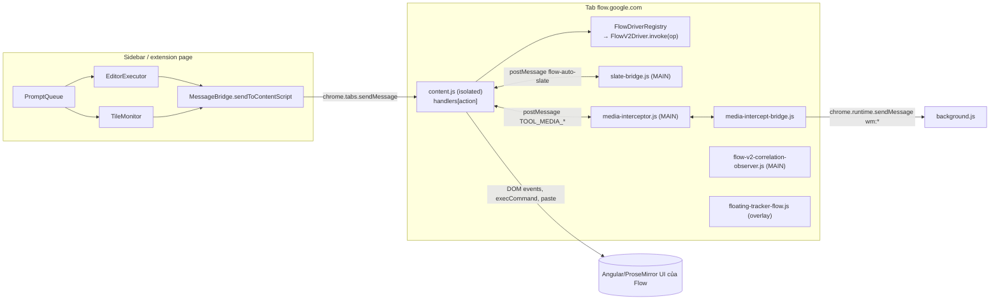
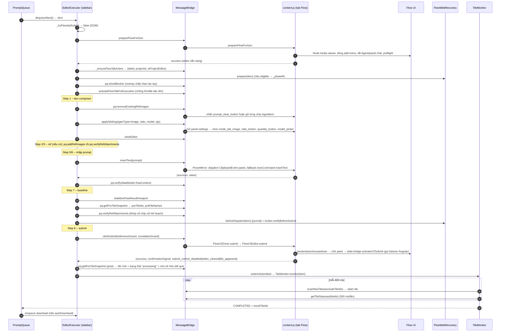
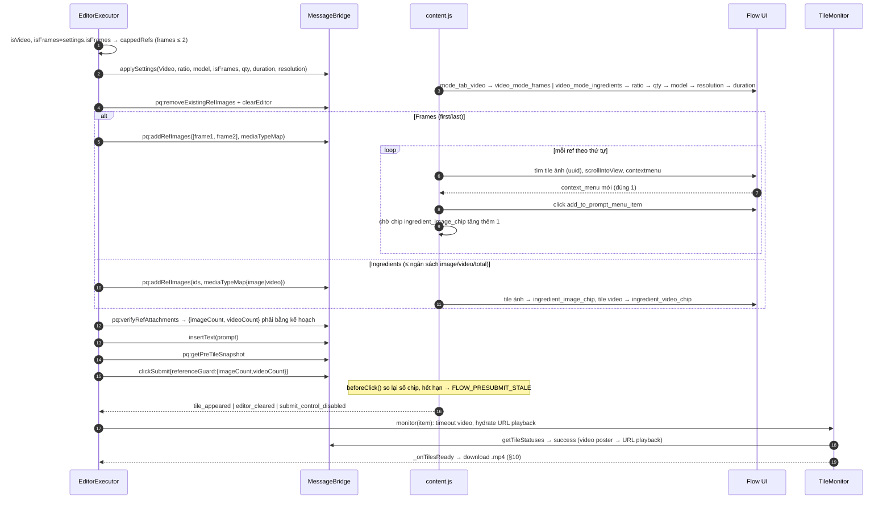
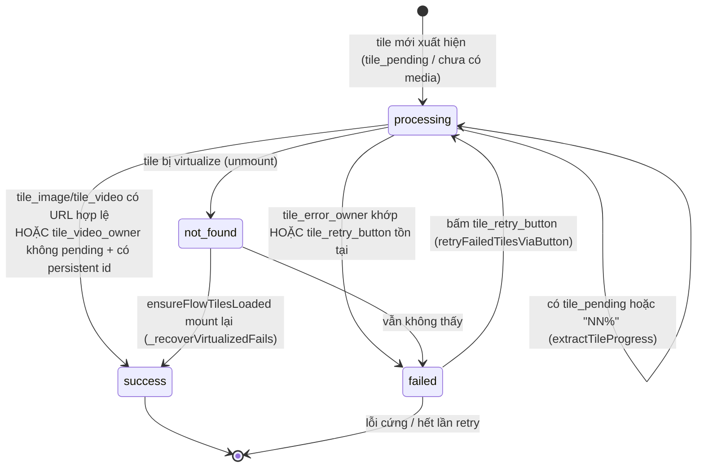
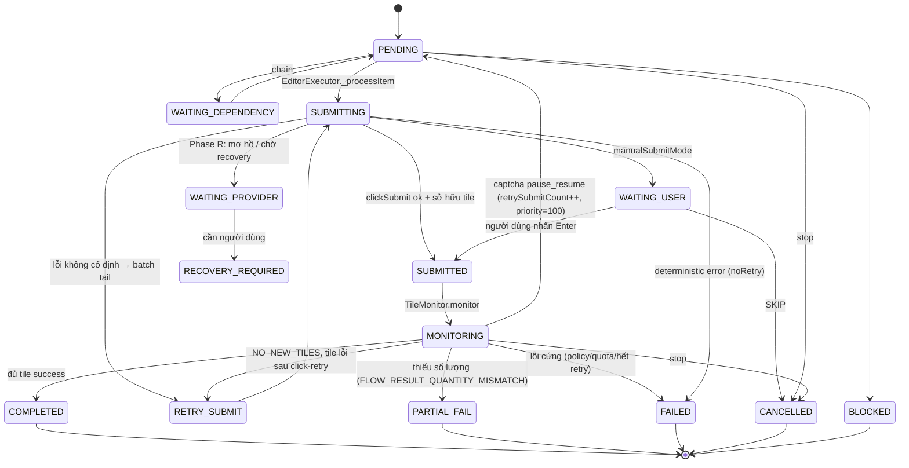
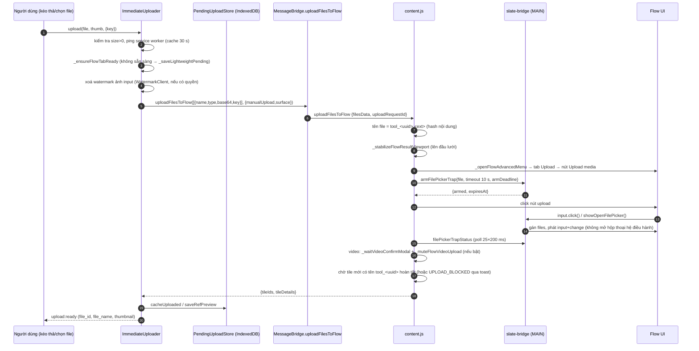
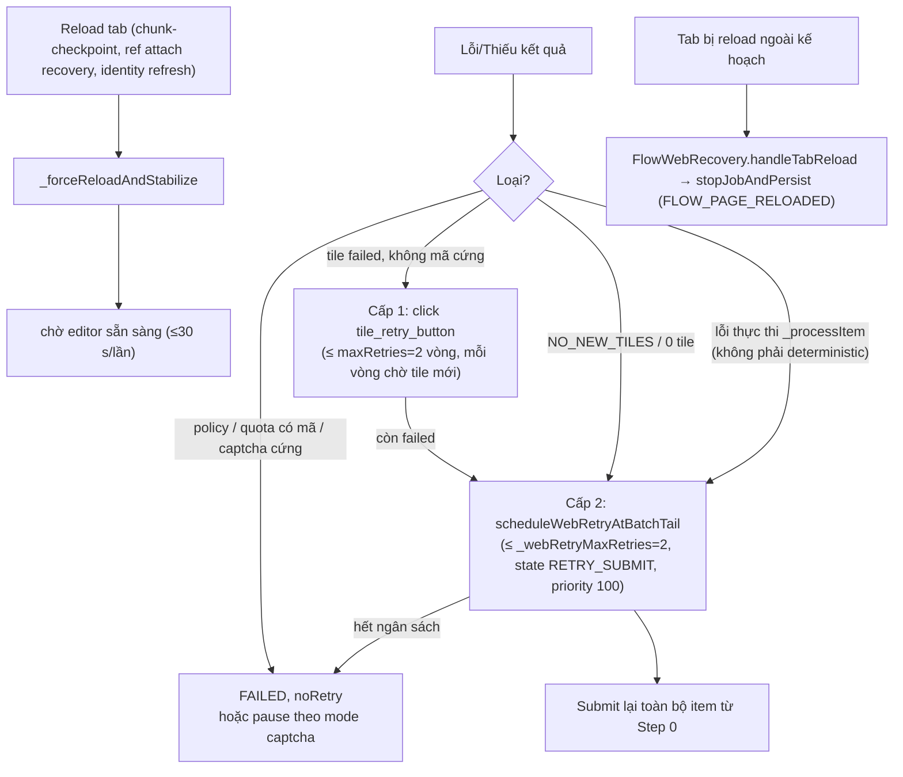
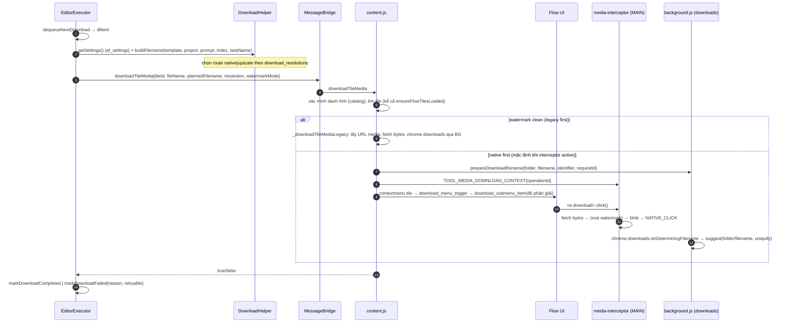

# 4. Google Flow qua DOM (chế độ v1)

> **Cập nhật runtime 05/11/2026:** [chương 16](16-flow-gpt-runtime-findings.md) đã thu được **82 selector Flow hiện tại**, config transport/correlation và **11 nhóm private config ChatGPT** trên gói Free. Các câu bên dưới nói chúng chưa quan sát được là giới hạn của lượt phân tích trước, không còn là blocker hiện tại. Phần giao thức **Max Speed + mã Bridge** vẫn chưa thu được. Lượt đào sâu mới chỉ tập trung Flow và ChatGPT.

ToolFlow điều khiển giao diện web `flow.google.com` bằng content script: gõ prompt vào editor, chọn model/tỉ lệ/số lượng, gắn ảnh tham chiếu bằng menu chuột phải, bấm nút Generate, theo dõi các "tile" kết quả trong lưới rồi tải về qua menu Download của Flow. Toàn bộ selector, tên icon, chuỗi lỗi đều **do server cấp** (key `tool_provider_configs.data.flow.profiles.v2.selectors` và `tool_provider_api_configs.data.flow.configs.*`). Extension chỉ chứa logic.

Hai điểm gây hiểu nhầm cần nói trước:

- **"v1 = DOM" là cách gọi trong tài liệu này**, đối lập với chế độ API (Bridge, RPC nội bộ, "Max Speed"). Trong code, chữ `v2` ở `FlowV2Driver`, `flow_v2`, `profiles.v2` là **phiên bản giao diện Flow mới** (route `/project/<uuid>`), **không phải** API v2. Driver `flow_legacy` (UI Flow cũ) bị chặn cứng: `FLOW_LEGACY_GENERATION_DISABLED` [QS].
- **Đường DOM được điều phối ở extension page (sidebar), không phải ở content script.** `EditorExecutor`/`TileMonitor`/`PromptQueue` chạy trong sidebar, gửi từng lệnh nhỏ (`pq:addRefImages`, `clickSubmit`, `scanNewTiles`…) tới `content.js` qua `chrome.tabs.sendMessage`. `content.js` chỉ thực thi và trả kết quả [QS].

Ghi chú về nguồn: mọi đường dẫn tính từ thư mục extension `1.3.138_0/`. Offset `@n` là vị trí ký tự trong file đã bundle (một dòng rất dài).

---

## 1. Bản đồ file

| file | kích thước | vai trò |
|---|---:|---|
| `content.js` | 619 KB | Content script chính trên `flow.google.com`: message handler (~130 action), đọc selector từ config, gõ prompt, settings, ref, submit, quét tile, tải file, phát hiện lỗi/captcha, homepage/project |
| `src/core/flow/FlowPageDriver.js` | 2.8 KB | Lớp cơ sở driver: whitelist 19 operation, chặn `flow_legacy`, bắt buộc đang ở editor của project |
| `src/core/flow/FlowDriverRegistry.js` | 2.9 KB | Phân tích URL Flow (`/u/<n>/`, locale, `/project/<uuid>`), chọn driver, kiểm tra "đang ở editor" |
| `src/core/flow/drivers/FlowV2Driver.js` | 6.6 KB | Driver duy nhất còn dùng. Gom các adapter nhỏ ở `v2/*` vào hàm toàn cục của `content.js` |
| `src/core/flow/drivers/v2/FlowV2Editor.js` | 8.5 KB | Xoá/chèn text, **submit có xác nhận** (3 tín hiệu), fallback Enter |
| `…/v2/FlowV2TileResolver.js`, `…ComponentPicker.js`, `…GenerationSettings.js`, `…PageSettings.js`, `…MediaMenu.js` | 0.3–1.1 KB | Vỏ mỏng, ủy quyền cho hàm trong `content.js` |
| `slate-bridge.js` | 13 KB | Chạy ở **MAIN world**: giữ registry listener click, kích hoạt nút Submit của Angular, bẫy file picker khi upload, focus editor |
| `media-interceptor.js` | 15.7 KB | MAIN world: hook `window.fetch`, `HTMLElement.prototype.click`, `<a download>` để tráo byte bằng bản đã xoá watermark |
| `media-intercept-bridge.js` | 8.6 KB | Isolated world: cầu nối `postMessage` ↔ `chrome.runtime` cho interceptor (xin cấu hình, gọi `wm:*`) |
| `flow-v2-correlation-observer.js` | 68 KB | MAIN world: hook fetch/XHR để bắt biên nhận request generate (ngoài phạm vi, chỉ nhắc ở §9) |
| `floating-tracker-flow.js` | 436 KB | Overlay "tracker" nổi trên trang Flow: tiến độ, lưới kết quả, pause/stop, tải hàng loạt, lịch sử theo project |
| `src/core/TrackerRegenProjection.js` | 5.7 KB | Gộp job regen vào job gốc để tracker hiển thị đúng |
| `src/core/FlowObserverConfigRelay.js` | 1.5 KB | Đọc `tool_provider_api_configs` rồi phát sự kiện `TOOL_FLOW_OBSERVER_TRANSPORT`, `TOOL_FLOW_NATIVE_MEDIA_SCHEMA` cho observer MAIN world |
| `src/core/EditorExecutor.js` | 148 KB | Vòng lặp gửi prompt: định tuyến API/DOM, 8 bước cho mỗi prompt, pacing, tải file |
| `src/core/TileMonitor.js` | 71 KB | Theo dõi kết quả, "claim" tile, phân loại lỗi, bấm Retry |
| `src/core/TileResolver.js`, `TileCache.js` | 7.5 KB, 2 KB | Ánh xạ id ảnh ref (`file_id`, `file_name`, thumbnail) → tile đang mount; cache có rate-limit quét 1 s |
| `src/core/FileUploader.js` | 42 KB | Đọc file local, base64, chia khối; dùng chung bởi tab Gen |
| `src/core/ImmediateUploader.js` | 23 KB | Upload ngay khi người dùng thả ảnh, hàng đợi tuần tự, xoá watermark ảnh input trước khi upload |
| `src/core/PendingUploadStore.js` | 22 KB | IndexedDB `autoflow_pro` (5 store) lưu file chờ upload, cache đã upload, preview ref |
| `src/core/FlowWebRecovery.js` | 65 KB | "Phase R": sổ nhật ký (journal) mỗi prompt chạy DOM; phục hồi khi tab reload, giữ captcha, retry có ngân sách |
| `src/shared/FlowCookieRecovery.js` | 8.7 KB | UI xoá cookie Flow rồi reload. **Chỉ cho chế độ API** (cần Bridge), xem §8.4 |
| `src/shared/ProjectHelper.js` | 25 KB | Xác minh project hiện tại trước khi "Run All" (`getFlowProjectContext`) |
| `src/core/FlowBridgeStatusDot.js` | 4.8 KB | Chấm trạng thái Bridge/API trên sidebar. Ẩn khi người dùng không bật API |
| `src/core/providers/FlowAdapter.js` | 6.4 KB | Adapter provider `flow`: năng lực model (số ref tối đa, hỗ trợ frames…), `submit()` vào `PromptQueue` |
| `src/core/MessageBridge.js` (phụ) | 125 KB | Đường gửi lệnh sidebar → tab Flow: chọn tab, ghim target, timeout ack, tự inject lại content script |
| `src/core/PromptQueue.js` (phụ) | 272 KB | Hàng đợi/job, chunk reload, retry cuối batch (chỉ đọc phần liên quan) |
| `src/shared/DownloadHelper.js` (phụ) | 59 KB | Đặt tên file, thư mục, chọn độ phân giải, tải qua Flow menu |

---

## 2. Cấu hình điều khiển DOM (tìm thấy / không tìm thấy)

### 2.1 Selector của Flow: **không có** trong storage đã dump

| kiểm tra | kết quả |
|---|---|
| `tool_provider_configs.json` → `data` | chỉ có `chatgpt`, `gemini`, `grok`, `muse` **[QS]** |
| `tool_provider_api_configs.json` → `data` | cũng chỉ 4 provider đó, không có `flow` **[QS]** |
| `tool_config_versions.json` → `providers` | `flow: 273` (có tồn tại ở server) **[QS]** |
| `tool_providers.json` | liệt kê `flow` (config_version 273, base_url `https://flow.google.com`) **[QS]** |
| `af_execution_config.json`, `af_system_settings.json` | **có** các khối `flow_api`, `flow_recovery`, `queue`, `timing`… (xem §8.5) **[QS]** |

Kết luận: selector DOM của Flow tồn tại ở server nhưng **không nằm trong bản dump này**. Lý do chưa rõ **[?]**; hai giả thuyết **[SL]**: (a) lúc dump, snapshot Flow chưa được broker nạp (đang ở trạng thái `FLOW_V2_CONFIG_MISSING`); (b) server không trả Flow cho tài khoản/thiết bị này. Hệ quả thực tế **[SL]**: với đúng storage này, content script sẽ thấy `_getFlowProfileSelectors()` = `null`, handler trả `FLOW_V2_CONFIG_MISSING`/`CONFIG_ACCESS_REQUIRED` và **không điều khiển được trang**. Vì vậy các tên key dưới đây suy ra **từ code đọc config**, không phải từ giá trị thật; **không có chuỗi selector CSS nào được biết**.

### 2.2 Đường đọc config trong `content.js`

```js
// content.js @58843  _getFlowProfileSelectors2
var flow=_selectorConfig?.flow; if(!flow||location.origin!=="https://flow.google.com")return null;
var profile=flow.profiles?.v2; if(!profile||!profile.host_patterns.includes(location.origin))return null;
return profile.selectors||null
```

- `_getDynamicSelector(key)` → `profiles.v2.selectors[key]`, cache 30 s (`_SELECTOR_CACHE_TTL = 3e4`). Mỗi entry là object, không phải chuỗi: `{selectors:[…], icon_text, button_text, attribute, …}`.
- Tiện ích truy vấn: `_q`/`_qa` (nối `selectors` bằng `", "`), `_v2QueryConfigured` (thử lần lượt từng selector), `_v2QueryVisibleConfigured` (lấy phần tử **hiển thị, mới nhất**), `_v2FindSemanticControl` (lọc thêm theo `icon_text`: tên glyph Material Icons).
- Nguồn dữ liệu: `ConfigSnapshotAccess.read(["tool_provider_configs"])`, nghe `chrome.storage.onChanged`; nếu thiếu thì `chrome.runtime.sendMessage({action:"getProviderConfigs"|"getProviderApiConfigs", provider:"flow"})`. Chờ tối đa `_SELECTOR_WAIT_MAX_MS = 10 s`, poll 200 ms.
- Cổng bật/tắt từ xa: `tool_provider_api_configs.data.flow.configs.flow_v2_driver = {enabled, messages{vi,…}}`. `enabled:false` → hiện overlay lỗi cấu hình (`_showConfigErrorOverlay`), mọi action sinh ảnh bị từ chối `FLOW_V2_DISABLED`.

### 2.3 Key selector Flow được code đọc (95 key)

Gom theo nhóm chức năng. Mỗi key là một object cấu hình, **[QS]** tên key; **[?]** giá trị.

| nhóm | key |
|---|---|
| Editor / submit | `slate_editor`, `submit_button`, `prompt_clear_button`, `flow_credit_limit_alert`, `mention_inline_chip` |
| Cài đặt sinh (panel) | `settings_button`, `settings_panel_candidates`, `settings_panel_marker`, `mode_tab_image`, `mode_tab_video`, `video_mode_frames`, `video_mode_ingredients`, `ratio_button`, `quantity_button`, `video_duration_tab`, `video_resolution_tab`, `model_picker_button`, `model_picker_panel`, `model_picker_item` |
| Ref / ingredient | `ingredient_bar`, `ingredient_image_chip`, `ingredient_video_chip`, `ingredient_voice_chip`, `ingredient_character_chip`, `ingredient_remove_button`, `context_menu`, `menu_item`, `add_to_prompt_menu_item` |
| Add menu (component, upload) | `composer_advanced_menu_button`, `add_component_root`, `add_component_listbox`, `add_component_option`, `add_component_title`, `add_component_description`, `add_component_detail`, `add_component_apply_button`, `add_component_voice_tab`, `add_component_character_tab`, `add_component_mobile_close`, `add_component_mobile_filter_trigger`, `add_component_mobile_filter_list`, `advanced_menu_add_to_prompt_button`, `advanced_menu_voices_tab`, `advanced_menu_characters_tab`, `add_menu_upload_tab`, `add_menu_upload_media_button`, `upload_consent_confirm`, `video_upload_confirm`, `tab_button_generic`, `icon_element` |
| Tile | `tile_container` (+ trường `attribute`, `persistent_id_attribute`), `tile_image`, `tile_video`, `tile_video_owner`, `tile_video_poster`, `tile_pending` (+ `progress_selectors`, `video_icon_text`), `tile_error_owner`, `tile_error_message`, `tile_retry_button`, `tile_display_name`, `edit_link`, `warning_icon` |
| Tải về | `download_menu_trigger`, `download_submenu` (+ `attribute`), `download_submenu_item` |
| Agent / panel chặn | `agent_mode_active`, `agent_panel_owner`, `agent_panel_close`, `agent_instruction_dialog`, `agent_instruction_done`, `flow_agent_toggle_button`, `flow_agent_instruction_done_button`, `flow_chat_agent_close_button`, `media_viewer_owner` |
| Trạng thái trang | `signed_out_indicator`, `project_error_indicator`, `compact_layout_marker`, `flow_scroll_container` |
| Project / homepage | `projects_page`, `project_card`, `project_link`, `project_title`, `new_project_button`, `project_all_media_navigation`, `page_settings_root`, `page_settings_trigger`, `page_settings_grid_view`, `page_settings_grid_size`, `grid_size_small_button`, `show_tile_details_setting`, `flow_tab_slider_trigger` |

Các trường con (không phải key cấp 1) mà code dùng: `selectors[]`, `icon_text`, `icon_text_alt`, `button_text[]`, `text_match`, `attribute`, `attribute_selected`, `persistent_id_attribute`, `ratio_icons{ratio→glyph}`, `text_format` (có `{value}`), `label_selector`, `class_selected`, `selected_owner`, `progress_selectors[]`, `video_icon_text`, `aria_pressed_on`, `anchor_walk_depth`, `panel_label_text[]`.

### 2.4 Key `api-configs` của Flow mà DOM cần

| key (`data.flow.configs.*`) | dùng để | nơi đọc |
|---|---|---|
| `flow_v2_driver` | cổng bật driver + thông báo | `_getFlowV2DriverGateState` |
| `error_patterns` | chuỗi lỗi, phân tách bằng dấu gạch đứng: `captcha_text`, `quota_text`, `rate_limit_text`, `policy_text`, `upload_blocked_text`, `image_load_failed_text`, `recovery_codes{policy,rate_limit}` | `_matchFlowPattern`, `FlowWebRecovery.classifyCodes` |
| `flow_api_v2_error_mapping` / `api_error_codes` | map tiền tố mã lỗi → `quota_exceeded`, `per_model_daily`, `tier_restricted`, `bot_detected`, `captcha_failed`, `content_blocked` | `TileMonitor._classifyVerifiedProviderCode` |
| `image_url_pattern.url_substring` | nhận biết URL ảnh Flow trong tile | `_getMediaUrlPattern` |
| `download_resolutions{image[],video[]}` | danh sách độ phân giải, mỗi mục có `value`, `route` = `native`/`upscale`, nhãn menu | `_getDownloadMenuLabel`, `DownloadHelper` |
| `radix_trigger_button_pattern` | mẫu selector chứa `{suffix}` | `_buildRadixTriggerSelector` |
| `flow_v2_observer_transport`, `native_project_media_identity` | đường dẫn JSON để observer đọc response | `FlowObserverConfigRelay` |
| `max_ref_images`, `supports`, model `config` (`supports_frames`, `duration_overrides`, `ref_support_overrides`, `max_voices`…) | giới hạn ref theo model | `FlowAdapter` (qua `ProviderConfigManager`, `ModelRegistry`) |

---

## 3. Luồng tổng quát và cách một lệnh tới trang Flow



### 3.1 Content script được nạp thế nào [QS]

`manifest.json` có hai nhóm cho `https://flow.google.com/*`:

- `document_idle`, isolated: `ConfigSnapshotAccess`, `FlowObserverConfigRelay`, `FlowPageDriver`, `FlowDriverRegistry`, 6 file `v2/*`, `FlowV2Driver`, `FlowUuidGateway`, **`content.js`**, `TrackerRegenProjection`, **`floating-tracker-flow.js`**, `media-intercept-bridge.js`.
- `document_start`, **MAIN**: `media-interceptor.js`, `flow-v2-correlation-observer.js` và (nhóm riêng) `slate-bridge.js`.

`MessageBridge._injectContentScript` nạp lại **đúng danh sách đó** bằng `chrome.scripting.executeScript` (và `slate-bridge.js` với `world:"MAIN"`) khi tab bị unloaded/discarded; thử lại 3 lần nếu `tab.status === "unloaded"`; thất bại → `FLOW_CONTENT_REINJECT_FAILED`.

### 3.2 Cổng kiểm tra mỗi message (`content.js@460893`) [QS]

1. `ping` trả `{pong, contentRevision, projectId…}`.
2. Nếu URL **không phải editor của project** và action không thuộc `pageActions` (danh sách ~24 action an toàn) → `FLOW_PROJECT_REQUIRED`. Ngoại lệ: `prepareFlowForGen`, `runAutoPrompt` khi URL có project id (đang ở trang con).
3. `_verifyFlowTarget(message)`: so `message._flowTarget` `{driverKey, origin, projectId, tabId, routePrefix}` với URL thật → `FLOW_DRIVER_MISMATCH`, `FLOW_ORIGIN_MISMATCH`, `FLOW_PROJECT_MISMATCH`. Đây là chống chạy nhầm project khi người dùng chuyển tab/project giữa chừng.
4. Action thuộc nhóm "cần cổng": phải có `flow_v2_driver.enabled === true`, nếu chưa có config thì tự gọi `getProviderApiConfigs {force:true}` (`_getReadyFlowV2DriverGateState`).
5. Chạy `handlers[action]()`, bọc `Promise`, trả `sendResponse`. Mỗi lệnh (trừ nhóm đọc) tăng `_flowIdentityActivity.version` để cơ chế làm mới danh tính media biết đang có thao tác.

`FlowPageDriver.invoke` thêm một lớp nữa: whitelist 19 operation, `flow_v2` chỉ chạy khi `isProjectEditor`; lỗi nội bộ được gói thành `{success:false,error:"DRIVER_OPERATION_FAILED"}`.

```js
// FlowPageDriver.OPERATIONS
["getProjectContext","prepareForGeneration","getEditor","clearEditor","insertText","submit",
 "applyGenerationSettings","applyPageSettings","enumerateTiles","getTileStatuses","waitForNewTiles",
 "scanMedia","listComponents","selectComponent","addRefs","removeRefs","upload","download","preflight"]
```

`FlowDriverRegistry._parseV2Path` chấp nhận: tiền tố tuỳ chọn `/u/<số>` (nhiều tài khoản Google) và locale `^[a-z]{2,3}(-[a-z]{2,4})?$`, rồi `/project/<uuid>`. `isProjectEditor` đúng khi **không còn segment nào sau uuid** (loại trang `/edit/<mediaId>` = media viewer).

### 3.3 Timeout và đối tượng lệnh (`MessageBridge._sendFlowMessage`) [QS]

- `Promise.race` giữa `chrome.tabs.sendMessage` và timer; hết hạn → `FLOW_COMMAND_ACK_TIMEOUT` (`noRetry:true`) và ghi log trạng thái tab (`active/discarded/frozen`). Phản hồi `null` → `FLOW_CONTENT_NO_RESPONSE`.
- Timeout thiếu config → `FLOW_COMMAND_TIMEOUT_CONFIG_UNAVAILABLE`: **không có số mặc định cứng**, phải lấy từ `api_timeout_ms` (60 000 ms trong dump).
- Lệnh quét có `flowScanRequestId` + `flowScanDeadline` (= `flow_ref_scan_timeout_ms`, 60 000 ms) để huỷ chủ động bằng `cancelFlowScanRequest`.
- Ghim tab theo "execution target": `beginExecutionTarget(item.id)` lưu `{tabId, driverKey, origin, projectId, routePrefix}`; mọi lệnh sau đó so lại, lệch → `FLOW_EXECUTION_TARGET_CHANGED`.

---

## 4. Sequence: một lượt sinh ảnh (DOM)

Điều kiện vào đường DOM: `EditorExecutor._processItem` gọi `_tryFlowApiSubmit(item)` trước; nếu không đủ điều kiện API thì rơi xuống DOM. `_isFlowApiMode` trả `false` khi: job đã khoá `web`; có `@voice:`/`@char:`/voice/character (`FLOW_API_COMPONENT_WEB_ONLY`); `apiModeEnabled` tắt (`USER_API_MODE_DISABLED`; **tài khoản trong dump: `apiModeEnabled:false`, `defaultGenMode:"auto"`** nên chạy DOM); thiếu entitlement `flow_api_enabled`; hoặc API lỗi rồi bị khoá sang web (`_commitFlowJobRoute(job,"web",…)`) [QS].



### 4.1 Từng bước, từ `EditorExecutor._processItem` [QS]

| # | bước | message | ghi chú |
|---|---|---|---|
| 0 | chuẩn bị | `prepareFlowForGen` | `_exitFlowMediaViewer`, `_ensureFlowV2ProjectMediaReady`, `_ensureFlowV2AddMenuClosed`, `_ensureFlowV2AgentReady` (tắt Agent/panel chat/hộp thoại instruction), rồi `preflight` |
| – | kiểm tra tab | `_ensureFlowTabActive` | phải `driverKey==="flow_v2"`, `projectId` có, `isProjectEditor`; `item.projectId !== webContext.projectId` → `FLOW_PROJECT_MISMATCH` (`noRetry`) |
| – | chuẩn bị recovery | `_webRecovery.prepare(item)` | nếu item đủ điều kiện (xem §8.3) |
| – | chặn UI | `pq:showBlocker`, `beginFlowZoomSession{factor:.3}` | zoom hiện là **no-op**: handler trả `{mode:"scroll_only"}` (chỉ dọn phiên cũ) |
| – | chống throttle | `activateFlowTabForExecution` (background) | `chrome.tabs.update({active:true})`; `heartbeatActivateFlowTab` lặp lại khi theo dõi |
| 1 | dọn composer | `pq:removeExistingRefImages` | nhấn `prompt_clear_button` nếu icon khớp, thất bại thì gỡ từng chip qua `ingredient_remove_button`; còn chip → `FLOW_INGREDIENT_CLEAR_INCOMPLETE:x/y` |
| 1.2 | settings | `applySettings` | bỏ qua nếu **không** có `genType` và cặp settings giống `_lastSettings`; có `genType` thì luôn áp lại |
| 1.3 | xoá editor | `clearEditor` + `sleep(0.4×inputTimeout)` | `inputTimeout=1000` ms trong dump → 400 ms |
| 1.5/1.6 | voice/character | `selectFlowVoice`, `selectFlowCharacter` | chỉ khi không dùng mention inline |
| 2/3 | ref | `pq:addRefImages` rồi `pq:verifyRefAttachments` | §6 |
| 5/6 | prompt | `insertText` hoặc `_insertSegments` (inline `@char:`/`@voice:`), `pq:verifySlateModel` | rỗng → thử lại 1 lần |
| 7 | baseline | `stabilizeFlowResultViewport`, `pq:getPreTileSnapshot` | lưu `preTileIds`, `preFileNames` |
| 7b | chốt ref | `pq:verifyRefAttachments` | khác kế hoạch → `FLOW_REFERENCE_ATTACHMENT_DRIFT:a/b,c/d` (`noRetry`); vượt ngân sách → `FLOW_REFERENCE_TOTAL_LIMIT_EXCEEDED` |
| 8 | submit | `clickSubmit` (hoặc chờ người dùng nếu `manualSubmitMode`) | §4.3 |
| 8b | sở hữu tile | `pq:getPreTileSnapshot` lần 2 | tính tile mới, lọc theo loại media, tile "processing" = chủ sở hữu |

### 4.2 Gõ prompt (ProseMirror, không phải Slate thuần)

Editor của Flow v2 là **ProseMirror** (`classList.contains("ProseMirror")`), dù key selector vẫn tên `slate_editor` (tên kế thừa). `insertText` không gõ từng phím:

```js
// content.js @314492 insertText
const paste=new ClipboardEvent("paste",{clipboardData:clipboard,bubbles:true,cancelable:true});
editor.dispatchEvent(paste); // thành công nếu paste.defaultPrevented hoặc text đổi
if(method!=="paste") execResult=document.execCommand("insertText",false,String(text));
```

Sau đó so khớp **chuẩn hoá** (bỏ zero-width `\u200B\u200C\u200D\uFEFF`, gộp khoảng trắng) với kỳ vọng; lệch thì chờ 150 ms đọc lại. `FlowV2Editor.insert` còn thử lại một lần nếu DOM editor bị thay (React remount): `EDITOR_INSERT_NOT_CONFIRMED`. `clearEditor` dùng `selectNodeContents` + `execCommand("delete")`, dự phòng `selectAll`+`delete`, rồi kiểm tra cả text lẫn số chip inline.

Với prompt có `@char:Tên`/`@voice:Tên`: `MentionParser.splitByComponents` chia thành đoạn, chèn từng đoạn (`segmentMode`) xen kẽ với `_addCharacterInline`/`_addVoiceInline` (chọn component từ add-menu) rồi `_verifyInlineInsert` (`Step 6 (inline)`); sai thì **thử lại đúng 1 lần** rồi bỏ item.

### 4.3 Bấm Generate: vì sao phải có `slate-bridge.js`

Bấm bằng `element.click()` từ isolated world **không đủ**: Angular của Flow có listener bỏ qua sự kiện không tin cậy (`isTrusted=false`) hoặc phụ thuộc tiêu điểm/paint. ToolFlow xử lý bằng tổ hợp (`clickFlowSubmitControl`, `content.js@320064`):

1. `pointerdown` + `mousedown` + `focus()` trên nút (một `MutationObserver` quan sát nút chuyển sang `disabled`/`aria-disabled`/class disabled = "control accepted").
2. **Chờ paint** (2 lần `requestAnimationFrame` + 120 ms, hoặc 120 ms dwell nếu tab ẩn) trong ngân sách `dispatchDeadline`; hết hạn → `FLOW_PRESUBMIT_STALE`, `notDispatched:true`.
3. `pointerup`/`mouseup`, gắn thuộc tính `data-toolflow-submit-token=<uuid>` lên nút.
4. Gửi `postMessage {source:"flow-auto-slate", action:"activateV2Submit", submitToken}` sang **MAIN world**. `slate-bridge.js` tìm nút theo token, lấy listener click của nút rồi gọi trực tiếp với một `Proxy` quanh `MouseEvent` giả `isTrusted:true`.
5. Không thành công → `element.click()` native; nếu bridge timeout thì coi là "mơ hồ" (không click lại, tránh gửi hai lần).

Cách `slate-bridge.js` lấy được listener của Angular (chính là lý do **monkey-patch `addEventListener`**) [QS]:

```js
// slate-bridge.js
EventTarget.prototype.addEventListener=function(type,listener,options){
  if(type==="click"&&this instanceof HTMLButtonElement&&this.type==="submit"&&listener){ /* ghi vào WeakMap clickRegistry */ }
  return Reflect.apply(nativeAddEventListener,this,arguments)}
```

- DOM không có API liệt kê listener. Script chạy ở `document_start` MAIN world **trước khi Angular đăng ký**, nên ghi lại mọi listener `click` của `<button type="submit">` vào `WeakMap`. Kèm `removeEventListener` đã vá để bỏ khỏi registry khi Flow gỡ.
- `_angularClickListeners(target)` thử `window.ng.getListeners` (chỉ có ở bản dev của Angular) rồi mới dùng registry. Chọn tier nào được ghi vào `tiers` ở kết quả.
- Con `Proxy` che `isTrusted`, `target`, `currentTarget`, `composedPath` để callback tưởng là sự kiện thật. **Đây là kỹ thuật lách kiểm tra "sự kiện do người dùng"**, mong manh theo cấu trúc DOM.
- `__flowAutoSlateBridgeCleanup` gỡ patch và khôi phục `addEventListener` gốc khi bản mới được tiêm (idempotent), ghi nhận `priorClickRegistry` để không mất listener đã bắt.

Bridge cũng xử lý `focus` (đặt selection vào editor qua `editor.selection` của Slate **nếu tìm được Slate qua React fiber**, ngược lại chỉ `focus()` DOM) và 3 action file-picker (§7.2). Với handler lạ nó trả `FLOW_LEGACY_GENERATION_DISABLED`. Các hàm Slate cũ (`findSlateEditor` đi qua `__reactFiber$`) vẫn còn nhưng nhánh `insertText`/`clear` của bridge đã bị bỏ; editor hiện thao tác bằng ProseMirror ở isolated world.

### 4.4 Xác nhận đã submit (`FlowV2Editor.submit`) [QS]

Trước khi bấm: editor tồn tại và **không rỗng**; `_checkFlowCreditLimit()` (`flow_credit_limit_alert` hiện) → `PUBLIC_ERROR_USER_QUOTA_REACHED`; tìm nút tối đa 2 s; chờ hết `disabled` tới `timeoutMs` (mặc định 30 s); nếu text editor đổi so với `promptBefore` → `FLOW_PRESUBMIT_STALE`. Ghi baseline tile (`snapshotTiles`) rồi bấm. Sau bấm, **một trong ba tín hiệu** là đủ:

| tín hiệu | nghĩa |
|---|---|
| `submit_control_disabled` | nút Submit chuyển sang disabled (Flow nhận lệnh) |
| `editor_cleared` | editor trống lại |
| `tile_appeared` | xuất hiện tile chưa có trong baseline |

Chưa thấy gì sau 1200 ms, listener Angular chưa chạy, editor còn nguyên prompt, nút còn bật → **fallback `pressEnter`** (`pressFlowEditorSubmit`) đúng một lần. Hết `timeoutMs` → `SUBMIT_NOT_CONFIRMED`. Mã lỗi "chưa gửi" (`notDispatched:true`): `EDITOR_NOT_FOUND`, `EDITOR_EMPTY`, `SUBMIT_BUTTON_NOT_FOUND`, `SUBMIT_BUTTON_DISABLED`, `SUBMIT_CLICK_NOT_DELIVERED`, `FLOW_PRESUBMIT_STALE`.

Pacing sau mỗi item (`EditorExecutor._runLoop`): ngủ `0.8×inputTimeout` sau submit; giữa hai prompt `randomDelayMin..Max` (dump: 5–15 s); sau `batch_size` prompt thì nghỉ `rest_min..rest_max` (5–15 s), mặc định batch 6 [QS dữ liệu, SL ý nghĩa hành vi "chống bot"].

### 4.5 Settings panel (`_applyFlowV2Settings`, `content.js@326839`)

Thứ tự: `_ensureFlowV2AgentReady` → mở panel (tối đa 3 lần bấm `settings_button`) → `selectRadio` lần lượt:

| bước | key | khớp bằng | thiếu thì |
|---|---|---|---|
| mode | `mode_tab_image` / `mode_tab_video` | `icon_text` của icon trong nút | **lỗi cứng** `V2_MODE_OPTION_NOT_FOUND` |
| video | `video_mode_frames` / `video_mode_ingredients` | `icon_text` | lỗi cứng |
| ratio | `ratio_button` | `ratio_icons[ratio]` = glyph | `allowAbsentGroup`: nếu nhóm không có thì **giữ giá trị cố định của model** |
| số lượng | `quantity_button` | `text_format.replace("{value}",qty)` | như trên |
| model | `model_picker_button` → `model_picker_panel` → `model_picker_item` | so tên + alias (NFKC, bỏ ký tự đầu không chữ) | `MODEL_OPTION_NOT_FOUND`/`MODEL_OPTION_NOT_APPLIED` |
| độ phân giải video | `video_resolution_tab` | nhãn `^\d{3,4}p$` (bỏ qua nếu nhóm vắng) | giữ nguyên |
| thời lượng video | `video_duration_tab` | số giây đầu nhãn, vd `6s` → 6 | giữ nguyên; bỏ hẳn nếu `skipFlowDurationControl` |

Mỗi lựa chọn được **xác minh** bằng `aria-checked`/`aria-selected`/`data-state=active`/`attribute_selected` trong ≥ 1.2 s; không thấy → `V2_SETTING_NOT_APPLIED:key`. Cuối cùng đóng panel (Escape ×3 trên panel, document, body; cuối cùng nhấn lại trigger) và kiểm tra: `V2_SETTINGS_PANEL_CLOSE_FAILED`.

Ở tầng `applySettings`: lỗi họ `V2_SETTINGS_*`/`V2_SETTING_(OPTION_NOT_FOUND|NOT_APPLIED)` bị **bypass** ("DOM incompatible – bỏ qua settings cho prompt này", đóng panel, trả thành công có `bypassed:true`), nhưng lỗi `V2_MODEL_*`, `MODEL_OPTION_*`, `V2_MODE_*` thì ném tiếp. `EditorExecutor._applyWebSettingsBeforeRefs` thử lại 1 lần sau 350 ms, rồi bypass nếu không phải item recovery; chế độ chain bắt buộc `applied.success===true && !bypassed`.

Mục tiêu: tránh việc đổi giao diện Flow làm sập cả batch; đổi lại có thể sinh với cài đặt sai mà không báo. **Điểm yếu** (xem §12).

---

## 5. Sequence: một lượt sinh video có ref image và first/last frame

Khác ảnh ở: bước `applySettings` có `genType=Video` + `isFrames`, ngân sách ref khác, thêm giới hạn thời lượng/độ phân giải, theo dõi lâu hơn (timeout video, `video_max_monitor`) và tải `.mp4`.



### 5.1 Ref image: không upload lại, mà "Add to prompt" từ tile có sẵn

Toàn bộ ref đã nằm trong **project Flow** dưới dạng tile (do upload trước, §7). `addFileToPrompt` (`content.js@362399`) làm mỗi ref:

1. Nếu id có dạng UUID: `flow_uuid_gateway.resolve([uuid],{mode:"web",requireWebInteraction:true})` xác nhận media tồn tại; không → `FLOW_MEDIA_UUID_NOT_FOUND`.
2. Tìm tile: `strictImageIdentity` (ảnh) / `strictVideoIdentity` (video, nhận ASB id) so id **chính xác** với danh tính tile; trượt thì `resolveTileByFileName`, rồi `ensureFlowTilesLoaded` (cuộn lưới ảo hoá để mount tile, giới hạn `flow_ref_scan_timeout_ms`).
3. Lấy `_acquireCtxMenuLock` (**khoá toàn cục**: chỉ một menu chuột phải mở tại một thời điểm).
4. Tối đa **3 vòng**: `scrollIntoView`, kiểm tra lại danh tính, `simulateContextMenu` (chuỗi pointer/mouse event nút phải), chờ **đúng 1** menu mới khớp `context_menu` bằng `MutationObserver`. Không mở được → mô phỏng **long press** (`pointerType:"touch"`, cho layout mobile/compact). >1 menu → `ambiguous_context_menu`, dừng.
5. Duyệt `menu_item` tìm `add_to_prompt_menu_item` rồi bấm; chờ chip `ingredient_image_chip` (hoặc `ingredient_video_chip` nếu ref là video) tăng đúng một; sai → `v2_chip_not_confirmed`.

Lý do thất bại được ghi nhãn (`failureReasons`): `image_uuid_missing`, `tile_not_found`, `requested_media_not_mounted`, `ambiguous_context_menu`, `context_menu_not_open`, `add_menu_item_not_found`, `v2_chip_not_confirmed`, `unstable_ref_identity`, `context_lock_unavailable`, `scan_timeout`.

`EditorExecutor` còn: thử lại các ref lỗi tại chỗ; `recoverLateAttachmentAck` (đếm chip tới 4 lần, mỗi lần 100 ms, nếu đúng số lượng thì coi là thành công muộn); nếu lệch sau khi thêm → **dựng lại composer một lần** (`removeExistingRefImages`, chọn lại voice/character, `addRefImages` lại, `Step 3: reference attachment rebuild`). Quá nữa → `_reloadAndRetryReferenceAttachment` (reload tab, §8.2).

### 5.2 First/last frame

- Chọn **Frames** bằng `video_mode_frames` (Ingredients dùng `video_mode_ingredients`). Với `isFrames` thì `EditorExecutor` **bỏ qua parse mention** (`_components=[]`), không chọn voice/character.
- Ngân sách: `_capModelReferences` với `isFrames` ⇒ `maxTotal = min(totalCap − characterCount, 2)`. Vượt: ném `FLOW_CHAIN_REFERENCE_LIMIT` (chain), `MOTION_REF_CAP_EXCEEDED` (motion) hoặc cắt bớt (`Model reference cap: using n, omitted m`).
- Nguồn cặp frame (từ `PromptQueue`): `task.frame_pairs[{frame1,frame2}]` → `refImageMode="sequential"`, mỗi prompt nhận `[frame1, frame2]`; hoặc `frame_1_file_id` + `frame_2_file_id`. Chế độ chain `video_last_frame` tự chọn `Frames` khi ≤ 2 ref, `Ingredients` khi > 2 (`useIngredients=isVideo&&refs.length>2`).
- **Thứ tự thêm chip = thứ tự trong mảng** `refFileIds`; code **không** có bước nào chỉ định "khung đầu"/"khung cuối" riêng trong DOM. Việc chip đầu thành first frame và chip hai thành last frame là do giao diện Flow tự gán **[SL]**. Không có chỗ nào trong `content.js` kiểm tra nhãn Start/End **[QS: không thấy]**.
- Số ref ảnh tối đa theo model: `FlowAdapter.getMaxRefImages({mode,isFrames,modelValue})` đọc `ModelRegistry.findModel("flow",model).config.max_ref_images.image`; video ingredient dùng `.video`, tổng `.total`; `supports_frames`, `ref_support_overrides` (theo `input_type`, `duration`) và `duration_overrides` (ví dụ buộc `force_duration` khi có ref) quyết định có cho phép.
- Item video có ref: `getDurationOverride` có thể **ép thời lượng**, và `settings.flowVideoDuration` phải khớp một nút `video_duration_tab` thì mới bấm.

### 5.3 Khác biệt theo dõi kết quả video

- Timeout nhận kết quả: key `video_timeout_ms` hoặc `image_timeout_ms` (dump chỉ có `image_timeout_ms=300000`; `video_timeout_ms` **không có** trong `af_system_settings` nên mọi video dùng 300 s của ảnh **[SL]**).
- `isFlowV2Video`: mốc "grace" 90 s thay vì 12 s, và một **deadline cứng** (`V2_RESULT_NOT_IDENTIFIED`, `noRetry`) nếu không nhận ra tile sở hữu.
- Tile video chỉ coi là `success` nếu có `tile_video` với URL hợp lệ, hoặc `tile_video_owner` không còn `tile_pending` **và** có persistent id. `_hydrateCompletedVideoPlayback` bổ sung URL phát từ poster.
- Giới hạn song song: `max_monitor=6`, `video_max_monitor=4` (dump).

---

## 6. Máy trạng thái

### 6.1 Tile (mức DOM, `detectTileStatus`, `content.js@118035`)

`detectTileStatus` chỉ trả `processing | success | failed`; `getTileStatuses` thêm `not_found` khi tile không còn mount (lưới ảo hoá).



Quy tắc đáng chú ý [QS]:

- Thứ tự ưu tiên: **failed** (có `tile_error_owner` hoặc nút retry) > **processing** (`tile_pending`) > **success** (URL media được `_isAllowedFlowMediaUrl` cho phép). `success` được cache 1500 ms/tile; `failed`/`processing` xoá cache ngay.
- Id tile: `_getTileRuntimeId` = thuộc tính cấu hình `tile_container.attribute` || persistent id; không có thì `dom-tile:<n>` (ngẫu nhiên, gắn qua `WeakMap`). Nghĩa là **id tile không bền** khi DOM remount.
- Lỗi "ảnh không tải được" (`image_load_failed_text` + đúng 1 nút retry trong `tile_error_owner`) được phân biệt với lỗi sinh: `_autoRefreshVisibleImageLoadErrors` / `_refreshOwnedImageLoadError` tự bấm tải lại trước khi coi là hỏng; khi tải về, tile còn lỗi load → `FlowImageLoad: owned tile did not recover; download withheld`.
- `getPendingTileCount` đếm tile có `tile_pending` hoặc `processing` (có thể loại id đã claim); dùng cho watchdog và quyết định reload.

### 6.2 Item (mức hàng đợi, `QueueItem.STATE`)



`isTerminal` = `COMPLETED, PARTIAL_FAIL, FAILED, CANCELLED, BLOCKED`. Lỗi **cố định** (không retry cả item) khớp regex trong `EditorExecutor`: `SUBMIT_BUTTON_NOT_FOUND`, `FLOW_CREDIT_LIMIT`, `FLOW_RESULT_OWNERSHIP_AMBIGUOUS`, `FLOW_LEGACY_GENERATION_DISABLED`, `FLOW_PROJECT_REQUIRED`, `FLOW_EXECUTION_TARGET_CHANGED`, `FLOW_DRIVER_MISMATCH`, `FLOW_PROJECT_MISMATCH`, `FLOW_ORIGIN_MISMATCH`, `UNSUPPORTED_FLOW_ORIGIN`, `FLOW_V2_DISABLED`, `FLOW_V2_CONFIG_MISSING`, `V2_SETTING_MISSING:`, `V2_SETTING_OPTION_NOT_FOUND:`, `V2_MODEL_*`, `MODEL_OPTION_*`, `CONFIG_REQUIRED:`.

### 6.3 Vòng theo dõi kết quả (`TileMonitor`)

`monitor(item)`: chờ slot (`hasCapacityFor`, tối đa `timeout+20 s` → `FLOW_MONITOR_CAPACITY_TIMEOUT`), đặt `MONITORING`, rồi `_monitorItem`:

1. `_waitForTiles`: mỗi **400 ms** gọi `scanNewTiles{excludeTileIds: đã claim + preTileIds, excludeFileNames}`. Lọc theo loại media mong đợi (`genType`), loại tile "video đã success nhưng không thuộc lineage processing" (remount cũ), lọc theo `_ownTileIds/_ownTileAliases` nếu đã khoá ownership, chấm điểm (id bền > uuid), rồi **claim** vào `_claimedTileIds` (`Map<tileId,{jobId,itemId}>`) tối đa `quantity`. Tile đã claim bởi item khác bị bỏ qua. Mỗi 15 s gọi `getPendingTileCount` để "heartbeat" `_lastClaimAt`.
2. `_waitClaimedTilesComplete`: mỗi 500 ms `getTileStatuses{tileIds}`. Mốc: `GEN_GRACE_MS=12 s` (video 90 s), `GEN_EXTEND_MS=60 s`, `ITEM_STUCK_MS=60 s`, `FAILED_DEFINITIVE_GRACE_MS=8 s`, `MAX_READOPT=6`, trần tuyệt đối `max(timeout, 20 phút)`. `failed` được tính **dứt khoát** chỉ sau 8 s ổn định.
3. Phân loại:
   - tất cả `success` → `COMPLETED`, `resultTileIds`, gọi `_onTilesReady` (xếp hàng tải).
   - `success < quantity` mà không `failed` → `PARTIAL_FAIL` (`FLOW_RESULT_QUANTITY_MISMATCH:x/y`).
   - có `failed` → `_handleFailedTiles` (§8.1).
   - không thấy tile nào → hỏi `getFlowErrorState`; lỗi cứng thì xử lý ngay, không thì `_requestFallbackSubmit(item,"NO_NEW_TILES")` (đẩy cuối batch).
4. Watchdog `PromptQueue._startStagnationWatchdog`: 15 s/lần, ngưỡng `isStagnant(60 s)`; **chỉ cập nhật `_lastClaimAt`/log**, không reload ("reload disabled during generation").

Claim collision: nếu hai item cùng nhận một media (`strong` correlation) → hạ cả job sang **sequential** (`forcedV2WebSequential`) để khỏi ghép nhầm kết quả.

### 6.4 Quyền sở hữu kết quả (anti-mixing)

Do mọi tile nằm chung một lưới, hệ thống dùng nhiều lớp để biết tile nào của prompt nào:

- `preTileIds`/`preFileNames` (baseline trước submit) → tile mới = "appeared".
- Tile `processing` ngay sau submit = **owner**; `_mustFollowProcessingOwners` loại mọi kết quả ngoài lineage đó.
- `FlowV2CorrelationBroker` + `flow-v2-correlation-observer.js` (MAIN world) bắt biên nhận request để gán `operationId`/`mediaId` (xem §9). Có "strong receipt" thì dùng; không thì rơi về DOM.
- `_domOwnershipAmbiguous` (số tile mới > `quantity` và không có chủ rõ) → `FLOW_RESULT_OWNERSHIP_AMBIGUOUS` (không retry).
- Số item chạy song song bị giới hạn bởi `canAdmitWithActive`; mặc định batch >1 mà không có correlation mạnh → ép `sequentialMode` (log: "Flow API không khả dụng, fallback Flow V2 DOM → chuyển batch sang sequential").

---

## 7. Upload ảnh ref / frame / character

### 7.1 Đường đi



### 7.2 Bẫy file picker (`armFilePickerTrap`) [QS]

Mở hộp thoại chọn file của hệ điều hành bằng script là không thể, nên bridge ở MAIN world **thay thế tạm** ba cửa vào:

- `HTMLInputElement.prototype.click` → nếu `type=file` và chưa bắn: gán `input.files` bằng `DataTransfer` chứa `File` (dùng setter native của `HTMLInputElement.prototype.files`), kiểm tra `name/size/type` khớp, rồi `setTimeout` phát `input` + `change`.
- Listener `click` ở pha capture trên `document` (kể cả `<label for>`) → chặn sự kiện, tiêm file.
- `window.showOpenFilePicker` → trả `fakeHandle` có `getFile()`.
- Tự huỷ sau `timeoutMs` (10 s) và có **lease** (`expiresAt`); nếu bridge cũ thiếu `expiresAt` thì `refreshFlowUploadBridge` tiêm lại bridge một lần. Không arm được → **không click nút upload** (`V2_UPLOAD_TRAP_ARM_FAILED`) để tránh bật hộp thoại thật.
- Chỉ **một** trap sống tại một lúc (`__tfPickTrap`, `trapOwner` để đúng chủ mới được huỷ).

Mã lỗi bước upload: `V2_UPLOAD_MENU_NOT_OPEN`, `V2_UPLOAD_TAB_NOT_FOUND`, `V2_UPLOAD_CONFIG_MISSING`, `V2_UPLOAD_BUTTON_NOT_FOUND`, `V2_UPLOAD_TRAP_ARM_FAILED`, `V2_UPLOAD_BUTTON_DETACHED`, `V2_UPLOAD_TRAP_NOT_FIRED`, `UPLOAD_ABORTED`, `UPLOAD_BLOCKED` (toast khớp `error_patterns.upload_blocked_text`), `V2_UPLOAD_RESULT_UNVERIFIED`. Riêng nhóm "trước khi picker bắn" (menu/tab/button/arm/detached) được `_invokeFlowV2UploadWithPreDispatchRetry` thử lại tối đa `uploadMaxRetries` (≤ 10) cách 750 ms; **sau khi picker đã bắn thì không gửi lại** (tránh upload đôi), chuyển sang reconcile.

### 7.3 Đặt tên và idempotency upload

```js
// content.js @179691 _buildFlowUploadFilename
const source=JSON.stringify(["tool-flow-upload-v1",fd.key||fd.name||"",fd.type||"",contentHash]); // sha256 → uuid v8-ish
return `tool_${uuid}${extension.toLowerCase()}`
```

Tên file tải lên là `tool_<uuid>.<ext>` suy ra từ **hash nội dung + key**, nên cùng một file → cùng tên. Nhờ đó: `_findReusableFlowUploadTile(existingTiles, name)` tái dùng tile đã upload; `_flowV2PendingUploads` (khoá `[projectId,name]`) giúp **reconcile**, không bắn picker lần hai (`uploadReconcileOnly`). `_createFlowUploadRegion(existingTiles)` giữ "vùng" baseline để phân biệt tile upload mới với tile khác.

Ràng buộc nhận biết: `_isDeterministicToolUploadName`, `_matchesFlowUploadName`, `_isCompletedOwnedFlowImageUpload`, `_isCompletedOwnedFlowVideoUpload`, `_flowUploadResultWakeEligible`.

### 7.4 Lưu trữ phía sidebar

`PendingUploadStore` (IndexedDB `autoflow_pro`, version 5):

| store | nội dung |
|---|---|
| `pending_uploads` | file chờ (chưa gửi được vì tab Flow chưa sẵn sàng) |
| `uploaded_cache` | cache đã upload, hạn `CACHE_MAX_AGE_MS = 24 h` |
| `lightweight_pending` | bản nhẹ (metadata + blob tham chiếu) |
| `workflow_paste_blobs` | ảnh dán vào workflow, ân hạn 3 ngày |
| `flow_ref_previews` | thumbnail/preview ref |

Dọn định kỳ: sau 30 s khi nạp rồi mỗi 2 giờ. `ImmediateUploader` giữ hàng đợi **tuần tự** (`this._queue`), `_uploading: Map`, `_cancelled: Set`; phát sự kiện `upload:stage` (`queued → preparing → uploading → resolving → ready`), `upload:started/failed`. Lỗi `FILE_EMPTY` (file 0 byte do hỏng profile) và `SW_NOT_RESPONDING` được báo rõ.

Upload video: nếu `autoMuteFlowVideoUpload` (đang `true` trong `af_settings`) thì tắt tiếng sau khi upload với timeout `flow_video_upload_mute_timeout_ms` (30 000 ms). Modal xác nhận upload video (`video_upload_confirm`) và đồng ý điều khoản (`upload_consent_confirm`, cũng được `acceptUploadConsent` tự bấm sau reload, tối đa 5 lần).

### 7.5 Character / voice

Không có upload: chọn từ **thư viện component** đã có trong tài khoản Flow. `_scrapeFlowV2Components(kind)` mở add-menu (`composer_advanced_menu_button`), chuyển tab (`add_component_voice_tab`/`add_component_character_tab`), duyệt `add_component_listbox`/`add_component_option` và đọc `add_component_title`/`description`/`detail`. `_selectFlowV2Component` chọn theo `search_value`, bấm `add_component_apply_button`. Không tìm thấy → `voice_not_found`/`character_not_found`; `EditorExecutor` ghi `_lastVoiceKey`/`_lastCharacterKey` = `…:notfound` để **không dò lại** ở prompt kế và gửi tiếp không có component. Voice chỉ dùng cho video (prompt ảnh có `@voice:` bị `stripComponents`). `maxVoices`/`maxCharacters` lấy từ model config.

---

## 8. Lỗi, kiểm duyệt, captcha và phục hồi

### 8.1 Phát hiện lỗi ở trang

Có **ba nguồn**, phối hợp:

| nguồn | cách | chạy ở |
|---|---|---|
| DOM toast | `[data-sonner-toast]` → `_classifyFlowToast`: khớp `error_patterns.{captcha_text,quota_text,rate_limit_text,policy_text}` (lowercase, tách theo dấu gạch đứng) → `category ∈ captcha/quota/rate_limit/policy`; còn nhận cả `PUBLIC_ERROR_[A-Z0-9_]+` làm "mã nhà cung cấp" | `content.js` |
| Widget reCAPTCHA | iframe có `src` chứa `google.com/recaptcha`, `recaptcha/api2/bframe` hoặc `recaptcha/enterprise`, rộng/cao > 40 px và đang hiển thị → `{category:"captcha", source:"widget"}` (ưu tiên hơn toast) | `content.js` `_getFlowErrorState` |
| Tile lỗi | `tile_error_owner` + `tile_error_message` → `extractTileFailureReason` rồi `_classifyFlowErrorText` | `content.js` |
| Biên nhận mạng | observer MAIN world đọc response của request generate: regex mã lỗi (`PUBLIC_ERROR_*`, `SEXUALLY_EXPLICIT`, `CHILD_SAFETY`, `*_ERROR/_FAILED/_FAILURE`) → `item._flowTerminalResponseError.errorCodes` | `flow-v2-correlation-observer.js` |

`PUBLIC_ERROR_*` và `SEXUALLY_EXPLICIT` **không có** trong `content.js` ngoài một regex; chuỗi `SEXUALLY_EXPLICIT`/`CHILD_SAFETY` chỉ xuất hiện trong observer. Ánh xạ mã → loại lỗi nằm ở **config server** (`flow_api_v2_error_mapping`), ToolFlow không tự hard-code mã kiểm duyệt cụ thể [QS].

`TileMonitor._classifyVerifiedProviderCode(text)`: lấy các token `^[A-Z][A-Z0-9_]{2,119}$`, so khớp tiền tố dài nhất trong map (cho phép `code === prefix || code.startsWith(prefix + "_")`) và chỉ chấp nhận 6 loại: `quota_exceeded`, `per_model_daily`, `tier_restricted`, `bot_detected`, `captcha_failed`, `content_blocked`. Ánh xạ tiếp: `bot_detected|captcha_failed → captcha`, `quota_*|tier_restricted → quota`, `content_blocked → policy`.

Quyết định theo loại (`_handleFailedTiles` / `_handleClassifiedFlowError`):

| loại | hành vi |
|---|---|
| **policy** (`content_blocked`) | **cứng**: dừng item, `FAILED`, `noRetry`; không bấm Retry |
| **quota** có mã map | cứng: `FAILED` (kèm `errorType`); không có mã map → coi như thường, retry có giới hạn |
| **captcha** có mã map | theo `captcha_recovery_mode` (§8.4) |
| **rate_limit** | **không cứng**: chỉ phát `flow:error_classified`, vẫn retry (không có backoff riêng ở đường DOM của queue, xem §8.6) |
| không phân loại được | click Retry tối đa `_maxRetries` (mặc định 2) |

### 8.2 Các cấp phục hồi trên đường DOM



**Cấp 1 – Click Retry** (`TileMonitor._retryViaButton` → `content.js retryFailedTilesViaButton`): mỗi tile lỗi bấm đúng **một** `tile_retry_button` nằm trong `tile_error_owner`; có `excludeTileIds` để không đụng tile của item khác. Với `flow_v2` mỗi lần bấm được bọc trong một `retryAttempt` riêng (`broker.arm` → click → `disarm(...,"monitoring")`) và chỉ chấp nhận tile mới nếu `ownerId` là một **tile non-success duy nhất** vừa xuất hiện. Chờ kết quả bằng `_waitClaimedTilesComplete`.

**Cấp 2 – Retry cuối batch** (`PromptQueue.scheduleWebRetryAtBatchTail`): `_webRetryMaxRetries = 2` (bị đặt bằng `maxRetries` của config, **về 0** nếu `featureGate.canUseRetryOnFail()` sai). Đặt `RETRY_SUBMIT`, `priority=100`, `_webRetryReservedAttempt`, ghi `retryReason`, `enqueue`. Nhờ đặt cuối batch, prompt lỗi không chặn các prompt sau. `_commitWebRetryAttempt` chốt `retrySubmitCount` khi thực sự bắt đầu lần mới và (nếu verified) cấp `attemptId` mới.

**Cấp 3 – Reload tab** (`_forceReloadAndStabilize`). **Không dùng cho phục hồi sinh**: các lý do `retry-recovery`, `tier2-fallback`, `stagnation-recovery`, `consecutive-fail-recovery` bị chặn ngay ("forceReload disabled for generation recovery"). Các lý do còn hoạt động trên đường DOM:

| lý do | khi nào |
|---|---|
| `chunk-checkpoint` | sau mỗi `chunk_size` prompt (§8.5) |
| `reference-attach-recovery` (nhóm "identity refresh") | ref không gắn được; qua `flow_uuid_gateway.controlledRefresh` có kiểm tra an toàn |
| `workflow-*`, `api-results-refresh`, `user-*` | workflow/Bridge/người dùng bấm |
| `user-flow-cookie-recovery` | chỉ API + Bridge (§8.4) |

Điều kiện chặn: có item dispatch dở (`unsafeToReload`), tile đang monitor (trừ chunk checkpoint), editor bận, còn download (drain tối đa 45 s), job đang pause (chờ người dùng), **cooldown 90 s** giữa hai lần reload tự động (`RELOAD_COOLDOWN_MS`), `_reloadSuppressCount>0`. Content script từ chối reload nếu còn `tile_pending` (`V2_PENDING_TILES_ACTIVE`) hoặc editor có nháp (`FLOW_IDENTITY_REFRESH_DRAFT`).

Reload thực hiện: gửi `autoReloadFlow` → `clearEditor` rồi `setTimeout(()=>location.reload(),100)` → chờ 1.5 s → `_waitFlowEditorReady` (poll 1 s, tối đa 30 s/lượt): cần `alive && hasEditor && tài liệu mới` (so `documentEpoch` trước/sau), tự bấm `acceptUploadConsent` (≤5 lần), rồi `getEditor`. Thất bại → `EDITOR_NOT_READY`, trả `false` (degrade, không crash). Thành công: `resetEphemeralClaims`, `_reloadPromptCounter=0`, `_consecutiveFailCount=0`, `_editorExecutor._lastSettings=null` (buộc áp lại settings).

### 8.3 `FlowWebRecovery` ("Phase R")

Mục đích: **không mất/không gửi đôi prompt** khi trình duyệt/tab hỏng giữa chừng. `eligible(item)`: owner ∈ {prompts, task, workflow, motion}, **không** phải chain, `flow_v2`, không `manualSubmitMode`, không đi API.

- **Journal** trong `chrome.storage.local`: `flow_web_recovery_v1` (mảng record), `flow_web_recovery_meta_v1` (`windowCount`, `closed`, `members`). Ghi tuần tự qua `writeTail`. Khoá điều phối giữa nhiều cửa sổ: `navigator.locks.request("flow-web-recovery-owner",{ifAvailable:true})`.
- Mỗi record chứa `outputs[]` (từng output `pending → dispatched → completed | failed | retry_queued | captcha_held`), `attempts[]`, `snapshot` (prompt, ref, settings, `_flowTabId`, `accountId`), `max` (ngân sách).
- `beforeDispatch` kiểm: cùng project (`FLOW_RECOVERY_PROJECT_CHANGED`), cùng tài khoản (`FLOW_RECOVERY_ACCOUNT_CHANGED`), không `recoveryRequired`, retry đúng điều kiện (`FLOW_RECOVERY_AUTO_RESUBMIT_DISABLED`, `FLOW_RECOVERY_PERMISSION_DENIED`, `FLOW_RECOVERY_PROMPT_CHANGED`, `FLOW_RECOVERY_BUDGET_EXHAUSTED`, `FLOW_RECOVERY_DUPLICATE_DISPATCH`).
- `handleTabReload(tabId,…)` (gắn vào `chrome.tabs.onUpdated`): nếu reload **không nằm trong kế hoạch** (`_plannedFlowRecoveryReload`), các job có record chưa kết thúc bị `stopJobAndPersist(jobId,{pageReloaded:true,stopReason:"FLOW_PAGE_RELOADED"})` và đánh dấu `interrupted`. Có reload do chính mình thì bỏ qua.
- `unknown(item,reason)` (kết quả không xác minh được): retire attempt, loại `operationId`/`mediaId` đã thấy khỏi tập "excluded", chỉ cho retry nếu có mã lỗi nhà cung cấp hoặc biên nhận thất bại đã xác minh; ngược lại `noRetry`, item `FAILED`/`WAITING_PROVIDER` (**ưu tiên không gửi đôi hơn tự retry**).
- `_applyExplicitRejection`: dùng `classifyCodes` → `policy`/`rate_limit` retry nếu còn ngân sách và `autoResubmit`; `quota` có mã → hỏng cứng; `captcha` theo mode.
- `take()`/`pending` cấp slot retry cho vòng gửi; `expireIdleRecovery` dọn record treo.

### 8.4 Captcha: pause/resume, normal_error, stop_batch; cookie clear

`ExecutionConfig.getFlowCaptchaRecoveryMode()` ∈ `pause_resume | normal_error | stop_batch`, **không có mặc định** (thiếu → `ConfigRequiredError`, `_captchaRecoveryMode()` trả `null`, xử lý "fail closed"). Dump: `captcha_recovery_mode = "pause_resume"`.

| mode | hành vi (DOM, owner `prompts`) |
|---|---|
| `pause_resume` | `_handleClassifiedFlowError` đặt `item.state=PENDING`, `retrySubmitCount++`, `priority=100`, `enqueue` lại; phát `flow:error_classified` → UI **dừng job** và hiện overlay `#toolflow-captcha-overlay` (`showCaptchaOverlay`, nút **Tiếp tục**/**Dừng workflow**). Người dùng giải captcha trên trang Flow rồi bấm `captcha:userAction {decision: resume hoặc abort}` → `PromptQueue._onCaptchaUserAction` → `resumeJob(pausedJobId)` / `stopJob(…,"GEN_CAPTCHA_ABORT")`. Hết `maxRetries` (`captchaResumeExhausted`) → `FAILED`, `errorType="captcha_failed"` |
| `normal_error` | xử lý như lỗi thường: "continue bounded retry", dùng cấp 1 + 2 |
| `stop_batch` | item `FAILED` ngay, `noRetry` |

Với Phase R: `_holdCaptchaForResume` chuyển output `failed(category=captcha)` → `captcha_held`, item `WAITING_PROVIDER`; `resume(jobId)` đổi các output đó sang `retry_queued` (`userResume:true`, **không** trừ ngân sách `used`). Nút Pause/Resume cũng có ở tracker (`pq:pauseJob`/`pq:resumeJob`).

**Xoá cookie + reload (`FlowCookieRecovery`) chỉ dành cho chế độ API** (không phải DOM): kích hoạt khi `errorType==="bot_detected"`, `genMode==="api"`, job `paused` với `pauseReason==="api_unusual_activity"`; cần Extension Bridge hỗ trợ `flow_clear_cookies_reload` (`BridgeClient.supportsFlowCookieRecovery`) — Bridge **không có trên máy phân tích** nên phần này chỉ đọc được phía sidebar. Gọi `BridgeClient.clearFlowCookiesAndReload({tabId,projectId})`, không tự xoá cookie từ extension ToolFlow. Điều kiện an toàn trước khi chạy: `_flowCookieRecoveryQuiet()` (không có monitor, download, API in-flight, editor bận…), cùng target/tab/project với job. Có cả lối thủ công (`clearFlowCookiesForTest`).

### 8.5 Chunk mode (reload định kỳ) và các cấu hình recovery

`af_execution_config.flow_recovery` (đã đối chiếu trong dump):

| key | giá trị dump | dùng ở |
|---|---|---|
| `auto_recovery_enabled` | `true` | `_startStagnationWatchdog` (bật/tắt xử lý stagnation) |
| `chunk_mode_enabled` | `true` | `getFlowChunkConfig().enabled` |
| `chunk_size` | `40` | ngưỡng `_reloadPromptCounter` |
| `consecutive_fail_threshold` | `2` | `failurePressure` (khi quyết định hoãn reload) |
| `backoff_base_sec`, `backoff_max_sec`, `backoff_jitter_percent` | `30`, `300`, `20` | **chỉ** `getExponentialBackoffMs` ở đường `runAutoPrompt` trong `content.js`, xem §8.6 |
| `captcha_recovery_mode` | `"pause_resume"` | §8.4 |
| `session_refresh_enabled`, `session_refresh_interval_min` | `<redacted>` | `_readFarSetting` (chưa thấy nơi dùng trên đường DOM) **[?]** |

`_checkAndPerformReload` (gọi sau mỗi item và sau mỗi vòng `_runLoop`):

1. Bỏ qua nếu Phase R còn việc (`pending`/`blocked`), API in-flight, `_reloadSuppressCount>0`.
2. Khi `_reloadPromptCounter >= chunk_size` và đã qua cooldown 90 s: `_chunkDraining=true` (ngừng nhận prompt mới), phát `pq:chunkStatus {phase:"draining"}`; **drain** monitor + download tối đa **6 phút** (`DRAIN_TIMEOUT_MS`), vừa drain vừa chạy download; timeout → `cancelled` và giữ nguyên việc đang dở.
3. Gọi `forceReloadAndStabilize("chunk-checkpoint")` (§8.2, có bypass "pipeline busy" riêng). Cần `documentEpoch` trước reload. `_waitChunkReloadEditorReady` **lặp vô hạn** (mỗi 30 s cảnh báo) tới khi editor sẵn sàng hoặc người dùng dừng.
4. Thành công: `_completedChunks++`, `pq:chunkStatus {phase:"resumed"}` → tracker hiển thị trạng thái chunk (`FloatingTracker.setChunkStatus`).

Mục đích **[SL]**: giải phóng bộ nhớ DOM/React của một trang Flow bị tích tile và giảm rủi ro treo, chứ không phải chống phát hiện.

### 8.6 Backoff (chính xác ở đâu?)

- `getExponentialBackoffMs(retryIdx, settings)`: `min(base × 2^retryIdx, max) ± jitter%` (jitter ≤ 50%), mặc định 30 s/300 s/20%. **Chỉ được gọi trong `runAutoPrompt` của `content.js`** (đường "direct" chạy cả vòng lặp trong trang; `retrySettings` đọc `_afExecConfig.flow_recovery` và `workflow.max_retries/timeout_sec`). Với entitlement `retry_on_fail` ≠ 1 thì `maxRetries=0`.
- Đường chính (`EditorExecutor`/`PromptQueue`) **không có backoff theo cấp số nhân**: thay bằng (a) xếp retry xuống cuối batch, (b) `rest_min/rest_max` giữa các batch, (c) cooldown 90 s cho reload. Đây là điểm khác với những gì cấu hình `backoff_*` gợi ý **[QS: không thấy nơi khác gọi]**.
- `runAutoPrompt` ở `content.js` trả `{blocked:true,reason:"already_running"}` nếu đã chạy và, khi gặp `@voice:`/`@char:`, **strip khỏi text** (đường direct không hỗ trợ inline).

### 8.7 Trang/tài khoản không sẵn sàng

`FlowV2Driver.preflight`: `signed_out_indicator` → `V2_SIGNED_OUT`; `project_error_indicator` → `V2_PROJECT_ERROR`; panel/chế độ Agent bật → thử `_ensureFlowV2AgentReady` (đóng panel chat Agent, bấm Done hộp thoại instruction, tắt Agent) rồi `V2_AGENT_BLOCKED`; `media_viewer_owner` → `V2_MEDIA_VIEWER_OPEN`; thiếu editor → `V2_COMPOSER_NOT_READY`. `_isLabsFlowLoginLanding` nhận biết trang đăng nhập `labs.google/fx`. `_isFlowConfigAccessBlocked`: mã `BANNED|BLOCKED|DISABLED|REVOKED|NOT_AUTHORIZED|DEVICE_LIMIT` hiện overlay; bản sao trái phép (`EXTENSION_NOT_AUTHORIZED`) hiện `_showCloneDetectedOverlay`.

---

## 9. Hook MAIN world và overlay

### 9.1 `media-interceptor.js` + `media-intercept-bridge.js` (xoá watermark khi tải)

Mục tiêu: khi Flow tải file (qua `<a download>` hoặc fetch), **tráo byte** thành bản đã xoá watermark.

- Hook `window.fetch`: với URL khớp `cfg.patterns` (regex do server cấp qua `wm:getInterceptConfig`) nhân bản response, sniff kiểu (`image/*`, `video/mp4`) rồi gửi `postMessage TOOL_MEDIA_INTERCEPT {id,base64,mime,url}`. Bridge (isolated) kiểm quyền `wm:canRemove` và cài đặt `autoRemoveWatermark(Video)` rồi gọi background `removeWatermark`/`wm:cleanVideo`; kết quả quay về qua `TOOL_MEDIA_INTERCEPT_RESULT`. Hết `timeout_ms`/`image_timeout_ms` (mặc định 120 s) → trả bản gốc.
- Hook `HTMLElement.prototype.click` + `click` capture ở document: chặn `<a download>` khớp mẫu, tải bản gốc bằng `NATIVE_FETCH`, xoá watermark, tạo `Blob` + `<a data-tool-passthrough>` và `NATIVE_CLICK`. Lỗi → **luôn rơi về tải gốc** (`onFail`).
- "Vé" ý định (`TOOL_WM_ORIGIN_TICKET`, TTL 90 s): `watermarkMode==="clean"|"original"` buộc theo lượt này bất kể cài đặt chung.
- `activeDownloadContext {operationId, captureId, captureOnly}` (TTL 95 s; 15 phút nếu `captureId`) ghép lượt tải với yêu cầu rename (§10). Chống xử lý lặp: `done` (10 s) theo URL đã bỏ tham số ký (`Expires`, `Signature`…), `cleanedOutputs` (fingerprint SHA-256, tối đa 32).
- Bridge tự thử lại đẩy config theo lịch `[1.5 s, 4 s, 10 s, 30 s]` rồi `[60 s, 120 s, 300 s, 300 s]` nếu thiếu quyền; hủy khi `Extension context invalidated`.
- `window.__toolInterceptActive` cho `downloadTileMedia` biết có nên đi đường "Flow menu trước".

### 9.2 `flow-v2-correlation-observer.js` (ngoài phạm vi, tóm tắt)

Hook XHR + fetch ở MAIN world (revision 44) để đọc **response của request generate**, phát `TOOL_FLOW_V2_CORRELATION_RECEIPT`, `TOOL_FLOW_V2_MEDIA_IDENTITIES`. Cấu hình đường dẫn JSON lấy từ `FlowObserverConfigRelay` (`flow_v2_observer_transport.paths` ≤ 8 đường, `version:1`; `native_project_media_identity`). Cho phép gán `operationId`/`mediaId` cho từng prompt (đối chiếu "strong"), bắt `errorCodes`. Chi tiết nên đọc ở tài liệu riêng.

### 9.3 `floating-tracker-flow.js` (overlay)

Overlay nổi `FloatingTracker` (lưới + thanh): hiển thị job/item/tile, tiến độ `%` (`_scanTileProgress` đọc `progress_selectors`), trạng thái chunk, nút **Pause/Resume** (`pq:pauseJob|resumeJob`), **Stop all** (`pq:stopAll`), mở lưới, tải một/nhiều (`genBatchDownloadItem`, `genBatchBatchAction` ở `content.js`), xoá lịch sử, sửa prompt, regen. Nhận cập nhật bằng `pq:trackerUpdate`, `pq:chunkStatus`, `pq:trackerHide`, `ft:historyProtection`. Lưu snapshot theo project: `tool_flow_tracker_snapshots` (qua `ft:cacheSnapshot` tới background, TTL/số lượng theo `_trackerHistoryPolicy`), thu gọn job: `tool_flow_tracker_collapsed_jobs`; mở lưới tự động sau reload: marker `af_flow_api_auto_open_tracker_grid`. `TrackerRegenProjection.batchJobs` gộp job regen vào job chủ. Ở DOM v1, `ExecutionBlocker` (cùng content script) phủ lớp chặn thao tác tay (`pq:showBlocker/hideBlocker`) và tự ẩn khi `waitUserSubmit` (manual).

`FlowObserverConfigRelay` (2.9 KB) là cầu config → MAIN world: `ConfigSnapshotAccess.read(["tool_provider_api_configs"])`, phát hai `CustomEvent` khi vân tay thay đổi, lắng nghe `*_READ` để phát lại theo yêu cầu.

---

## 10. Tải file và đặt tên

### 10.1 Điều phối (`EditorExecutor._processDownload`) [QS]



Timeout bảo vệ ngoài (`_awaitFlowDownload`): ảnh `max(image_timeout_ms||300 s, 100 s)`; video `max(video_download_timeout_ms||300 s, 660 s)` (+ thời gian poll nếu route `upscale` qua API). Trong `content.js`: native timeout 120 s (ảnh) / 600 s (video, riêng thời gian tạo file = một nửa).

### 10.2 Kế hoạch chọn đường (`[FlowDownloadPlan]`, `content.js@252500`)

| điều kiện | đường chạy trước |
|---|---|
| `_wmOn` (xoá watermark bật 3 tầng) và không phải video native/ảnh native/upscale | **legacy**: lấy byte tile (`applyResolutionToUrl`) rồi `chrome.downloads` |
| video `flow_v2` và interceptor bật hoặc tile không có `<video>` | **Flow menu trước** (`_nativeVideoFirst`) |
| ảnh `flow_v2`, interceptor bật, không phải "clean 1k" | **Flow menu trước** (`_nativeImageFirst`) |
| mặc định | Flow menu, rơi về legacy khi thất bại |
| route `upscale` hoặc `motionCapture` | Flow menu **bắt buộc**, không fallback ("native fallback blocked") |

Xoá watermark qua ba tầng (`_shouldRemoveWatermark`): `af_system_settings.remove_watermark_enabled`; entitlement `image_remove_watermark_enabled` / `video_remove_watermark_enabled`; cài đặt người dùng `autoRemoveWatermark` / `autoRemoveWatermarkVideo` (đang `false` trong dump → **giữ bản gốc**). `watermarkMode` ép `clean`/`original` vượt cài đặt chung.

Menu tải: chuột phải tile → `download_menu_trigger` (khớp `icon_text` + `aria-haspopup="menu"`, fallback theo `button_text`) → rê chuột (chuỗi `pointerover/enter/move/down`) để mở `download_submenu` (qua thuộc tính `attribute` hoặc menu mới xuất hiện) → chọn mục theo nhãn từ `download_resolutions[media].label`. Nếu menu chỉ có một mục tải trực tiếp thì Flow tự chọn độ phân giải. Có khoá `_acquireCtxMenuLock` dùng chung với bước ref.

### 10.3 Đặt tên (`DownloadHelper.buildFilename`)

```js
// DownloadHelper.buildFilename
filename=(template||"[Date]_[Prompt]").replace(/\[Date\]/gi,date).replace(/\[Time\]/gi,time)
 .replace(/\[Project\]/gi,safeProject).replace(/\[Prompt\]/gi,safePrompt).replace(/\[Index\]/gi,safeIndex);
```

- Placeholder: `[Date]` (`YYYY-MM-DD`, theo `toISOString` = **UTC**), `[Time]` (`HH-mm-ss` giờ địa phương), `[Project]`, `[Prompt]`, `[Index]` (đệm 3 số `001`).
- Chuẩn hoá: `_toAscii` (đ→d, bỏ dấu NFD); `Project` cắt 30 ký tự, `Prompt` cắt **40** ký tự; ký tự ngoài `[A-Za-z0-9_-]` → `_`; gộp `_+`, bỏ `_` đầu/cuối; rỗng → `flow_<Date.now()>`.
- Mẫu mặc định `[Date]_[Project]_[Prompt]_[Index]`; trong dump: `fileNameTemplate = "[Index]_[Prompt]_[Project]_[Date]"`, `fileNameProject=""`, `downloadFolder="toolflow_output"`.
- Thư mục: `normalizeDownloadRootFolder` (cấm đường dẫn tuyệt đối/`..`/ổ đĩa; ký tự `:*?"<>|` → `_`; vi phạm thì dùng `toolflow_output`). Nếu có `taskName`: thư mục con = `normalizeDownloadName(taskName)` (cắt 30), **trừ khi trùng tên thư mục gốc** (bỏ lớp trùng). Kết quả: `<folder>[/<task>]/<filename>.<ext>`.
- Đuôi: `png` (ảnh), `mp4` (video); độ phân giải **upscale** thêm hậu tố `_<res>` trước đuôi (`replace(/\.[^.\/]+$/, "_"+res+".ext")`).
- `createFilenamePlan` tạo **kế hoạch tên theo lô** với cùng `timestamp`, `index = vị trí+1`. `plannedFilename` được **gắn vào output trong journal** (`flow_web_recovery_v1[].outputs[].filename`) nên bản tải sau khi phục hồi vẫn đúng tên.
- Rename thực tế do background: `prepareDownloadRename` đẩy `{folder, filename, identifier, requestId, expires}` vào `_pendingDownloadRenames` (TTL `max(5 phút, creationTimeout+30 s)`, lưu bền); `chrome.downloads.onDeterminingFilename` khớp hàng đợi rồi `suggest({filename:"folder/name.ext", conflictAction:"uniquify"})` (trùng tên thì Chrome thêm `(1)`).
- Motion: `buildMotionFilename` đặt vào `<motionFolder>/<tên project ASCII ≤100>`.

### 10.4 Chọn độ phân giải

`downloadResolution` (dump: `1k`) cho ảnh, `videoDownloadResolution` (`720p`) cho video; nếu truyền ảnh-res cho tile video thì thay bằng video-res (`_IMAGE_ONLY_RES=["1k","2k","original"]`). `route` trong `download_resolutions` quyết định native hay upscale (upscale video phải đi Flow menu và thời gian tối đa dài hơn).

### 10.5 Lỗi tải

`FLOW_MEDIA_UUID_NOT_FOUND`, `FLOW_DOWNLOAD_TARGET_NOT_FOUND`, `FLOW_DOWNLOAD_TARGET_SCAN_COOLDOWN` (sau một lần quét trượt: nghỉ **60 s** `_tileSweepFailUntil`), `FLOW_DOWNLOAD_TARGET_UNMOUNTED`, `FLOW_DOWNLOAD_IDENTITY_MISMATCH`, `FLOW_DOWNLOAD_TIMEOUT`, `DOWNLOAD_STOPPED`, `FLOW_VIDEO_STREAM_MISSING`, `FLOW_VIDEO_HTTP_<n>`, `FLOW_VIDEO_DOWNLOAD_BAD_MIME` (phải `video/mp4`), `FLOW_DOWNLOAD_BAD_MEDIA_TYPE:*`. Nhóm "không còn mục tiêu" → `retryable:false`; nhóm có `noRetry`/`noReplay`/`dispatchStarted` cũng không replay (tránh tải đôi). `isDownloading`/`_currentDownloadItem` chặn reload ở §8.2.

---

## 11. Homepage / project / điều hướng

- `getCurrentProjectId` = `FlowDriverRegistry.projectIdForUrl(location.href)`. SPA điều hướng được phát hiện bằng cách **vá `history.pushState/replaceState`** + `popstate` (50 ms) → `_notifyFlowNavigate` gửi `projectContext {projectId, documentTitle, fromSPANavigate}` cho background, đồng thời `FloatingTracker._handleProjectNavigation`.
- Homepage (không có project): `setupFlowHomepageObserver` quan sát `projects_page`, debounce 1 s, gửi `flowHomepageProjectsChanged {count}`; `scanFlowProjects` tự cuộn lấy toàn bộ thẻ (`_autoScrollLoadProjects`, lưới ảo hoá) rồi `_collectFlowProjects` đọc `project_card`/`project_link`/`project_title`; `openFlowProject {projectId}` kiểm tra UUID, tìm `project_link` khớp rồi click, dự phòng `location.assign` sau một khoảng; `getFlowProjectContext`/`ProjectHelper.getRunAllProjectContext` (timeout 5 s) xác minh trước "Run All" (`project.runAllBlocked`).
- `new_project_button`, `project_all_media_navigation`, `page_settings_*` (lưới nhỏ, bật hiển thị chi tiết tile) được `_ensureFlowV2PageSettingsApplied` dùng để ép layout lưới có thể quét ổn định.
- Lưới Flow là **ảo hoá**: tile ngoài viewport bị unmount. Nên: `stabilizeFlowResultViewport` (cuộn lên đầu trước ref/upload/snapshot), `ensureFlowTilesLoaded` (cuộn để mount tile cần), `_recoverVirtualizedFails`, cache `TileCache`/`tileCache` (≤100 mục), `MIN_SCAN_INTERVAL=1000 ms`, `markFailed(key)` để không dò lại khoá hỏng.
- `ensureFlowTabActive` (background) kích hoạt tab khi `document.visibilityState==="hidden"` (Chrome làm chậm timer/paint của tab nền, nên mọi thao tác DOM quan trọng đều kiểm tra và kích hoạt lại).

---

## 12. Bảng tham chiếu

### 12.1 Message/action từ sidebar tới `content.js` (rút gọn theo nhóm) [QS]

| nhóm | action |
|---|---|
| Ngữ cảnh/trạng thái | `ping`, `getFlowDriverContext`, `getProjectContext`, `checkContentScriptAlive`, `getRunningState`, `getFlowErrorState`, `checkFlowAgentMode`, `disableFlowAgentMode`, `checkFlowChatAgentPanel`, `closeFlowChatAgentPanel`, `checkFlowAgentInstructionDialog`, `doneFlowAgentInstructionDialog` |
| Chuẩn bị/điều khiển | `prepareFlowForGen`, `prepareFlowForScan`, `stabilizeFlowResultViewport`, `flowPreflight`, `stopExecution`, `resetStop`, `pauseExecution`, `resumeExecution`, `acceptUploadConsent`, `autoReloadFlow`, `getFlowReloadPendingCount`, `cancelFlowIdentityRefresh`, `beginFlowZoomSession`, `endFlowZoomSession`, `zoomGuard:revoked`, `pq:showBlocker`, `pq:hideBlocker`, `pq:pauseExecution`, `pq:chunkStatus`, `showCaptchaOverlay`, `hideCaptchaOverlay` |
| Nhập liệu | `getEditor`, `clearEditor`, `insertText`, `clickSubmit`, `applySettings`, `applyFlowPageSettings`, `countInlineChips`, `addVoiceInline`, `addCharacterInline`, `scrapeFlowVoices`, `selectFlowVoice`, `scrapeFlowCharacters`, `selectFlowCharacter` |
| Ref | `pq:addRefImages`, `pq:verifyRefAttachments`, `pq:removeExistingRefImages`, `pq:verifySlateModel`, `addFileToPrompt`, `pq:addBatchReferences` |
| Upload | `uploadFilesToFlow`, `cancelFlowUpload` |
| Tile/kết quả | `pq:getPreTileSnapshot`, `scanNewTiles`, `getCurrentTileIds`, `waitForNewTiles`, `getTileStatuses`, `detectTileStatus`, `getPendingTileCount`, `retryFailedTilesViaButton`, `scanFlowTiles`, `scanGalleryTiles`, `scanFlowImages`, `findTileByFileName`, `checkTilesExist`, `checkFilesExist`, `ensureFlowTilesLoaded`, `getThumbnailsByIds`, `resolveVideoPlaybackUrl`, `extractTileIdentifiers`, `lookupFlowMediaCatalog`, `correctStaleFileIds` |
| Tải | `downloadTileMedia`, `downloadImage`, `fetchImageAsBase64`, `fetchVideoAsBase64`, `cancelTileMediaDownload`, `getDownloadCounter`, `genBatchDownloadItem`, `genBatchDownloadStatus`, `genBatchBatchAction`, `motionWebCaptureRead/Release` |
| Correlation | `flowCorrelationArm`, `flowCorrelationWait`, `flowCorrelationSnapshot`, `flowCorrelationDisarm` |
| Project | `scanFlowProjects`, `openFlowProject`, `cancelFlowScanRequest`, `cancelFlowScans` |
| Tracker | `pq:trackerUpdate`, `pq:trackerHide`, `pq:recoveryTrace`, `pq:apiAuthStatus`, `legacyTrackerUpdate`, `ft:historyProtection`, `providerConfigUpdated`, `providerApiConfigUpdated` |

`content.js` → background: `projectContext`, `flowHomepageProjectsChanged`, `ensureFlowTabActive`, `activateFlowTabForExecution`, `getProviderConfigs`, `getProviderApiConfigs`, `prepareDownloadRename`, `awaitPreparedDownload`, `cancelPreparedDownload`, `cancelDownloadRename`, `chromeDownload`, `removeWatermarkAndDownload`, `wm:cleanVideo`, `wm:getInterceptConfig`, `wm:canRemove`, `captcha:userAction`, `reportFlowError`, `promptProgress`, `promptExecutionComplete`, `downloadCountUpdate`, `flowApiResolveMediaForDownload`, `refreshFlowUploadBridge`, `flow:uploadMenuFocus`, `flow:openSidebar`, `zoomGuard:begin|beat|end|recover`, `getBrowserZoom`, `setBrowserZoom`, `flow:viewportSettleClock`, `queueImageToGenTab`.

`postMessage` (cùng trang): `flow-auto-slate` / `flow-auto-slate-result` (slate-bridge); `TOOL_MEDIA_INTERCEPT(_RESULT|_CONFIG|_STATE|_DONE|_FALLBACK)`, `TOOL_MEDIA_DOWNLOAD_CONTEXT(_ACK)`, `TOOL_WM_ORIGIN_TICKET`, `TOOL_MOTION_CAPTURE_*` (interceptor); `TOOL_FLOW_V2_CORRELATION_*`, `TOOL_FLOW_OBSERVER_TRANSPORT`, `TOOL_FLOW_NATIVE_MEDIA_SCHEMA(_READ)` (observer).

### 12.2 Storage key liên quan

| key | nơi | nội dung |
|---|---|---|
| `tool_provider_configs` | local | selector DOM các provider (**không có `flow`** trong dump) |
| `tool_provider_api_configs` | local | cấu hình `flow.configs.*` (**không có `flow`** trong dump) |
| `tool_config_versions` | local | `providers.flow=273` |
| `af_execution_config` | local | `flow_recovery`, `queue`, `timing`, `parallel`, `workflow`, `flow_api` |
| `af_system_settings` | local | timeout (`api_timeout_ms`, `image_timeout_ms`, `flow_ref_scan_timeout_ms`, `flow_video_upload_mute_timeout_ms`), `remove_watermark_enabled`, `flow_api_*` |
| `af_settings` | local | `inputTimeout`, `randomDelayMin/Max`, `fileNameTemplate`, `fileNameProject`, `downloadFolder`, `downloadResolution`, `videoDownloadResolution`, `autoRemoveWatermark(Video)`, `autoMuteFlowVideoUpload`, `apiModeEnabled`, `defaultGenMode`, `manualSubmitMode`, `humanizedMode`, `defaultImageModel`, `defaultVideoModel`… |
| `af_entitlements` | local | `retry_on_fail`, `*_remove_watermark_enabled`, `flow_api_enabled`… |
| `flow_web_recovery_v1`, `flow_web_recovery_meta_v1` | local | journal Phase R |
| `tool_flow_tracker_snapshots`, `tool_flow_tracker_collapsed_jobs`, `af_flow_api_auto_open_tracker_grid` | local | tracker |
| `flowReloadUiState` | session | `{active,stage,startedAt,at}` cho overlay reload |
| `_pendingDownloadRenames` | local (qua background) | hàng đợi rename |
| IndexedDB `autoflow_pro` | – | 5 store ở §7.4 |

### 12.3 Giá trị mẫu từ dump (tài khoản Free) [QS]

| key | giá trị |
|---|---|
| `queue` | `batch_size 6`, `max_monitor 6`, `video_max_monitor 4`, `rest_min/max_sec 5/15` |
| `timing.delay_between_prompts_sec` | `3` (đường direct) |
| `af_settings` | `inputTimeout 1000`, `randomDelayMin/Max 5/15`, `apiModeEnabled false`, `defaultGenMode "auto"`, `defaultImageModel "Nano Banana 2.1"`, `defaultVideoModel "Omni 1.1 Flash"`, `defaultRatio "9:16"`, `defaultVideoDuration "6s"`, `defaultVideoInputType "Ingredients"` |
| `parallel` | `flow_v2_web_enabled true`, `web_resubmit_enabled true` |
| `workflow` | `max_retries 1`, `timeout_sec 180`, `on_error "continue"` |

---

## 13. Điểm đáng học / Điểm yếu

### Đáng học

- **Tách rõ "điều phối" và "thực thi"**: sidebar giữ máy trạng thái, content script chỉ có hành động nhỏ, có `_flowTarget` để chống chạy nhầm project/tab/driver.
- **Mọi hành động đều có xác minh sau**: editor đã có text? số chip ref đúng? nút Submit đã disabled/editor rỗng/tile mới? Thay vì tin vào "đã click".
- **Chống gửi đôi**: `notDispatched` phân biệt "chưa gửi" với "mơ hồ"; Phase R + journal bền, ưu tiên `WAITING_PROVIDER` hơn tự retry khi không chắc; upload đặt tên theo hash để idempotent.
- **Sở hữu kết quả nhiều lớp** (baseline → processing-owner → correlation → alias → claim map) để không ghép nhầm tile giữa các prompt song song.
- **Fail-closed theo config**: thiếu config/timeout/selector thì **dừng có mã lỗi**, không đoán; trạng thái server có thể tắt từ xa một driver (`flow_v2_driver.enabled`).
- Kỹ thuật tương tác với UI khó: bẫy file picker, long-press cho layout mobile, khoá menu chuột phải, vá `addEventListener` sớm để lấy listener.

### Điểm yếu / rủi ro

- **Phụ thuộc server hoàn toàn**: không có selector thì không chạy. Dump này **không chứa selector Flow**, nên không thể tái dựng hay kiểm tra offline.
- **Cơ chế lách `isTrusted`** (Proxy sự kiện + gọi listener Angular qua registry vá `addEventListener`) mong manh: đổi framework/cấu trúc nút (không còn `type=submit`) là hỏng; đồng thời đây là kỹ thuật tự động hoá trái ý đồ "chỉ người dùng mới bấm", có rủi ro ToS.
- **Bypass cài đặt âm thầm**: `V2_SETTING_*` thiếu thì bỏ qua và vẫn sinh, kết quả có thể sai model/tỉ lệ/số lượng mà người dùng không biết (chỉ có log).
- **Retry không nhất quán**: `backoff_*` chỉ dùng ở đường direct; đường chính dùng retry cuối batch và reload bị tắt khi sinh. Cấu hình server gợi ý hành vi mà đường chính không thực hiện **[QS]**.
- **Id tile không bền** (`dom-tile:<n>`), lưới ảo hoá, nên phải dựa nhiều vào cuộn/quét và cooldown 60 s; tải hàng loạt với lưới lớn có thể chậm hoặc trượt (`FLOW_DOWNLOAD_TARGET_NOT_FOUND`).
- **Timer bị throttle** khi tab nền (phải kích hoạt tab liên tục, `activateFlowTabForExecution`), nên không chạy được "ngầm" thật sự.
- Quyền/nghĩa vụ: dùng `<all_urls>`, hook `fetch` toàn trang Flow, tráo byte tải về (xoá watermark) — rủi ro pháp lý/ToS; dữ liệu ảnh người dùng đi qua background để xoá watermark.
- `video_timeout_ms` không có trong system settings của dump → mọi video có thể dùng timeout 300 s của ảnh **[SL]**.

---

## 14. Câu hỏi mở

1. Giá trị thật của `profiles.v2.selectors` và `host_patterns` của Flow là gì? Dump không chứa `flow` trong `tool_provider_configs`/`tool_provider_api_configs` dù `tool_config_versions.providers.flow = 273`. Do chưa nạp, do tài khoản Free bị giới hạn hay do broker từ chối **[?]**.
2. `session_refresh_enabled`/`session_refresh_interval_min` (đã che) được dùng ở đâu trên đường DOM? Trong `PromptQueue._readFarSetting` chỉ thấy ánh xạ, chưa thấy lời gọi dùng nó **[?]**.
3. First/last frame: có chỗ nào kiểm tra nhãn "Start/End" trên chip không, hay hoàn toàn dựa vào thứ tự thêm? Chưa thấy kiểm tra nào trong `content.js` **[?]**.
4. `SystemConfig.safeGetTimeout("video_timeout_ms")` mặc định ra sao khi thiếu? `SystemConfig` nằm ngoài phạm vi đã đọc **[?]**.
5. Chuỗi mã kiểm duyệt cụ thể (`PUBLIC_ERROR_*`, `SEXUALLY_EXPLICIT`, `CHILD_SAFETY`…) và bản đồ `flow_api_v2_error_mapping` thực tế nằm ở đâu và gồm gì (config server) **[?]**.
6. Đường `runAutoPrompt` trong `content.js` (direct, có backoff mũ) còn được gọi từ luồng nào ở sidebar? `FlowAdapter.submit` đi qua `PromptQueue` khi `PromptQueue.isEnabled()`, nếu không thì `MessageBridge.runAutoPrompt` — chưa xác định điều kiện `isEnabled()` ngoài thực tế **[?]**.
7. Hành vi của Extension Bridge (`flow_clear_cookies_reload`) khi xoá cookie: phạm vi domain, có xoá cache không (`cacheCleared` có trong kết quả). Bridge không có trên máy **[?]**.
8. `FlowUuidGateway` (88 KB) và `FlowV2CorrelationBroker` (40 KB) quyết định nhiều nhánh nhận diện media/ownership; chỉ được tóm tắt ở đây, cần tài liệu riêng.
