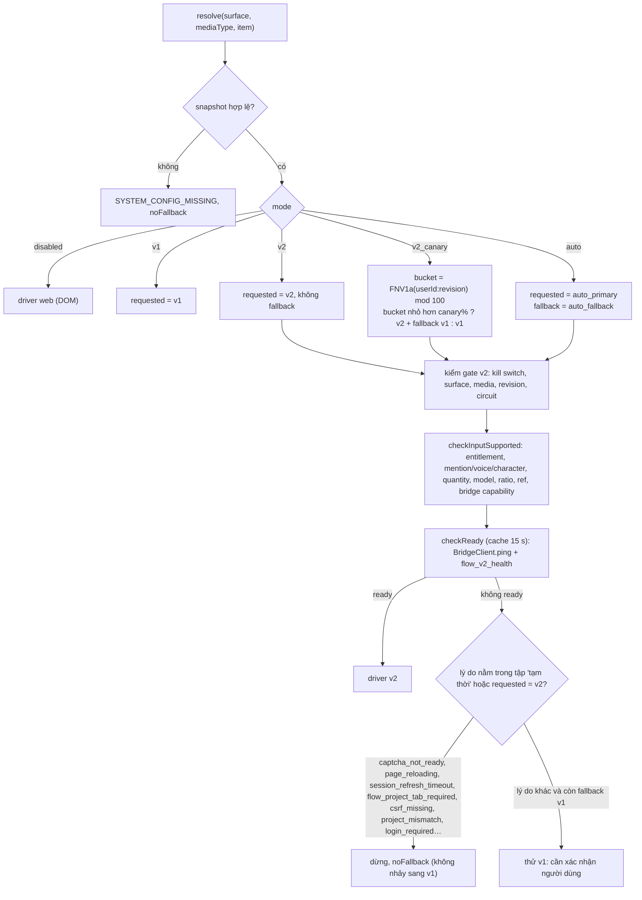
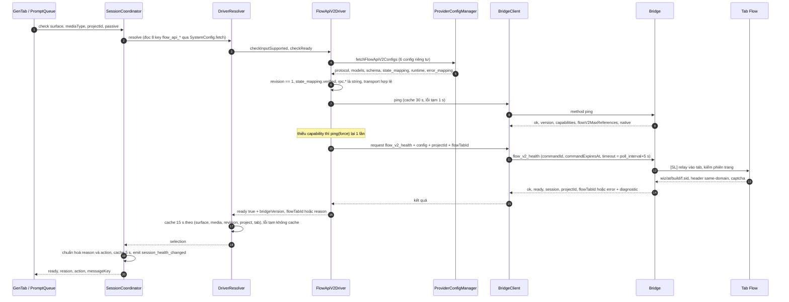
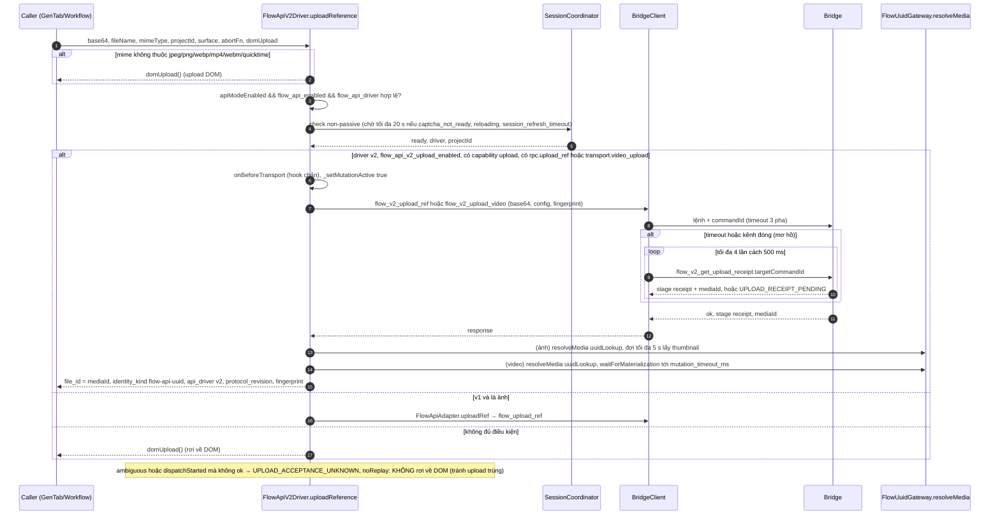
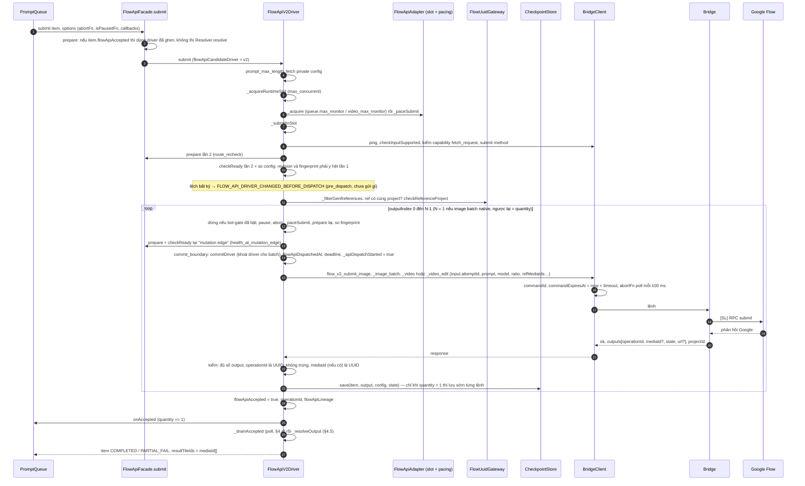
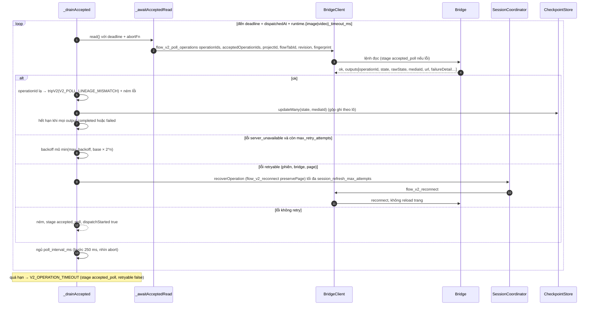
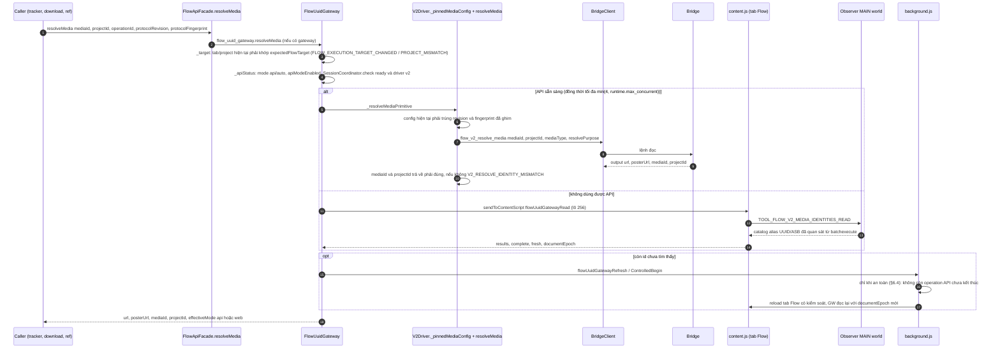
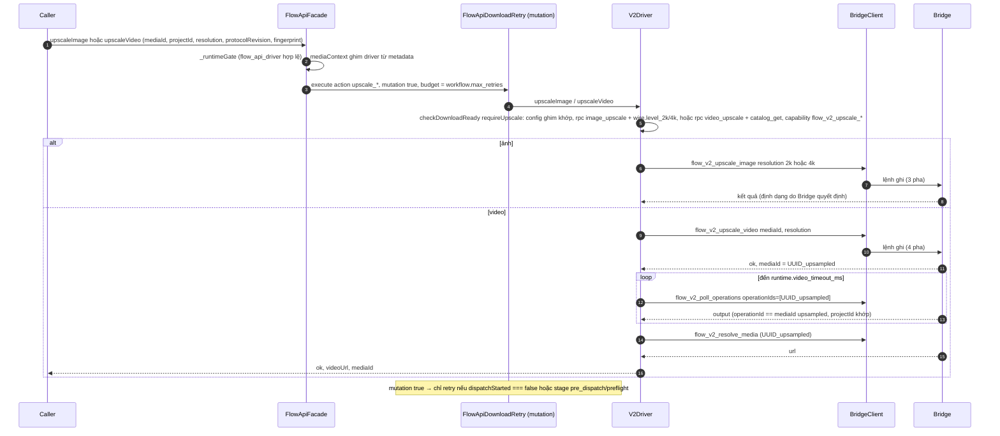
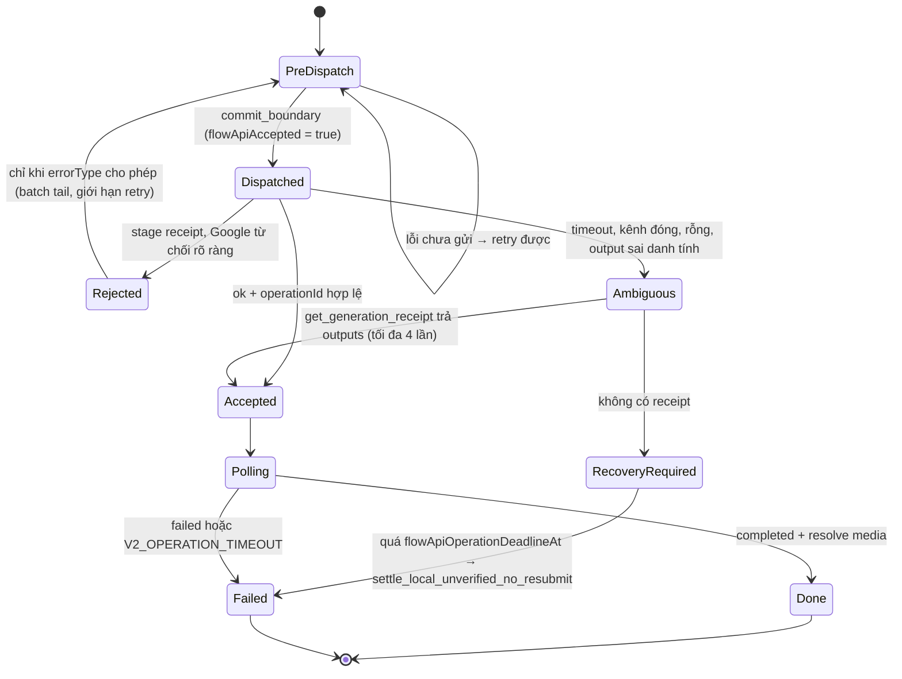
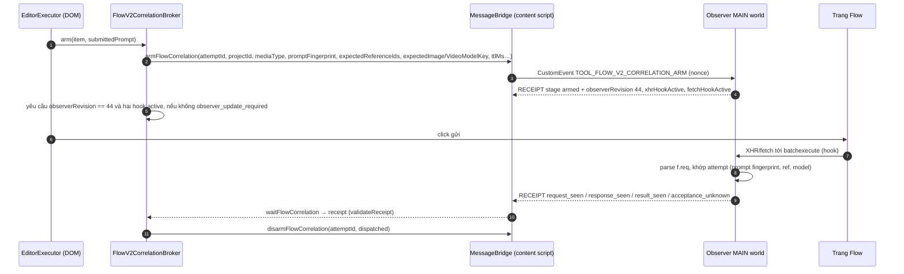

# 5. Google Flow API v2 — chế độ "Max Speed" qua extension Bridge

> **Cập nhật runtime 05/11/2026:** [chương 16](16-flow-gpt-runtime-findings.md) đã thu được **82 selector Flow hiện tại**, config transport/correlation và **11 nhóm private config ChatGPT** trên gói Free. Các câu bên dưới nói chúng chưa quan sát được là giới hạn của lượt phân tích trước, không còn là blocker hiện tại. Phần giao thức **Max Speed + mã Bridge** vẫn chưa thu được. Lượt đào sâu mới chỉ tập trung Flow và ChatGPT.

"Max Speed" là cách ToolFlow gen ảnh/video trên Google Flow **không click DOM**: ToolFlow (extension chính) gọi `chrome.runtime.sendMessage(BRIDGE_ID, {method, params})` sang một extension thứ hai, **ToolBridge** (`heieobedadlfdkppgagnhfakcdapbfka`, không có trên máy phân tích). Bridge mới là bên nói chuyện với Google. ToolFlow chỉ làm phần "bộ não": chọn driver, đóng gói config giao thức do server Tool cấp, chống gửi trùng, poll, phân loại lỗi, lưu checkpoint để phục hồi.

Tài liệu này mô tả phía ToolFlow (đọc được 100%) và đánh dấu rõ chỗ phụ thuộc Bridge hoặc server mà **không quan sát được**. Không chạy extension, không gọi mạng; chỉ đọc tĩnh code v1.3.138 và JSON storage đã che.

> **Cảnh báo thuật ngữ — có ba thứ đều bị gọi là "v2"** (teardown chung ghi nhầm gộp):
> | Tên | Nghĩa | File |
> |---|---|---|
> | **Flow page driver `flow_v2`** | Driver DOM cho **giao diện Flow mới** (click, nhập prompt). Có cổng server `flow_v2_driver`, `flow_v2_web_correlation`, `parallel.flow_v2_web_enabled`. | `src/core/flow/drivers/FlowV2Driver.js`, `FlowV2CorrelationBroker.js`, `flow-v2-correlation-observer.js` |
> | **Flow API driver `v2`** (tài liệu này) | Gọi RPC nội bộ qua Bridge. Nhãn UI: "Max Speed v2". | `src/core/flow-api/FlowApiV2Driver.js` |
> | **Flow API driver `v1`** | Cũng qua Bridge nhưng Bridge tự giữ token Google, nhận config endpoint từ server. | `FlowApiV1Driver.js` + `providers/FlowApiAdapter.js` |
>
> Quan trọng: `FlowV2CorrelationBroker` và observer MAIN-world phục vụ **chế độ web (DOM) song song**, không nằm trên đường gen của API v2. Phần 7 giải thích rõ vai trò thật của chúng.

---

## 1. Bản đồ file

| File (trong `src/core/` trừ khi ghi khác) | Kích thước | Vai trò |
|---|---|---|
| `flow-api/FlowApiFacade.js` | 11.8 KB | Cổng vào duy nhất cho submit/resolve/upscale: `prepare` (chọn driver, ghim), `submit`, `resolveMedia`, `upscaleImage/Video`, `checkDownloadReady`. |
| `flow-api/FlowApiDriverResolver.js` | 13.1 KB | Chọn `v1`/`v2`/`web` theo `flow_api_driver` (`v1`,`v2`,`v2_canary`,`auto`,`disabled`); cache health 15 s; **circuit breaker** schema drift. |
| `flow-api/FlowApiV1Driver.js` | 4.7 KB | Bọc `FlowApiAdapter` (đường v1) thành cùng giao diện driver. |
| `flow-api/FlowApiV2Driver.js` | 89 KB | Lõi v2: `uploadReference`, `checkInputSupported`, `checkReady`, `submit` → `_submitInSlot`, `_drainAccepted` (poll), `_resolveOutput`, `resolveMedia`, `upscaleImage/Video`. |
| `flow-api/FlowApiSessionCoordinator.js` | 33 KB | Health theo `(surface, mediaType, project, tab)`, chuẩn hoá `reason`, `reconnect`, `recoverOperation`, chờ reload. TTL health 5 s, cooldown reconnect 2 s. |
| `flow-api/FlowApiV2CheckpointStore.js` | 22 KB | Checkpoint operation đã được nhận (`tool_flow_api_checkpoints_v2_schema1`), khoá recovery, `fingerprint(config)`, `recoverCheckpoints`. |
| `flow-api/FlowApiDriverError.js` | 13 KB | `normalize()` lỗi → `{stage, ambiguous, dispatchStarted, retryable, errorType}`; thông điệp hiển thị. |
| `flow-api/FlowApiTelemetry.js` | 6 KB | Log + đẩy sự kiện `flow_api_lifecycle` lên server (đã băm id, lọc prompt/token/config). |
| `flow-api/FlowApiDownloadRetry.js` | 3 KB | Retry có ngân sách `workflow.max_retries` cho đọc/download/upscale. |
| `providers/FlowApiAdapter.js` | 59 KB | Đường v1 (`flow_generate`…) **và** hạ tầng dùng chung cho v2: `_acquire/_release` (slot), `_paceSubmit`, `classifyError`, `getErrorPolicy`, `_resolveRefUuid`. |
| `BridgeClient.js` | 16 KB | Toàn bộ giao tiếp với Bridge: timeout, phân loại `ambiguous`/`pre_dispatch`, cancel, khôi phục receipt, ping/status cache. |
| `FlowUuidGateway.js` | 88 KB | Cổng phân giải media UUID (API v2 hoặc web), kiểm tra ref cùng project, "controlled refresh" tab Flow. |
| `FlowUuidRefreshCoordinator.js` | 5.6 KB | (Chạy trong SW) sổ cái yêu cầu refresh, key `flow_uuid_gateway_refresh_records_v1`. |
| `FlowV2CorrelationBroker.js` + `FlowV2CorrelationProtocol.js` | 39.7 + 4 KB | Phía ToolFlow của giao thức quan sát **chế độ web** (xem §7). |
| `FlowObserverConfigRelay.js` | 1.5 KB | Bơm `flow_v2_observer_transport` và `native_project_media_identity` từ storage sang observer MAIN-world bằng `CustomEvent`. |
| `flow-v2-correlation-observer.js` (gốc extension) | 68 KB | MAIN world, hook XHR+fetch trên `flow.google.com`. |
| `ProviderConfigManager.js` | 30.7 KB | `fetchFlowApiV2Configs`, `getFlowApiV2ConfigSync`: ghép 6 config riêng tư. |
| `background.js` (các handler `flowUuid*`, `_flowDownloadBridgeRequest`, `onMessageExternal`) | 522 KB | Phía service worker: stop-safety, refresh coordinator, tải file qua Bridge. |
| `PromptQueue.js` (các hàm `*Ambiguous*`, `_resetApiAttemptForRetry`) | 272 KB | Chính sách retry/phục hồi ở tầng hàng đợi. |

---

## 2. Kiến trúc và phân vai

```mermaid
flowchart LR
  subgraph TF["ToolFlow (extension chính, MV3)"]
    UI["Side panel: GenTab / Workflow / Task"]
    PQ["PromptQueue (retry, recovery)"]
    FAC["FlowApiFacade"]
    RES["FlowApiDriverResolver"]
    SC["FlowApiSessionCoordinator"]
    V2["FlowApiV2Driver"]
    CP["FlowApiV2CheckpointStore<br/>chrome.storage.local"]
    BC["BridgeClient"]
    GW["FlowUuidGateway"]
    PCM["ProviderConfigManager<br/>(private configs trong RAM)"]
    SYS["SystemConfig<br/>flow_api_* (af_system_settings)"]
  end
  subgraph BR["ToolBridge (extension riêng, KHÔNG quan sát được)"]
    BSW["service worker"]
    BREL["content script relay"]
    BMAIN["MAIN world script"]
  end
  subgraph FP["Tab flow.google.com/project/UUID"]
    PAGE["trang Flow + phiên Google của user"]
    OBS["flow-v2-correlation-observer (MAIN)<br/>chỉ nghe, không gửi"]
  end
  SRV["labs.tool.vn/api/v1<br/>cấp config giao thức, entitlement"]
  GOOG["Google Flow backend"]
  UI --> PQ --> FAC --> RES --> SC --> V2
  V2 --> BC
  V2 --> CP
  GW --> BC
  PCM -. "protocol, models, schema, state_mapping, runtime, error_mapping" .-> V2
  SYS -. "driver, canary, surfaces, transport" .-> RES
  SRV --> PCM
  SRV --> SYS
  BC -- "chrome.runtime.sendMessage(BRIDGE_ID)" --> BSW
  BSW <--> BREL <--> BMAIN
  BMAIN -- "[SL] gọi RPC bằng phiên của trang" --> GOOG
  PAGE --- GOOG
  OBS -. "đọc request và response của trang" .- PAGE
```



Phân vai chính [QS trừ khi ghi khác]:

| Việc | Ai làm |
|---|---|
| Quyết định có dùng API không (entitlement, `apiModeEnabled`, `flow_api_driver`) | ToolFlow + server |
| Giá trị RPC ID, mã model, wire format, state mapping | **Server Tool** (config riêng tư), ToolFlow chỉ chuyển nguyên (`protocol`, `models`, `schema`, `stateMapping`, `runtime`) vào mỗi lệnh |
| Dựng request Google, giữ phiên/captcha/CSRF, gửi | **Bridge** [SL cho chi tiết bên trong; QS rằng ToolFlow không làm việc này] |
| Idempotency, deadline, poll, retry, phân loại lỗi, checkpoint | ToolFlow |
| Lưu receipt theo `commandId` để tra lại | Bridge (ToolFlow gọi `flow_v2_get_*_receipt`) |

---

## 3. Điều kiện để v2 sẵn sàng

Có **bốn tầng cổng**, đi từ ngoài vào trong. Chỉ khi cả bốn đều qua, một lệnh mutation (submit/upload/upscale) mới được gửi.

### 3.1 Tầng người dùng và entitlement
| Điều kiện | Nơi kiểm | Quan sát trên tài khoản mẫu |
|---|---|---|
| `af_settings.apiModeEnabled` = true (công tắc "Dùng Flow API (Chạy song song • Max Speed)") | `FlowApiAdapter.isApiModeIntended`, `uploadReference` | **`false`** |
| `defaultGenMode` ∈ `api`,`auto` (hoặc `executionMode="api"`) | `isApiModeIntended` | `auto` |
| Entitlement `flow_api_enabled` | `featureGate.canUse` → `V2_ENTITLEMENT_MISSING` | **`value: null`** (gói Free) |
| Workflow: `execution_config.workflow.flow_api_enabled` | `isApiModeIntended({forWorkflow})` | `true` |

→ Với dữ liệu mẫu v2 **chắc chắn không chạy**: công tắc tắt và entitlement trống. Đây cũng là lý do `tool_provider_configs.json` / `tool_provider_api_configs.json` **không có mục `flow`**: config riêng tư của Flow không được cấp cho gói này [SL — khớp với `fetchPrivateConfigs` chỉ giữ slug mà server trả về `granted`].

### 3.2 Tầng chọn driver (Resolver) — `af_system_settings`
`FlowApiDriverResolver._systemSnapshot` yêu cầu **đủ 8 key** và hợp lệ, thiếu một key là `SYSTEM_CONFIG_MISSING` (không fallback):

| Key (`flow_api_*`) | Ràng buộc | Giá trị mẫu |
|---|---|---|
| `driver` | `disabled`/`v1`/`v2`/`v2_canary`/`auto` | `v2` |
| `v2_enabled` | bool (kill switch) → `V2_KILL_SWITCH_OFF` | `true` |
| `v2_canary_percent` | int 0–100 | `0` |
| `v2_surfaces` | ⊂ {`gen`,`task`,`workflow`} → `V2_SURFACE_NOT_ENABLED` | 3 giá trị |
| `v2_media_types` | ⊂ {`image`,`video`} → `V2_MEDIA_NOT_ENABLED` | cả hai |
| `auto_primary` | `v1`/`v2` | `v2` |
| `auto_fallback` | `none`/`v1`/`v2` | `v1` |
| `v2_config_revision` | int ≥ 1; **phải ≤ `SUPPORTED_REVISION = 1`** của client → `V2_CLIENT_REVISION_UNSUPPORTED` | `1` |
| `v2_generation_transport` (đọc riêng trong `checkReady`) | `xhr` hoặc `fetch_request` | `fetch_request` |
| `v2_upload_enabled` (chỉ cho upload) | bool | `true` |

Thêm: circuit `V2_CIRCUIT_OPEN` (do `tripV2`, xem §8.4).

Chọn driver:



Điểm tinh tế [QS]: khi v2 hỏng mà fallback v1 thì **không tự chuyển** — `V1_FALLBACK_CONFIRMATION_REQUIRED` buộc người dùng xác nhận (`confirmV1Fallback`), và nếu v1 cũng chưa có phiên thì `V1_CONNECTION_REQUIRED`. Sau khi đã chấp nhận, job **khoá driver** (`job._flowApiDriverLock`): đổi driver giữa batch bị cấm (`FLOW_API_BATCH_DRIVER_CHANGED`).

### 3.3 Tầng đầu vào (`checkInputSupported`)
v2 từ chối trước khi gửi (stage `pre_dispatch`, `noRetry`) khi:
- Prompt có component `@mention`/voice/character: `V2_COMPONENT_INPUT_UNSUPPORTED` (trừ video Frames).
- `quantity` không nguyên hoặc > 32: `V2_QUANTITY_INVALID`.
- Không có model, hoặc `config.models[mediaType]` không có model đó (`default`) → `V2_MODEL_MISSING` / `V2_MODEL_UNSUPPORTED`.
- Prompt dài hơn `models[...].max_prompt_chars` → `PROMPT_TOO_LONG`.
- Ratio không có trong `schema.aspect_ratios.{image|video}` → `V2_IMAGE_RATIO_UNVERIFIED` / `V2_VIDEO_RATIO_UNVERIFIED`.
- Video: không ánh xạ được `(model, ratio, số ref, Frames/Ingredients, duration, resolution)` sang một model key → `V2_VIDEO_MODEL_MODE_UNSUPPORTED`; frames phải 1 hoặc 2 ảnh.
- Video edit (ref là video): cần `video_edit_video` trong model, `rpc.video_edit_submit`, đúng 1 video ref, `video_edit_frames{start<end≤1e5}`, và capability Bridge `flow_v2_submit_video_edit` (+ `flow_v2_video_edit_mixed_refs` nếu có ảnh ref hoặc độ phân giải 360p).
- Layout `ingredients_layout`/`first_frame_layout` khác `canonical_v1` → config invalid; ref video "canonical" cần capability `flow_v2_ingredients_canonical`/`flow_v2_first_frame_canonical`.

### 3.4 Tầng sức khoẻ (`FlowApiV2Driver._checkReadyUnshared`) — thứ tự kiểm
1. `ProviderConfigManager.fetchFlowApiV2Configs()` có đủ 6 phần (`protocol, models, schema, state_mapping, runtime, error_mapping`) → nếu không: `V2_PRIVATE_CONFIG_MISSING`.
2. `protocol.schema_version === revision === 1` → nếu không: `V2_PROTOCOL_REVISION_MISMATCH` (UI: *build drift*, hành động "update ToolFlow").
3. `state_mapping.verified === true` → nếu không: `V2_STATE_MAPPING_UNVERIFIED`.
4. `protocol.rpc` có kiểu **string** cho: ảnh `image_submit`, `media_resolve`; video `video_submit`, `video_text_submit`, `video_first_frame_submit`, `video_first_last_submit`, `video_poll`, `media_resolve` → nếu không: `V2_RPC_CONFIG_INVALID`.
5. `flow_api_v2_generation_transport` ∈ {`xhr`,`fetch_request`}; nếu `fetch_request` thì thêm capability `flow_v2_fetch_request_generation`.
6. `BridgeClient.ping` → `installed`; có đủ capability bắt buộc (§3.5). Thiếu: `V2_BRIDGE_VERSION_UNSUPPORTED` → UI `bridge_outdated`. Ping lỗi tạm (`BRIDGE_REQUEST_TIMEOUT`/`BRIDGE_CHANNEL_CLOSED`/`EMPTY_RESPONSE`) → `retryable`, **không** kết luận "chưa cài".
7. `BridgeClient.request("flow_v2_health", {...config, surface, mediaType, projectId, flowTabId})` → `{ok, ready, session, projectId, flowTabId}`. Đây là bước duy nhất chứng minh **tab Flow thật sự dùng được**. Lý do thất bại do Bridge trả (xem bảng §3.6).

### 3.5 Capability Bridge (chuỗi trong `ping.capabilities`)
| Capability | Bắt buộc khi | Ghi chú |
|---|---|---|
| `flow_v2_health`, `flow_v2_submit_image`/`flow_v2_submit_video`, `flow_v2_poll_operations`, `flow_v2_resolve_media`, `flow_v2_cancel_command` | mọi lượt gen v2 (`requiredCapabilities(mediaType)`) | `submit_*` theo media |
| `flow_v2_fetch_request_generation` | `generation_transport = fetch_request` | |
| `flow_v2_submit_image_batch` | tuỳ chọn: ảnh `quantity>1` gửi **1 lệnh** | không có thì lặp `quantity` lệnh đơn |
| `flow_v2_submit_video_edit`, `flow_v2_video_edit_mixed_refs` | video có video-ref / ảnh+video-ref / 360p | |
| `flow_v2_first_frame_canonical`, `flow_v2_ingredients_canonical` | video ref ảnh dạng canonical | |
| `flow_v2_upload_ref`, `flow_v2_upload_video` | upload bằng API (nếu thiếu → rơi về upload DOM) | |
| `flow_v2_upscale_image`, `flow_v2_upscale_video` | upscale | |
| `flow_v2_reconnect`, `flow_v2_preserve_page_reconnect`, `flow_v2_unusual_reload` | reconnect thường / giữ trang khi có operation đang chạy / reload sau cảnh báo bất thường | thiếu → `capability_missing` |
| `flow_clear_cookies_reload`, `flow_clear_cache_reload` + phiên bản ≥ 1.3.33 | xoá cookie Flow (`supportsFlowCookieRecovery`) | |
| `ping.flowV2MaxReferences` | trần số ref: `min(giá trị, 32)`, mặc định 8 nếu Bridge không khai | |

Phiên bản: `bridge_min_version` = `1.3.38` (system setting) **chỉ** dùng để hiện huy hiệu "ToolBridge cũ — cập nhật" ở `GenTab`/Settings; cổng cứng là **capability**, không phải so số phiên bản [QS].

### 3.6 Lý do not-ready và hành động UI (`FlowApiSessionCoordinator._normalized`)
| Mã gốc | `reason` chuẩn | Hành động |
|---|---|---|
| `BRIDGE_NOT_INSTALLED`, `no_client` | `bridge_not_installed` | cài Bridge |
| `V2_BRIDGE_VERSION_UNSUPPORTED` | `bridge_outdated` | cập nhật Bridge |
| `V2_PRIVATE_CONFIG_*`, `V2_RPC_CONFIG_INVALID`, `V2_GENERATION_TRANSPORT_CONFIG_MISSING`, `SYSTEM_CONFIG_MISSING`, `CAPTCHA_CONFIG_INVALID` | `protocol_config_missing` | liên hệ hỗ trợ |
| `V2_PROTOCOL_REVISION_MISMATCH`, `V2_STATE_MAPPING_UNVERIFIED`, `PROTOCOL_FINGERPRINT_MISMATCH`, `INVALID_V2_COMMAND`, `origin_mismatch` | `build_drift` | cập nhật ToolFlow |
| `V2_PAGE_RELAY_UNAVAILABLE`, `captcha_not_ready`, `CAPTCHA_FAILED` | `fresh_page_session_required` | thử lại phiên |
| `V2_PAGE_COMMAND_TIMEOUT`, `BRIDGE_REQUEST_TIMEOUT`, `BRIDGE_CHANNEL_CLOSED` | `session_refresh_timeout` | thử lại |
| `V2_PAGE_RELOADING`, `V2_CONTENT_SCRIPT_RECOVERING` | `page_reloading`, `content_script_recovering` | chờ |
| `flow_project_tab_required`, `project_mismatch`, `login_required`, `csrf_missing` | giữ nguyên | mở đúng project / đăng nhập |

Không retry được: `bridge_outdated`, `build_drift`, `protocol_config_missing`, `capability_missing`, `V2_ENTITLEMENT_MISSING`, `V2_CLIENT_REVISION_UNSUPPORTED`, `V2_CIRCUIT_OPEN`.

Config tối thiểu mà `FlowApiV2Driver` đòi (đọc bằng `_runtimeInteger`, thiếu/không hợp lệ ném `V2_RUNTIME_CONFIG_INVALID:<key>`):

| Khoá | Dùng cho | min |
|---|---|---|
| `runtime.max_concurrent` | slot song song của driver v2 | 1 |
| `runtime.submit_pacing_ms` | giãn cách giữa các lệnh submit | 50 |
| `runtime.request_timeout_ms` | timeout cơ sở một lệnh Bridge (1 000–120 000) | 1 000 |
| `runtime.mutation_timeout_ms` | timeout cho pha ghi (mặc định = request) | 1 000 |
| `runtime.poll_interval_ms` | chu kỳ poll / chờ vật chất hoá | 1 (Bridge nhận 250–60 000) |
| `runtime.image_timeout_ms`, `runtime.video_timeout_ms` | **deadline** của operation | 1 (video ≤ 7 200 000) |
| `runtime.max_retry_attempts`, `base_backoff_ms`, `max_backoff_ms` | retry đọc | 0 |
| `runtime.session_refresh_max_attempts` | số lần reconnect khi đang poll | 0 |
| `runtime.session_refresh_timeout_ms` | timeout reconnect (3 000–60 000) | — |
| `runtime.schema_drift_threshold/min_samples/window_ms` | circuit breaker | tuỳ chọn |
| `protocol.rpc.{image_submit, media_resolve, video_submit, video_text_submit, video_first_frame_submit, video_first_last_submit, video_poll}` | bắt buộc theo media | string |
| `protocol.rpc.{upload_ref, video_edit_submit, image_upscale, video_upscale, catalog_get}` + `protocol.transport.video_upload` | tính năng tuỳ chọn | string |
| `schema.wire.image_upscale_level_2k/4k` | số nguyên cho upscale ảnh | int |
| `schema.aspect_ratios.{image,video}` | ratio hợp lệ | map |
| `models.{image,video}[...]` | `default`, `ui_values`, `max_prompt_chars`, `by_ratio`, `text_2_video`, `frame_2_video`, `start_end_frame_2_video`, `reference_frame_2_video`, `generation_resolutions`, `video_edit_*` | — |
| `error_mapping` | tiền tố mã lỗi → `errorType` | map |

**Giá trị thật của các khoá này không quan sát được** (config riêng tư, chỉ nằm trong RAM; server chỉ cấp khi entitlement cho phép) [?].

---

## 4. Sequence diagram từng luồng

Ký hiệu: **TF** = ToolFlow, **BC** = BridgeClient, **BR** = Bridge (hộp đen), **PG** = tab Flow + Google.

### 4.1 Health check



Chống bão health [QS]: `_readyChecks` và `_pageHealthChecks` gộp các lời gọi trùng khoá thành một chuyến bay; `invalidate()` tăng `_healthEpoch` để kết quả cũ bị bỏ; nếu epoch đổi trong lúc kiểm thì trả `fresh_page_session_required`. Sự kiện làm vô hiệu: `flow_api:driver_changed`, `provider:api_config_updated` (key `flow_api_v2_*`), `featuregate:refreshed` (đổi `flow_api_enabled`), reload tab Flow.

Bằng chứng về cách Bridge xác minh phiên (nằm trong diagnostic `fresh_page_session_required`) [QS]: `sessionProof ∈ {page_session_missing, same_domain_header_missing}`, `wizPresent`, `atPresent`, `buildPresent`, `fSidPresent`, `nativeRequestObserved`, `sameDomainHeaderObserved`.

### 4.2 Upload ảnh/video tham chiếu



Điểm đáng chú ý [QS]:
- **Chỉ trước khi gửi** mới được rơi về `domUpload()`. Sau khi lệnh đã rời ToolFlow, mọi lỗi đều thành `UPLOAD_ACCEPTANCE_UNKNOWN` với `noReplay = true`; catch ngoài chỉ nuốt lỗi khi `!error.noReplay`.
- `UPLOAD_PROJECT_MISMATCH` cũng `noReplay`.
- Với video, nếu không xác minh được video đã "hiện hình" (`resolveMedia` lỗi) → `failure.dispatchStarted = true`, `stage = accepted_poll`, không replay (`V2_UPLOAD_VIDEO_RESULT_UNVERIFIED`). Ảnh thì chỉ bỏ qua thumbnail (timeout 5 s).
- ID tham chiếu hợp lệ: UUID hoặc chuỗi ASB `AB-[A-Za-z0-9_-]{37,}` (≤ 2048 ký tự).

### 4.3 Submit ảnh / video



Chi tiết [QS]:
- Phương thức Bridge chọn theo: ảnh → `flow_v2_submit_image`, hoặc `flow_v2_submit_image_batch` nếu Bridge có capability và `quantity>1`; video → `flow_v2_submit_video`, hoặc `flow_v2_submit_video_edit` nếu có video-ref.
- `input` gửi sang Bridge: `itemId, attemptId, projectId, prompt, model, ratio, duration, resolution, isFrames, quantity, refMediaIds, refVideoMediaIds`. **Kèm** `generationTransport, protocol, schema, models, runtime, stateMapping, protocolRevision, protocolFingerprint, flowTabId`.
- `attemptId` = `item.attemptId || item.id`; nếu `quantity>1` và không phải batch native thì thêm hậu tố `:<outputIndex>` để mỗi lệnh có định danh riêng.
- Số slot: tầng 1 `runtime.max_concurrent` (v2 only), tầng 2 `execution_config.queue.max_monitor` (6) cho ảnh và `video_max_monitor` (4) cho video, tầng 3 `_paceSubmit` serialize theo `max(apiSubmitDelayMs, runtime.submit_pacing_ms≥50)`.
- Lỗi bị Google từ chối (`!response.ok`, không mơ hồ): với `quantity==1` thoát luôn; `quantity>1` thì tiếp tục lệnh sau trừ khi `errorType ∈ {bot_detected, captcha_failed, auth_expired, quota_exceeded, per_model_daily, tier_restricted, rate_limited}`. Ghi `item.flowApiFailureDetail`, gọi `onProviderQuota`/`onProviderBotGate`.
- Item kết quả: `identity_kind: "flow-v2-api-uuid"`, `identity_durability: "durable-resolver"`, `api_driver: "v2"`, `protocol_revision`, `protocol_fingerprint`. Hai trường sau được **ghim** vào item để các lần đọc sau (resolve, download, upscale) dùng đúng phiên bản giao thức đã tạo ra media; lệch → `V2_PINNED_CONFIG_MISMATCH`.

### 4.4 Poll



Trạng thái [QS]: `FlowApiV2CheckpointStore._terminalKind` coi `completed|complete|done|succeeded|success|resolved` là hoàn tất và `failed|error|cancelled|canceled|rejected` là thất bại; mọi giá trị khác là đang chạy. `unknownState` + `rawState` (số) do Bridge gắn khi `state_mapping` không biết giá trị đó.

Thông điệp **deadline được lưu** (`flowApiOperationDeadlineAt`, `checkpoint.operationDeadlineAt`) nên reload panel không "gia hạn" thời gian chờ.

### 4.5 Phân giải media (resolve)



Với **download** (`resolvePurpose: "download"`) video, `BridgeClient` ghi vết `[FlowDownloadRuntime]` gồm `swBuild/relayBuild/mainBuild/decoderRevision/flowTabId/matchingProjectTabs/tabPinned/repairAttempted/repairOutcome` — cho thấy Bridge gồm ≥ 3 thành phần (SW, relay, MAIN) và có cơ chế "repair" tab [QS tên trường, SL vai trò].

### 4.6 Upscale



Chi tiết video: biên nhận phải khớp regex `^<uuid>_upsampled$`; poll dùng chính `mediaId` upsampled làm `operationId`; `output.projectId` phải bằng project (ngoại lệ: state `failed` dạng compact với `projectId === null` được coi là "tạm thời" và poll tiếp, trừ khi có bằng chứng lỗi). Trạng thái ngoài ý muốn → `V2_UPSCALE_LINEAGE_MISMATCH`.

---

## 5. Từng thành phần

### 5.1 `BridgeClient` (ToolFlow → Bridge)
**Giao thức**: `chrome.runtime.sendMessage(BRIDGE_ID, {method, params}, cb)`. Phản hồi là JSON `{ok, error, …}`. Kênh phụ `BridgeClient.stream()` dùng `chrome.runtime.connect` (cổng với `{reqId, method, params}`, nhận `progress`) nhưng **không có chỗ nào gọi** trong toàn bộ extension [QS: grep không thấy `.stream()` ngoài vendor] → mã chết hoặc để dành cho phiên bản Bridge sau.

**Phân biệt "chưa cài" và "kênh đóng"** (`_runtimeErrorCode`):

| `chrome.runtime.lastError` | Mã | Hàm kết quả | Ý nghĩa |
|---|---|---|---|
| `receiving end does not exist` / `could not establish connection` | `BRIDGE_NOT_INSTALLED` | `_undeliveredResult` | **Chắc chắn chưa gửi tới**. Lệnh ghi: `stage: pre_dispatch, dispatchStarted: false, ambiguous: false` |
| lỗi khác (vd. port đóng trước khi trả lời) | `BRIDGE_CHANNEL_CLOSED` | `_uncertainResult` | **Không biết** Bridge có xử lý chưa |
| không có phản hồi trong timeout | `BRIDGE_REQUEST_TIMEOUT` | `_uncertainResult` | như trên |
| `res` rỗng | `EMPTY_RESPONSE` | `_uncertainResult` | như trên |
| không có `chrome.runtime.sendMessage` | `NO_RUNTIME` | trả thẳng | |

`_uncertainResult` cho **8 lệnh ghi** (`upload_ref`, `upload_video`, `submit_image`, `submit_image_batch`, `submit_video`, `submit_video_edit`, `upscale_image`, `upscale_video`) trả `{stage:"ambiguous", dispatchStarted:true, ambiguous:true}`; cho **2 lệnh đọc đã nhận** (`poll_operations`, `resolve_media`) trả `{stage:"accepted_poll", dispatchStarted:true}`; các lệnh còn lại không gắn stage.

**Timeout theo lệnh** (`_requestTimeout`; `cfg` = `runtime.request_timeout_ms`, hợp lệ 1 000–120 000, sai → 10 000):

| Lệnh | Timeout |
|---|---|
| `ping`, `get_status`, `set_flow_api_maintenance` | 5 000 ms |
| `refresh_token` | 20 000 |
| `flow_validate_session`, `open_flow_login(_manual)` | 60 000 |
| `flow_v2_health` | `poll_interval_ms + 5 000` (250–60 000), sai → 10 000 |
| `flow_v2_reconnect` | `session_refresh_timeout_ms + 10 000` (3 000–60 000), sai → 10 000 |
| `flow_v2_get_*_receipt` | `min(cfg + 5 000, 30 000)` |
| `poll`, `resolve` (1 pha) | `cfg + 20 000` |
| submit ảnh/video, upload, upscale ảnh (3 pha) | `cfg×3 + 30 000 + max(0, mutation_timeout − cfg)` |
| `upscale_video`, `submit_video` có ref (4 pha) | `cfg×4 + 30 000 + max(0, mutation_timeout − cfg)` |
| `flow_clear_cookies_reload` | `api_timeout_ms` (60 000; thiếu → `CONFIG_NOT_READY`) |

Mỗi lệnh `flow_v2_*` được gắn `commandId = v2-client-<ts>-<random>` và `commandExpiresAt = now + timeout` trước khi gửi → Bridge có thể từ chối lệnh quá hạn [SL: chưa thấy code Bridge, nhưng không có lý do nào khác để gửi `commandExpiresAt`].

**Huỷ**: nếu có `abortFn`, `BridgeClient` poll mỗi 100 ms; khi abort: gửi `flow_v2_cancel_command {commandId, commandExpiresAt}` (timeout 10 s) và **trả ngay** `{…uncertain, error:"ABORTED", cancelled:true, noRetry:true, noReplay:true}`. Phản hồi muộn của lệnh gốc chỉ được log (`[FlowApiStoppedReceipt]`: `operationId`, `mediaId`, `state`), không được dùng.

**Khôi phục receipt** (chỉ khi `result.ambiguous === true`):
- Upload: tối đa 4 lần, cách 500 ms, gọi `flow_v2_get_upload_receipt {projectId, targetCommandId}`; thành công khi `ok && stage==="receipt" && mediaId`; tiếp tục khi `UPLOAD_RECEIPT_PENDING`/`BRIDGE_CHANNEL_CLOSED`/`BRIDGE_REQUEST_TIMEOUT`/`EMPTY_RESPONSE`, còn lại dừng.
- Generation (4 lệnh submit): `flow_v2_get_generation_receipt {projectId, targetCommandId, flowTabId}`; thành công khi `outputs.length>0`; tiếp tục khi `GENERATION_RECEIPT_PENDING` + lỗi kênh.
- Upscale: **không có** khôi phục receipt [QS].
- Sau cùng: `TOKEN_EXPIRED`/`NO_FLOW_KEY` → xoá cache status, ghi `chrome.storage.session.flowApiLastAuthError {error, at, method}` (UI dùng trong 10 phút), phát `flow_api:auth_invalid`.

**Cache** (static, trong RAM mỗi context): `ping` 30 s (1 s nếu lỗi tạm; lỗi tạm sau khi từng cài → giữ bản cũ và đánh `uncertain: true`, **không** kết luận "chưa cài"); `get_status` 5 s; single-flight cho cả hai; `bridge:changed` phát khi chữ ký `(installed, version, capabilities)` đổi.

**Bảng lệnh Bridge mà ToolFlow gọi** [QS toàn bộ tên]:

| Nhóm | Method |
|---|---|
| Điều khiển | `ping`, `get_status` (`tokenReady, tokenAgeMs, flowTabOpen, tokenBootstrapActive, version`), `refresh_token`, `flow_validate_session`, `open_flow_login`, `open_flow_login_manual`, `set_flow_api_maintenance {enabled}`, `flow_clear_cookies_reload {tabId, projectId, userInitiated}` |
| v1 | `flow_resolve_tier`, `flow_create_project`, `flow_upload_ref`, `flow_generate {kind, config, input}`, `flow_poll_video`, `flow_resolve_media`, `flow_upscale_image`, `flow_upscale_video` |
| v2 phiên | `flow_v2_health`, `flow_v2_reconnect`, `flow_v2_cancel_command` |
| v2 ghi | `flow_v2_upload_ref`, `flow_v2_upload_video`, `flow_v2_submit_image`, `flow_v2_submit_image_batch`, `flow_v2_submit_video`, `flow_v2_submit_video_edit`, `flow_v2_upscale_image`, `flow_v2_upscale_video` |
| v2 đọc | `flow_v2_poll_operations`, `flow_v2_resolve_media`, `flow_v2_get_upload_receipt`, `flow_v2_get_generation_receipt` |

Service worker `background.js` cũng nói chuyện trực tiếp với Bridge (`_flowDownloadBridgeRequestOnce`) để tải file khi panel đóng; nó bọc các lệnh đọc/upscale bằng `FlowApiDownloadRetry` và đồng bộ `set_flow_api_maintenance` mỗi khi `af_settings`/`af_system_settings` đổi (bật khi `apiModeEnabled && defaultGenMode∈{api,auto} && flow_api_driver∈{v1,v2,v2_canary,auto}`).

### 5.2 `FlowApiFacade`
- `_runtimeGate`: luôn `SystemConfig.fetch()` rồi kiểm `flow_api_driver` ∈ {v1,v2,v2_canary,auto}; `disabled` → `SYSTEM_DRIVER_DISABLED`.
- `prepare(item)`: nếu `item.flowApiAccepted === true` và đã có `flowApiDriver` → **trả ngay driver đã ghim** (không resolve lại, không fallback). Ngược lại gọi Resolver với `identity = user.id`, `pinnedDriver = job._flowApiDriverLock`.
- `submit`: ghi `item._flowApiV2Step` (bước hiện tại cho chẩn đoán: `route_selection → driver_preflight → … → bridge_submit`). Lỗi lớp vận chuyển (`TRANSPORT_FAILED, REQUEST_TIMEOUT, BRIDGE_*, V2_PAGE_*`…) → `Resolver.invalidate()`. Riêng `FLOW_API_DRIVER_CHANGED_BEFORE_DISPATCH` (chưa gửi) được tự thử lại tối đa **3 lần** chọn lại driver, chỉ khi `flowApiAccepted !== true`.
- `_mediaContext`: tìm `apiDriver` từ metadata media; không có nhưng là media cũ `flow-api-uuid` không có `operationId` và `flow_api_driver != v2` → coi là v1 (tương thích ngược).
- `_refreshDownloadTransport` (làm `onRetry` của download): `BridgeClient.invalidate()` rồi gửi lại `flow_v2_health` với config ghim.

### 5.3 `FlowApiV2CheckpointStore` — receipt và idempotency lưu bền
Khoá `chrome.storage.local["tool_flow_api_checkpoints_v2_schema1"]` = map `operationId → checkpoint`:

```
{driver:"v2", protocolRevision, protocolFingerprint, itemId, jobId, projectId, flowTabId?,
 attemptId, operationId, mediaId, mediaType, surface, state,
 submittedAt, dispatchedAt, operationDeadlineAt, lastPolledAt}
```
(`recoveryRevoked: true` được gắn khi người dùng dừng job.) Khoá khoá `chrome.storage.session["tool_flow_api_recovery_locks_v2_schema1"]`: `{operationId: {owner, expiresAt}}` với TTL `min(270 000, 2×request_timeout_ms + 30 000)`; ghi rồi **đọc lại để xác minh `owner`** (bầu chủ đơn giản giữa nhiều context: panel + side panel + SW).

- `fingerprint(config)` = FNV-1a 32 bit (`fnv1a-xxxxxxxx`) trên JSON chuẩn hoá (khoá sắp xếp) của `protocol, models, schema, state_mapping, runtime`. Dùng để **ghim config** vào operation: mọi lần đọc về sau yêu cầu fingerprint trùng, nếu server đã đổi giao thức giữa chừng thì phục hồi bị chặn thay vì đọc sai.
- `save()` chỉ lưu khi `protocolRevision === 1`, `operationId` và `projectId` là UUID, `item.id` có mặt. Config được đóng băng sâu (`_deepFreeze`) và đếm tham chiếu theo bản chụp (`_retainRuntime`).
- `recoverCheckpoints()` (đánh thức bởi `provider:api_config_updated`, `bridge:changed`, `sse:connected`, `auth:login`, `featuregate:refreshed`): với mỗi checkpoint, bỏ qua nếu item còn sống (`_flowApiSubmitPromise`) hoặc job bị thu hồi; nếu đang ở project khác → `RECOVERY_REQUIRED/project_mismatch`; lấy lock; `flow_v2_poll_operations`; nếu lỗi retryable thì `recoverOperation`; `failed` → patch FAILED + `noRetry`; `completed` → `_resolve` → patch COMPLETED + `results[{url, tileId}]`; còn chạy → tự đặt lịch lại sau `poll_interval_ms`; quá hạn → `V2_OPERATION_TIMEOUT`. Patch gửi về tracker qua `chrome.runtime.sendMessage({action:"ft:recoveryPatch"})` (bỏ qua surface `workflow`).

### 5.4 `FlowApiDriverError` — hợp đồng stage
`normalize(error, ctx)` gán một trong 5 `stage`:

| `stage` | Nghĩa | Có thể gửi lại? |
|---|---|---|
| `pre_dispatch` / `preflight` | Chưa gửi lệnh ghi nào | Có (nếu `retryable`) |
| `receipt` | Google **đã từ chối** (có `grpcCode>0` hoặc `PUBLIC_ERROR_*`) và chưa có `operationId` | Tuỳ `errorType`; không coi là đã nhận |
| `ambiguous` | Đã gửi, không biết kết quả | **Không bao giờ** |
| `accepted_poll` | Đã có `operationId`; đang đọc kết quả | Chỉ **đọc** lại, không submit lại |
| `terminal` | Operation kết thúc thất bại | Không |

Suy luận mặc định (không có `stage` rõ): có `operationId` → `accepted_poll`; `dispatchStarted` nhưng không có `operationId` và mã không thuộc `ABORTED|V2_OPERATION_TIMEOUT|V2_POLL_|V2_RESOLVE_|FLOW_API_V2_RECOVERY_` → `ambiguous`; còn lại `pre_dispatch`. `SESSION_CODES` (TOKEN_EXPIRED, BRIDGE_*, V2_PAGE_*, csrf_missing, captcha_not_ready…) → `retryable` và `errorType = auth_expired` nếu không phân loại được.

`FlowApiAdapter.classifyError` ra `errorType` ∈ {`quota_exceeded, per_model_daily, content_blocked, tier_restricted, bot_detected, media_expired, captcha_failed, auth_expired, project_mismatch, schema_changed, server_unavailable, unknown`}; v2 ưu tiên `error_mapping` (khớp tiền tố dài nhất) rồi mới tới regex cục bộ. `getErrorPolicy`: chỉ `auth_expired` và `server_unavailable` là `retryable`; tất cả `fallbackDom: false` (API lỗi **không** tự chuyển sang DOM).

### 5.5 `FlowApiSessionCoordinator`
- `check()` có single-flight, cache 5 s; bỏ qua probe khi đang upload web, reload đồng bộ hoặc đang có dispatch (trả health "giả định" từ trạng thái dispatch để không quấy rầy lúc gen).
- `reconnect()` chỉ một chuyến bay cho mỗi khoá, cooldown 2 s, gộp người gọi (`coalescedCallers`). Ba chế độ: *standard* (cho phép reload tab), *accepted-read* (`preservePage`, khi có operation đã nhận — chọn tự động qua `PromptQueue.hasAcceptedV2Operation`), *forced* (`forcePageReload` sau "unusual activity", cần capability `flow_v2_unusual_reload`). Bắt buộc có Bridge + capability tương ứng + config, rồi gọi `flow_v2_reconnect` với `{projectId, userInitiated, flowTabId, recoveryAuthorized, forcePageReload, preservePage, recoveryReason, allowFocus: userInitiated}`.
- `recoverOperation()` (cho operation đã nhận): luôn `preservePage` trừ khi `operationTerminal` — **không reload trang** trong lúc một operation đang chờ kết quả.
- Gom `waitForReload` / `hasPendingReload`: submit chờ ở "mutation edge" nếu reconnect đang giữ rào chắn reload (`_reloadBarriers`).

### 5.6 `FlowApiTelemetry`
Mọi sự kiện đi qua `sanitize()`: bỏ khoá nhạy cảm (`prompt, cookie, at, fsid, csrf, captcha*, token, authorization, protocol, schema, models, runtime, statemapping, requestbody, responsebody, freq`), băm id (`item/attempt/operation/media/project/job` → `session:<fnv>` với salt phiên), cắt URL còn `origin+pathname`. Các sự kiện trong `_remoteEvents` được gửi lên server qua `UsageSync.trackEvent("flow_api_lifecycle", …)`: `commit_boundary, submit_started, submit_receipt, operation_state_transition, poll_state_changed, media_resolved, driver_selected/fallback/selection_failed, schema_drift, session_health_changed, session_reconnect_*, api_recovery_required, correlation_*`… → **Tool thấy vòng đời mỗi lượt gen API (đã băm id)**. Danh sách khoá bị lọc cũng là bằng chứng gián tiếp rằng wire Google dùng `at`, `f.sid`, `f.req` (batchexecute).

### 5.7 `FlowApiAdapter` (phần dùng chung + v1)
- Slot: `_acquire(abortFn, mediaType)` với hàng đợi riêng cho ảnh (`queue.max_monitor`, mặc định 4 nếu thiếu) và video (`queue.video_max_monitor`); quét 250 ms.
- `_paceSubmit(delayMs)`: chuỗi promise `_submitPaceTail` bảo đảm **thứ tự** và khoảng cách tối thiểu giữa hai lần khởi động submit (toàn cục, mọi surface).
- v1: `submit` → `_resolveTier` (`flow_resolve_tier`), `_resolveProjectId` (`flow_create_project` khi cần), rồi `flow_generate {kind:"image"|"video", config: rawApiConfig, input:{projectId, tier, prompt, refUuids, aspect|ratioEnum, model|videoModelKey, …}}`. Khác biệt then chốt với v2: **v1 gửi cả `config` (endpoint, key, captcha) của server cho Bridge và Bridge tự dựng request**; v2 gửi bộ `protocol/models/schema/runtime/state_mapping` và chạy qua phiên của tab Flow. Lỗi `status >= 500` ở v1 cũng bị coi là `ambiguous`.
- Config v1 do server cấp (tên khoá, không phải giá trị): `api_endpoints, flow_api_key, captcha_config, api_model_mapping, api_video_model_keys, api_image_ratio_mapping, api_video_ratio_mapping, api_video_resolutions, api_image_input_types, api_image_upsample_resolutions, api_rate_limits, api_error_codes, api_video_edit, chain_config, bridge_download_url`.

---

## 6. Cơ chế chống gửi trùng và xử lý kết quả mơ hồ

### 6.1 Nguyên lý: "đã rời máy thì không bao giờ gửi lại"
Ranh giới là **`commit_boundary`** trong `_submitInSlot`, ngay trước `BridgeClient.request(method…)`. Từ đây:
- `item.flowApiAccepted` được set **ngay cả khi** ném lỗi (khối `catch (requestError)` set `flowApiAccepted = true` nếu `dispatchStarted` hoặc `ambiguous`), `item._apiDispatchStarted = true`.
- Chỉ khi Bridge trả đúng `{stage:"pre_dispatch", dispatchStarted:false, ambiguous:false}` **và** chưa có `operationId`, cờ `_apiDispatchStarted` mới được hạ về `false` → item được phép retry.

### 6.2 Các lớp chống trùng
| # | Lớp | Cơ chế | Nguồn |
|---|---|---|---|
| 1 | Ghim driver theo item | `flowApiAccepted && flowApiDriver` → `prepare` trả driver đã ghim, không resolve lại | `FlowApiFacade.prepare` |
| 2 | Khoá driver theo batch | `job._flowApiDriverLock`; đổi driver → `FLOW_API_BATCH_DRIVER_CHANGED` (`noRetry`) | `commitDriver` |
| 3 | `commandId` mỗi lệnh | `v2-client-<ts>-<rand>`; làm khoá tra receipt (`targetCommandId`) và khoá huỷ | `BridgeClient.request` |
| 4 | `attemptId` mỗi lượt | `item.attemptId||item.id`, `…:<i>` cho quantity>1; chỉ **đổi** (`crypto.randomUUID()`) khi retry hợp lệ (lỗi `pre_dispatch/receipt`, không ambiguous/accepted_poll) và `_resetApiAttemptForRetry` xoá `operationId/mediaId/lineage/dispatchedAt/deadline` | `PromptQueue._retryApiNormalFailureAtBatchTail`, `_resetApiAttemptForRetry` |
| 5 | Kiểm lại tại "mutation edge" | Trước mỗi lệnh ghi: `prepare` lại, `checkReady` lại, **so `revision` và `fingerprint` với lúc đầu**; lệch → `FLOW_API_DRIVER_CHANGED_BEFORE_DISPATCH` (chưa gửi) | `_submitInSlot` |
| 6 | Single-flight/slot/pacing | `_runtimeInFlight ≤ max_concurrent`, `_acquire`, `_paceSubmit` tuần tự | §4.3 |
| 7 | Retry có điều kiện | `FlowApiDownloadRetry.retryable(error, mutation)`: `noRetry`/`noReplay` → không; lỗi ghi chỉ retry nếu `dispatchStarted === false` hoặc stage `pre_dispatch/preflight`; không bao giờ retry `GOOGLE_REJECTED|RPC_REJECTED|SCHEMA_CHANGED|…QUOTA|POLICY|CONTENT|…` | `FlowApiDownloadRetry` |
| 8 | Khôi phục receipt thay vì gửi lại | Mơ hồ → `flow_v2_get_*_receipt` theo `commandId` (4×500 ms) | `BridgeClient.request` |
| 9 | Upload không rơi về DOM sau khi gửi | `UPLOAD_ACCEPTANCE_UNKNOWN`, `noReplay` | `uploadReference` |
| 10 | Checkpoint bền + khoá lease | Phục hồi **chỉ poll**, không submit | §5.3 |
| 11 | Xác thực danh tính output | Đủ số lượng, `operationId` UUID, không trùng giữa các lệnh, `mediaId` UUID; sai → `tripV2("V2_SCHEMA_DRIFT_OUTPUT_IDENTITY")` + trạng thái `ambiguous` | `_submitInSlot` |
| 12 | Dừng cứng | Dừng sau khi đã nhận: xoá checkpoint, `noteApiStop` ghi `flow_uuid_gateway_unsettled_api:<projectId>` (job + operation chưa kết thúc) để chặn reload tab cho tới khi mọi operation đã stop xác minh terminal | `flowUuidApiStop`, `_reconcileFlowUuidApiStops` |

### 6.3 Máy trạng thái mơ hồ



Điều quan trọng về `RecoveryRequired` [QS `PromptQueue`]:
- Item `RECOVERY_REQUIRED` với `errorPolicy.stage==="ambiguous"` **chặn resume job** (`FLOW_RECOVERY_RESULT_UNVERIFIED`); job workflow bị tạm dừng (`_holdAmbiguousApiWorkflow`).
- `_expireAmbiguousApiRecovery`: sau `flowApiOperationDeadlineAt`, đặt `FAILED` hoặc `PARTIAL_FAIL`, `noRetry`, `recoveryExhausted`, nhãn `flowRecovery.unverified`, ghi audit `api_ambiguous_deadline_exhausted` với `action:"settle_local_unverified_no_resubmit"`, rồi xoá checkpoint. **Không submit lại**; người dùng tự kiểm tra trên Flow.
- Retry tự động cho lỗi "thường" (`unknown, content_blocked, server_unavailable`) chỉ xảy ra khi **không** ambiguous, chưa có output, chưa nhận operation, và đẩy xuống **cuối batch** (`_retryApiNormalFailureAtBatchTail`), giới hạn bởi `_apiGenerationRetryLimit`.

### 6.4 "Controlled refresh" và an toàn khi reload
Reload tab Flow để làm mới catalog media là hành động **nguy hiểm** nếu còn operation API đang bay. `_verifyFlowUuidControlledSafety` (SW) từ chối (`safe:false`) khi: owner không còn khớp; còn upscale chưa xong; operation đã dừng chưa xác minh terminal (`stopped_api_unverified`); còn checkpoint v2 cùng project (`accepted_api_checkpoint`); còn bản ghi `flow_web_recovery_v1` ở trạng thái `dispatched/retry_queued/captcha_held`; hoặc bất kỳ context extension nào trả `context_busy` khi bị `flowUuidContextProbe` hỏi (timeout 2 s, kiểm kê context phải không đổi). Tức là có một **giao thức hai pha** (`Begin → Safety/Boundary → Finish`) giữa panel và SW để tránh reload giữa chừng một lệnh ghi.

### 6.5 Circuit breaker schema drift
`tripV2(reason)` tích mẫu theo revision trong cửa sổ `schema_drift_window_ms` (mặc định 60 s); đủ `max(threshold, min_samples)` mẫu (mặc định 1) → `V2_CIRCUIT_OPEN`, mọi lệnh sau đó bị `driver_selection_failed`. Kích hoạt bởi: `V2_SCHEMA_DRIFT_OUTPUT_IDENTITY`, `V2_SCHEMA_DRIFT_RESOLVED_MEDIA`, `V2_POLL_LINEAGE_MISMATCH`, `V2_RESOLVE_LINEAGE_MISMATCH`. Reset thủ công `resetV2Circuit()`. Ý nghĩa: nếu Google đổi wire format và Bridge/config giải mã sai, **dừng ngay** thay vì tiếp tục sinh trùng/sai.

---

## 7. Vai trò thật của `FlowV2CorrelationBroker` và observer MAIN-world

Đây **không** là một phần của đường API v2; chúng giải bài toán của chế độ **web song song** ("flow_v2 page driver"): khi vẫn click DOM, làm sao biết một lần bấm gửi **thực sự** tạo ra request tới Google và khớp prompt nào, nhờ vậy mới dám chạy nhiều item song song mà không nhận nhầm tile.



Cơ chế observer [QS]:
- **Hook**: thay `XMLHttpRequest.prototype.open/send` và `window.fetch` (kể cả `input instanceof Request` → `clone()`); chỉ quan tâm URL khớp `transportPaths` — danh sách đường dẫn cấu hình `flow_v2_observer_transport = {version:1, paths[≤8]}` (mỗi path `^/(?:[\w-]+/)*[\w-]+$`, ≤256 ký tự, không chứa `u/<n>`), do server cấp qua `FlowObserverConfigRelay` (`CustomEvent TOOL_FLOW_OBSERVER_TRANSPORT`). Không có path → `transportState="missing"` → không quan sát.
- **Giải mã**: đọc `f.req` (FormData, URLSearchParams, ArrayBuffer), tách các lời gọi RPC (`rpcId`), duyệt mảng lồng theo vị trí (`row[0][2][0]`…) để lấy prompt, ref UUID, character/voice (`voices/<id>`), model key, ratio enum.
- **Sự kiện** (đều là `window.dispatchEvent(CustomEvent)`): `TOOL_FLOW_V2_CORRELATION_ARM`, `…_DISARM`, `…_RECEIPT`; `TOOL_FLOW_V2_MEDIA_IDENTITIES(_READ)`; `TOOL_FLOW_NATIVE_MEDIA_SCHEMA(_READ)`; `TOOL_FLOW_OBSERVER_TRANSPORT(_READ)`; `TOOL_FLOW_V2_MEDIA_CATALOG_STATUS_READ`.
- **Receipt** (`FlowV2CorrelationProtocol.validateReceipt`): `stage ∈ {armed, input_seen, request_seen, response_seen, poll_seen, result_seen, acceptance_unknown}`, id dạng UUID, fingerprint dạng `id-xxxxxxxx` (FNV-1a), `children[{operationId, status ∈ accepted|processing|completed|failed, mediaId}]`.
- **Chống trùng ở tầng này**: `retired.requestSignatures` (≤256) nhớ chữ ký request đã gắn cho attempt cũ; arm mới trùng → `ambiguous_retired_request` (không gửi); `onTrustedInteraction` đếm tương tác thật của người dùng trong lúc chờ request chính xác (`interfered`) để biết có bị người dùng can thiệp.
- **Danh bạ media** (`mediaIdentities`, ≤4 096 alias): từ **mọi** phản hồi `batchexecute`, theo `native_project_media_identity` (đường dẫn mảng `collection_path`, `uuid_path`, `project_path`, `generation_path`, `details_path`, `media_types[2]` với `rules` và `asb_url_paths`) học ánh xạ UUID ↔ ASB (`AB-…`) ↔ project. `content.js` đọc qua `lookupFlowMediaCatalog` / `flowUuidGatewayRead`; cache snapshot ở `tool_flow_v2_media_catalog_snapshot`. Đây là đường **web** của `FlowUuidGateway` khi API không dùng được.
- **Revision**: `OBSERVER_REVISION = 44` cả ở observer lẫn protocol; khớp bắt buộc. Observer cũ chỉ bị thay khi `health().activeAttempts === 0`.
- **Cấu hình server**: `flow_v2_web_correlation` (`schema_version, allowed_surfaces, allowed_media_types, parallel_surfaces, parallel_media_types, parallel_max_quantity{image,video}, max_active_operations, observer_ack_timeout_ms, receipt_timeout_ms, attempt_ttl_ms, observation_only, request_bind_timeout_ms`) và công tắc `execution_config.parallel.flow_v2_web_enabled` (mẫu: `true`). `observation_only !== false` ⇒ chỉ quan sát, không cho song song.

Liên hệ với API v2 [SL]: quan hệ duy nhất là **dùng chung dữ liệu danh tính media** (UUID↔ASB) và `generation_transport = xhr | fetch_request`: cả hai tên khớp đúng hai hook mà observer đặt (XHR và fetch). Có vẻ Bridge phát request bằng một trong hai kênh đó trong trang để trông giống request gốc của Flow.

---

## 8. Phần phụ thuộc Bridge hoặc server mà **không quan sát được**

| # | Điều chưa biết | Vì sao không thấy | Mức |
|---|---|---|---|
| 1 | Toàn bộ code Bridge: dựng `f.req`, lấy `at`/`f.sid`/build label, đặt header, xử lý captcha | Extension `heieobedadlfdkppgagnhfakcdapbfka` không có trên máy; phân phối "Load unpacked" | [?] |
| 2 | Giá trị `protocol.rpc.*` (RPC ID), `models`, `schema.wire`, `state_mapping`, `runtime`, `error_mapping` | Config riêng tư chỉ nằm RAM, không có `flow` trong `tool_provider_*`; gói Free không được cấp | [?] |
| 3 | `bridge_download_url` và nội dung gói Bridge | Cũng thuộc config riêng tư | [?] |
| 4 | Định dạng chính xác đầu ra của `flow_v2_submit_*` ngoài các trường ToolFlow kiểm (`operationId`, `mediaId`, `state`, `url`, `attemptId`, `projectId`, `providerErrorCodes`, `grpcCode/Reason`, `diagnostic`, `failureDetail`, `rawState`, `unknownState`, `compact`) | Chỉ thấy phía tiêu thụ | [QS tối thiểu] |
| 5 | Bridge dedupe theo `commandId` ra sao, thời hạn lưu receipt, cơ chế `cancel`, xử lý `commandExpiresAt` | Chỉ thấy lệnh gọi | [?] |
| 6 | Bridge chọn tab Flow nào, "repair" tab thế nào, khi nào reload (có `allowFocus`, `forcePageReload`, `preservePage`) | Chỉ thấy tham số | [?] |
| 7 | Server quyết định ai được cấp config v2 (`flow_api_enabled`, `granted`), tỷ lệ canary, `config_revision` | Chỉ thấy phía nhận | [?] |
| 8 | Liệu Tool có đọc trộm gì từ telemetry | Danh sách trường gửi đi quan sát được (đã băm), nhưng server xử lý thế nào thì không | [?] |
| 9 | `BridgeClient.stream()` dùng cho gì | Không có nơi gọi | [?] |
| 10 | Chi tiết `FlowUuidGateway._resolve` nhánh `listMedia`/`lookupCatalog`, `_traceOperation` | Chưa đọc hết 88 KB; chỉ đọc luồng `resolve`, `_apiStatus`, `_controlledRefresh` | [?] |

---

## 9. Suy luận: Bridge có lẽ làm gì, vì sao Tool tách thành extension riêng [SL]

**Bridge có lẽ làm gì** (mỗi ý kèm bằng chứng gián tiếp):
1. **Chủ phiên Google.** `get_status` trả `tokenReady, tokenAgeMs, tokenBootstrapActive, flowTabOpen`; có `refresh_token`, `flow_validate_session`, `open_flow_login`. v1 gửi `config` (endpoint, key, captcha) kèm mỗi lệnh `flow_generate` ⇒ Bridge tự gọi Google bằng token riêng.
2. **Với v2, chạy trong chính trang Flow.** Diagnostic `wizPresent/atPresent/buildPresent/fSidPresent/sameDomainHeaderObserved/nativeRequestObserved`, lỗi `V2_PAGE_RELAY_UNAVAILABLE`, `V2_CONTENT_SCRIPT_RECOVERING`, `V2_PAGE_COMMAND_TIMEOUT`, trường trace `swBuild/relayBuild/mainBuild`, `flowTabId`, `matchingProjectTabs`: kiến trúc 3 mảnh (SW → content script relay → script MAIN-world). Script MAIN-world có quyền đọc `WIZ_global_data` (token CSRF `at`, build label, `f.sid`) và phát `batchexecute` đúng định dạng của Flow, nên Google thấy cookie/ngữ cảnh/captcha y như người dùng thật.
3. **Biên dịch tham số cấp cao → RPC cụ thể.** Server cấp `protocol.rpc.*`, `models`, `schema.wire`; Bridge là "trình thông dịch" của spec đó. Fingerprint + `schema_version` ép Bridge và ToolFlow cùng hiểu một bản spec (`PROTOCOL_FINGERPRINT_MISMATCH`, `PROTOCOL_REVISION_UNSUPPORTED`).
4. **Giải mã phản hồi sang trạng thái chuẩn.** `state_mapping` + `unknownState/rawState` + `decoderRevision/codecRevision`.
5. **Sổ receipt/idempotency.** `commandId`, `get_*_receipt`, `cancel_command`, `commandExpiresAt` ⇒ Bridge ghi lại lệnh đã nhận (có thể bền qua việc SW ngủ) và từ chối lệnh quá hạn hoặc đã huỷ.
6. **Quản lý vòng đời tab:** `flow_v2_reconnect`, `flow_clear_cookies_reload`, "repair", `set_flow_api_maintenance` (báo Bridge rằng ToolFlow đang chạy API để Bridge không tự reload/can thiệp).

**Vì sao tách thành extension riêng:**
- **Quyền hạn.** Manifest ToolFlow có `tabs, scripting, downloads, declarativeNetRequestWithHostAccess, <all_urls>` nhưng **không có** `cookies`, `webRequest`, `browsingData`, `debugger`. Xoá cookie/cache (`flow_clear_cookies_reload`) và đọc/giữ phiên Google cần những quyền đó; đặt ở extension riêng để ToolFlow giữ bề mặt quyền nhỏ hơn (và nếu Bridge bị gắn cờ thì ToolFlow vẫn sống) [SL, tỉ lệ cao].
- **Chính sách cửa hàng.** ToolFlow lên Chrome Web Store (có `extension_url` cửa hàng). Bridge phân phối dạng "Load unpacked" (hướng dẫn bật Developer mode) ⇒ nằm ngoài kiểm duyệt; thao tác tự động hoá trên phiên Google là chỗ dễ vi phạm chính sách nhất [SL].
- **Chu kỳ cập nhật độc lập.** Google đổi wire thường xuyên; Bridge cập nhật kênh riêng, ToolFlow chỉ cần kiểm `capabilities` + `bridge_min_version`, không phải chờ review cửa hàng. UI cũng có luồng "Thay ToolBridge cũ bằng bản mới" [QS UI, SL lý do].
- **Cô lập bí mật.** Token/phiên Google nằm trong Bridge; ToolFlow (và gián tiếp backend Tool, nơi nhận telemetry) không cần chạm tới. Ranh giới `chrome.runtime.sendMessage(ID)` là một biên tin cậy rõ ràng [SL].
- **Tuổi thọ tiến trình.** MV3 service worker của ToolFlow rất bận (hàng đợi, SSE, MCP); đặt phần giữ kết nối với Flow ở nơi khác tránh bị đánh thức/ngủ cùng nhau, và cho phép ToolFlow dùng mô hình "gửi lệnh, nhận receipt, poll" thay vì giữ kết nối.
- **Khoá thương mại.** Bridge là điều kiện để dùng "Max Speed" (`settings.bridgeNeedInstall`) ⇒ Tool kiểm soát khả năng này qua entitlement `flow_api_enabled` và qua việc chỉ cấp config giao thức cho người được phép [SL].

---

## 10. Bảng tham chiếu

### 10.1 Message/action và event nội bộ liên quan
| Tên | Hướng | Mục đích |
|---|---|---|
| `chrome.runtime.sendMessage(BRIDGE_ID, {method, params})` | TF → Bridge | Mọi lệnh Bridge (§5.1) |
| `ft:recoveryPatch` | CheckpointStore → tracker | Cập nhật item sau phục hồi |
| `flowUuidApiStop` | panel → SW | Ghi `flow_uuid_gateway_unsettled_api:<project>` khi người dùng dừng |
| `flowUuidGatewayRefresh` / `flowUuidControlledBegin|Finish|Status|Safety|Boundary` | panel/content ↔ SW | Reload tab Flow có kiểm soát (hai pha) |
| `flowUuidContextProbe` / `flowUuidContextProbeReply` | SW ↔ mọi context extension | Hỏi "có đang bận không" trước reload |
| `flowUuidGatewayRead` | panel → content script | Đọc catalog media đã quan sát (nhánh web) |
| `lookupFlowMediaCatalog`, `checkContentScriptAlive` | panel → content script | Catalog / `documentEpoch` |
| `onMessageExternal` (origin `labs.tool.vn`) | web Tool → TF | `ping`, `resolveFlowApiMedia`, … (không phải Bridge) |
| Event bus: `flow_api:driver_changed`, `flow_api:auth_invalid`, `flow_api:mutation_activity`, `bridge:changed`, `provider:api_config_updated`, `provider:private_configs_loaded`, `featuregate:refreshed` | nội bộ | Làm mới health, đánh thức recovery |
| `CustomEvent` MAIN↔isolated: `TOOL_FLOW_V2_CORRELATION_ARM/DISARM/RECEIPT`, `TOOL_FLOW_V2_MEDIA_IDENTITIES(_READ)`, `TOOL_FLOW_NATIVE_MEDIA_SCHEMA(_READ)`, `TOOL_FLOW_OBSERVER_TRANSPORT(_READ)` | content ↔ observer | §7 |

### 10.2 Storage key liên quan
| Key | Area | Nội dung |
|---|---|---|
| `tool_flow_api_checkpoints_v2_schema1` | local | Checkpoint operation đã nhận (§5.3) |
| `tool_flow_api_recovery_locks_v2_schema1` | session | Lease phục hồi |
| `tool_flow_api_checkpoints_v1` | local | Checkpoint của đường v1 (`FlowApiAdapter.recoverCheckpoints`, bật bởi `chain_config.recovery_enabled`) |
| `flowApiLastAuthError` | session | Lỗi auth gần nhất (UI dùng trong 10 phút) |
| `flow_uuid_gateway_refresh_records_v1` | local | Sổ yêu cầu refresh (tối đa 256 bản ghi) |
| `flow_uuid_gateway_unsettled_api:<projectId>` / `:unknown` | local | Operation đã dừng nhưng chưa xác minh terminal |
| `tool_flow_v2_media_catalog_snapshot` | local (qua `ConfigSnapshotAccess`) | Snapshot danh bạ media của observer |
| `af_settings.apiModeEnabled`, `defaultGenMode` | local | Công tắc Max Speed, chế độ gen |
| `af_system_settings.flow_api_*`, `bridge_min_version`, `api_timeout_ms` | local | Cấu hình hệ thống |
| `af_execution_config.flow_api`, `.queue`, `.workflow`, `.flow_recovery`, `.parallel` | local | Cấu hình thực thi |
| `tool_provider_api_configs` (`flow.configs.flow_v2_observer_transport`, `.native_project_media_identity`, `.flow_v2_web_correlation`, `.chain_config`) | local | Config có thể đọc từ content script |
| (RAM) `ProviderConfigManager._privateConfigs.flow.flow_api_v2_{protocol,models,schema,state_mapping,runtime,error_mapping}` | RAM | Config giao thức riêng tư |

### 10.3 Config key (server → client) và giá trị mẫu
| Key | Mẫu | Ghi chú |
|---|---|---|
| `flow_api_driver` | `v2` | `af_system_settings` **và** `af_execution_config.flow_api.driver` (bản sao) |
| `flow_api_v2_enabled / _canary_percent / _surfaces / _media_types / _config_revision / _generation_transport / _upload_enabled` | `true / 0 / [gen,task,workflow] / [image,video] / 1 / fetch_request / true` | |
| `flow_api_auto_primary / _auto_fallback` | `v2 / v1` | |
| `bridge_min_version` | `1.3.38` | Chỉ huy hiệu UI |
| `api_timeout_ms` | `60000` | timeout `clear_cookies_reload`, probe |
| `execution_config.queue` | `batch_size 6, max_monitor 6, video_max_monitor 4, rest 5–15 s` | Trần slot |
| `execution_config.timing.delay_between_prompts_sec` | `3` | |
| `execution_config.workflow.max_retries` | `1` | Ngân sách `FlowApiDownloadRetry` (thiếu → `CONFIG_REQUIRED:exec_max_retries`) |
| `execution_config.flow_recovery` | `auto_recovery_enabled true, backoff 30–300 s ±20%, captcha_recovery_mode pause_resume, consecutive_fail_threshold 2, chunk_size 40` | Chế độ phục hồi captcha/unusual activity |
| `execution_config.parallel.flow_v2_web_enabled` | `true` | Cổng chế độ web song song (§7) |

### 10.4 Telemetry gửi về server
`flow_api_lifecycle` với `lifecycle_event ∈ {commit_boundary, submit_started, submit_receipt, operation_state_transition, poll_state_changed, media_resolved, driver_selected, driver_fallback, driver_selection_failed, schema_drift, session_health_changed, session_reconnect_started/finished, sse_driver_changed, job_admitted, job_terminal, task_job_admitted, api_recovery_required, api_waiting_user_resume, api_user_resume_requeued, correlation_*}` + trường: băm id, `driver, mode, surface, media_type, stage, reason, error_code, state, protocol_revision, duration_ms, output_count, retry_count…`.

---

## 11. Điểm đáng học / Điểm yếu

**Đáng học**
- Tách rõ **4 giai đoạn có tên** (`pre_dispatch` → `receipt` → `ambiguous` → `accepted_poll`/`terminal`) và gắn vào *mọi* kết quả từ ranh giới trong suốt (BridgeClient); logic retry chỉ cần đọc `stage`.
- `commit_boundary` + cờ `flowApiAccepted` **ghim driver và bất biến "không gửi lại"**; kiểm lại revision+fingerprint sát lệnh ghi.
- Config giao thức là **dữ liệu có fingerprint**, ghim vào operation: đổi config giữa chừng không làm đọc sai.
- Receipt theo `commandId` thay vì idempotency key phía Google (Google không cho): khả thi vì ranh giới Bridge là của Tool.
- Phục hồi bằng checkpoint + lease (đọc-lại-để-xác-minh) giữa nhiều context MV3.
- Circuit breaker dựa trên *bất biến danh tính* (operation/media/project phải đúng) chứ không chỉ lỗi HTTP.
- Telemetry có lọc và băm có chủ đích.

**Điểm yếu / rủi ro**
- **Phụ thuộc kép vào thứ không kiểm chứng được**: Bridge (cài thủ công, ngoài cửa hàng) và config server. Nếu Tool tắt `flow_api_v2_enabled` hoặc Google đổi wire, tính năng chết ngay; không có đường DOM tự động (`fallbackDom:false`).
- Nhiều "v2" trùng tên → dễ nhầm (và tài liệu teardown ban đầu đã gộp nhầm).
- Lệnh upscale **không có khôi phục receipt**; `ambiguous` upscale chỉ báo lỗi, người dùng có thể mất credit mà không biết.
- Kết quả mơ hồ cuối cùng chỉ "bỏ cuộc có chú thích" (`settle_local_unverified_no_resubmit`): an toàn về trùng lặp nhưng gây thiếu output; không có đối soát chủ động với danh sách media của project.
- Trạng thái nằm ở nhiều chỗ (`item`, checkpoint, `flow_web_recovery_v1`, `unsettled_api`, session lock) → độ phức tạp cao; nhiều chuỗi lý do rải rác cần đồng bộ thủ công (`SESSION_CODES`, danh sách "transient" bị lặp lại ba lần ở Resolver).
- `BridgeClient.stream` mã chết; khóa phiên bản Bridge chỉ là cảnh báo UI.
- Telemetry vòng đời gửi về Tool kể cả sự kiện `correlation_*`: tuy đã băm id nhưng vẫn là dấu vết hành vi.

---

## 12. Câu hỏi mở
1. Giá trị thật của `protocol.rpc.*`, `transport.video_upload`, `schema.wire.*`, `runtime.*` — chỉ có khi đăng nhập tài khoản có entitlement `flow_api_enabled`.
2. Bridge dedupe lệnh theo `commandId` trong bao lâu? Receipt nằm RAM hay storage? Có sống qua việc SW Bridge ngủ?
3. `generation_transport = xhr` khác `fetch_request` ở chỗ nào trên wire (Bridge phát request bằng XHR hay `fetch(new Request(...))` trong trang)? Observer đã hook cả hai nên có thể là hai chế độ ngụy trang.
4. Bridge có dùng cùng "native media identity" schema như observer để `resolve_media`/`catalog_get`, hay có đường riêng?
5. `BridgeClient.stream()` và `progress` message — bản Bridge nào dùng?
6. `PromptQueue` quyết định `ambiguous` → `RECOVERY_REQUIRED` ở đâu chính xác (đã thấy hậu quả, chưa lần ra điểm đặt)? Cần đọc tiếp các nhánh `catch` quanh `FlowApiFacade.submit` trong `PromptQueue`.
7. `FlowUuidGateway._resolve` nhánh `lookupCatalog`/`listMedia` và `checkReferenceProject` (xác định ref thuộc project nào, `lineageCheck`) chưa đọc hết.
8. Bridge có bắt buộc `externally_connectable`/kiểm `sender.id` với ID ToolFlow? Chỉ biết chiều ToolFlow → Bridge.
