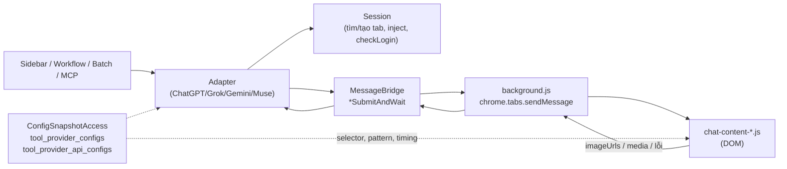
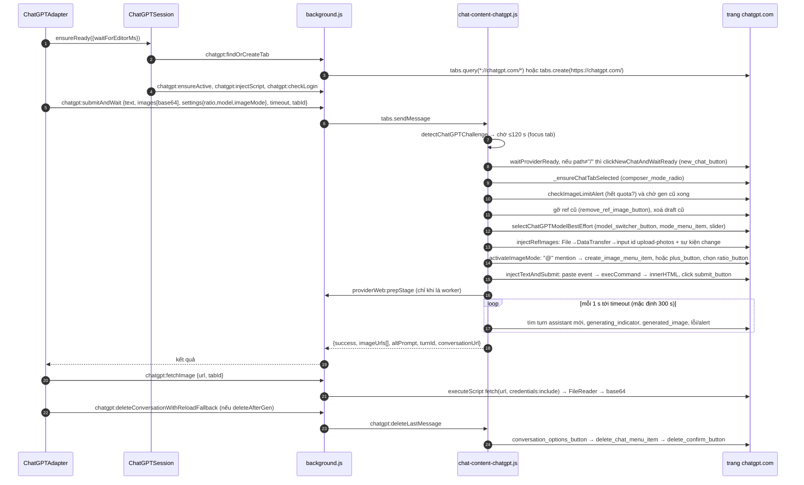
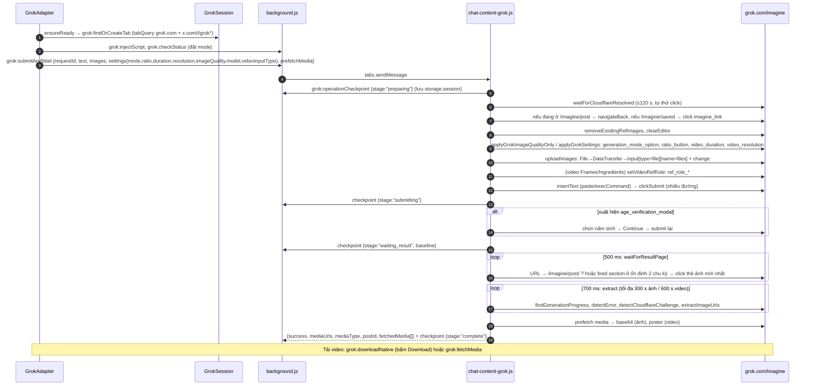
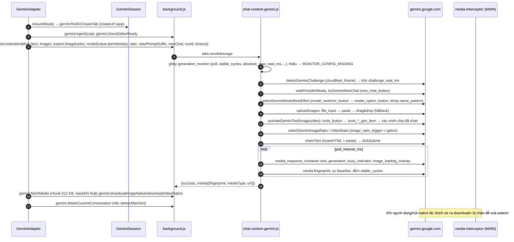
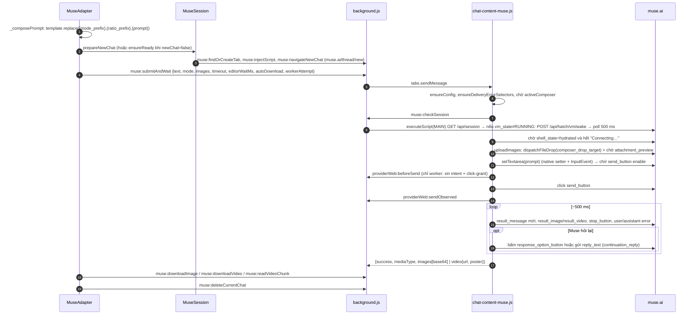
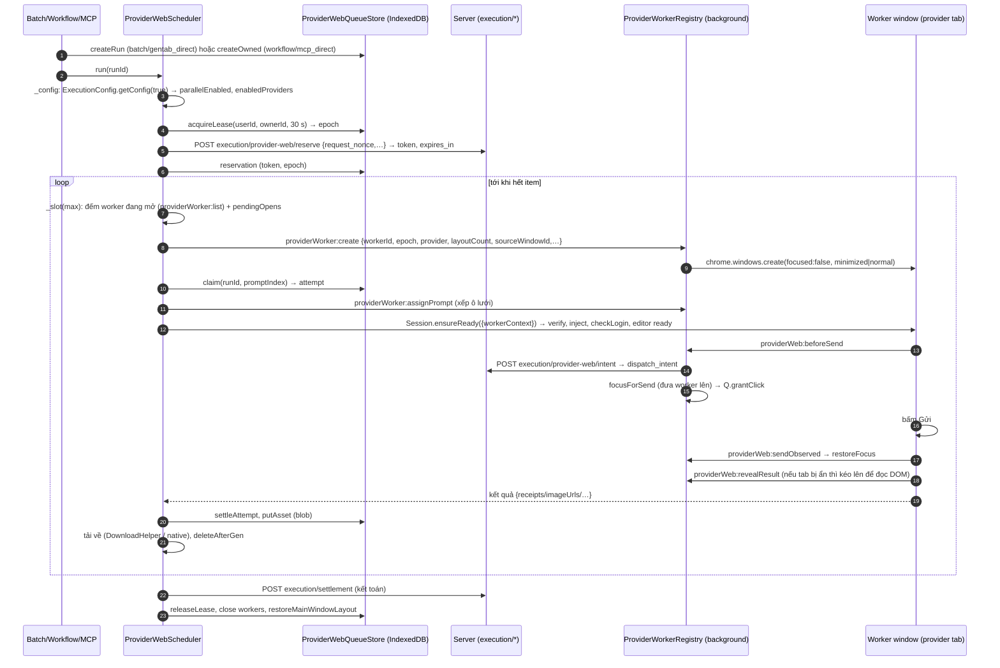

# 6. ChatGPT, Grok, Gemini, Muse: tự động hoá và chạy song song

> **Cập nhật runtime 05/11/2026:** [chương 16](16-flow-gpt-runtime-findings.md) đã thu được **82 selector Flow hiện tại**, config transport/correlation và **11 nhóm private config ChatGPT** trên gói Free. Các câu bên dưới nói chúng chưa quan sát được là giới hạn của lượt phân tích trước, không còn là blocker hiện tại. Phần giao thức **Max Speed + mã Bridge** vẫn chưa thu được. Lượt đào sâu mới chỉ tập trung Flow và ChatGPT.

ToolFlow không gọi API sinh ảnh của ChatGPT, Grok, Gemini hay Muse. Nó điều khiển giao diện web của chính tài khoản người dùng. Mỗi provider có một content script riêng (`chat-content-*.js`) gõ prompt, upload ảnh tham chiếu, bấm gửi, chờ kết quả, rồi lấy ảnh hoặc video về.

Selector, mẫu lỗi, thời gian chờ và cờ tính năng đều do server đẩy xuống. Content script **không có selector cứng dự phòng** [QS].

Chạy song song dựa trên "worker window". Đây là một cửa sổ Chrome riêng mở sẵn trang provider, có khoá lease/epoch trong IndexedDB và server cấp quyền "intent" trước mỗi lần bấm gửi. Cơ chế này hiện chỉ bật cho **muse, chatgpt, gemini**. Grok vẫn chạy tuần tự trên một tab.

Phạm vi: phân tích tĩnh extension v1.3.138 (code đã beautify để đọc) và dữ liệu `chrome.storage.local` đã che. Không chạy extension, không gọi mạng. Cách sơ đồ này được dựng ra: đọc code rồi suy ra luồng. Chưa có trace runtime.

Nhãn độ tin cậy: **[QS]** quan sát trực tiếp · **[SL]** suy luận · **[?]** chưa rõ.

---

## 1. Bản đồ file

Đường dẫn tính từ thư mục gốc extension. Kích thước là byte, đo bằng `stat`.

| File | Kích thước | Vai trò |
|---|---:|---|
| `chat-content-chatgpt.js` | 148 340 | Content script trên `chatgpt.com`: new chat, chọn model, bật chế độ tạo ảnh, upload ref, gõ prompt, submit, theo dõi kết quả, xoá chat |
| `chat-content-grok.js` | 106 735 | Content script trên `grok.com`: điều hướng `/imagine`, đặt mode/ratio/quality/duration, upload ref, submit, chờ, prefetch media, Cloudflare, xác minh tuổi |
| `chat-content-gemini.js` | 103 342 | Content script trên `gemini.google.com`: chọn model, bật tool "tạo ảnh/video", đặt ratio, upload, theo dõi, tải qua chunk hoặc nút native, xoá chat |
| `chat-content-muse.js` | 59 407 | Content script trên `muse.ai`: new chat, upload ref bằng drag-drop, gửi, đoán kết quả, tự "tiếp tục" khi Muse hỏi lại, tải video, xoá thread |
| `floating-tracker-chat.js` | 26 660 | `FloatingTracker` và `ExecutionBlocker` gắn vào 4 trang chat: thanh tiến độ nổi, lớp chặn thao tác của user |
| `src/core/providers/AIProviderAdapter.js` | 807 | Lớp cơ sở: `ensureReady/submit/uploadRef/cancel`, `isEnabled()` hỏi `featureGate.canUse(featureKey)` |
| `src/core/providers/ChatGPTAdapter.js` | 12 348 | Adapter ChatGPT: chuẩn hoá ratio, gọi `MessageBridge.chatGPTSubmitAndWait`, retry reload, `submitText` cho AI Agent |
| `src/core/providers/GrokAdapter.js` | 34 611 | Adapter Grok: model, input type video (Ingredients/Frames), giới hạn ref, `grokSubmitAndWait`, recover khi mất kết nối, UI khung frame |
| `src/core/providers/GeminiAdapter.js` | 10 585 | Adapter Gemini: ghép ratio suffix, `generation_monitor`, retry 2 lượt, phục hồi `TEXT_ONLY` |
| `src/core/providers/MuseAdapter.js` | 6 923 | Adapter Muse: ghép prompt từ `prompt_prefixes`, `museSubmitAndWait`, retry theo `exec_max_retries` |
| `src/core/providers/ProviderRegistry.js` | 2 048 | Đăng ký adapter theo `key`; `get(key)` mặc định về `flow` |
| `src/core/ChatGPTSession.js` | 15 319 | Quản lý tab ChatGPT: `findOrCreateTab`, inject script, `checkLogin`, ready TTL; nhánh worker (`_ensureWorkerReady`) |
| `src/core/GrokSession.js` | 11 252 | Quản lý tab Grok; `setMode/Ratio/VideoDuration/Resolution/ImageQuality`, `checkStatus` |
| `src/core/GeminiSession.js` | 10 436 | Quản lý tab Gemini; `reconnectAfterNavigation`, `forceRefresh` |
| `src/core/MuseSession.js` | 9 655 | Quản lý tab/worker Muse; `prepareNewChat`, đồng bộ URL worker, `probeReady` |
| `src/core/ChatGPTConfig.js` | 1 312 | Lấy `error_patterns` + `ui_text_patterns` của ChatGPT từ scope `private` (cache `af_chatgpt_config`, TTL 1 giờ) |
| `src/core/GrokConfig.js` | 1 236 | Tương tự cho Grok (`af_grok_config`) |
| `src/core/ProviderConfigManager.js` | 30 715 | Bộ nạp cấu hình provider: selector DOM, api config, private config; getter đồng bộ cho adapter |
| `src/core/ProviderWebScheduler.js` | 90 672 | Bộ điều phối chạy song song: slot, mở/đóng worker, claim item, submit, nhận kết quả, tải về, xoá chat, retry, settle |
| `src/core/ProviderWorkerRegistry.js` | 41 016 | Registry cửa sổ worker trong `chrome.storage.session`: tạo/verify/đóng cửa sổ, xếp lưới, focus để gửi, reveal để lấy kết quả |
| `src/core/ProviderWebQueueStore.js` | 117 819 | IndexedDB `toolflow_provider_web_batches`: batch, run, item, attempt, lease, reservation, outbox |
| `src/core/ProviderWebBatchView.js` | 121 842 | UI hàng đợi batch cho provider web (liệt kê/đổi tên/xoá/rerun). Chỉ đọc bề mặt gọi API, chưa đọc kỹ nội dung [SL] |
| `src/core/LegacyProviderResultWake.js` | 7 735 | Báo thức (`chrome.alarms`) kéo cửa sổ đang chạy tuần tự lên để lấy kết quả khi tab bị ẩn |
| `src/core/ProviderTabLock.js` | 3 667 | Khoá bộ nhớ theo provider cho nhánh tuần tự; mỗi lần acquire kích hoạt tab provider |
| `src/core/ProviderMeta.js` | 6 711 | Tên/icon provider từ `GET /providers` (cache `tool_providers`) |
| `media-interceptor.js` + `media-intercept-bridge.js` | 15 661 + 8 609 | Chỉ Gemini: chặn `fetch` và `<a download>` ở MAIN world để xoá watermark. Không dùng để phát hiện kết quả [QS] |

Phần trong `background.js` liên quan (đường dẫn `background.js › message.action===…`): `chatgpt:*`, `grok:*`, `gemini:*`, `muse:*`, `providerWorker:*`, `providerWeb:*`, `_probeMuseSessionInPage`.

---

## 2. Kiến trúc chung của một lượt chạy

Quy ước chung cho cả 4 provider:

- **Hợp đồng adapter** [QS] (`AIProviderAdapter`): `key`, `featureKey` (`chatgpt_enabled`, `grok_enabled`, `gemini_enabled`, …), `executionAction` (`chatgpt_run`, `grok_run`, `gemini_run`), `capabilities` (đọc từ `ProviderConfigManager.safeGet*Sync`), `ensureReady()`, `submit()`, `uploadRef()`. Cache `capabilities` bị huỷ khi nhận các sự kiện `sse:provider_config_updated`, `provider:api_config_updated`, `provider:models_updated`, `auth:logout`, …
- **Kết quả trả về chuẩn**: `{success, imageUrls|mediaUrls|receipts, error, noRetry, message, diagnostic}`. Mã `noRetry:true` cắt vòng retry ở tầng trên.
- **Selector chỉ từ server** [QS]: mỗi content script có `_getDynamicSelector(key)` đọc `tool_provider_configs.data[provider].selectors[key]` qua `ConfigSnapshotAccess.read` (cache `_SELECTOR_CACHE_TTL`). `_queryWithFallback(key, defaultSelectors=null)`: nếu server không có key thì mảng selector rỗng, không có gì để thử.
  - Danh sách `selectors[]` được thử **theo thứ tự trong mảng** bằng `querySelector`.
  - Trường `priority` (P0/P1/P2) **không được code nào đọc** (grep `.priority` = 0 trong 4 content script và `ProviderConfigManager`). Đây chỉ là nhãn cho người soạn config [QS].
  - Với các khoá "điều khiển" (`composer`, `submit_button`, `stop_button`, `plus_button`, `ratio_button`, `model_switcher_button`) ChatGPT lọc thêm: phần tử phải được render và tương tác được. `exclude_if_aria_contains` loại nút giọng nói/dictation khỏi `submit_button`.
  - Khi server đổi cấu hình, background gửi `providerConfigUpdated` và content script xoá cache selector.
  - Khi selector thất bại, `ProviderConfigManager.reportFailure` có thể báo `POST /api/v1/analytics/selector-failure` (throttle 5 phút).
- **Ba lớp cấu hình** [QS]:
  1. `tool_provider_configs`: selector DOM, `config_version`, `profiles.legacy` (cùng nội dung với `selectors`, `host_patterns` rỗng).
  2. `tool_provider_api_configs`: timing, ratio, `supports`, `max_ref_images`, URL, pattern lỗi (muse có nội dung, 3 provider kia `configs: {}` trong snapshot).
  3. Scope `private` (`RequestSigner.fetchProtected("private")`): `error_patterns`, `ui_text_patterns`, `prompt_prefixes`, `generation_monitor`,… Cần `ConfigSnapshotAccess.privateApi(provider)` (chỉ cho chatgpt, grok, gemini) hoặc `ProviderConfigManager.fetchPrivateConfigs`. Các key bị khoá (`_GATED_API_CONFIG_KEYS`) gồm `prompt_prefixes`, `watermark_removal`, `api_endpoints`, `captcha_config`,…
  - Snapshot đã che nên **không thấy** pattern lỗi của ChatGPT/Grok/Gemini ở đây. Phải suy tên khoá từ code (mục 5).
- **Timeout khởi động worker** do `ExecutionConfig.getProviderStartupTimeoutMs(provider)` trả về: 10 000–120 000 ms, mặc định 60 000 ms.

### 2.1 Cấu hình server trong snapshot (khoá liên quan)

`af_execution_config.json › parallel` [QS]:

| Khoá | Giá trị thấy | Ý nghĩa |
|---|---|---|
| `provider_web_enabled` | `true` | Công tắc tổng cho chạy song song |
| `provider_web_enabled_providers` | `["muse","chatgpt","gemini"]` | **Không có `grok`** |
| `provider_web_max_concurrent_workers` | `2` | Mã chấp nhận 1–4 |
| `provider_web_{muse,chatgpt,gemini}_startup_timeout_ms` | `60000` | Chờ composer sẵn sàng |
| `provider_web_workflow_enabled` | `true` | Bề mặt workflow |
| `provider_web_mcp_direct_enabled` | `true` | Bề mặt MCP |
| `provider_web_motion_enabled` | `true` | Bề mặt Motion (chỉ chatgpt, gemini) |
| `web_resubmit_enabled` | `true` | [?] không thấy nơi dùng trong phạm vi này |

Cùng file: `queue.batch_size=6`, `queue.max_monitor=6`, `queue.video_max_monitor=4`, `queue.rest_min_sec=5`, `queue.rest_max_sec=15`, `timing.delay_between_prompts_sec=3`, `workflow.max_retries=1`, `workflow.timeout_sec=180`, `workflow.delay_nodes_sec=3`.

`tool_provider_api_configs.json › data.muse.configs` [QS]:

| Khoá | Giá trị | Dùng ở |
|---|---|---|
| `automation_timings` | `new_chat_timeout_ms 10000`, `poll_interval_ms 150` | Tạo chat mới, poll UI |
| `reference_upload_timings` | `poll 200`, `settle 2000`, `timeout 120000` ms | Chờ ref gắn xong |
| `result_wait` | `text_min_elapsed_ms 8000`, `text_stable_ms 9000`, `pending_media_patterns[6]` | Phân biệt "chỉ text" với "ảnh đang tới" |
| `error_patterns.generation_failed_text` | chuỗi `A\|B\|…` (I'm afraid, wasn't able to, Couldn't generate, internal error, Chưa tạo, không thể,…) | `GENERATION_FAILED` |
| `media_fetch` | `attempts 3`, `retry_delay_ms 500`, `timeout_ms 10000` | Tải ảnh về base64 |
| `session_readiness` | `session_url /api/session`, `wake_url /api/hatch/vm/wake`, `assigned_status assigned`, `running_state RUNNING`, `disabled_state DISABLED`, `hydrated_state hydrated`, `connecting_patterns ["Connecting...","Connecting…"]`, `poll 500`, `timeout 15000` | Đánh thức VM của Muse |
| `timeouts` | `image_ms 300000`, `video_ms 600000` | Hạn chờ kết quả |
| `max_ref_images` | `image 10`, `video 1` | Giới hạn ref |
| `ratios` | image: 1:1, 4:3, 3:4, 16:9, 9:16 (mặc định 9:16); video: cùng 5 mức | Ratio |
| `supports` | `ref_image, ratio, video, auto_download, delete_after_gen = true`; `humanized, image_mode, quantity = false` | Cờ năng lực |
| `urls.new_chat_url` | `https://muse.ai/thread/new` | Tạo chat/worker |

Khoá Muse **không có trong snapshot** nhưng code đọc: `prompt_prefixes` (`template`, `modes`, `ratios`), `continuation_reply` (`request_phrases`, `reply_text`), `exec_max_retries` (trong `ExecutionConfig`), mẫu `delivery_error` [QS code].

Model (`tool_provider_models.json`) [QS]: ChatGPT `Instant, Medium, High, Extra High, Pro` (ảnh). Gemini `Flash, Pro, Argon` (dùng chung ảnh/video, có `dom_identity.name_pattern` để khớp tên trong menu). Muse `spark` ("Spark 1.3"; ảnh+video, ref ≤ 10, video ref ≤ 1). Grok `grok-imagine` (ảnh ref ≤ 5; video có `Ingredients` ≤ 5 ref và `Frames` ≤ 2 ref với role first/last frame).

---

## 3. ChatGPT (`chatgpt.com`)

Chỉ tạo **ảnh** (`UNSUPPORTED_MEDIA_TYPE` nếu mediaType khác `image`). Ratio đi qua nút ratio nếu UI có, đồng thời còn nối một câu vào prompt.

### 3.1 Sequence một lượt tạo ảnh

### 3.2 Từng bước (code)

| Bước | Hành vi | Nguồn |
|---|---|---|
| Mở tab | Tìm tab `*://chatgpt.com/*` trong cùng cửa sổ trước, rồi mọi cửa sổ; không có thì `tabs.create` và chờ `status=complete` tối đa 15 s | `background.js › chatgpt:findOrCreateTab` |
| Đưa về trang chủ | `chatgpt:ensureActive` với `navigateToHome`/`forceRefresh` có thể gắn `?_t=<now>` để ép tải lại | `background.js › chatgpt:ensureActive` |
| New chat | Đã ở `/` thì chỉ chờ composer ổn định (`_waitComposerStable`). Ngược lại: bậc 1 click `new_chat_button`, bậc 2 `chat_history_home_link`, bậc 3 click anchor tổng hợp `/` | `clickNewChatAndWaitReady` |
| Chọn model | `selectChatGPTModel`: mở `model_switcher_button`, so nhãn trong menu. Nhãn lấy từ api-config `chatgpt_model_labels` (chuỗi `a\|b`), slider mức nỗ lực từ `chatgpt_model_slider_values`. "Best effort": lỗi không dừng lượt chạy | `selectChatGPTModelBestEffort` @1492 |
| Upload ref | Giải base64 thành `File`, tìm `file_input` (`#upload-photos`), nếu không có thì click `plus_button`; gán qua `DataTransfer`, bắn `change`. Chờ preview/hoàn tất theo `reference_upload_timings` (`preview_timeout_ms`, `completion_timeout_ms`, `settle_ms`, `poll_interval_ms`). Lỗi: `UPLOAD_COUNT_MISMATCH`, `UPLOAD_STILL_PENDING`, `FILE_INPUT_NOT_FOUND`, `COMPOSER_DIRTY`… | `injectRefImages` @1894 |
| Bật chế độ ảnh | Bậc 1: gõ `@` → menu mention → `create_image_menu_item` (hoặc khớp chữ theo `ui_text_patterns.create_image_menu_text`) → chờ `image_mode_pill`. Bậc 2: `plus_button` → menu. Thất bại thì dùng **fallback prefix** `"Generate an image of: "` (setting `chatgptFallbackPrefix`) | `activateImageMode` @1537 |
| Ratio | Click `ratio_button`, chọn theo `aria-label` (`RATIO_ARIA_MAP`). Luôn nối vào cuối prompt `"\n\nGenerate the image in 16:9 (widescreen) aspect ratio."` (bảng `ratioToPromptSuffix`) | `ratioToPromptSuffix` @1519 |
| Gõ prompt | Tầng 1: bắn `ClipboardEvent("paste")` với `DataTransfer`. Tầng 2: `document.execCommand("insertText")`. Tầng 3: ghi `innerHTML` + `InputEvent`. Kiểm tra mất pill chế độ ảnh, nghi chèn kép (`IMG_VERIFY`), editor bị detach | `injectTextAndSubmit` @2090 |
| Gửi | Chờ `submit_button` enable (đợi upload xong). Tầng: `click()` → phím Enter (keydown/keypress/keyup) → `simulateClick` (chuỗi Pointer+Mouse) → gọi `__reactProps.onClick` → `form.requestSubmit()`. Xác nhận bằng turn user mới hoặc composer đã rỗng | cùng hàm |
| Chống nhảy hội thoại | Nếu SPA nhảy về chat cũ (`_yankedBack`) thì chờ stream cũ xong (≤120 s) rồi trả `SUBMIT_FAILED_NEED_RELOAD` + `reason:"YANKED"`; lượt sau bỏ bước bật chế độ ảnh (`skipImageToggle`) | `submitAndWait` listener |

### 3.3 Chờ kết quả: DOM, không chặn mạng

`waitForImageResult` (@3370) poll **1 s** [QS]:

1. Tìm turn assistant mới sau `baseline` (snapshot số turn/ảnh trước khi gửi).
2. Đang stream? (`isStreaming`) → sau 5 s (hoặc 10 s nếu text có chữ tích cực như "i'll create", "here's") bắt đầu so mẫu lỗi.
3. Ảnh chờ (`generated_image` chưa có `src` hoặc có lớp `blur-2xl`) → tiếp tục chờ.
4. Có ảnh sinh ra (alt "Generated image…" hoặc `[data-testid="generated-image-preview"] img[src^="blob:"]`) và đã hết stream → `extractImageUrls`, **dedupe theo `file_id`**, bỏ ảnh ref (alt khác "Generated image" mà không rỗng).
5. Văn bản hoàn tất mà không có ảnh: sau `POST_COMPLETE_GRACE_MS = 5000` → `TEXT_ONLY` (có `textOnlyConfirmed`); adapter dùng `RetryHelper.recoverMediaTextOnly` gửi lại trên chính hội thoại.
6. Hạn tuyệt đối `message.timeout || 300000`; lý do thoát: `absolute_cap | heartbeat_lost | no_generating`; lỗi `TIMEOUT`.

Thành công trả `{imageUrls, altPrompt, turnId, conversationUrl}`. URL ảnh là URL CDN (`estuary/content`, `oaiusercontent`, `/backend-api/`) hoặc `blob:`. **Tải về**: `background.js › chatgpt:fetchImage` chạy `fetch(url,{credentials:"include"})` ngay trong trang (world `MAIN` nếu là `blob:`, nếu không là `ISOLATED`), đọc ra data URL base64, hạn 180 s [QS].

### 3.4 Selector ChatGPT (44 khoá; trích mẫu)

| Nhóm | Khoá | Mục đích | Trích mẫu |
|---|---|---|---|
| Soạn | `composer` (P0) | Ô nhập | `#prompt-textarea`, `div.ProseMirror[role="textbox"]` |
| | `submit_button` (P0) | Nút gửi, loại nút thoại bằng `exclude_if_aria_contains` | `#composer-submit-button`, `button[data-testid="send-button"]` |
| | `stop_button` | Phát hiện/ngừng sinh | `[data-testid="stop-button"]`, `button[aria-label="Ngừng"]` |
| | `plus_button`, `file_input`, `ref_upload_pending`, `remove_ref_image_button`, `audio_attachment_remove_button`, `text_file_tile`, `pa_source_text_file` | Đính kèm, theo dõi upload, gỡ ref | `#upload-photos`; `[data-composer-attachments] … > button[aria-label]` |
| Chế độ ảnh | `mention_menu`, `menu_items`, `create_image_menu_item`, `image_mode_pill`, `ratio_button`, `open_menu`, `composer_mode_radio` | Bật "Create image", chọn ratio, chuyển tab Chat | `.__menu-item:has(use[href*="#create-image-plugin"])`, `button[aria-label="Choose image aspect ratio"]`, `[data-system-hint-type="picture_v2"]` |
| Model | `model_switcher_button`, `model_effort_slider`, `model_effort_slider_control`, `mode_menu_item` | Chọn model/mức nỗ lực | `button.__composer-pill[aria-haspopup="menu"]`, `[data-reasoning-slider="true"] [role="slider"]` |
| Hội thoại | `new_chat_button`, `chat_history_home_link`, `conversation_turn`, `assistant_turn`, `message_author` | Định vị turn mới, nhận dạng danh tính turn (`identity_attributes`) | `a[data-testid="create-new-chat-button"]`, `[data-testid^="conversation-turn-"][data-turn="assistant"]` |
| Kết quả | `generated_image`, `cdn_image`, `generating_indicator`, `image_generation_progress`, `image_action_buttons`, `paragen_container`, `thinking_indicator`, `response_text_content`, `completed_text_response` | Nhận ảnh, tiến độ, phân biệt text-only | `img[alt^="Generated image"]:not([aria-hidden])`, `[data-testid="image-gen-loading-state"]`, `img[src*="oaiusercontent"]` |
| Lỗi/chặn | `generation_error_alert`, `cloudflare_iframe` (P0), `challenge_overlay`, `login_button`, `auth_link` | Báo lỗi, Cloudflare, chưa đăng nhập | `[data-turn-key] [role="alert"]`, `iframe[src*="challenges.cloudflare.com"]`, `.cf-turnstile` |
| Xoá | `conversation_options_button`, `conversation_options_menu`, `delete_chat_menu_item`, `delete_confirm_button` | Xoá chat sau khi tải | `[data-testid="delete-chat-menu-item"]`, `button[data-testid="delete-conversation-confirm-button"]` |

### 3.5 Xoá chat

`deleteLastAssistantMessage` (@414) mở menu tuỳ chọn hội thoại → "Delete" → xác nhận trong dialog (dialog tìm bằng chính `challenge_overlay`), chờ điều hướng. Mã lỗi: `DELETE_TRIGGER_NOT_FOUND`, `DELETE_MENU_NOT_FOUND`, `DELETE_CONFIRM_NOT_FOUND`, `CLEANUP_CANCELLED` (có lượt submit mới hơn `requestedAt`), `CLEANUP_NOT_CONFIRMED`, `CONVERSATION_CHANGED` (URL khác `expectedConversationUrl`). Scheduler gọi `chatgpt:deleteConversationWithReloadFallback` và có nhánh tải lại tab nếu xoá lần đầu thất bại [QS].

### 3.6 Văn bản (AI Agent / prompt enhancer)

`ChatGPTAdapter.submitText` dùng cùng đường, nhưng `imageMode:false`, `newChat:true`, `expectText:true`; content script tắt chế độ ảnh nếu đang bật, gắn `getEnhancePrefix()` (cấu hình server) trước prompt, rồi `waitForTextResult`. Có thêm listener `provider:textTask` [QS].

---

## 4. Grok (`grok.com`, mục "Imagine")

Tạo **ảnh và video**. Điều khiển ở trang `/imagine`. Kết quả hiện ở feed rồi vào trang `/imagine/post/<id>`.

### 4.1 Sequence

### 4.2 Từng bước

| Bước | Hành vi | Nguồn |
|---|---|---|
| Hợp lệ hoá | Adapter kiểm `GROK_MODEL_CONFIG_MISSING`, `GROK_INPUT_TYPE_CONFIG_MISSING`, `GROK_REF_LIMIT_EXCEEDED` (số ref theo model, `Frames` ≤ 2) trước khi chạm DOM | `GrokAdapter.submit` |
| Mode ảnh/video | `selectMode`: tìm `[role=radiogroup] button[role=radio]`, khớp nhãn theo api-config `mode_labels` và đường SVG `mode_toggle_svg_paths`; xác nhận bằng thuộc tính `aria-checked` (`confirmGrokSelection`). Video thất bại → `GROK_VIDEO_MODE_NOT_CONFIRMED` | `selectMode` @1205 |
| Chất lượng ảnh | `image_quality_picker` (radiogroup "Image generation speed"); giá trị `speed`… tuỳ api-config `image_quality_labels` | `selectImageQuality` |
| Video | `video_duration_menu_button`/`video_duration_picker`, `video_resolution_menu_button`/`video_resolution_picker`, mặc định 6s/720p; tuỳ chọn `allowLower` | `selectGrokVideoDropdown` @1286 |
| Ratio | `ratio_button` (aria-label "Aspect Ratio"/"Tỷ lệ khung hình") rồi `ratio_menu_item`; map từ api-config `ratios` | `selectRatio` @1353 |
| Ref ảnh | Giống ChatGPT nhưng input là `input[type=file][name="files"]`; có thể gán role từng ảnh (First frame/Last frame/Reference) qua hover-card (`ref_role_trigger`, `ref_role_options`…). Cũng có "mention bypass" (`@` trong prompt) cho một số ref | `uploadImages` @1655, `setVideoRefRole` @1729 |
| Gõ + gửi | `insertText` (paste event → `beforeinput` → `execCommand`), `clickSubmit` thử nhiều transport (formRequestSubmit, Enter, nativeClick…) và chờ "ack" theo `automation_timings` (`ui_ready_timeout_ms`, `selection_timeout_ms`, `submit_ack_timeout_ms`, `poll_interval_ms`) | `clickSubmit` @1078 |
| Chờ kết quả | `waitForResultPage`: chấp nhận khi URL chuyển sang `/imagine/post/…`, hoặc ảnh inline `data:image/…` ổn định 2 lần (khi không có ref), hoặc ảnh đầu feed `[id^="imagine-masonry-section-0"]` ổn định ≥ 2 chu kỳ thì click thẻ. Tiến độ % đọc bằng `findGenerationProgress`; đứng im ở một mức % quá `HEARTBEAT_TIMEOUT = 90 s` thì thoát sớm | `waitForResultPage` @2066 |
| Lấy URL | `extractImageUrls(excludeUrls, cdnHosts)` loại URL của ảnh ref; host CDN hợp lệ lấy từ api-config `urls.cdn_patterns` (mặc định `assets.grok.com`). Video lấy `video`/`video source` trong `result_container` | @2195 |
| Prefetch | Với ảnh, content script fetch luôn thành base64 (`prefetchMedia`); với video thì **không** (`prefetchMedia: mode !== "video"`) và để tầng trên gọi `grok:fetchMedia` hoặc `grok:downloadNative` | `handleSubmitAndWait` |
| Tải native | `grok:downloadNative`: bấm `result_download_button`; nếu chưa thấy thì mở `result_post_actions_button` trước. Lỗi `DOWNLOAD_BUTTON_NOT_FOUND`, `POST_ACTIONS_UNAVAILABLE`, `POST_MEDIA_MISMATCH` | listener @3560 |
| Xoá | **Không có** bước xoá chat cho Grok: `GrokAdapter` và danh sách selector không có khoá xoá. Worker cũng từ chối `deleteAfterGen` cho provider khác chatgpt/gemini (`WORKER_DELETE_UNSUPPORTED`) [QS] |  |

**Hồi phục sau mất kết nối** [QS]: mỗi bước quan trọng ghi `grok:operationCheckpoint` vào `chrome.storage.session` với khoá `grokOperation:<tabId>:<requestId>` (stage: `preparing → submitting → waiting_result → complete`, kèm `baseline`, `refUrlsToExclude`). Nếu tab nạp lại, adapter inject lại script và gọi lại `grokSubmitAndWait` với `recover:true` (tối đa 3 lần). Content script đọc `recoveryState`, hoặc trả luôn `result` nếu stage đã `complete`, hoặc tiếp tục chờ nếu đang `waiting_result`. Thiếu trạng thái → `GROK_RECOVERY_STATE_MISSING`.

### 4.3 Selector Grok (52 khoá; trích mẫu)

| Nhóm | Khoá | Mục đích | Trích mẫu |
|---|---|---|---|
| Soạn | `composer`, `submit_button`, `stop_button` | Nhập, gửi, ngừng | `form div[contenteditable="true"]`, `.ProseMirror`; `button[type="submit"][aria-label="Submit"]`; `button[aria-label="Stop"]` |
| Mode & điều khiển | `generation_mode`, `generation_mode_option` (có `selected_attribute: aria-checked`, `svg_path_selector`), `control_radio_option`, `image_quality_picker`, `ratio_button`, `ratio_menu_item`, `video_duration_*`, `video_resolution_*`, `video_control_menu_option`, `open_menu` | Đặt mode, ratio, quality, duration, resolution | `[role="radiogroup"][aria-label="Generation mode"]`, `button[aria-label="Aspect Ratio"]`, `button[aria-label="Video duration"][aria-haspopup="menu"]` |
| Ref | `file_input`, `upload_container`, `upload_loading_indicator`, `upload_error_icon`, `upload_error_close_button`, `remove_image_button`, `remove_image_button_broad`, `ref_role_trigger`, `ref_role_options`, `ref_role_option`, `ref_role_first_frame`, `ref_role_last_frame` | Upload, bắt lỗi upload, gỡ ref, gán vai trò ảnh | `input[type="file"][name="files"]`; `svg.lucide-triangle-alert` |
| Điều hướng | `imagine_link`, `saved_button`, `back_button` | Về `/imagine`, thoát trang post | `a[href="/imagine"]`, `button[aria-label="Back"]` |
| Kết quả | `result_container`, `result_image`, `result_inline_image`, `result_lightbox_inline_image`, `result_video`, `result_feed_section`, `result_feed_card_image`, `filmstrip_item`, `grok_cdn_image`, `result_download_button`, `result_post_actions_button`, `result_lightbox_post_actions_button` | Tìm ảnh/video, tải native | `[data-lightbox-media]`, `main article:has(video)`, `[id^="imagine-masonry-section-0"]`, `img[src*="assets.grok.com"]` |
| Chặn | `cloudflare_iframe`, `cloudflare_turnstile`, `cloudflare_overlay_dialog`, `age_verification_modal` (`data-analytics-name="age_verification"`), `age_verification_scroll_container`, `age_verification_year_button`, `age_verification_continue_button`, `subscription_dialog`, `modal_overlay_wrapper`, `auth_link` | Phát hiện Cloudflare, tuổi, gói trả phí, chưa đăng nhập | `iframe[src*="challenges.cloudflare.com"]`, `#dialog-portal .x-commerce [role="dialog"][data-slot="xds-modal-surface"]` |

Lưu ý [QS]: `base_url` trong config là `https://x.com/i/grok`, nhưng content script chỉ được khai báo cho `https://grok.com/*` và `https://*.grok.com/*`; `PROVIDER_URLS.grok.createUrl` là `https://grok.com/` và `imagine` là `https://grok.com/imagine`. Tab query còn thêm `https://x.com/i/grok*` và `grok:operationCheckpoint` chấp nhận URL x.com. Chưa rõ trường hợp tab ở x.com có được inject không [?].

---

## 5. Gemini (`gemini.google.com`)

Tạo **ảnh và video** (công cụ trong menu "Tools"). Một mô hình (Flash/Pro/Argon) dùng chung cho cả hai loại.

### 5.1 Sequence

### 5.2 Từng bước

| Bước | Hành vi | Nguồn |
|---|---|---|
| Cấu hình bắt buộc | `getGeminiApiConfig()` = `ConfigSnapshotAccess.privateApi("gemini")` (kèm `__configVersion`). Thiếu `generation_monitor[image|video]`, `interaction`, `editor wait` → trả `MONITOR_CONFIG_MISSING/INVALID`, `INTERACTION_CONFIG_MISSING`, `EDITOR_WAIT_CONFIG_MISSING` (nghĩa là **thất bại sớm, không đoán số**) | `runGeminiMedia` @2514 |
| Tránh giẫm chân | `PROVIDER_BUSY` nếu đang có lượt khác trên tab; `CONVERSATION_CHANGED` nếu URL khác `retryConversationPath` | cùng hàm |
| Chọn model | `selectGeminiModel`: đọc `model_trigger_label`, mở `model_switcher_button`, duyệt `model_option_button` (`data-mode-id`), khớp bằng `dom_identity.name_pattern` (regex ở `tool_provider_models`) và đánh dấu bằng `model_option_selected`; đóng menu | @1600 |
| Bật công cụ | `activateGeminiTool(mediaType)`: `tools_menu_button`/`tools_button` → `tools_image_gen_item` (icon `image_create`) hoặc `tools_video_gen_item` (icon `movie`) → xác nhận chip `tools_image_selected_chip`/`tools_video_selected_chip`. Sai thì chọn lại model và thử lại một lần; cuối cùng `TOOL_VERIFY_FAILED` | @1783 |
| Prefix prompt | api-config `media_mode_prompt_prefixes` chèn trước prompt, thiếu → `TOOL_PROMPT_PREFIX_MISSING` | `runGeminiMedia` |
| Ratio | Ảnh: `image_ratio_trigger` + `image_ratio_option_{1_1,3_4,4_3,9_16,16_9}`; video: `video_ratio_trigger` + `video_ratio_option_{landscape,portrait}`. Không chọn được thì `IMAGE_RATIO_FALLBACK_MISSING`/`VIDEO_RATIO_FALLBACK_MISSING` (fallback = nối `prompt_suffix` của ratio vào prompt) | @1436, @1308 |
| Upload | Thứ tự: `file_input` (có thể phải bấm `add_button` trước) → `ClipboardEvent("paste")` lên composer → `DragEvent` dragenter/dragover/drop lên `composer`/`input_area_container`. Trong selector hiện tại **không có** khoá `file_input` cho Gemini nên bậc đầu rơi xuống paste/drop [QS]. Đợi xong bằng `upload_in_progress`, đếm `uploaded_image`. Lỗi `REF_UPLOAD_FAILED`, `REF_UPLOAD_COUNT_MISMATCH` | `uploadImages` @635 |
| Gõ + gửi | `insertText` dùng `execCommand("insertHTML")` + `InputEvent`, sau đó `clickSubmit` chờ `submit_button`; lỗi `INSERT_FAILED`, `SEND_BUTTON_NOT_FOUND` | @807, @910 |
| Theo dõi | `waitForGeminiMediaResult` (@2202). Cấu hình `monitor`: `poll_interval_ms`, `startup_timeout_ms`, `heartbeat_stale_ms`, `stable_cycles` (≥ 2), `minimum_settle_ms`, `min_completion_guard_ms`, `absolute_max_wait_ms`, `previous_run_wait_ms`, `scroll_throttle_ms`, `scroller_refresh_ms`, `challenge_wait_ms`, `max_materialized_bytes`. Xong khi có media mới (so `fingerprint` với `baseline`, loại fingerprint của ref) **và** không còn busy **và** ổn định `stable_cycles` chu kỳ. Cuộn đáy hội thoại (`conversation_scroll_root`) để ép lazy-load | @2202 |
| Lỗi theo dõi | `STARTUP_TIMEOUT`, `GENERATION_STALLED`, `ABSOLUTE_TIMEOUT`, `GEMINI_TEXT_ONLY_RESULT` (khớp `error_patterns.text_only_pattern`), `RESULT_REVEAL_CHANNEL_FAILED`, `SCROLL_ROOT_CONFIG_MISMATCH`. Lỗi sinh từ provider khớp `error_patterns` qua `detectGeminiMediaError` | cùng hàm |
| Lấy media | `gemini:fetchMedia`: chỉ cho phép host trong api-config `media_allowed_hosts` (hoặc `blob:` cùng origin của chính ảnh vừa sinh), `fetch(credentials:"include")`, kiểm MIME `image/*|video/*`, trả từng chunk **512 KB** base64 (`MEDIA_PAYLOAD_TOO_LARGE` nếu vượt `max_materialized_bytes`). Nguồn sai → `INVALID_MEDIA_URL` | `validateGeminiMediaSource` @1901, `readGeminiMediaChunk` @1939 |
| Tải native | Gemini tải bản "full size" bằng nút của UI: `image_more_menu_button` → `image_menu_download_item` hoặc `image_download_button`; video: `video_more_menu_button` → `video_menu_download_item`/`video_download_button`. Scheduler **tuần tự hoá** các lần tải native bằng `_serializeGeminiNativeDownload` và `background.js` gắn tên file cho download đang chờ (`_findArmedGeminiRenameIndex`) [QS] | `downloadGeminiImageNative` @2068 |
| Xoá | `deleteCurrentConversation`: `conversation_actions_menu` → `delete_menu_item` → `delete_confirm_dialog`/`delete_confirm_button`; xác thực đúng hộp thoại bằng `delete_confirm_identity` (link `support.google.com/gemini?p=deleted_chats`) | @514 |

Vai trò của `media-interceptor.js` (MAIN world) trên Gemini [QS]: vá `window.fetch` và `HTMLElement.prototype.click`, chặn thẻ `<a download>` khớp mẫu URL lấy từ server (`wm:getInterceptConfig`), tải bytes, gửi qua `media-intercept-bridge` để `wm:cleanVideo`/`removeWatermark` làm sạch, rồi trả `Response` đã sạch. Chỉ bật khi tài khoản có quyền `wm:canRemove`. Đây là phần "xoá watermark khi tải", không liên quan phát hiện kết quả.

### 5.3 Retry ở adapter

`GeminiAdapter.submit` gọi `submitOnce(1, newChat=true)`. Các lỗi đáng thử lại (`SEND_FAILED, COMPOSER_DIRTY, NEW_CHAT_FAILED, CONVERSATION_CHANGED, MODEL_TRIGGER_NOT_FOUND, MODEL_NOT_AVAILABLE,…`) chạy lượt 2: `SEND_FAILED` → `GeminiSession.reconnectAfterNavigation`, `NEW_CHAT_FAILED` → `forceRefresh`, còn lại → gửi lại trên chat mới. `GEMINI_TEXT_ONLY_RESULT` → `RetryHelper.recoverMediaTextOnly` (chỉ khi `textOnlyConfirmed`). **Trong worker không retry** ở tầng adapter: scheduler tự quyết định [QS].

### 5.4 Selector Gemini (58 khoá; trích mẫu)

| Nhóm | Khoá | Mục đích | Trích mẫu |
|---|---|---|---|
| Soạn | `composer`, `input_area_container`, `submit_button`, `stop_button`, `new_chat_button` | Nhập/gửi/ngừng/chat mới | `.ql-editor`, `rich-textarea`; `button.send-button.submit`; `gem-nav-list-item[data-test-id="new-chat-button"] a` |
| Model | `model_switcher_button`, `model_option_button` (`attribute_id: data-mode-id`, `attribute_selected: aria-current`), `model_option_label`, `model_option_selected`, `model_trigger_label` | Chọn model | `button[data-test-id="bard-mode-menu-button"]`, `gem-menu-item[data-mode-id]`, `.picker-primary-text` |
| Tools | `tools_menu_button`, `tools_menu_scope`, `tools_menu_item`, `tools_button`, `tools_image_gen_item`, `tools_video_gen_item`, `tools_image_selected_chip`, `tools_video_selected_chip` | Bật công cụ ảnh/video bằng icon Material | `button.toolbox-drawer-item-list-button:has(mat-icon[data-mat-icon-name="image_create"])` |
| Ratio | `image_ratio_trigger`, `image_ratio_option_1_1`…`_16_9`, `video_ratio_trigger`, `video_ratio_option_landscape/portrait` | Chọn tỉ lệ | `input-companion-item[role="menuitemradio"][aria-label="16:9"]` |
| Upload | `add_button`, `upload_in_progress`, `uploaded_image`, `image_preview`, `motion_audio_sent_file`, `motion_audio_user_turn` | Đính kèm ref (cả audio cho Motion) | `uploader-file-preview .image-preview.loading`, `img[data-test-id="uploaded-img"]` |
| Kết quả | `media_response_container`, `response_container`, `response_text`, `generated_image`, `image_result`, `image_result_container`, `video_result`, `video_result_container`, `generation_busy_indicator`, `image_loading_overlay`, `conversation_scroll_root`, `screen_reader_label` | Nhận ảnh/video, theo dõi busy | `model-response generated-image`, `generated-video video[src]`, `.markdown[aria-busy="true"]` |
| Tải | `image_more_menu_button`, `image_menu_download_item`, `image_download_button`, `video_more_menu_button`, `video_menu_download_item`, `video_download_button` (có `button_text` đa ngôn ngữ) | Tải full-size | `gem-menu-item[data-test-id="image-download-button"]` |
| Xoá | `conversation_actions_menu`, `delete_menu_item`, `delete_confirm_dialog`, `delete_confirm_button`, `delete_confirm_action`, `delete_confirm_identity` | Xoá chat | `mat-dialog-actions gem-button[cdkfocusinitial] button` |
| Chặn | `cloudflare_iframe` (P0) | Challenge Cloudflare hoặc reCAPTCHA | `iframe[src*="challenges.cloudflare.com"]`, `iframe[src*="recaptcha"]` |

---

## 6. Muse (`muse.ai`)

Muse là web app chat có "VM" phía server. Tạo **ảnh và video**. Hầu hết hằng số timing và mẫu lỗi nằm trong api-config (xem 2.1). Hầu như mọi nhánh thiếu config đều trả lỗi `*_CONFIG_MISSING` thay vì dùng mặc định.

### 6.1 Sequence

### 6.2 Từng bước

| Bước | Hành vi | Nguồn |
|---|---|---|
| Ghép prompt | `prompt_prefixes` (kênh private): `template` chứa `{mode_prefix}`, `{ratio_prefix}`, `{prompt}`; `modes[image|video]`, `ratios[<ratio>]`. Thiếu thì `fetchPrivateConfigs(true)` rồi thử lại; vẫn thiếu → `PROMPT_PREFIX_CONFIG_MISSING`. **Muse không có nút ratio/mode: mọi thứ đi qua prompt** [QS] | `MuseAdapter._composePrompt` |
| Chặn kết quả sai loại | Nếu `result.mediaType` khác loại đã yêu cầu → `MUSE_RESULT_TYPE_MISMATCH` | `MuseAdapter.submit` |
| New chat | Mở "chat switcher" (`chat_switcher_trigger`) → `side_chats_panel` → `new_chat_button`; hoặc `muse:navigateNewChat` điều hướng thẳng `new_chat_url`, kiểm origin trước (`NOT_MUSE_URL`, `NEW_CHAT_URL_ORIGIN_INVALID`). Hết `new_chat_timeout_ms` (10 s) → lỗi | `createMuseNewChat`, `background.js › muse:navigateNewChat` |
| Đánh thức VM | `_probeMuseSessionInPage` chạy trong trang (`world:"MAIN"`, fetch `credentials:include`, `redirect:"error"`): `GET session_url` → nếu `status≠assigned` → `MUSE_SESSION_NOT_ASSIGNED`; `vm_state=DISABLED` → `MUSE_VM_DISABLED`; HTTP 401 → `MUSE_SESSION_EXPIRED`; nếu chưa `RUNNING` thì `POST wake_url {vm_id, retry_count:0, connect_attempt_id}` rồi poll mỗi 500 ms tới `timeout_ms`. VM đổi giữa chừng → `MUSE_SESSION_CHANGED` | `background.js › _probeMuseSessionInPage` |
| Sẵn sàng UI | Vòng chờ: `[data-hatch-shell-hydration-state]` = `hydrated`, `connection_status` không còn chuỗi "Connecting…", `activeComposer()` có. Hết hạn → `MUSE_CONNECTION_NOT_READY` | `checkSessionBeforeSubmit` @674 |
| Upload ref | Tạo `File`, gói `DataTransfer`, bắn `dragenter/dragover/drop` lên `composer_drop_target`/`attachment_scope`; chờ số `attachment_preview` bằng số ref trong `reference_upload_timings`. Ref đổi giữa chừng → `REF_UPLOAD_FAILED` | `uploadImages` @963, `dispatchFileDrop` @264 |
| Gõ + gửi | `composer` là `textarea[data-hatch-composer-prehydration-input]`, gán qua native setter + `InputEvent`; kiểm lại nội dung trước khi gửi (`EDITOR_TEXT_MISMATCH`). Nút `send_button` phải enable, nếu không `SEND_BUTTON_NOT_CLICKABLE`/`SEND_BUTTON_NOT_FOUND`. Với worker: **xin intent từ server trước khi bấm** (mục 8) | `submitAndWait` @1100 |
| Xác nhận gửi | Nếu không thấy user message mới / `delivery_error` → `MUSE_DELIVERY_UNCONFIRMED` (adapter retry theo `exec_max_retries`) | `freshDeliveryError` @449 |
| Theo dõi | Poll ~500 ms. Kết quả = phần tử `result_message` mới (thuộc tính `data-message-id`) chứa `result_image` (`button.hatch-chat-groupable-bubble img`) hoặc `result_video` (`[data-hatch-video-wrapper][data-hatch-video-src]`, poster `data-hatch-video-poster`). `pending_media_patterns` báo ảnh sắp tới nên chưa kết luận "chỉ text" | `submitAndWait` |
| Muse hỏi lại | `clickFirstResponseOption` (nút gợi ý trong tin nhắn assistant mới) hoặc `continuationRequest`: nếu một tin assistant duy nhất khớp `continuation_reply.request_phrases`, không có media, không còn `stop_button`, đứng yên `text_stable_ms` (9 s) và đã qua `text_min_elapsed_ms` (8 s) thì tự gửi `reply_text`. Lỗi `MUSE_CONTINUATION_SEND_UNAVAILABLE` | @467, @482 |
| Lỗi sinh | `generation_failed_text` (regex dạng `A\|B\|…`) đếm theo số lần xuất hiện: tăng so với trước lượt gửi thì `GENERATION_FAILED`. Chỉ có text lâu hơn ngưỡng → `MUSE_TEXT_ONLY_RESULT` | @515, @537, @549 |
| Hạn | `timeouts.image_ms 300000` / `video_ms 600000`; hết → `TIMEOUT` | `MuseAdapter.submit` |
| Tải ảnh | `fetchImageWithRetry`: `asDataUrl` với `media_fetch.attempts` (3) × `retry_delay_ms` (500) × `timeout_ms` (10 s); phải là `data:image/…;base64`; thiếu config → `MUSE_MEDIA_FETCH_CONFIG_MISSING` | @578 |
| Tải video | Poster chụp bằng `captureVideoPoster` (canvas) khi video sẵn sàng; byte video đọc theo chunk qua `muse:readVideoChunk` (stage open/read/close, chỉ cho `blob:`, chỉ cho worker còn sở hữu attempt). Nút tải native: `download_menu_item` với `muse:downloadImage/downloadVideo` (lỗi `DOWNLOAD_MENU_ITEM_NOT_FOUND`, `DOWNLOAD_TARGET_CHANGED`, `MEDIA_RESULT_AMBIGUOUS`) | @895, @1912 |
| Xoá | `deleteCurrentChat`: `chat_switcher_trigger` → `active_thread_row` → `active_thread_options_button` → `delete_thread_menu_item` → `delete_confirm_button`; luôn kiểm `ACTIVE_THREAD_CHANGED` giữa các bước | @1820 |

### 6.3 Selector Muse (23 khoá, tất cả dựa vào `data-*`)

| Khoá | Mục đích | Trích mẫu |
|---|---|---|
| `composer`, `composer_drop_target`, `attachment_scope`, `file_input`, `attachment_preview` | Ô nhập, vùng thả file, theo dõi ref | `textarea[data-hatch-composer-prehydration-input]`, `[data-hatch-composer-root="true"]`, `button[data-pel-click="chat_remove_attachment_click"]` |
| `send_button`, `stop_button` | Gửi, ngừng | `button[data-pel-click="chat_send_message"]`, `button[data-testid="hatch-composer-stop-button"]` |
| `shell_state`, `connection_status` | Biết app đã hydrate/đang kết nối | `[data-hatch-shell-hydration-state]` (đọc thuộc tính), `[data-hatch-connection-status-announcer]` |
| `new_chat_button`, `chat_switcher_trigger`, `side_chats_panel`, `active_thread_row`, `active_thread_options_button` | Chat mới và quản lý thread | `button[data-testid="hatch-chat-compose"]`, `[data-testid="hatch-thread-row"][aria-current="page"]` |
| `result_message` (`attribute: data-message-id`), `user_message`, `result_image`, `result_video` (`attribute: data-hatch-video-src`, `media_selector: video`, `poster_attribute`), `response_option_button`, `delivery_error` | Nhận diện kết quả/lỗi | `[data-message-item="true"][data-message-role="assistant"]` |
| `download_menu_item`, `delete_thread_menu_item`, `delete_confirm_button` | Tải, xoá | `[role="menuitem"][data-pel-click="media_download"]`, `button[data-pel-click="chat_thread_delete_confirm"]` |

Priority: 19 khoá P0, 4 khoá P1 [QS]. Muse không có khoá Cloudflare/kiểm tra tuổi/quota nào.

---

## 7. Cloudflare/Turnstile, xác minh tuổi, hết quota, kiểm duyệt

| Tình huống | ChatGPT | Grok | Gemini | Muse |
|---|---|---|---|---|
| **Cloudflare / captcha** | `detectChatGPTChallenge`: có `cloudflare_iframe`, hoặc `challenge_overlay` mà `text_match` (server) hoặc chữ "verifying"+"cloudflare" xuất hiện. Gọi `chatgpt:ensureActive {focusWindow:true}` đưa tab lên, chờ tối đa **120 s** chờ người dùng bấm. Quá hạn → `CHALLENGE_TIMEOUT` | `detectCloudflareChallenge`: iframe/turnstile **nhìn thấy**, hoặc overlay có chữ khớp `cloudflare_challenge_text`. `waitForCloudflareResolved` (120 s): gửi `cloudflare:challenge` cho sidebar (detected/waiting/resolved), gọi `grok:ensureActive {focusWindow}`, **ẩn `ExecutionBlocker`** để user click được, thử `turnstile.execute/reset` và sự kiện chuột tổng hợp mỗi 10 s (tối đa 5 lần). Thêm: hỏi lại trong lúc trích kết quả, nếu hiện lại → `CLOUDFLARE_CHALLENGE_TIMEOUT` | `detectGeminiChallenge` chỉ xét `cloudflare_iframe` (gồm cả reCAPTCHA). Chờ `monitor.challenge_wait_ms`, gọi `gemini:ensureActive {focusWindow}`; khi theo dõi kết quả cũng kiểm lại. → `CHALLENGE_TIMEOUT` | Không có logic Cloudflare |
| **Cách giải** | Chỉ **chờ người**. Không tự bấm | Thử tự bấm bằng sự kiện **không tin cậy** (`isTrusted=false`) nên [SL] ít khả năng vượt được Turnstile thật; thực tế vẫn dựa vào người | Chỉ chờ người | n/a (Muse có "VM wake" thay cho challenge) |
| **Xác minh tuổi** | Không | **Có**: `age_verification_modal` xuất hiện sau submit → chọn năm sinh trong `age_verification_scroll_container` (chọn năm đầu tiên ≤ năm hiện tại−25; nếu không có thì thử 2000/1995/1990), bấm Continue, chờ modal đóng (≤5 s), rồi **submit lại**. Lỗi `AGE_VERIFICATION_FAILED`, `SUBMIT_FAILED_AFTER_AGE_VERIFY` | Không | Không |
| **Hết quota / gói trả phí** | `checkImageLimitAlert`: nếu `document.body` chứa cụm "reached your image creation limit" (cứng trong code) → `LIMIT_ALERT` ngay trước khi gửi. Lỗi `RATE_LIMIT` qua mẫu text | `subscription_dialog`/`modal_overlay_wrapper` chứa `subscription_required_text`, hoặc hash `#subscribe` → `SUBSCRIPTION_REQUIRED`. `rate_limit_text` → `RATE_LIMIT` | Không có mã quota riêng; rơi vào `error_patterns` hoặc `GEMINI_TEXT_ONLY_RESULT` / `GENERATION_STALLED` [SL] | Không có mã quota riêng; `MUSE_VM_DISABLED`, `MUSE_SESSION_NOT_ASSIGNED` liên quan quyền dùng VM |
| **Kiểm duyệt nội dung** | Mẫu `content_blocked_text` → `CONTENT_BLOCKED`; `image_gen_failed_text` → `IMAGE_GEN_FAILED`; cả hai chỉ xét văn bản dài ≥ 80 ký tự; thêm `generation_error_alert` (`role="alert"` trong turn) | `content_blocked_text` → `CONTENT_BLOCKED`; `network_error_text` → `NETWORK` | `detectGeminiMediaError(api, root)` khớp `error_patterns`; nếu chỉ ra text mà không có media → `GEMINI_TEXT_ONLY_RESULT` | `generation_failed_text` (config mẫu nhận biết "I'm afraid", "Couldn't generate",…) → `GENERATION_FAILED`; `MUSE_TEXT_ONLY_RESULT` |
| **Chưa đăng nhập** | `login_button`/`auth_link` → `NOT_LOGGED_IN` (qua `chatgpt:checkLogin`) | `checkLoginRequired` (selector `auth_link` + `not_logged_in_text`) → `NOT_LOGGED_IN` | `gemini:checkLogin` | `muse:checkLogin`; 401 từ `/api/session` → `MUSE_SESSION_EXPIRED` |
| **Mẫu text lấy từ đâu** | Scope private `error_patterns` + `ui_text_patterns` (`ChatGPTConfig`, cache `af_chatgpt_config`). Các khoá thấy trong code: `rate_limit_error_text`, `content_blocked_text`, `image_gen_failed_text`, `network_error_text`, `generated_image_alt_text`, `cloudflare_challenge_text`, `text_only_pattern`, `create_image_menu_text` | `configs.error_patterns` (`rate_limit_text`, `content_blocked_text`, `network_error_text`, `cloudflare_challenge_text`, `subscription_required_text`, `not_logged_in_text`), phân tách bằng `\|`, so không phân biệt hoa thường | `api.error_patterns.text_only_pattern` + các mẫu lỗi khác trong private config | `error_patterns.generation_failed_text` (thấy trong snapshot) |
| **Nếu thiếu mẫu** | `_ensurePatternsConfig` chờ tối đa 10 s (`_PATTERNS_WAIT_MAX_MS`); sau đó "error detection degraded" (vẫn gửi nhưng không bắt được `CONTENT_BLOCKED`/`RATE_LIMIT`) | Chờ 10 s (`_GROK_PATTERNS_WAIT_MAX_MS`); sau đó phát hiện lỗi/Cloudflare bị suy giảm | Fail-fast (`MONITOR_CONFIG_MISSING`) | Fail-fast (`*_CONFIG_MISSING`) |

---

## 8. Chạy song song: worker window và điều phối

### 8.1 Hai chế độ

| | Tuần tự (legacy) | Worker song song |
|---|---|---|
| Nơi chạy | Một tab provider duy nhất (tab đã mở của user hoặc tab do extension tạo), `ChatGPTSession/GrokSession/GeminiSession/MuseSession` quản lý | Cửa sổ Chrome riêng cho mỗi worker, tối đa N cửa sổ |
| Khoá | `ProviderTabLock` (trong bộ nhớ) cho từng provider, kích hoạt tab (`chatgpt:ensureActive`, `gemini:ensureActive`, `grok:ensureActive`, `ensureFlowTabActive`); `reset()` khi Stop/kết thúc workflow | `navigator.locks` (`toolflow-provider-web-dom`), lease/epoch trong IndexedDB, reservation phía server |
| Provider | flow, chatgpt, grok, gemini, muse | **muse, chatgpt, gemini** (và Motion cho chatgpt/gemini). `grok` bị từ chối: `PROVIDER_WORKER_UNSUPPORTED` và không có trong `provider_web_enabled_providers` |
| Retry | `RetryHelper`, vòng `_reloadableErrors` ở adapter | Scheduler: `workflow.max_retries`, `_createRecoverableRetry` (tạo run con) |

`ProviderTabLock.acquire(provider, label, {signal, timeoutMs})` [QS]: vòng `while (locks.has(provider)) await …` rồi gắn `owner`; nếu tab đang active không phải provider này thì gửi message kích hoạt tab và chờ 300 ms (`_switchSettleMs`). Mã lỗi `PROVIDER_LOCK_CANCELLED`, `PROVIDER_LOCK_TIMEOUT` đều `noRetry`. `ensureActiveSilent` sửa "tab drift". Chỉ `WorkflowExecutor` dùng nó (và dùng `acquire("flow", "worker preparation …")` cùng `acquireDomTurn()`) [QS].

### 8.2 Sơ đồ điều phối một run song song

### 8.3 Từng thành phần

**`ProviderWebScheduler`** (static, `window.ProviderWebScheduler`) [QS]:

- **Nguồn run**: `batch`, `gentab_direct` (qua `run`); `workflow`, `mcp_direct` (qua `createOwned`/`runOwned`, có xác thực `owner` = `{workflowId,nodeId}` hoặc `{mcpJobId,runnerId}`).
- **Admission** (`_admissionFor`): với bề mặt workflow/mcp_direct dùng `ExecutionConfig.getProviderWebSurface(surface, provider)`; ngược lại `getProviderWebWorkers`. Bất kỳ cờ nào tắt → `PROVIDER_WEB_PAUSED_BY_CONFIG` / `PROVIDER_WEB_NOT_ROLLED_OUT`.
- **Slot toàn cục** (`_slot`): đếm `providerWorker:list.totalCount + _pendingOpens`; nhỏ hơn `min(maximum, maxConcurrentWorkers)` mới cấp. Hàng đợi chờ (`_slotWaiters`) **ưu tiên provider khác lần cấp trước** (`_lastSlotProvider`) để chia công bằng giữa chatgpt/gemini/muse. Quá tải thì chờ 2 s rồi hỏi lại. Số slot **dùng chung giữa mọi provider** (cấu hình `max_concurrent_workers=2` nghĩa là tối đa 2 cửa sổ worker trong toàn extension).
- **Khởi động tuần tự, chạy song song**: `_startupGate` bắt mỗi worker khởi động **lần lượt** (đợi worker trước đã claim item và gửi xong), còn phần chờ kết quả thì song song (`Promise.race(pending)`). `target = min(maxConcurrentWorkers, còn lại + pending)`, nếu config đổi giữa chừng thì `active.paused = true`.
- **Lượt gửi nối đuôi**: `_submitWorkerWithActivation` dùng `_workerSubmitTurn` (một chuỗi promise) để chỉ **một** worker ở giai đoạn "gõ và bấm gửi" tại một thời điểm. Lý do [SL]: lúc bấm gửi cần cửa sổ ở trạng thái hiển thị và có focus, nên không thể nhiều cửa sổ cùng lúc; kết hợp `navigator.locks("toolflow-provider-web-dom")` ở `acquireDomTurn` cho phần chuẩn bị workflow.
- **Chờ editor trước, kích hoạt sau**: `ChatGPT/Gemini/MuseSession.ensureReady({workerContext})` (kiểm chủ sở hữu, inject, checkLogin, `chatgpt:checkWorkerEditorReady`) **trước khi** focus cửa sổ, để cửa sổ chỉ nổi lên đúng lúc bấm.
- **Tải & xoá**: `_downloadWorkerReceipts` đặt tên file theo `DownloadHelper.buildFilename` (+ `downloadSubFolder`). Gemini tải bằng native tuần tự; Muse/ChatGPT dùng bytes đã lưu (`downloadStoredProviderImage/Video`) hoặc `chromeDownload`. `deleteAfterGen` **chỉ xoá khi đủ `quantity` kết quả và tải thành công** (`cleanupReason`: `setting_disabled | incomplete_results | download_failed | …`).
- **Kết toán**: trạng thái cuối `success | partial | failed | stopped | paused | needs_review`; ghi lịch sử qua outbox (`_recordHistory`/`_historyPayload`) và `execution/settlement`.
- **Retry cấp run**: `run()` lặp: nếu kết quả `failed|partial|needs_review` và `retryCount < workflow.max_retries` thì `_createRecoverableRetry` tạo run mới (kèm giữ trạng thái pause/stop).
- **GC**: `pruneExpiredOwnedRuns` mỗi ≤ 1 giờ xoá run workflow/MCP đã hết hạn.
- **Bố cục màn hình**: `prepareMainWindowLayout` thu cửa sổ chính (nếu đang maximize/fullscreen) về 90% màn hình để dành chỗ cho worker; sau run `restoreMainWindowLayout`.

**`ProviderWorkerRegistry`** (chạy trong service worker; lưu `chrome.storage.session` khoá `toolflow_provider_worker_windows`; bố cục: `toolflow_workflow_worker_layout`, `toolflow_main_worker_layout_<windowId>`) [QS]:

- `create(...)`: kiểm `admittedMax` (1–4) so với số worker hiện có + đang tạo (motion); lỗi `WORKER_CAPACITY_FULL`, `WORKER_ID_EXISTS`, `WORKER_TAB_ALREADY_OWNED`, `WORKER_URL_CONFIG_MISSING`, `WORKER_START_URL_CONFIG_MISSING`. Tạo **cửa sổ** `chrome.windows.create({url, focused:false, type:"normal", state:"minimized"|"normal"})`, đặt bounds theo ô lưới (`_windowBounds`: chia chiều cao màn hình cho `count` cửa sổ, đặt cạnh cửa sổ nguồn). Có thể `reuseTabId` (tab đang active, đúng origin).
- **Gemini nhiều tài khoản**: cần `accountTabId` (tab Gemini của user); URL khởi đầu phải thuộc route tài khoản (`/app`, `/u/<n>/…`), nếu không `GEMINI_ACCOUNT_ROUTE_UNVERIFIED`; `_matchesAccount` kiểm khi tái dùng tab.
- `verify(owner)`: trả `WORKER_OWNER_MISMATCH | WORKER_TAB_LOST | WORKER_TAB_LOADING`. Content script và session gọi `providerWorker:verify` trước mọi thao tác.
- `focusForSend`: chỉ `chrome.windows.update(focused:true)` khi tab đang `hidden`, hoặc bị cửa sổ nguồn che, hoặc chưa focus; có "focus lease" 5 s. `restoreFocus` trả focus về cửa sổ nguồn sau khi gửi. `revealForResult` tuần tự hoá bằng `_resultRevealTurn` để kéo cửa sổ lên khi tab bị ẩn (Chrome làm chậm tab ẩn nên kết quả cần hiển thị).
- `Muse` worker: bản ghi có `openedAtNewChat`; `MuseSession` yêu cầu `WORKER_NEW_CHAT_NOT_OWNED` nếu worker không mở ở chat mới.

**`ProviderWebQueueStore`** (IndexedDB `toolflow_provider_web_batches`, version 4) [QS]:

| Object store | keyPath | Index | Nội dung |
|---|---|---|---|
| `batches` | `id` | `scope` | Lô prompt người dùng đặt |
| `assets` | `id` | `scope`, `batchId`, `runId` | Ảnh ref và kết quả (blob) |
| `runs` | `id` | `scope`, `userId` | Một lần chạy, cài đặt `settingsSnapshot` |
| `items` | `id` | `runId` | Từng prompt; trạng thái `QUEUED → … → COMPLETED/FAILED/PARTIAL_FAIL/CANCELLED/NEEDS_REVIEW` |
| `attempts` | `id` | `itemId` | Từng lần thử: `submitStage` `pre_submit → intent_request → dispatch_intent`, `clickGrantedAt`, `sendObservedAt`, `receiptStage` |
| `reservations` | `id` | `runId` | Token đặt chỗ từ server |
| `leases` | `userId` | — | Lease: `ownerId`, `epoch`, `expiresAt` (30 s, gia hạn bằng timer) |
| `outbox` | `id` | `runId`, `scope` | Hàng đợi đồng bộ lịch sử lên server |

Cơ chế "bấm gửi có hàng rào" [QS]: `markIntentRequest` (cần `pre_submit` và đúng `tabId`) → server trả `dispatch_intent` → `markIntent` → `grantClick` (kiểm lease còn hạn, `epoch` trùng, reservation `reserved`, chưa grant) → content script mới được click → `markSendObserved`. Mọi bước dùng "fence" (`PROVIDER_ATTEMPT_STATE_CONFLICT`, `PROVIDER_INTENT_REQUEST_FENCED`, `PROVIDER_SEND_OBSERVATION_FENCED`) để một worker cũ hoặc epoch cũ không thể gửi trùng. `PROVIDER_COORDINATOR_BUSY` / `PROVIDER_RECONCILE_REQUIRED` khi có coordinator khác đang giữ lease.

**Lệnh gọi server của nhánh song song** [QS]: `POST execution/provider-web/reserve`, `POST execution/provider-web/intent`, `POST execution/settlement`, tất cả qua `ExecutionGate._apiCall` hoặc `_signedFetch` (Bearer + HMAC; xem tài liệu phần auth). Kèm `X-Extension-Id`. `reserve` và `settlement` có `request_nonce` ngẫu nhiên.

**`LegacyProviderResultWake`** (nhánh tuần tự): khi chạy workflow tuần tự trên tab bị che, content script gửi `provider:legacyResultWake {phase:"begin", requestId}`; background lưu bản ghi `provider_legacy_result_wake_<tabId>` (storage.session) và đặt `chrome.alarms` sau `FIRST_MS=30 s`, rồi mỗi `NEXT_MS=60 s`, tối đa `MAX_AGE_MS=10 phút`. Mỗi lần alarm nổ, nếu tab provider đang `hidden` thì kéo cửa sổ lên (`_reveal`). `phase:"finish"` xoá. Hỗ trợ `chatgpt, muse, gemini, flow` (không có grok) [QS]. Cũng có `provider:revealLegacyResult` / `provider:legacyInputFocus` cho các lần kéo tab thủ công.

### 8.4 Các thông điệp liên quan

| Action | Hướng | Mục đích |
|---|---|---|
| `chatgpt:findOrCreateTab / ensureActive / injectScript / checkLogin / submitAndWait / abort / fetchImage / deleteLastMessage / checkWorkerEditorReady / ensureChatMode / closeTab / getTabInfo / navigated` | UI/Session ↔ BG ↔ CS | Điều khiển tab và lượt ChatGPT |
| `grok:findOrCreateTab / ensureActive / restoreFocus / injectScript / checkLogin / checkStatus / applySettings / applySettingsInline / setRatio / submitAndWait / abort / fetchImage / fetchMedia / downloadNative / operationCheckpoint / gen_progress / getTabInfo / closeTab / tabClosed / navigated` | như trên | Điều khiển Grok |
| `gemini:findOrCreateTab / ensureActive / injectScript / checkLogin / checkEditorReady / ping / submitAndWait / abort / fetchMedia / downloadImageNative / downloadVideoNative / deleteCurrentConversation / getTabInfo` | như trên | Điều khiển Gemini |
| `muse:findOrCreateTab / ensureActive / injectScript / checkLogin / checkSession / newChat / navigateNewChat / submitAndWait / abort / downloadImage / downloadVideo / readVideoChunk / captureVideoPoster / playVideo / fetchVideoForFlow / deleteCurrentChat / trace / getTrackerSnapshot / broadcastTracker` | như trên | Điều khiển Muse |
| `providerWorker:create / list / verify / assignPrompt / activateForSubmit / restoreFocus / returnToSourceIfWorkerFocused / prepareMainLayout / restoreMainLayout / prepareWorkflowLayout / restoreWorkflowLayout / close / trackerUpdate` | Scheduler ↔ BG(Registry) | Vòng đời worker window |
| `providerWeb:prepStage / inputFocus / inputFinished / beforeSend / sendObserved / revealResult / changed` | CS ↔ BG | Hàng rào gửi và báo tiến độ chuẩn bị |
| `provider:legacyResultWake`, `provider:revealLegacyResult`, `provider:legacyInputFocus` | CS → BG | Kéo tab lên khi chạy tuần tự |
| `cloudflare:challenge` | CS → Sidebar | Báo trạng thái challenge (detected/waiting/resolved) |
| `providerConfigUpdated`, `pq:trackerUpdate`, `getProviderConfigs`, `wm:getInterceptConfig/canRemove/cleanVideo` | BG ↔ CS | Cấu hình sống, tracker, watermark |

### 8.5 Storage key liên quan

| Nơi | Khoá | Nội dung |
|---|---|---|
| `storage.local` | `tool_provider_configs`, `tool_provider_api_configs`, `tool_provider_models`, `tool_providers`, `af_execution_config`, `af_chatgpt_config`, `af_grok_config`, `af_settings` (có `chatgptFallbackPrefix`, `inputTimeout`) | Cấu hình, model, setting |
| `storage.session` | `toolflow_provider_worker_windows`, `toolflow_workflow_worker_layout`, `toolflow_main_worker_layout_<windowId>`, `toolflow_motion_worker_creations`, `grokOperation:<tabId>:<requestId>`, `provider_legacy_result_wake_<tabId>` | Trạng thái tạm có thể mất khi đóng trình duyệt |
| IndexedDB | `toolflow_provider_web_batches` (v4) | Hàng đợi, lease, outbox (bảng ở 8.3) |

---

## 9. So sánh bốn provider

| Tiêu chí | ChatGPT | Grok | Gemini | Muse |
|---|---|---|---|---|
| Host (content script) | `*://chatgpt.com/*` | `grok.com`, `*.grok.com` | `*://gemini.google.com/*` | `muse.ai`, `*.muse.ai` |
| Media | Ảnh | Ảnh + video | Ảnh + video | Ảnh + video |
| Model | Instant, Medium, High, Extra High, Pro | grok-imagine | Flash, Pro, Argon | spark |
| Chọn model/mode | Pill + menu + slider nỗ lực; "Create image" bằng `@` mention | radiogroup mode ảnh/video, speed (quality) | Menu bard-mode + Tools (icon `image_create`/`movie`) | Không (cố định, đi qua prefix prompt) |
| Ratio | `ratio_button` + câu nối vào prompt | `ratio_button` | Menu `input-companion` (ảnh 5 mức, video 2 mức), fallback suffix | Chỉ qua prompt prefix |
| Ref ảnh | `input#upload-photos` (hoặc `plus_button`) + `DataTransfer` | `input[name=files]` + `DataTransfer`, role first/last frame/reference | `file_input` → paste → drag&drop | Drag&drop vào `composer_drop_target` |
| Số ref tối đa | Từ `max_ref_images` (api config) | Ảnh ≤ 5; video Ingredients ≤ 5, Frames ≤ 2 | Ảnh ≤ 10, video ref ≤ 1 | Ảnh ≤ 10, video ≤ 1 |
| Gõ prompt | paste event → execCommand → innerHTML | paste → beforeinput → execCommand | insertHTML + InputEvent | native setter textarea |
| Gửi | 5 tầng (click, Enter, simulateClick, React onClick, requestSubmit) | nhiều transport + chờ ack | `submit_button` | `send_button` (cần intent khi worker) |
| Phát hiện kết quả | DOM, poll 1 s, so baseline turn | DOM + URL `/imagine/post`, poll 500/700 ms, % tiến độ | DOM, fingerprint, `stable_cycles` | DOM `data-message-id`, poll ~500 ms |
| Chặn mạng/hook | Không | Không | MAIN-world chỉ để xoá watermark khi tải | Không |
| Lấy bytes | `chatgpt:fetchImage` (fetch trong trang, base64) | prefetch trong content script (ảnh); video qua fetchMedia/downloadNative | chunk 512 KB qua `gemini:fetchMedia`, hoặc nút native | `asDataUrl` (ảnh); `readVideoChunk` (video) |
| Hạn mặc định | 300 s ảnh (`chatgpt_timeout_ms` nếu có) | 300 s ảnh, 600 s video, đứng im 90 s thì thoát | `generation_monitor.absolute_max_wait_ms` | 300 s ảnh, 600 s video |
| Cloudflare | Chờ người 120 s | Chờ người + thử click tổng hợp, ẩn lớp chặn | Chờ người | Không |
| Tuổi | Không | Có, tự chọn năm sinh | Không | Không |
| Quota | Phát hiện chữ "image creation limit" | Hộp thoại gói trả phí | Không riêng | Không riêng; trạng thái VM |
| Xoá chat | Có | **Không** | Có | Có |
| Worker song song | Có | **Không** (không trong `enabled_providers`; `PROVIDER_WORKER_UNSUPPORTED`) | Có (cần `accountTabId`) | Có |
| Cấu hình thất bại | Một phần fail-soft (mẫu lỗi), phần timing fail-fast (`EDITOR_WAIT_CONFIG_MISSING`) | Fail-soft cho mẫu lỗi (10 s), fail-fast cho model/input | Fail-fast | Fail-fast |
| Số selector (server) | 44 | 52 | 58 | 23 |

---

## 10. Điểm đáng học / Điểm yếu

**Đáng học**

- **Mọi thứ nhạy cảm với giao diện do server điều khiển**: selector, mẫu lỗi, timing, ratio, model label. Khi provider đổi DOM, chỉ cần đẩy config mới (SSE `providerConfigUpdated`) mà không phải phát hành lại extension. Mẫu `reportFailure` cho server biết selector nào hỏng.
- **Nhiều tầng fallback cho thao tác khó**: gõ prompt (paste → execCommand → innerHTML), gửi (5 tầng), upload (input → plus menu → paste → drop), tạo ảnh (mention → plus menu → prefix chữ). Mỗi tầng kiểm chứng kết quả (có pill không, có chèn kép không, editor còn gắn DOM không) trước khi nhận.
- **Phát hiện kết quả bằng baseline**: chụp trạng thái trước khi gửi (số turn, nguồn ảnh, fingerprint) để không nhầm với kết quả cũ hoặc ảnh ref. Dedupe ảnh theo `file_id`.
- **Hàng rào gửi có chủ sở hữu** (lease + epoch + reservation + intent + click-grant) ngăn gửi trùng, kể cả khi hai cửa sổ hoặc hai phiên cùng chạy. Server nắm quyền cấp mỗi lần bấm gửi.
- **Chạy song song bằng cửa sổ riêng, chỉ focus đúng lúc gửi**, tránh phải bắt user ngồi nhìn; có bố cục lưới và khôi phục cửa sổ chính.
- **Khôi phục theo checkpoint** của Grok (`storage.session`) và `recover:true`.
- **Cố tình fail-fast khi thiếu config** (Gemini, Muse) thay vì đoán giá trị, giúp lỗi lộ rõ.

**Điểm yếu / rủi ro**

- **Phụ thuộc hoàn toàn vào DOM và chữ**: ChatGPT cứng cụm "reached your image creation limit"; phát hiện lỗi dựa vào so chuỗi (đa ngôn ngữ dễ lệch). Nhãn model/ratio khớp theo aria-label hoặc text.
- **Cloudflare chỉ có lời giải "chờ người"**; nhánh tự click của Grok dùng sự kiện không tin cậy nên hiệu quả đáng ngờ [SL]. Khi chạy nền hoặc song song, người dùng có thể không thấy challenge.
- **Chọn năm sinh tự động ở Grok** (xác minh tuổi): hành vi nhạy cảm về điều khoản dịch vụ và quyền riêng tư của tài khoản.
- **Trường `priority` không được dùng**; thứ tự duy nhất là thứ tự mảng, nên P0/P1/P2 dễ gây hiểu nhầm cho người soạn config.
- **Song song bị kẹt ở bước gửi** (một lượt gửi mỗi lần, khởi động worker tuần tự): lợi ích chủ yếu ở phần chờ sinh, không ở phần chuẩn bị. Tổng slot dùng chung cho cả 3 provider, mặc định chỉ 2.
- **Grok bị loại khỏi song song và không có xoá chat**, nên tăng dần lịch sử Imagine; thiếu chuẩn hoá so với 3 provider kia.
- **Snapshot rỗng cho api-config ChatGPT/Grok/Gemini** nên nhiều tham số (mẫu lỗi, `generation_monitor`, `media_allowed_hosts`) không kiểm chứng được từ dữ liệu có sẵn.
- **Gemini không có `file_input`** trong selector hiện tại nên upload luôn đi đường paste/drop: nhạy hơn với thay đổi UI [QS].
- **Giả định tab thấy được**: Chrome làm chậm tab nền, nên mã phải "reveal" cửa sổ khi chờ kết quả. Kết quả là cửa sổ nhảy lên bất chợt khi chạy.

---

## 11. Câu hỏi mở

1. Nội dung thật của scope `private` cho ChatGPT, Grok, Gemini (`error_patterns`, `ui_text_patterns`, `generation_monitor`, `media_allowed_hosts`, `prompt_prefixes`). Snapshot đã che nên không có số liệu.
2. Vì sao `grok` không có trong `provider_web_enabled_providers` mà `ExecutionConfig` vẫn chấp nhận giá trị `"grok"`? Do chưa hoàn thiện nhánh worker, hay do tắt từ phía server cho gói Free? [?]
3. Content script Grok chỉ khai báo `grok.com`. Tab ở `x.com/i/grok` (đang là `base_url` trong config) có chạy được không?
4. `web_resubmit_enabled` dùng ở đâu trong luồng gửi lại? Không thấy trong phạm vi file đã đọc.
5. `ProviderWebBatchView` (121 KB) mới chỉ đọc bề mặt gọi; chưa rõ toàn bộ luồng UI (rerun, hide, edit presentation).
6. Giá trị thật của `exec_max_retries`, `continuation_reply` (Muse) và `chatgpt_timeout_ms`, `video_timeout_ms` (SystemConfig).
7. Cách `MessageBridge.*SubmitAndWait` (không thuộc phạm vi) chuyển tiếp message, đặc biệt `revealHiddenSidebarProvider` / `revealHiddenWorkflowProvider`.

---

## Phụ lục: nguồn trích dẫn nhanh

- Hợp đồng adapter: `src/core/providers/AIProviderAdapter.js › AIProviderAdapter`; đăng ký: `ProviderRegistry.bootstrap`.
- ChatGPT: `chat-content-chatgpt.js › waitForImageResult @3370`, `activateImageMode @1537`, `injectTextAndSubmit @2090`, `detectChatGPTChallenge @863`, `checkImageLimitAlert @2764`, `deleteLastAssistantMessage @414`; `background.js › chatgpt:fetchImage`.
- Grok: `chat-content-grok.js › handleSubmitAndWait @2405`, `waitForCloudflareResolved @733`, `handleAgeVerificationModal @810`, `waitForResultPage @2066`, `detectSubscribeModal @2316`; `GrokAdapter.submit @764`; `background.js › grok:operationCheckpoint`.
- Gemini: `chat-content-gemini.js › runGeminiMedia @2514`, `waitForGeminiMediaResult @2202`, `selectGeminiModel @1600`, `activateGeminiTool @1783`, `validateGeminiMediaSource @1901`; `media-interceptor.js`.
- Muse: `chat-content-muse.js › submitAndWait @1100`, `checkSessionBeforeSubmit @674`, `continuationRequest @482`; `MuseAdapter._composePrompt`; `background.js › _probeMuseSessionInPage`.
- Song song: `ProviderWebScheduler › _slot / _openWorkerWithCapacityWait / _runOnce / _submitWorkerWithActivation / _workOne`; `ProviderWorkerRegistry › create / verify / focusForSend / revealForResult / _windowBounds`; `ProviderWebQueueStore › acquireLease / markIntentRequest / grantClick / markSendObserved`; `background.js › providerWeb:beforeSend` (POST `execution/provider-web/intent`).
- Cấu hình: `ExecutionConfig › getProviderWebWorkers / getProviderWebSurface / getProviderStartupTimeoutMs`; `ProviderConfigManager › fetchPrivateConfigs / reportFailure`; `ConfigSnapshotAccess › privateApi`.
