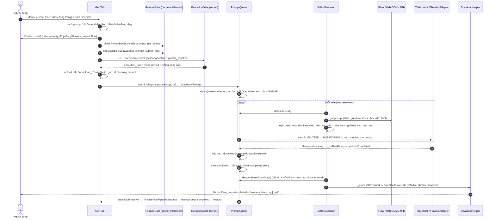
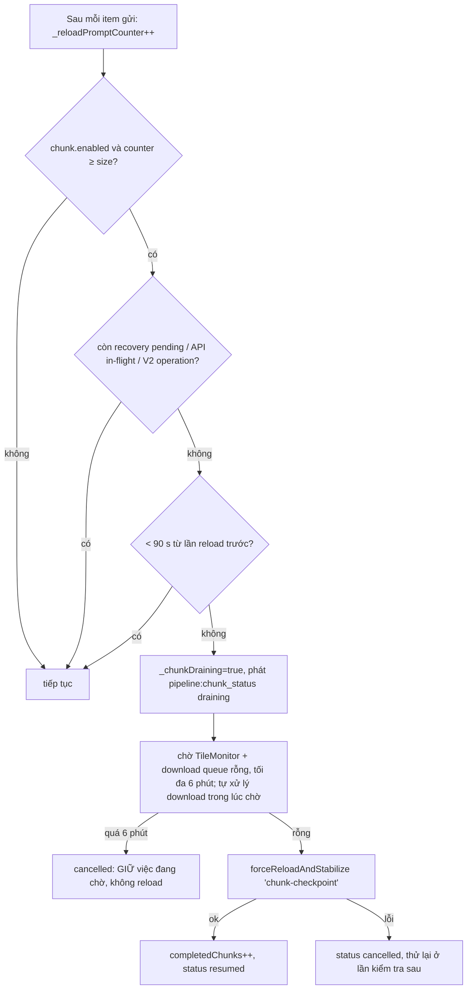
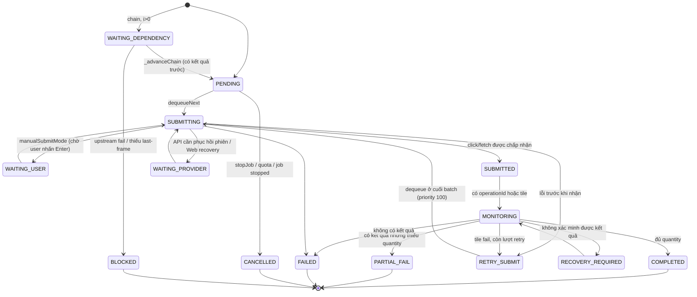
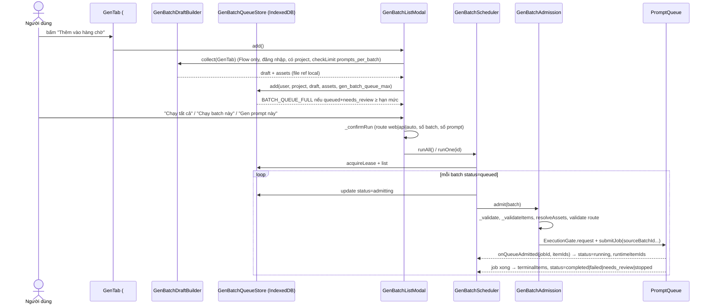
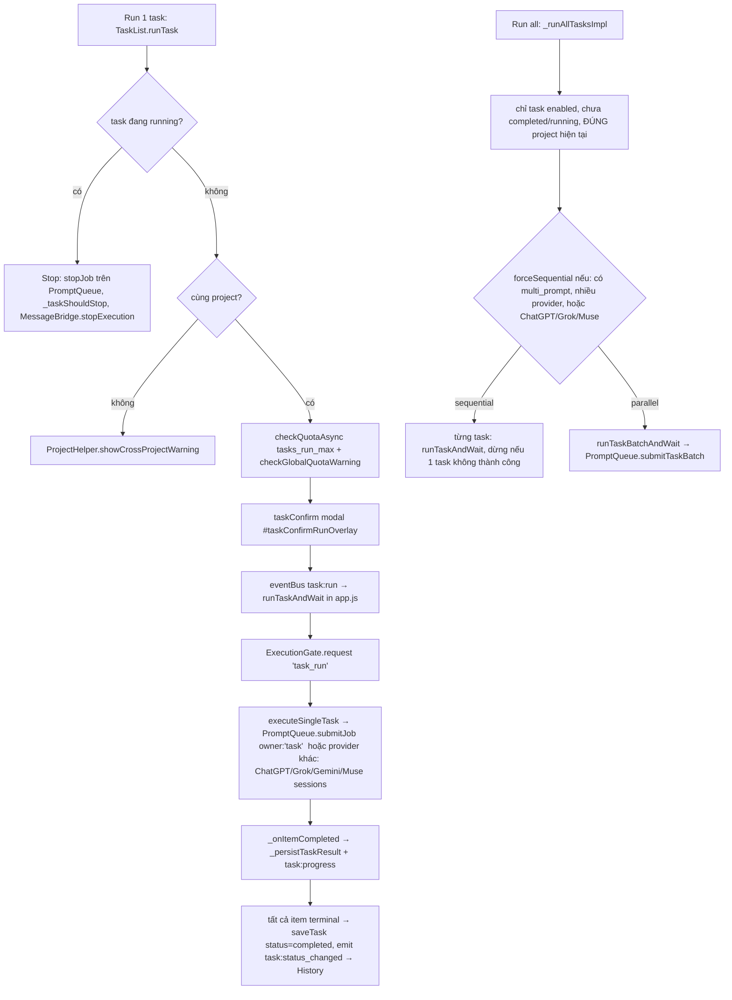
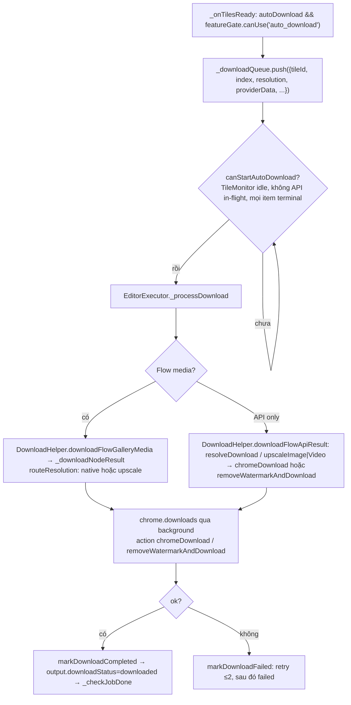

# 7. Tab Gen, hàng đợi prompt, batch, Tasks và thư viện nội dung

Mảng này là "lõi sản phẩm" của ToolFlow v1.3.138: người dùng dán N prompt vào tab **Gen**, extension chia prompt, gán ảnh tham chiếu, xin phép server (quota), đẩy vào **PromptQueue** để gửi lần lượt lên Google Flow (kiểu Web/DOM hoặc Flow API), theo dõi kết quả, tự retry, rồi tải N file về đĩa. Cùng một hàng đợi còn phục vụ **Gen Batch list** (hàng chờ lưu trong IndexedDB, giới hạn theo gói) và **Tasks** (cấu hình prompt được lưu trên server, chạy lại nhiều lần). Phần phụ trợ là các thư viện nội dung: My Prompts, Snippets, Templates, Style (addon prompt), Character, Voice, Album/Photos, History.

Quy ước độ tin cậy: **[QS]** quan sát trực tiếp trong code/data · **[SL]** suy luận · **[?]** chưa rõ. Toàn bộ phân tích tĩnh, không chạy extension. Mọi đường dẫn nguồn tính từ `…/1.3.138_0/src/`; file bundle gần như một dòng, offset `@n` là ký tự trong file gốc, số dòng (`L…`) là sau khi format bằng prettier (chỉ dùng để dễ tra).

---

## 7.1 Bản đồ file

| file | kích thước | vai trò |
|---|---|---|
| `prompts/GenTab.js` | 462 862 | UI + logic tab Gen: nhập prompt, chọn provider/model/ratio, ref image, chain, auto-download, confirm modal, gọi `PromptQueue.submitJob`, finalize, failed-prompt list |
| `core/PromptQueue.js` | 271 930 | Hàng đợi trung tâm (singleton `PromptQueue.getInstance()`): admission, `dequeueNext`, retry, pause/resume/stop, chunk-reload, hàng đợi download, snapshot cho UI, lưu kết quả Task |
| `core/QueueItem.js` | 15 405 | Một prompt trong hàng đợi: state machine, `outputs[]`, audit vòng đời |
| `core/Job.js` | 821 | Một lượt chạy (tập các `QueueItem`): `running/paused/completed/stopped`, đếm completed/failed/partial |
| `core/EditorExecutor.js` (ngoài phạm vi, đọc phần pacing) | 147 817 | Vòng `_runLoop`: lấy item, gửi vào Flow, **nghỉ ngẫu nhiên**, nghỉ dài sau `batch_size`, xử lý download |
| `core/TileMonitor.js` (ngoài phạm vi, đọc phần cấu hình) | 70 946 | Theo dõi kết quả (tile) của Web mode, retry tile; `max_monitor` |
| `core/QueueMonitor.js` | 30 700 | UI tab Logs › Queue: 3 thẻ Editor/Tiles/Download, danh sách job, mục Auto Download |
| `core/PipelineFooter.js` | 15 398 | Thanh "Pipeline" dưới sidebar: tiến độ, Pause/Resume, Stop all, trạng thái chunk-reload |
| `core/BatchQueue.js` + `queue/QueuePanel.js` | 5 540 + 12 040 | Hàng đợi **legacy** (`prompt/task/workflow` qua `window.runAutoPrompt`). Có load trong `sidebar.html` nhưng không có chỗ nào `new QueuePanel` hay gọi `batchQueue.add` ngoài chính hai file → **mã chết** [QS] |
| `core/GenBatchDraftBuilder.js` | 14 233 | Gom trạng thái tab Gen thành "draft batch" + **ánh xạ ref → prompt** (`_mapping`) |
| `core/GenBatchQueueStore.js` | 30 640 | IndexedDB `toolflow_gen_batches` v3 (stores `batches`, `assets`, `leases`) |
| `core/GenBatchScheduler.js` | 18 140 | Chạy tuần tự các batch đã lưu; lease coordinator; đồng bộ trạng thái về store |
| `core/GenBatchAdmission.js` | 15 239 | Kiểm tra lại batch rồi gọi `submitJob` (kèm `sourceBatchId`) |
| `core/GenBatchListModal.js` | 281 538 | Modal "Danh sách batch": render, sửa batch/prompt, run-all/run-one, regen, download |
| `core/RefImageAssignment.js` | 454 | Hàm chọn nhóm ref cho prompt thứ i (xoay vòng) |
| `core/ImageStore.js`, `AlbumStore.js` | 15 798, 7 196 | IndexedDB `autoflow_pro` v5: album, ảnh, blob, upload chờ |
| `core/ImageNameRegistry.js`, `MediaRegistry.js`, `ThumbnailCache.js` | 1 940, 8 903, 1 101 | Tên ảnh cho `@mention`; định danh/thumbnail ref (giới hạn `media_registry_max_size`=500); cache blob URL |
| `core/MentionParser.js` | 17 514 | Parse `@tên`, `@voice:`, `@char:`; upload ảnh pending |
| `shared/MentionMenu.js`, `MentionChips.js` | 13 373, 5 283 | Menu autocomplete `@` và chip hiển thị mention |
| `shared/ImagePickerModal.js` | 75 211 | Chọn ref: Album / Flow images / Upload |
| `core/CharacterRegistry.js`, `CharacterPicker.js`, `shared/CharacterSelectModal.js` | 5 126, 4 761, 14 355 | Nhân vật Flow (scrape từ tab Flow) |
| `core/VoiceRegistry.js`, `VoicePicker.js`, `shared/VoiceSelectModal.js` | 11 579, 5 625, 21 374 | Giọng video (catalog từ server + scrape) |
| `shared/StyleSelectModal.js` | 22 330 | Chọn/tạo "Phong cách" (addon prompt) |
| `multi-task/TaskModal.js` | 272 092 | Form tạo/sửa Task (+ tab Results) |
| `multi-task/TaskList.js` | 127 316 | Danh sách task, run/run-all/stop, clone, download |
| `multi-task/MultiTaskTab.js` | 699 | Khởi tạo TaskList + TaskModal |
| `core/ApiStorage.js` (phần Tasks) | 19 440 | `getTasks/getTask/saveTask/deleteTask/updateTaskStatus` → `labs.tool.vn/api/v1/tasks` |
| `prompts/MyPromptsTab.js` | 22 696 | Tab Prompts › "My prompts" |
| `snippets/SnippetsPanel.js`, `UserPromptsManager.js` | 18 060, 4 960 | Snippet = prompt của user (`/prompts` API hoặc `af_user_prompts`) |
| `templates/TemplatesTab.js` | 39 019 | Template server-side (danh mục, rating, premium) |
| `history/GenerationHistory.js`, `HistoryTab.js` | 15 554, 24 077 | Ghi/đọc lịch sử (`/history` hoặc `af_history`) |
| `albums/AlbumList.js`, `AlbumCreateModal.js`, `photos/PhotosTab.js` | 52 423, 12 449, 30 312 | Tab Photos: Album, Flow images, thanh dung lượng |
| `shared/DownloadHelper.js` | 58 945 | Dựng tên file, tải Flow API/Web, watermark, nâng độ phân giải |
| `core/DownloadExecutor.js` | 2 936 | Bộ tải **legacy** (`downloadTileMedia` qua content script, timeout 45 s) – xem 7.8 |
| `sidebar.html` (phần `#tab-gen`, `#confirmRunOverlay`, `#tab-tasks`…) | – | HTML các control của tab Gen |

Dữ liệu đối chiếu (`_work/storage/`): `af_execution_config.json`, `af_settings.json`, `af_entitlements.json`, `af_system_settings.json`, `af_addon_prompts.json`, `tool_provider_models.json`, `tool_i18n_vi.json`.

---

## 7.2 Luồng tổng: từ dán N prompt đến N file trên đĩa

### 7.2.1 Sơ đồ



### 7.2.2 Các bước chi tiết

**Bước 1 – Nhập và tách prompt.** `GenTab.startBtn` (`#startBtn`) → handler trong `GenTab.init` (L~1500). Nếu checkbox `#multiPromptCheck` bật, văn bản tách bằng regex `/\n\s*\n/` (một hoặc nhiều dòng trống), trim, bỏ rỗng; nếu tắt thì cả ô là một prompt. [QS] `GenTab › init` (`baseText.split(/\n\s*\n/)`), lặp lại ở `GenBatchDraftBuilder._prompts` và `TaskModal._splitMultiPrompt`. Hint UI: `gen.multiPromptHint` = "Mỗi prompt cách nhau bằng 1 dòng trống". Nút **Import .txt** (`#importTxtBtn` → `importTxtFile`) nạp file text vào ô này.

**Bước 2 – Style (addon prompt).** Nếu đã chọn "Phong cách", `finalPrompts = prompt + "\n\n" + addon.content` cho **từng** prompt. [QS] `GenTab › init` (`${prompt2}\n\n${selectedAddon.content}`). Khi chạy lại prompt lỗi, `_retryFailedPrompts` cắt đúng hậu tố đó (`_stripAddon`) để không nối đôi.

**Bước 3 – Chặn trùng luồng.** Với provider Flow, nếu `GenBatchListModal.scheduler` đang `running/paused` hoặc IndexedDB có batch `isPossiblyLive`, "Generate" bị từ chối với thông báo `genBatch.directBlocked` ("Batch list Flow đang hoạt động. Hãy dùng Add to queue."). [QS]

**Bước 4 – Confirm modal** (`_showConfirmModal`, DOM `#confirmRunOverlay`): đổi ratio (`#confirmAspectRatio`), số lượng (`#confirmQuantity`), độ phân giải tải (`#confirmDownloadRes`), chế độ chạy (`#confirmRunMode`), chế độ gửi tự động/thủ công (`#confirmSubmitModeSwitch` → `manualSubmitMode`), "Reload Flow trước khi chạy" (`#confirmReloadFlow` → `forceReloadAndStabilize("user-pre-submit")`), chuyển Multi/Single prompt (`#confirmPromptModeToggle`), huy hiệu trạng thái provider (Sẵn sàng/Chưa đăng nhập/Cloudflare/Bị chặn) và cảnh báo trùng tab Flow. Nút Run bị khoá cho tới khi provider "ready". Với Flow, tuyến thực tế (`flowExecutionMode`) là **web** nếu prompt có `@voice:`/`@char:` (component chỉ chạy Web) hoặc API chưa bật; ngược lại theo `defaultGenMode` (`auto` trong `af_settings`). [QS]

**Bước 5 – Cổng quota phía client.**
1. `featureGate.checkPromptBatchLimit(N)`: so `N` với `prompts_per_batch` (Free = 5; thiếu entitlement → mặc định 4; `-1` = vô hạn). Vượt → thông báo `gen.batchLimitExceeded`, **không** gọi server, ghi `_recordPreSubmitDenial`. [QS] `FeatureGate.getPromptBatchLimit`.
2. `featureGate.checkGlobalQuotaWarning("Generate")`: nếu `prompt_submit_max` còn 0 → dừng; còn ≤10 % → phát `quota:warning`. [QS]
3. `ExecutionGate.request("generate", N, {owner:"prompts", provider, media_type, has_ref, ref_count})` → `POST execution/request`. Server trả `execution_token` và `allowed`, `remaining`, `limit`, `global_*`. Bị từ chối → `ExecutionGate.showDeniedDialog` (có nút thử lại gọi `startBtn.click()`). [QS] `core/ExecutionGate.js › request`.
4. Với Flow còn gọi `sendToContentScript("resetStop")` trước khi upload ref.

**Bước 6 – Chuẩn bị ref ảnh.** (chi tiết ở 7.5) `correctFileIds` sửa id ref theo cache; `reuploadMissingFiles` upload lại ảnh đã mất trên Flow (nếu ảnh biến mất hẳn → dialog `gen.refImageUnavailable` và **huỷ** lượt chạy); ref dạng `upload_*` được upload lên Flow (`uploadPendingFiles`); riêng mode `@mention` gọi `MentionParser.uploadPendingImagesBatch`. Video Frames: khung Start/End được gom thành `frameFileIds`.

**Bước 7 – Admission vào PromptQueue.** `PromptQueue.submitJob(request)` (L485): `_waitForAdmissionReload`, `_webRecovery.assertCanAdmit`, `ExecutionGate.claimQueueAdmission(token, "generate", N)`, tạo `Job`, sinh N `QueueItem` (áp `itemOverrides` cho từng prompt – chỉ các khóa `genType, ratio, model, quantity, isFrames, flowVideoDuration, flowVideoResolution, videoInputType`), gắn `voice`/`character` vào `settings` của mọi item, gán ref qua `_resolveRefForIndex`, đọc `ExecutionConfig` (`delay_between_prompts_sec` → `settings.apiSubmitDelayMs`; `queue.max_monitor`). Nếu job không `chain`, không `sequentialMode`, trang Flow V2 và có item Web mà `flowV2CorrelationBroker` không cho song song → **ép tuần tự** (`forcedV2WebSequential`) vì V2 không trả request-id trong DOM. Promise của `submitJob` resolve khi cả job (kể cả download) xong. [QS]

**Bước 8 – Vòng gửi.** `EditorExecutor._runLoop` lấy item bằng `PromptQueue.dequeueNext()`; thứ tự ưu tiên ở `_sortQueue`: item retry-tail Web xuống cuối, `priority` cao trước, item "api deferred" xuống sau, rồi `createdAt`. `dequeueNext` bỏ qua job `paused`, item `WAITING_DEPENDENCY`, item đang được sửa trong tracker (`_trackerEditInFlight`), item API retry-tail khi còn item thường. [QS]

**Bước 9 – Nhịp độ gửi (chia batch, nghỉ).** Xem 7.3.

**Bước 10 – Theo dõi kết quả.** Web: `TileMonitor` theo dõi tile mới trong DOM (tối đa `queue.max_monitor`=6 song song; video dùng `video_max_monitor`=4), timeout mỗi tile `workflow.timeout_sec`=180 s. API: `FlowApiAdapter`/`FlowApiV2Driver` poll operation, lưu checkpoint (`recoverCheckpoints` chạy 2 s sau khi `PromptQueue` khởi tạo). Khi xong: `_onTilesReady` (gửi `onResultsReady` để UI hiện thumbnail, **enqueue download**) và `_onItemCompleted` (đếm `completedCount/failedCount/partialCount`, lưu Task, advance chain, `_checkJobDone`). [QS]

**Bước 11 – Hoàn tất job.** `_checkJobDone`: khi mọi item terminal → `ExecutionGate.complete(token, success|partial|failed)` (chỉ **một lần**, trước khi chờ download); phát `onGenerationComplete`; nếu còn download pending thì `return` – `job.state = "completed"` chỉ đặt **sau khi** download xong. [QS] `PromptQueue › _checkJobDone` (L5090-5160). GenTab sau đó gọi `_finalizeFlowPipelineSuccess` → emit `prompt:completed` → `GenerationHistory.saveRecord`.

**Bước 12 – Tải file.** Xem 7.8. Điểm then chốt: **auto-download chỉ bắt đầu khi không còn bất kỳ item nào chưa terminal** (trừ ranh giới chunk). Nghĩa là N file được tải thành một đợt *sau khi cả N prompt sinh xong*, không tải xen kẽ. [QS] `PromptQueue › canStartAutoDownload`.

---

## 7.3 Chia batch, nghỉ, chunk và retry (4 tầng "chia" khác nhau)

Có bốn khái niệm "batch/chunk" độc lập, dễ nhầm:

| Tầng | Config/entitlement | Giá trị trong dữ liệu mẫu | Tác dụng | Nơi áp dụng |
|---|---|---|---|---|
| Giới hạn prompt mỗi lần bấm | `prompts_per_batch` (entitlement) | **5** (Free) | Từ chối ngay nếu N > 5 | `GenTab` (client) + `GenBatchDraftBuilder.checkLimit`, `TaskList._runAllTasksImpl`, `TaskModal._doSave` |
| Nhịp gửi | `queue.batch_size`, `queue.rest_min_sec`, `queue.rest_max_sec` (execution_config) + `randomDelayMin/Max` (af_settings) | 6 / 5 / 15 s; random 5–15 s | Sau mỗi prompt nghỉ ngẫu nhiên `[randomDelayMin, randomDelayMax]`; đủ `batch_size` prompt thì nghỉ dài `[rest_min, rest_max]` | `EditorExecutor._runLoop` |
| Giám sát đồng thời | `queue.max_monitor`, `video_max_monitor` | 6 / 4 | Số item đang chờ kết quả cùng lúc | `TileMonitor.updateSettings` |
| Chunk-reload | `flow_recovery.chunk_mode_enabled`, `chunk_size` | true / **40** | Sau 40 prompt (tính cả các lần gửi) → chờ drain, **reload tab Flow**, cooldown 90 s | `PromptQueue._checkAndPerformReload` |
| Trì hoãn giữa các prompt API | `timing.delay_between_prompts_sec` | 3 | `item.settings.apiSubmitDelayMs` cho đường API | `submitJob`, `FlowApiAdapter` |

Chi tiết nhịp gửi [QS] `EditorExecutor › _runLoop` @7402:

```
needsRapidSubmitPacing = !job.sequentialMode
if (needsRapidSubmitPacing && batchCount >= this._batchSize && queue.hasItems())
    sleep(random(restMin, restMax)); batchCount = 0
else if (needsRapidSubmitPacing && queue.hasItems())
    sleep(random(randomDelayMin, randomDelayMax))           // af_settings, mặc định code 3–10 s
else if (!needsRapidSubmitPacing) // tuần tự: bỏ delay vì đã chờ kết quả
    batchCount = 0
```

`_readSettings()` (PromptQueue L6465) đẩy `batch_size/rest_*` xuống `EditorExecutor.updateSettings` (đổi giây → ms) và `max_monitor/timeout_sec/max_retries` xuống `TileMonitor.updateSettings`. Giá trị mặc định cứng khi server không có config: 4 / 4 / 5 / 15 / 180 s / 2 retry. [QS]

**Chế độ chạy:** nút `#genRunModeBtn` chuyển `GenTab.runMode` giữa *parallel* (gửi liên tục, không chờ kết quả từng prompt) và *sequential* (chờ prompt trước xong). Chỉ hiện khi bật Multi-Prompt. Bật Chain ⇒ ép sequential. → `submitJob({sequentialMode})`. [QS]

### Chunk-reload (`_checkAndPerformReload`)


[QS] `PromptQueue › _checkAndPerformReload` (L5428-5545). Banner UI: `pipeline.chunkDraining / chunkReloading / chunkWait`. Đây là lý do auto-download vẫn chạy được *giữa* các chunk: ranh giới chunk coi các item còn trong `_itemQueue` là "tương lai" nên `canStartAutoDownload` cho phép tải phần đã xong.

### Retry và recovery

| Tình huống | Cơ chế | Giới hạn | Nguồn |
|---|---|---|---|
| Web: tile fail/không nhận | `scheduleWebRetryAtBatchTail`: item → `RETRY_SUBMIT`, `priority=100`, xếp **cuối batch**, chỉ chạy khi không còn item thường và `TileMonitor.activeCount==0` | `_webRetryMaxRetries` = `workflow.max_retries` (=1) và =0 nếu entitlement `retry_on_fail` tắt | `PromptQueue` L3692, `_readSettings` |
| API V2 lỗi thường (unknown/content_blocked/server_unavailable, đã bị từ chối ở receipt hoặc mọi operation đều failed) | `_retryApiNormalFailureAtBatchTail`, tăng `retrySubmitCount`, `attemptId` mới | `_apiGenerationRetryLimit` = `ExecutionConfig.getMaxRetries()` (0–10, mặc định 0) | L2605 |
| Captcha/"hoạt động bất thường" | `_handleFlowError` theo `flow_recovery.captcha_recovery_mode` = `pause_resume` → `pauseJob(jobId,"captcha")`, thông báo "chờ 1–2 phút rồi bấm Tiếp tục"; `stop_batch` dừng job; `normal_error` coi như lỗi thường. Task + captcha ⇒ luôn dừng job | – | L3191 |
| Flow API unusual-activity (bot_detected) | `_pauseApiUnusualActivityJob`, gợi ý chuyển Web mode (`gen.flowApiBotFallback*`) | – | L2332-2519 |
| API chưa sẵn sàng trước khi gửi | `_recoverApiPreDispatchItem` → `WAITING_PROVIDER`, auth recovery `_startApiAuthRecovery` | `backoff_base_sec`=30, `backoff_max_sec`=300, jitter 20 %, `consecutive_fail_threshold`=2 (execution_config) | L2866 |
| Tab Flow reload giữa chừng | `FlowWebRecovery` (journal, `windowMembers`, `pending`, `blocked`) | – | `core/FlowWebRecovery.js` (ngoài phạm vi) |
| Lỗi tải file | `markDownloadFailed`: đẩy lại đầu `_downloadQueue` tối đa **2** lần (`_dlRetry`) trừ khi `retryable:false` (target không tìm thấy) | 2 | L4071 |
| Prompt lỗi cuối cùng | `GenTab._showFailedPrompts` + dialog tổng kết; nút **Chạy lại tất cả** (`#retryFailedPromptsBtn`) trả prompt về ô nhập (bật Multi-Prompt nếu >1) | – | `GenTab` L7197-7330 |
| Regen từng item | event `queue:regen_item` → `regenItem` / `regenBatch`, dùng lại đúng ref đã gán | – | L1079-1890 |

---

## 7.4 Máy trạng thái

### 7.4.1 `QueueItem.STATE` (14 trạng thái) [QS]



- `isTerminal` = `COMPLETED, PARTIAL_FAIL, FAILED, CANCELLED, BLOCKED`.
- `isActive` = `SUBMITTING, SUBMITTED, MONITORING, RETRY_SUBMIT, WAITING_PROVIDER, RECOVERY_REQUIRED`. (`WAITING_USER`, `PENDING` không "active".)
- Nguồn gán trạng thái (đếm theo grep): `CANCELLED` 39 chỗ (EditorExecutor 21, TileMonitor 8, PromptQueue 8), `FAILED` 28, `RETRY_SUBMIT` 6 (đều trong PromptQueue), `WAITING_PROVIDER` 6 (FlowWebRecovery 4, PromptQueue 2), `PARTIAL_FAIL` chỉ ở `TileMonitor`, `WAITING_USER` chỉ ở `EditorExecutor`, `BLOCKED`/`WAITING_DEPENDENCY` chỉ ở `PromptQueue` (chain). [QS]
- Nhãn UI vi: `genBatch.status_*` (Chờ, Đang gửi, Đã gửi, Đang tạo, Chờ gửi lại, Chờ Flow, Cần khôi phục, Chờ người dùng, Chờ kết quả trước, Một phần lỗi, Lỗi, Đã huỷ, Bị chặn…).

### 7.4.2 `outputs[]` của một item (mỗi item có `quantity` output) [QS]
`QueueItem.syncCompletedOutputs / syncFailedOutputs / markOutputDownload`. Mỗi output: `{outputIndex, resultId, mediaId, mediaUuid, identityKind (uuid|flow_v2_asb|provider_filename|runtime_result|none), correlationConfidence (direct_result|serial_retry_heuristic|runtime_owner_only|synthetic_missing_output), status completed|failed, downloadStatus}`. `downloadStatus`: `not_requested → queued → downloading → downloaded | retrying → failed`, hoặc `not_applicable` với output fail. Output fail được bù cho đủ `quantity` bằng `synthetic_missing_output`, nên "quantity mismatch" luôn là 0 ở audit.

### 7.4.3 `Job.state` [QS]
`running ⇄ paused → completed | stopped`. `pauseJob` chỉ cho owner `prompts|mcp|motion` (hoặc lý do `api_unusual_activity`); ưu tiên lý do `manual(0) < captcha/provider_auth(1) < api_unusual_activity(2)`. Job giữ: `completedCount, failedCount, partialCount, totalExpected, sequentialMode, taskBatch, chain, sourceBatchId, projectId, _executionToken`. `Job.progress = round(completed/totalExpected·100)`.

### 7.4.4 `GenBatch.status` (bản ghi IndexedDB) [QS]
`queued → admitting → running ⇄ paused → completed | failed | needs_review | stopped`. `isPossiblyLive` = `admitting|running|paused` hoặc `needs_review` có `jobId` mà chưa `completedAt`. Chỉ `queued` và `needs_review` tính vào hạn mức `gen_batch_queue_max`.

---

## 7.5 Gán ref image cho từng prompt

### 7.5.1 Chế độ (`#refImageMode`, nhãn vi)
| `refImageMode` | Nhãn UI | Quy tắc gán | Nơi cài đặt |
|---|---|---|---|
| `none` | Không dùng (`gen.refModeNone`) | `[]` cho mọi prompt | `_mapping`, `_resolveRefForIndex` |
| `all` | Tất cả (`gen.refModeAll`) | mọi prompt nhận **toàn bộ** pool (`[...pool]`), dedupe | `_mapping` |
| `sequential` | Thứ tự (`gen.refModeSequential`) + ô "Ảnh tham chiếu mỗi prompt" `#refImagesPerPrompt` | prompt thứ `i` nhận `pool.slice(i·k, (i+1)·k)` (k = `RefImageAssignment.count`, ≥1) | `GenBatchDraftBuilder.sequentialRefs` |
| `mention` | `@Mention` | ref = các ảnh được `@tên` trong chính prompt đó, dedupe theo `file_id`, cắt `maxRefs` | `MentionParser.processMultiPrompts` → `_mapping` |
| `frames` (nội bộ, Video Frames) | Start/End | `[frame1, frame2]` của từng prompt | `_mapping(frames)` |

### 7.5.2 Hai thuật toán "tuần tự" khác nhau [QS]
- `RefImageAssignment.select(refs, i, k)`: `groups = ceil(n/k); start = (i mod groups)·k; slice(start, start+k)` ⇒ **xoay vòng**; dùng ở **Task** (`_enqueueTaskItems`) và `ApiStorage._verifyTaskRefGroupSave` (chỉ dùng `count`).
- `GenBatchDraftBuilder.sequentialRefs(pool, i, k)`: `pool.slice(i·k, (i+1)·k)` ⇒ **không xoay vòng**, prompt vượt quá pool nhận `[]`; dùng ở **Gen/Batch** (cả luồng gửi trực tiếp qua `_mapping`). `PromptQueue._resolveRefForIndex` chỉ rơi về `select` (xoay vòng) khi không có `refFileIdsPerPrompt`.
- Hệ quả: cùng 3 ảnh, 5 prompt, k=1 → Gen: `A,B,C,∅,∅` (prompt 4, 5 không có ref); Task: `A,B,C,A,B`. [SL – suy từ code, chưa chạy]. `GenTab.getRefLimit` bù bằng cách nhân giới hạn cho mode sequential (`số prompt × min(policy, k)`).

### 7.5.3 Giới hạn số ref
`GenTab.getRefLimit` → `ImagePickerModal.resolveMaxSelections({provider, mode, isFrames, modelValue, duration})`; thiếu thì mặc định `REF_LIMIT_IMAGE=10`, `REF_LIMIT_VIDEO=3`, chatgpt/grok/gemini = 4; với Flow/Gemini lấy `min(policy, getMaxRefImagesTotal(model))`. Mode `mention` không giới hạn ở UI (nhưng cắt ở `_mapping(maxRefs)`). Config model server: `tool_provider_models.json › config.max_ref_images` – ví dụ *Nano Banana 2.1 / Pro / 2 Lite*: image 10, total 10; các model Veo (Ingredients bị `ref_support_overrides: supported=false`): ảnh 2–3, `supports_ref_video=false`. `duration_overrides`: có ref → ép 8 s (Veo) hoặc ref video → 10 s (Omni Flash). `validateRefSelection` ném `BATCH_REF_LIMIT_EXCEEDED` nếu vượt; `GenTab` chỉ gửi N ảnh đầu khi vượt (`gen.refExceedLimitLog`). Entitlement: `ref_images` + `<provider>_ref_images` (`FeatureGate.canUseProviderRefImages`).

### 7.5.4 Danh tính ref
`MediaRegistry` giữ `refIdentity` {media_uuid, file_name, thumbnail, type}; `ImageNameRegistry.registerFromRefImages` nạp tên → cho `@mention` (key lower-case; `generateUniqueName`: lower, `[^a-z0-9_]`→`_`, tối đa 40 ký tự, thêm `_n`). Với Flow API, `GenBatchAdmission._validateApiRefIdentity` yêu cầu mỗi ref phải resolve được UUID mà `FlowApiV2Driver._referenceId` chấp nhận (`BATCH_API_REF_IDENTITY_UNAVAILABLE`). Ref `upload_*` chưa lên Flow bị chặn khi admit batch (`BATCH_REF_NOT_UPLOADED`) – batch lưu file gốc trong store `assets` và `GenBatchAdmission._resolveAssets` upload vào lúc chạy.

### 7.5.5 `@mention`, `@voice:`, `@char:`
- `MentionParser.MENTION_REGEX = /@(\[[^\]]+\]|[a-zA-Z0-9_]+)(?![a-zA-Z0-9_:])/g`; tên ảnh có khoảng trắng viết `@[Tên ảnh]`.
- `COMPONENT_REGEX = /@(voice|char):(\[[^\]]+\]|[^\s]+)/g` – component chỉ chạy **Web** (Flow API báo `BATCH_API_WEB_COMPONENT_CONFLICT`).
- `cleanPrompt` xoá `@mention` khỏi văn bản gửi đi và gộp khoảng trắng; `hasUnresolvedMentions` ⇒ cảnh báo `gen.mentionWarning` (Gen) hoặc `BATCH_MENTION_UNRESOLVED`/`needs_review` (batch).
- Task dùng regex riêng `@(\[[^\]]+\]|[\p{L}\p{N}_]+)` (cho phép chữ Unicode) và map `ref_image_names[fid].toLowerCase()` → file id.

---

## 7.6 Gen Batch list (hàng chờ lưu bền)



Điểm chính [QS]:
- **Phạm vi:** key `userId + "\0" + projectId` (`_scope`). Không có user/project → `BATCH_SCOPE_REQUIRED`. Đổi project/đăng nhập/đăng xuất làm scheduler `_stopIntent` và nhả lease.
- **Chỉ Flow** (`BATCH_FLOW_ONLY`) và phải bật `pipeline_queue_enabled` + `queueEnabled`. Provider Muse/ChatGPT/Gemini dùng `ProviderWebScheduler` riêng (`webView.add`).
- **Hạn mức hàng chờ:** `gen_batch_queue_max` (Free = 3, `-1` = vô hạn; không tải được entitlement ⇒ `BATCH_QUEUE_ENTITLEMENT_UNAVAILABLE`, *fail-closed*). Đếm theo `status ∈ {queued, needs_review}` trong cùng scope, kiểm trong cùng transaction IndexedDB. Thông báo: `genBatch.queueFull`, `queueCount` "Đang chờ {count}/{limit}".
- **Lease** (`leases` store, gia hạn 10 s): chỉ một cửa sổ/ngữ cảnh điều phối batch cho scope; mất lease ⇒ dừng.
- **Fail-closed validation** trước khi chạy: model có trong `ModelRegistry` và đúng media type, ratio nằm trong `ProviderConfigManager.getRatios`, quantity trong `safeGetQuantityRangeSync`, duration/resolution hợp lệ, `autoDownload` cần `canUse("auto_download")`, `downloadResolution` nằm trong danh sách server, override per-item chỉ gồm 8 khóa, chain ⇒ quantity phải =1 (`BATCH_CHAIN_QUANTITY_ONE`), API mode cần `flow_api_enabled` và `FlowApiSessionCoordinator.check(...).ready`.
- **Thứ tự chạy:** `_loop` chọn batch `queued` đầu tiên (theo `order`), nếu đang có batch `admitting/running/paused` hoặc `needs_review` chưa xong thì **tạm dừng**; đợi `PromptQueue` rảnh rồi mới claim.
- **Phục hồi:** `recoverBatch` (store) chuyển batch lỗi về `queued` với `resumeItemIndexes` = các prompt chưa xong (đã `COMPLETED` giữ kết quả); `executionSegments` lưu các job cũ.
- **Hành động UI** (data-action, ~70): `run-all, run-batch, gen-item, pause/resume/stop (job-/manual-), regen-item/-batch/-failed, edit-batch, edit-item, batch-pick-refs, item-pick-refs, download-batch/-item, clear-queued/-history/-all, rename, delete, item-layout-toggle…`. Chế độ ref hiển thị: `genBatch.mode_all/sequential/mention/none/frames`.

---

## 7.7 Tasks (multi-task)

### 7.7.1 Cấu trúc một Task
Tạo bởi `TaskModal._doSave` (L3983) và lưu bằng `storageManager.saveTask` → `ApiStorage.saveTask` (`POST /tasks` hoặc `PUT /tasks/{id}`; `platform` luôn gán `"flow"`; 404 khi PUT ⇒ tự `POST` lại). Dữ liệu mẫu `af_tasks.json` = `[]` (tài khoản chưa có task). [QS]

| trường | ý nghĩa |
|---|---|
| `task_id` | `IdGenerator.next("task")` hoặc `task_<ts>_<rand>` |
| `task_name` | mặc định `Task <ngày giờ>` |
| `provider` | `flow | chatgpt | grok | gemini | muse` (mỗi provider có kiểm tra quyền `*_enabled`) |
| `prompt`, `multi_prompt`, `prompts[]` | prompt gốc; nếu `multi_prompt` thì tách bằng `_splitMultiPrompt` (cũng áp `prompts_per_batch`) |
| `media_type` (`Image|Video`), `model`, `ratio`, `quantity` | grok/gemini/muse luôn `quantity=1`; Flow chọn ratio hợp lệ theo `ProviderConfigManager.safeGetRatiosSync` |
| `video_input_type` (`Ingredients|Frames`), `video_duration`, `video_resolution` | chỉ khi Video |
| `voice_slug/voice_search_value`, `character_selections[]`, `character_slug`, `character_search_value` | chỉ Flow, không phải Frames |
| `ref_file_ids` (chuỗi phẩy), `ref_image_mode`, `ref_images_per_prompt`, `ref_image_names`, `ref_thumbnails`, `ref_file_names` | cắt theo `_getTaskRefLimit`; `_verifyTaskRefGroupSave` ném `TASK_REF_GROUP_NOT_SAVED` (409) nếu server không giữ `ref_images_per_prompt` |
| `frame_1_file_id`, `frame_2_file_id`, `frame_pairs[]`, `frame_*_thumbnail/file_name` | Video Frames (một cặp hoặc theo từng prompt) |
| `auto_download`, `download_resolution`, `video_download_resolution` | tải kết quả sau khi chạy |
| `addon_prompt_id`, `addon_prompt_text` | giữ lại khi edit (form không cho chọn mới) |
| `enabled` | công tắc `#taskEnabled`; Run-all bỏ qua task `enabled=false` |
| `status` | `pending | running | completed | failed` |
| `result_file_ids`, `result_thumbnails`, `result_file_names`, `result_provider_urls`, `error_message`, `executed_at` | kết quả, cập nhật qua `PATCH /tasks/{id}/status` và `_persistTaskResult` |
| `project_id`, `project_name`, `platform` | task gắn project; task cũ `project_id=null` được coi là "legacy shared" và gán project hiện tại khi lưu |
| `chatgpt_/gemini_/muse_delete_after_gen`, `grok_mode/duration/resolution/image_quality` | tuỳ provider |

API khác: `GET /tasks?page&per_page&search&project_id`, `GET /tasks/{id}`, `DELETE /tasks/{id}`, `PATCH /tasks/{id}/status` (body: `status`, `result_file_ids`, `result_thumbnails`, `result_file_names`, `result_provider_urls`, `error_message`, `executed_at`).

### 7.7.2 UI Task
- **Tab Tasks** (`#tab-tasks`): `#taskSearchToggle`, `#refreshTasksBtn`, `#taskProjectSelectInline` (lọc project), `#taskRunModeBtn` (parallel/sequential), `#runAllTasksBtn`, `#addTaskBtn`. Mỗi thẻ task có chọn, bật/tắt, Run/Stop, sửa, clone, reset, xoá, tải kết quả; chọn nhiều ⇒ "Run selected/Delete selected" (`toggleSelect`, `runSelected`, `deleteSelected`).
- **TaskModal** (~108 control, id `task*`): `#taskName`, `#taskPrompt` + `#taskMultiPromptCheck`, tìm prompt `#taskPromptSearchBtn`, tab provider `#taskProviderTabs`, `#taskMediaType`, model theo provider (`#taskModel/#taskVideoModel/#taskChatgptModel/…`), `#taskVideoInputType`, `#taskVideoDuration`, `#taskVideoResolution`, `#taskRatio`, `#taskQuantity`, character/voice picker, `#taskRefImageMode`, `#taskRefImagesPerPrompt`, `#taskOpenImagePickerBtn`, `#taskScreenCaptureBtn`, `#taskFrame1/2*`, `#taskAutoDownload`, `#taskDownloadResolution`, `#taskVideoDownloadResolution`, `#taskResultsTab` (xem kết quả, thumbnail hết hạn được `_refreshExpiredThumbnails` / `_resolveTaskMediaUrlsByUuid` làm mới).

### 7.7.3 Chạy Task



- `submitTaskBatch` (PromptQueue L842): một `Job(owner:"task", label:"Run All Tasks")` với `taskBatch = {tasks, currentIdx, mode, settingsPerTask}`; **parallel** enqueue toàn bộ task cùng lúc; **sequential** chỉ enqueue task 0, `_checkTaskBoundary` nạp task kế khi mọi item của task trước terminal. `resetTaskResults` xoá kết quả cũ trước khi chạy. Mỗi item mang `_taskId, _taskName, _autoDownload, _downloadResolution` ⇒ tên thư mục con khi tải = `task_name`.
- Task chỉ có Flow đi qua `PromptQueue`; ChatGPT/Grok/Gemini/Muse dùng session riêng trong `app.js` (`executeSingleTask`) [QS ở mức tên hàm, chi tiết ngoài phạm vi].
- Sau mỗi task Flow thành công: `featureGate.recordTaskRun()`, `recordGenRun()`, `recordPromptSubmit(n,"task")`; với đường pipeline, ExecutionGate được `complete` bởi `_checkJobDone`.
- Task bị chặn nếu `ProjectHelper.assertRunAllProject` phát hiện lệch project giữa lúc bấm và lúc dispatch.
- Lỗi nhỏ phát hiện: thông báo vượt `prompts_per_batch` trong `_runAllTasksImpl` dùng `t.name` trong khi task lưu `task_name` ⇒ tên task có thể hiện `"undefined"` [SL].

---

## 7.8 Tải về: từ tile đến file trên đĩa

### Tên file
`DownloadHelper.buildFilename({template, project, prompt, index, taskName, folder, ext, timestamp})` [QS] `shared/DownloadHelper.js` L546:

| token | giá trị |
|---|---|
| `[Date]` | `YYYY-MM-DD` (UTC ISO) |
| `[Time]` | `HH-MM-SS` (giờ local) |
| `[Project]` | `fileNameProject` (≤30 ký tự, ASCII, `[^a-zA-Z0-9_-]`→`_`) |
| `[Prompt]` | prompt bỏ dấu ASCII, ≤40 ký tự, ký tự lạ → `_` |
| `[Index]` | `padStart(3,"0")` của `dlItem.index`; mặc định `String(promptIndex+1).padStart(3,"0")`, nếu `quantity>1` thì `"<001>_<seq>"` (ví dụ `001_2`) |

Sau đó gộp `_+`→`_`, bỏ `_` đầu/cuối; rỗng ⇒ `flow_<timestamp>`. Đường dẫn: `<downloadFolder>/<task_name chuẩn hoá>/<tên>.<png|mp4>` – nếu `taskName` trùng thư mục gốc thì bỏ một lớp. Mặc định trong dữ liệu mẫu: `downloadFolder="toolflow_output"`, `fileNameTemplate="[Index]_[Prompt]_[Project]_[Date]"` (mặc định trong code nếu thiếu là `[Date]_[Project]_[Prompt]_[Index]`). `normalizeDownloadRootFolder` từ chối đường dẫn tuyệt đối, `..`, ký tự cấm → rơi về `toolflow_output`. Ô `#genTabSubFolder` (`taskName` trong request) tạo thư mục con (≤30 ký tự). Nâng độ phân giải thêm hậu tố `_<res>` (ví dụ `_2k`) vào tên.

### Đường tải

- Timeout: `dlTimeoutMs` = ảnh `max(image_timeout_ms=300000, 100000)`; video `max(video_download_timeout_ms ?? 300000, 660000)` ms; video upscale cộng thêm poll budget + 20 phút. `FLOW_MEDIA_UUID_NOT_FOUND`, `FLOW_DOWNLOAD_TARGET_NOT_FOUND/UNMOUNTED/SCAN_COOLDOWN` ⇒ không retry (`retryable:false`).
- Độ phân giải: ảnh `1k` mặc định (tuỳ chọn khác lấy từ `ProviderConfigManager.getDownloadResolutionsSync("flow","image")`; route `native` hay `upscale`); video `720p` mặc định. Resolution phải nằm trong cấu hình server, nếu không ném `FLOW_DOWNLOAD_CONFIG_MISSING`.
- Watermark: `WatermarkClient.enabled(kind)` + `settings.watermarkMode` (`clean|original|inherit`); checkbox `#genTabWatermarkPill` (ảnh) / `#genTabWatermarkVideoPill` (video) do `image_remove_watermark_enabled`, `remove_watermark_enabled` điều khiển. Ảnh sạch watermark tải qua message `removeWatermarkAndDownload` (`alreadyClean:true`).
- `DownloadExecutor` (legacy, `downloadTileMedia`, timeout 45 s, nghỉ 200 ms) **không** được `PromptQueue` dùng cho đường chính – đường chính là `EditorExecutor._processDownload`. [QS về cấu trúc; việc không còn dùng: SL]
- Danh sách tên file kế hoạch: `DownloadHelper.createFilenamePlan` (dùng trong workflow/MCP; item của Gen tự dựng tên trong `_processDownload` nếu `plannedFilename` chưa có).

---

## 7.9 Quota/giới hạn áp vào đâu

Giá trị lấy từ `af_entitlements.json` (gói **Free**, `lastFetch` có trong file), `af_execution_config.json`, `af_system_settings.json`.

| Khóa | Loại | Giá trị Free | Áp ở đâu | Cách kiểm |
|---|---|---|---|---|
| `gen_enabled` | bool | 1 | `GenTab` (provider Flow), `TaskModal`; thiếu ⇒ mở upgrade/đăng nhập | `featureGate.canUse` |
| `gen_run_max` | quota/ngày | 20 | mỗi lượt Generate = 1 run (server tính trong `execution/request`); `recordGenRun()` khi xong | `ExecutionGate` (server) |
| `prompt_submit_max` | quota/ngày (toàn cục) | 100 | tổng prompt gửi đi; `checkGlobalQuotaWarning`, `getGlobalRemaining`; `TaskList` chặn nếu `tổng prompt > remaining` | client + server |
| `prompts_per_batch` | quota | 5 | N prompt trong một lần bấm / một Task multi / một Batch; mặc định 4 nếu thiếu | `checkPromptBatchLimit` |
| `gen_batch_queue_max` | quota | 3 | số batch `queued+needs_review` mỗi (user, project) | `GenBatchQueueStore.add` (transaction) |
| `tasks_max` | quota | 2 | số task tạo được (`canCreateTaskAsync`: cần đăng nhập, đếm từ `GET /tasks` meta.total) | `TaskModal._doSave`, `TaskList.cloneTask` |
| `tasks_run_max` | quota/ngày | 15 | `runTask` và `_runAllTasksImpl` (`checkQuotaAsync`) | client + server (`task_run`) |
| `tasks_enabled` | bool | 1 | hiện tab Tasks | `featureGate` |
| `snippets_max` | quota | 10 | lưu Snippet/My prompt (`canCreateSnippetAsync`; đếm `af_user_prompts` khi chưa đăng nhập) | `MyPromptsTab`, `SnippetsPanel` |
| `history_enabled`, `history_max` | bool/quota | 1 / 20 | tab History; server cắt số bản ghi; local tối đa 200 | `GenerationHistory` |
| `addon_prompt_enabled`, `addon_prompt_max` | bool/quota | **0** / 0 | nút "Tạo phong cách riêng" trong `StyleSelectModal` (`_canCreateCustomAddon`) | client |
| `auto_download` | bool | 1 | toggle `#genTabAutoDownload`, `_onTilesReady`, `GenBatchAdmission._validate` | `canUse` |
| `retry_on_fail` | bool | 1 | `_readSettings`: tắt ⇒ `maxRetries=0`; `_apiGenerationRetryLimit` | `canUseRetryOnFail` |
| `ref_images`, `chatgpt/gemini/muse_ref_images` | bool | 1 | picker ref; `PROVIDER_REF_IMAGES_DISABLED` | `canUseProviderRefImages` |
| `pipeline_queue_enabled` | bool | 1 | `PromptQueue.isEnabled()` (cùng `settings.queueEnabled`) | `canUse` |
| `prompt_templates_enabled`, `premium_templates` | bool | 1 / null | tab Templates | `canUsePromptTemplates` |
| `flow_api_enabled` | bool | null (chưa cấp) | Max Speed (API mode); `defaultGenMode` mặc định `auto` nhưng API chỉ chạy nếu có quyền | `canUse` |
| `api_rate_limit_per_minute` | quota | 3000 | giới hạn gọi API ToolFlow | `FeatureGate.getRateLimit` |
| `queue.batch_size / rest_* / max_monitor / video_max_monitor` | config server | 6 / 5–15 / 6 / 4 | xem 7.3 | `ExecutionConfig` |
| `flow_recovery.chunk_size` | config server | 40 | reload Flow mỗi 40 prompt | `ExecutionConfig.getFlowChunkConfig` |
| `workflow.max_retries / timeout_sec / on_error` | config server | 1 / 180 / continue | retry & timeout tile (dùng chung cho Gen) | `_readSettings` |
| `parallel.*` | config server | `provider_web_max_concurrent_workers=2`, `web_resubmit_enabled=true` | ChatGPT/Gemini/Muse chạy worker Web song song | `ExecutionConfig.getProviderWebWorkers` |
| `api_timeout_ms` | system | 60 000 | timeout gọi `execution/request` | `SystemConfig.safeGetTimeout` |
| `image_timeout_ms`, `video_timeout_ms`, `video_download_timeout_ms`, `tile_completion_timeout_ms` | system | 300 000 / 600 000 / 380 000 / 60 000 | timeout sinh/tải | `SystemConfig` |
| `media_registry_max_size`, `thumbnail_cache_max_size` | system | 500 / 200 | cache định danh ref và blob thumbnail | `MediaRegistry`, `ThumbnailCache` |
| `history_max_records` | system | 100 | số bản ghi lịch sử tối đa phía server/UI [?] | `HistoryTab` |

Quy tắc xử lý khi không xác định được quota: batch **fail-closed** (`*_ENTITLEMENT_UNAVAILABLE`); `prompts_per_batch`/`FeatureGate` có mặc định mềm (4). Server luôn là nguồn quyết định cuối vì `ExecutionGate.request` trả token thì mới được chạy; client chỉ kiểm tra sớm để tránh vòng đi-về. Chưa đăng nhập: quota dùng bộ đếm local (`af_local_usage`, `FeatureGate._localUsage`), không tạo được Task, không dùng được Batch list.

---

## 7.10 UI tab Gen – từng control

Nguồn: `sidebar.html` `#tab-gen` + handler trong `GenTab.init`. Nhãn tiếng Việt từ `tool_i18n_vi.json`.

### 7.10.1 Vùng prompt
| control | id | chức năng |
|---|---|---|
| Đếm prompt | `#promptCount`, `#promptBatchCount`, `#promptCharCount` | số prompt (`gen.promptCount`), số ký tự (`gen.promptCharacters`) |
| Multi-Prompt | `#multiPromptCheck` + `#multiPromptHint` | bật tách prompt theo dòng trống; đổi → cập nhật run-mode, ref mode, frames, chain |
| Ô prompt | `#promptsArea` (+ `#promptResizer` kéo dãn) | placeholder `gen.promptPlaceholder`; lưu tự động vào `tool_gentab_state.prompts` |
| Tìm prompt | `#promptSearchBtn` | modal tìm trong My prompts + Templates (`_psm*`), chèn vào ô |
| Trợ lý prompt | `#chatAIBtn` | Chat AI (`prompt_assistant_enabled`) |
| Import .txt | `#importTxtBtn`, `#importTxtFile` | nạp prompt từ file |
| Lưu prompt | `#promptSaveBtn` | lưu thành Snippet/My prompt (`snippets_max`) |

### 7.10.2 Provider và cấu hình sinh
| control | id | ghi chú |
|---|---|---|
| Tab provider | `#genProviderTabs`, `input#genProvider` (hidden, mặc định `flow`) | Flow / ChatGPT / Grok / Gemini / Muse; bị khoá theo `*_enabled`, tự chuyển về Flow khi mất quyền (`gen.autoSwitchProvider`) |
| Chấm Bridge | `#flowBridgeDot`, `#genFlowApiRefreshBtn` | trạng thái ToolBridge (Max Speed) |
| Cài đặt API / MCP | `#genApiSettingBtn` (tooltip "Gen Flow siêu tốc với Max Speed mode"), `#genMcpSettingBtn` | mở popup cài đặt |
| Loại | `#genTypeTabs`, `#genTypeToggle`, `select#genType` | Ảnh/Video (`gen.typeImage/typeVideo`) |
| Model | `#imageModel`, `#videoModel`, `#chatgptModel`, `#geminiModel`, `#grokModel`, `#museModel` | danh sách từ `tool_provider_models.json` (Flow mặc định ảnh `Nano Banana 2.1`, video `Omni 1.1 Flash`) |
| Kiểu đầu vào video | `#videoInputType` (Ingredients/Frames), `#grokVideoInputType` | Frames hiện khung Start/End |
| Thời lượng / độ phân giải sinh | `#flowVideoDuration`, `#flowVideoResolution`, `#grokDuration`, `#grokResolution`, `#grokImageQuality` | bị ép theo `duration_overrides` của model |
| Tỷ lệ | `select#aspectRatio` (`#ratioSection`) | danh sách từ cấu hình provider; ghi nhớ theo provider+media |
| Số lượng | `#genQtyMinus`, `#quantitySelect`, `#genQtyPlus` | khoảng min/max từ `ProviderConfigManager.safeGetQuantityRangeSync`; Chain bắt buộc =1 |
| Xoá sau gen | `#genChatgptDeleteAfterGen`, `#genGeminiDeleteAfterGen`, `#genMuseDeleteAfterGen` | dọn hội thoại ở provider chat |
| Nhân vật | `#genCharacterTrigger` → `CharacterSelectModal`, `#genCharacterSelect` (hidden) | chèn `@char:` / payload `character` |
| Giọng | `#genVideoVoiceTrigger` → `VoiceSelectModal`, `#genVideoVoiceSelect` | chỉ Video, không Frames; mặc định "Ngẫu nhiên" (`voice.random`) |
| Phong cách | `#addonPromptTrigger` → `StyleSelectModal` (`#addonPromptDropdown/Popup/List/Search/Select`) | nối nội dung addon vào cuối mỗi prompt; cache 24 h `af_addon_prompts` |

### 7.10.3 Ảnh tham chiếu
| control | id |
|---|---|
| Tab nhanh | `#refQuickTabs` |
| Chế độ ref | `select#refImageMode` (Tất cả / Thứ tự / Không dùng / @Mention; hộp `#refModeSelectRow`) |
| Số ref mỗi prompt | `#refImagesPerPromptMinus`, `#refImagesPerPrompt`, `#refImagesPerPromptPlus` |
| Thêm ảnh | `#openImagePickerBtn` → `ImagePickerModal` (Album / Flow / Upload); `#screenCaptureBtn` (chụp màn hình) |
| Xem trước | `#refImagesPreview` (kéo thả sắp xếp: `#refImagesDragHint` – `_reorderFileIds`), `#refRatioCount` ("{images} ảnh / {prompts} prompt"), `#refLimitHint`, `#refImagesCount`, `#clearAllGenRefsBtn` |
| Mention | `#mentionHelper`, `#mentionHelperTags` – danh sách tên có thể `@`; đổi tên ảnh bằng `_editRefImageName` (`_validateUniqueName`) |
| Lưu vào Album | `#saveToAlbumBtn` |
| Video Frames | `#frameSourcePanelContainer`, `#globalFrameConfig`, `#genTabFrame1/2Slot|Body|PickBtn|FileId`, `#perPromptFramesContainer` (cặp Start/End riêng cho từng prompt, "Gán theo cặp / Gán Start / Chuỗi A→B") |

### 7.10.4 Chain (Flow, Multi-Prompt)
`#genChainToggle` ("Dùng kết quả prompt trước làm ảnh tham chiếu…" hoặc "Tiếp tục từ khung hình cuối của video trước"), `#genChainPolicy` (`generated_only` = "Chỉ kết quả trước" / `generated_plus_mapped` = "Kết quả trước + ảnh đã gán"). Ràng buộc: ≥2 prompt, quantity=1, không voice/character, chỉ Video text-to-video hoặc Frames, cần ToolBridge hoặc Web; cảnh báo chuỗi dài (`gen.chainLongWarning`). Kỹ thuật: item i>0 ở `WAITING_DEPENDENCY`, `_advanceChain` nạp `resolvedRefFileIds` từ kết quả/last-frame của item i-1; lỗi ⇒ các item sau `BLOCKED` (`CHAIN_UPSTREAM_FAILED`/`CHAIN_RESULT_UNAVAILABLE`). `onFailure:"stop"` cố định.

### 7.10.5 Tải xuống
`#genTabAutoDownload` (cần `auto_download`), `#genTabSubFolder` (mặc định `toolflow-01`), `#genDlSettingsGear`, `#genTabWatermarkPill` / `#genTabWatermarkVideoPill`, `#genTabDownloadResolution` ("Chất lượng ảnh tải về"), `#genTabVideoDownloadResolution`.

### 7.10.6 Nút chạy và theo dõi
`#genRunModeBtn` (song song/tuần tự), `#genBatchListBtn` + `#genBatchBadge` (mở danh sách batch, huy hiệu số batch chờ), `#genBatchAddBtn` (thêm vào hàng chờ), `#startBtn` (Generate; trong lúc chạy hiện `#genRunningControls` với `#pauseBtn`/`#stopBtn`), khu **Prompt lỗi** (`#failedPromptsSection`: `#failedPromptsCount`, `#retryFailedPromptsBtn` "Chạy lại tất cả", `#clearFailedPromptsBtn`, `#failedPromptsList` có nút copy từng prompt). Thanh **PipelineFooter** dưới sidebar: nhãn "Pipeline", bộ đếm, thời gian, nút Pause/Resume (chỉ khi job `prompts/mcp/motion` pausable), nút Stop all (`pq:stopAll`), trạng thái retry (`retry:status`). Tab Logs › **Queue** (`QueueMonitor`): 3 thẻ Editor/Tiles/Download + danh sách job + mục "Auto Download".

### 7.10.7 Lưu trạng thái
`tool_gentab_state` (chrome.storage.local) lưu: `prompts, genType, aspectRatio, imageModel, videoModel, videoInputType(+Explicit), grokModel, grokVideoInputType, runMode, refImageMode, refImagesPerPrompt, selectedAddonPromptId, selectedVoiceSlug, selectedCharacterSlug, genSubFolder`. **Không** lưu danh sách ref ảnh và số lượng. Dữ liệu mẫu là `{}` (chưa dùng). Migration từ key cũ `presets`.

---

## 7.11 Thư viện nội dung

| Thư viện | Lưu ở đâu | Giới hạn | Chi tiết |
|---|---|---|---|
| **My Prompts / Snippets** | đăng nhập: `GET/POST/PUT/DELETE /prompts` (phân trang `per_page=20`); chưa đăng nhập hoặc lỗi mạng: `af_user_prompts` (id `local_<ts>`) | `snippets_max` | `UserPromptsManager` (`window.userPromptsManager`): `{title, content, category, tags, variables}`; biến cú pháp `{{ten_bien}}`, `extractVariables/fillVariables`; `_showVariableDialog` hỏi giá trị trước khi chèn vào Gen. Lỗi quota/403 thì ném lên, lỗi khác tự lưu local. `MyPromptsTab` có subtab Templates/My prompts, tìm, lọc category, "Dùng" → `_fillPromptAndSwitch` chuyển về tab Gen |
| **Templates** | server: `GET templates`, `templates/categories`, `POST templates/{id}/use`, `POST templates/{id}/rate` | `prompt_templates_enabled`, `premium_templates`, Free bị khoá template premium (`isFreePlan`) | `TemplatesTab`: lọc category/độ khó/media/premium, tìm, tải thêm; dùng template sinh prompt vào Gen. Có hướng dẫn `template_use_guide_image_url` |
| **Style (Addon prompt)** | `GET addon-prompts` (qua `chrome.runtime.sendMessage({action:"apiRequest"})`, cache `af_addon_prompts` 24 h; SSE `addon_prompts_updated` xoá cache); tạo/sửa/xoá riêng: `POST/PUT/DELETE addon-prompts/{id}` `{name, content}` | tạo custom cần `addon_prompt_enabled` & `addon_prompt_max` (Free = 0 ⇒ không tạo được) | 61 style trong dữ liệu mẫu (`category`: 3D & Animation 20, Đặc biệt 16, Nhiếp ảnh 10, Xu hướng 2025 9, Nghệ thuật 5, Other 1); trường `id, name, category, content, thumbnail_url, is_custom, is_premium, locked`. Style premium đang khoá hiện `gen.premiumStyleNeed`. Nội dung có thể là JSON "global_style_lock" dài (nối nguyên văn vào prompt). Tab trong modal: `Của tôi / Khác` |
| **Character** | scrape từ tab Flow: `tool_provider_characters_scraped` `{data:[{slug,name,search_value,thumbnail_url,scraped_at}],scrapedAt}`; `characters:refreshed` | – | `CharacterRegistry.selections()` chấp nhận nhiều dạng (string/JSON/object), dedupe theo `slug`; `payload()` trả `{slug, search_value, selections[]}` cho `settings.character`. Gắn vào prompt bằng `@char:Tên` hoặc chọn bằng picker; model cần `supports_character` |
| **Voice** | catalog server `GET /api/v1/provider-voices?provider=flow` (ký request bằng `RequestSigner`, TTL cache `tool_provider_voices_base`, fallback cache cũ 5 phút khi lỗi) + danh sách scrape `tool_provider_voices_scraped`; SSE cập nhật `handleSseUpdate` | `supports_voice` của model | `VoiceRegistry.findBySlug`; Gen gửi `{slug, search_value}` cho video không-Frames; có `@voice:` trong prompt |
| **History** | server `POST history` (batch tối đa 10 bản ghi hoặc flush 10 s), `GET history?page&per_page&is_favorite`, `PATCH history/{id}/favorite`, `DELETE history/{id}`; local `af_history` (tối đa 200) + `af_history_pending` | `history_enabled`, `history_max` | `GenerationHistory` nghe `task:status_changed` (completed/failed/stopped) và `prompt:completed`. Bản ghi gồm prompt, media_type, model, ratio, prompt_count, quantity, ref/result ids + thumbnails, `status success|partial|failed|stopped`, `error_details`, `gen_mode web|api`, `flow_api_version`, `fallback_reason`, `bridge_version`, `diagnostics` (lọc whitelist), `project_id`, `auto_download`. `HistoryTab._rerunPrompt` điền lại Gen (provider, prompt, genType, ratio, model, quantity, autoDownload) |
| **Album** | IndexedDB `autoflow_pro` v5 (`albums`, `album_images`, `image_blobs`, `pending_uploads`, `uploaded_cache`, `lightweight_pending`, `workflow_paste_blobs`, `flow_ref_previews`) | thanh dung lượng `#albumStorageBar` | `AlbumStore` CRUD album; `ImageStore.addImage`: thumbnail ≤ 50 KB (`MAX_THUMBNAIL_SIZE`), ảnh upload/capture nén thêm blob "medium"; `cleanupOldBlobs` xoá blob > 7 ngày (`BLOB_DEFAULT_MAX_AGE_DAYS`, cũng là `blobMaxAgeDays` trong settings) nhưng **bỏ qua blob còn được ảnh tham chiếu**; xoá album xoá luôn ảnh+blob. Ảnh có `name` để `@mention` (`ImageNameRegistry.refreshFromSources`) |
| **Photos tab** | – | – | 3 subtab: Album (`AlbumList`: create/add/capture/cleanup/delete/use/view), "Flow images" (`#photosFlowImagesGrid` + `#refreshFlowImagesBtn`: quét ảnh trong project Flow), Tìm (`#photosSearchInput`). Nút Download/Use trong từng ảnh; "Use" thêm vào ref Gen (`gen.refImageAdded`) |
| **ThumbnailCache** | RAM, LRU `maxSize=50` mặc định (cấu hình hệ thống `thumbnail_cache_max_size`=200) | – | Evict theo `lastAccess`, thu hồi blob URL qua `BlobUrlManager` |

---

## 7.12 Bảng message / event / storage / config

### Event bus (`window.eventBus`) và message `chrome.runtime`
| tên | hướng | ý nghĩa |
|---|---|---|
| `queue:state_changed` | PromptQueue → UI | snapshot job/item cho PipelineFooter, QueueMonitor, floating tracker |
| `queue:external_state` | background → sidebar | snapshot từ ngữ cảnh khác |
| `queue:stop_all`, `queue:stop_job`, `queue:pause_job`, `queue:resume_job`, `queue:regen_item` | UI → PromptQueue | điều khiển |
| `pq:stopAll`, `pq:pauseJob`, `pq:resumeJob`, `pq:stopJob` (`chrome.runtime.sendMessage`) | footer/floating tracker → background → sidebar | background chuyển thành `queue:stop_all` |
| `pq:clearRetryTracking`, `pq:pauseExecution` | PromptQueue → content script | xoá/ngừng theo dõi retry trong tab Flow |
| `flow:error_classified` → `execution:captcha_detected`, `execution:quota_exceeded`, `execution:rate_limited`, `node:policy_blocked` | phân loại lỗi Flow | `_handleFlowError` |
| `captcha:userAction` | UI → PromptQueue | người dùng đã giải captcha |
| `pipeline:chunk_status` {draining, resumed, cancelled} | PromptQueue → footer | trạng thái chunk-reload |
| `retry:status` | PromptQueue → footer | "Queued retry at batch tail" |
| `prompt:single_completed / single_partial` | PromptQueue → UI | tiến độ từng prompt |
| `prompt:completed` | GenTab → GenerationHistory | ghi lịch sử |
| `task:run`, `tasks:run_batch`, `task:progress`, `task:status_changed`, `tasks:batch_complete`, `storage:task_saved` | Task | luồng task |
| `execution:tracker_update` {owner, phase} | → ExecutionTracker/floating tracker | `started|completed|error|stopped` |
| `sse:addon_prompts_updated`, `voices:*`, `characters:refreshed`, `album:*`, `registry:*` | cập nhật thư viện | |
| content-script action: `resetStop`, `beginFlowZoomSession`/`endFlowZoomSession` (zoom 0.3), `downloadTileMedia`, `getRunningState`, `autoReloadFlow`, `getEditor`, `getThumbnailsByIds` | sidebar → tab Flow | |
| background action: `chromeDownload`, `removeWatermarkAndDownload`, `activateFlowTabForExecution`, `ensureFlowTabActive`, `apiRequest`, `openSettings` | | |
| HTTP: `POST execution/request`, `POST execution/complete`, `POST execution/cancel`, `POST usage/track` | ExecutionGate / FeatureGate | `https://labs.tool.vn/api/v1` |

### Storage key
`af_settings` (cài đặt người dùng: `autoDownload, downloadFolder, fileNameTemplate, fileNameProject, downloadResolution, videoDownloadResolution, randomDelayMin/Max, inputTimeout, queueEnabled, defaultGenMode, defaultImageModel/VideoModel/Ratio…`), `tool_gentab_state`, `af_execution_config`, `af_entitlements`, `af_system_settings`, `af_addon_prompts`, `af_tasks`, `af_projects`, `af_user_prompts`, `af_history`, `af_history_pending`, `tool_provider_characters_scraped`, `tool_provider_voices_base/_scraped`, `af_local_usage`. IndexedDB: `toolflow_gen_batches` (v3), `autoflow_pro` (v5).

### Config key
`queue.{batch_size,max_monitor,rest_min_sec,rest_max_sec,video_max_monitor}`, `timing.delay_between_prompts_sec`, `flow_recovery.{chunk_mode_enabled,chunk_size,auto_recovery_enabled,backoff_*,captcha_recovery_mode,consecutive_fail_threshold}`, `workflow.{max_retries,timeout_sec,delay_nodes_sec,on_error}`, `flow_api.{driver,v2_enabled,v2_surfaces:[gen,task,workflow],v2_media_types}`, `parallel.{provider_web_*,web_resubmit_enabled,flow_v2_web_enabled}`.

---

## 7.13 Điểm đáng học / Điểm yếu

**Đáng học**
- Tách rõ 3 lớp: *UI (GenTab) → Gate (quota/token) → Queue (state machine)*. Token `execution_token` được "claim" khi admission và `complete/cancel` đúng một lần (chống tính trùng quota), kể cả khi người dùng dừng.
- `QueueItem.outputs[]` với `correlationConfidence`, `identityKind`, `downloadStatus` giúp kiểm toán "N prompt → N×quantity file" tới từng output; `quantityMismatch` được ghi vào telemetry.
- Batch store **fail-closed** và kiểm tra lại toàn bộ (model, ratio, ref, route, entitlement) ngay trước admission; lease + revision (optimistic concurrency) ngăn hai cửa sổ chạy trùng.
- Nhịp độ chống bị chặn: random delay mỗi prompt + nghỉ dài mỗi `batch_size`, chunk-reload sau 40 prompt có cooldown và *drain* trước khi reload; captcha có 3 chính sách cấu hình từ server.
- Retry đưa item vào **cuối batch** thay vì thử ngay, tránh làm kẹt hàng đợi và giảm khả năng bị Flow chặn lặp.
- Auto-download chờ job rảnh nên tránh tranh tab Flow giữa lúc đang gửi prompt.

**Điểm yếu / rủi ro**
- Hai thuật toán gán ref "tuần tự" khác nhau (Gen không xoay vòng, Task xoay vòng) – hành vi lệch giữa Gen/Batch và Task.
- Auto-download dồn về cuối: nếu job dài/crash trước khi xong, file đã sinh nhưng chưa tải; chỉ chunk-boundary mới cho tải sớm.
- Đồng bộ nhiều bản cache (`MediaRegistry`, `thumbnailCache`, `fileNameCache`, `mediaUuidCache` trong GenTab) nên mã sửa id ref rất dài và dễ lệch.
- `BatchQueue`, `QueuePanel`, `DownloadExecutor` là mã legacy còn bundle (≈20 KB chết).
- `GenTab.js` 463 KB một class tĩnh; `GenBatchListModal` 282 KB – khó kiểm thử; phụ thuộc nhiều `window.*` global.
- Quota phía client (cache entitlement) có thể trễ so với server; chỉ `ExecutionGate.request` là quyền quyết định thật. Lỗi tên trường `t.name` (Task) trong thông báo vượt hạn mức.
- Cắt thầm khi vượt giới hạn ref (chỉ N ảnh đầu) – người dùng chỉ thấy log/ghi chú.

---

## 7.14 Câu hỏi mở
1. Phép "ghi nhận" quota `gen_run_max`/`prompt_submit_max` do server tự cộng khi `execution/complete` hay do `featureGate.record*`/`usage/track` (nhánh local)? Trong luồng pipeline Gen, `recordGenRun` không thấy gọi (chỉ trong nhánh legacy `GenTab` L3386) – cần xác nhận với server. **[?]**
2. Giá trị cụ thể của `randomDelayMin/Max` thực sự áp ở đâu khi `delay_between_prompts_sec`=3 (execution_config) và `randomDelayMin/Max`=5/15 (af_settings): code đọc cả hai (random delay cho Web, `apiSubmitDelayMs` cho API) nhưng thứ tự ưu tiên trong `FlowApiAdapter` chưa đọc. **[?]**
3. `runAutoPrompt`/`BatchQueue` thực sự không còn được gọi? Chỉ xác nhận không có tham chiếu trong `src/` và `*.js` gốc; có thể được gọi bởi ngữ cảnh khác (MCP/Telegram) **[?]**.
4. `executeSingleTask` (app.js) cho ChatGPT/Grok/Gemini/Muse: cách chia batch/nghỉ giống Flow hay dùng `ProviderWebScheduler`? Ngoài phạm vi, chưa đọc. **[?]**
5. `history_max` (=20) và `history_max_records` (=100) – hai giới hạn khác nhau, giới hạn nào hiện cho người dùng Free? **[?]**
6. Dữ liệu mẫu `tool_gentab_state={}` và `af_tasks=[]`: tài khoản chưa dùng Gen/Task nên chưa quan sát được bản ghi `GenBatch` thực (IndexedDB không nằm trong dump). **[?]**
