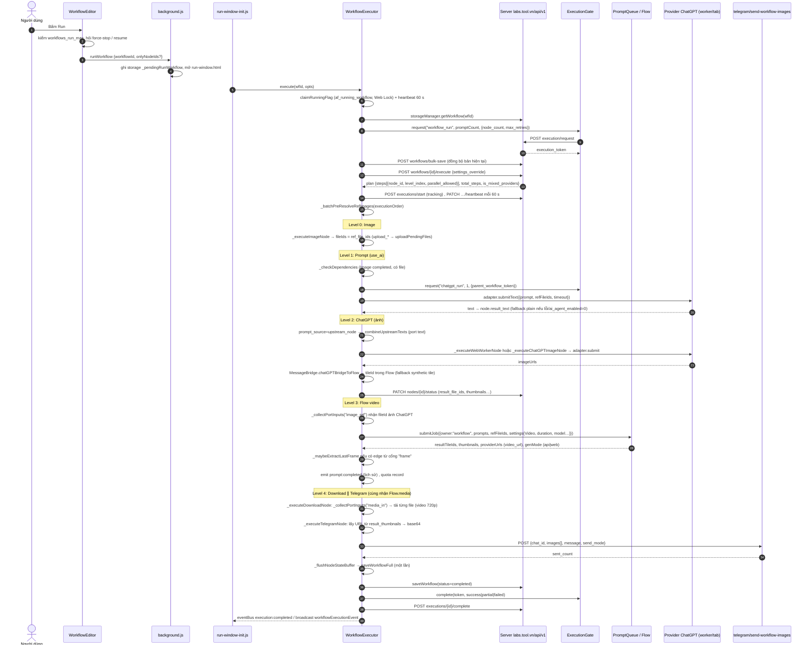
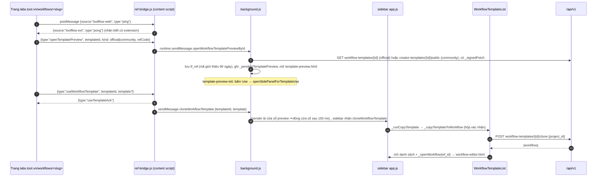

# 8. Workflow builder (editor node graph) và engine thực thi

Workflow của ToolFlow là một đồ thị có hướng gồm các node gắn port có kiểu (text / image / video / frame / any). Người dùng vẽ đồ thị bằng thư viện Drawflow ở `workflow-editor.html`. Client lưu đồ thị lên backend dưới dạng `nodes[]` + `edges[]` (`POST workflows/bulk-save`). Khi bấm Run, client xin server **kế hoạch chạy** (`POST workflows/{id}/execute` → các level topo). `WorkflowExecutor` chạy từng level ngay trong trang extension (cửa sổ `run-window.html` hoặc `workflow-editor.html`), lần lượt điều khiển provider (Google Flow API/DOM, ChatGPT, Grok, Gemini, Muse), tải file và gửi Telegram. Kết quả (file id, thumbnail, text) được ghi ngược vào chính node (`result_*`) và đẩy lên server qua `PATCH workflows/{id}/nodes/{nid}/status`.

Nhãn độ tin cậy: **[QS]** quan sát trực tiếp trong code/data · **[SL]** suy luận · **[?]** chưa rõ. Nguồn dẫn theo dạng `file › Class.method @offset`; mọi đường dẫn tính từ thư mục extension v1.3.138 (đã bundle esbuild, không obfuscate).

---

## 1. Bản đồ file

| file | kích thước | vai trò |
|---|---:|---|
| `src/workflow/WorkflowEditor.js` | 1.246.895 B | Controller của editor: tạo/sửa node, panel cấu hình, slug + mention, nút Run/Stop/Reset, lưu (`saveWorkflowFull`), publish/share template. |
| `src/workflow/DiagramCanvas.js` | 102.606 B | Bọc Drawflow: render node, kiểm tra kết nối port (`PORT_COMPAT`, `acceptFromNodeTypes`, `multiple`), `exportWorkflow()` → `{nodes, edges}`, nạp lại edge và tự migrate edge cũ sang port có kiểu. |
| `src/workflow/NodeTemplates.js` | 87.667 B | Danh mục node: `PORT_TYPES`, `PORT_COMPAT`, `types{}` (port từng node), `getDefaults()`, `normalizeNodeData()`, `getNodePorts()`, HTML từng loại node, merge cấu hình từ server (`workflow-node-types`). |
| `src/workflow/WorkflowHistory.js` | 2.885 B | Undo/redo: stack snapshot JSON tối đa 40, debounce 400 ms. |
| `src/workflow/WorkflowList.js` | 153.367 B | Danh sách workflow của tôi, import/export JSON, duplicate, reset, share, publish template. |
| `src/workflow/WorkflowTab.js` | 27.599 B | Tab "Workflow" ở sidebar (sub-tab My workflows / Templates). |
| `src/workflow/WorkflowTemplateList.js` | 69.596 B | Thư viện template chính thức: phân trang, danh mục, clone, đếm lượt dùng. |
| `src/workflow/SaveTemplateModal.js` | 30.651 B | Admin lưu workflow thành template (`admin/workflow-templates`). |
| `src/workflow/ShareWorkflowModal.js` | 16.718 B | Chia sẻ workflow qua email (`workflows/{id}/shares`). |
| `src/workflow/SharedWorkflowOverlay.js` | 16.978 B | Người nhận chấp nhận/từ chối lời mời share. |
| `src/workflow/WorkflowMediaModal.js` | 28.313 B | Xem media kết quả của node. |
| `src/creator/CreatorTemplatePublish.js` | 27.761 B | Creator publish template công khai (`creator-templates`). |
| `src/creator/MyTemplatesList.js` | 16.148 B | Danh sách template của creator (edit/unpublish/republish/preview). |
| `src/shared/WorkflowExportHelper.js` | 9.450 B | Chuyển `nodes/edges` sang file export JSON v1.0. |
| `src/shared/MentionMenu.js` / `MentionChips.js` | 13.373 / 5.283 B | UI gõ `@` trong textarea: menu gợi ý + chip hiển thị mention. |
| `src/core/MentionParser.js` | 17.514 B | Mention của **tab Gen** (`@tên_ảnh`, `@voice:`, `@char:`), khác cơ chế slug của workflow (xem §7). |
| `src/core/WorkflowExecutor.js` | 597.355 B | Engine thực thi: kế hoạch, thứ tự, từng node, retry, dừng, tracking server. |
| `src/core/WorkflowSingleNodeSession.js` | 12.983 B | Phiên chạy từng node riêng lẻ (nhiều node chạy chồng lấp trong 1 phiên). |
| `src/core/WorkflowVideoMerge.js` | 31.149 B | Node `video_merge`: tải clip, ghép bằng `MotionMergeTask` (mediabunny). |
| `src/core/WorkflowMuseVideoStore.js` | 5.424 B | IndexedDB lưu video Muse cục bộ. |
| `src/core/RetryHelper.js` | — | `RetryHelper.execute` (vòng retry dùng cho mọi node). |
| `src/core/ApiStorage.js` | 19.440 B | Gọi REST `workflows/*`, chuẩn hoá node trước khi lưu. |
| `src/core/ExecutionGate.js` | 16.086 B | Xin/đóng token chạy (`execution/request|complete|cancel`) để trừ quota. |
| `lib/drawflow.min.js` | 46.190 B | Thư viện đồ thị Drawflow. |
| `vendor/mediabunny.js` | 729.679 B | Mux/ghép video (dùng trong merge, watermark, last-frame). |
| `workflow-editor.html` + `workflow-editor-init.js` | 9.514 + 46.963 B | Trang editor (cửa sổ popup riêng): nạp ~130 script, khởi tạo auth/config/FeatureGate/Registry, tạo `WorkflowExecutor` rồi `WorkflowEditor`. |
| `run-window.html` + `run-window-init.js` | 11.743 + 15.719 B | Cửa sổ 520×720 chuyên để chạy workflow/node (đọc `_pendingRunWorkflow`). |
| `template-preview.html` + `-init.js` | 9.299 + 14.258 B | Xem trước template ở chế độ chỉ đọc (`_pendingTemplatePreview`) rồi "Use". |
| `workflow-template-editor.html` + `-init.js` | 7.262 + 8.329 B | Admin sửa template (`_pendingTemplate`, `admin/workflow-templates/{id}`). |
| `ref-bridge.js` | 2.625 B | Content script chạy trên `labs.tool.vn`: cầu nối "Use template" web ↔ extension. |

---

## 2. Mô hình dữ liệu

### 2.1 Kiểu port và tương thích [QS]

`NodeTemplates.PORT_TYPES` = `text, image, video, any, frame`. `PORT_COMPAT[nguồn] = [đích được nhận]`:

| port nguồn → | đích hợp lệ |
|---|---|
| `text` | `text`, `any` |
| `image` | `image`, `frame`, `any` |
| `video` | `video`, `any` |
| `frame` | `frame`, `image`, `any` |
| `any` | tất cả |

Trích: `NodeTemplates.js › PORT_COMPAT` → `image:["image","frame","any"], frame:["frame","image","any"]`.

Luật kiểm tra khi nối (`DiagramCanvas.js › connectionCreated` @62981): (1) type mismatch → từ chối; (2) `acceptFromNodeTypes` (ví dụ port `video_ref` của `generate` chỉ nhận từ `generate`/`image`); (3) `multiple:false` ở nguồn hoặc đích → từ chối nếu >1 kết nối. **Client không kiểm tra vòng lặp**; phát hiện chu trình do server làm khi lập kế hoạch (`plan.cycle_detected`) [QS: không có chuỗi "cycle" trong DiagramCanvas; `_fetchServerPlan` xử lý `cycle_detected`].

Port động: `dynamicType` (đổi kiểu theo `media_type`/`grok_mode`/`ref_media_kind`), `visibleWhen` (`isVideo`, `isVideoFrames`, `isVideoIngredient`, `isGrokVideo`, `enhance`) trong `NodeTemplates.getNodePorts`. Port `frame`/`last_frame` chỉ hiện khi node là video.

### 2.2 Workflow (bản ghi lưu qua `bulk-save`) [QS]

`ApiStorage.saveWorkflowFull(workflow, nodes, edges)` gửi `{...workflow, nodes, edges, platform:"flow"}`. Các trường workflow quan sát được:

```jsonc
{
  "wf_id": "…",              // id server
  "wf_name": "…",
  "status": "pending|running|completed|paused|error",
  "settings_json": {         // cấu hình theo workflow, ghi đè execution config
    "parallel_execution": true,
    "delay_between_nodes": 3,   // giây
    "max_retries": 1,
    "timeout": 180,             // giây → settings.tileTimeout
    "stop_on_error": false
  },
  "project_id": "…", "project_name": "…",   // Flow project
  "created_source": "extension|mcp|template|shared|admin_clone",
  "last_run_at": "ISO", "progress_completed": 0, "progress_total": 0, "current_node_id": "…",
  "nodes": [ /* §2.3 */ ], "edges": [ /* §2.4 */ ]
}
```
Nguồn: `ApiStorage.js › saveWorkflowFull`, `WorkflowExecutor.js › _executeWorkflowOwned` (`wfSettings.*`), `_updateWorkflowStatus`. Cột NOT NULL được ép mặc định trước khi gửi: `enabled:true, auto_download:false, enhance:false, enhance_fallback:true, multi_prompt:false, slug_auto:true`; `delay_seconds` kẹp về 1..300.

### 2.3 Node [QS]

`DiagramCanvas.exportWorkflow()` xuất mỗi node với các nhóm trường. Id sinh bằng `IdGenerator.next("node")` (fallback `node_<ts>_<rand>`); đồ thị Drawflow giữ thêm `_port_map` (`input_N`/`output_N` ↔ tên port).

| nhóm | trường |
|---|---|
| định danh/vị trí | `node_id, node_type, node_name, pos_x, pos_y, enabled, node_zoom(1\|1.5\|2)` |
| prompt | `prompt, prompt_source(textbox\|upstream_node), prompt_mode(auto\|mention\|all), ref_mode(auto\|mention\|all), multi_prompt, prompts_json[], slug, slug_auto` |
| sinh media | `media_type(Image\|Video), model, ratio, quantity, video_input_type(Ingredients\|Frames), video_duration, video_resolution, voice_slug, voice_search_value, character_selections, character_slug, character_search_value, style_prompt` |
| ref | `ref_file_ids ("id1, id2"), ref_thumbnails{id→url\|{thumbnail,type,video_url,source_thumbnail,persistent_media_id}}, ref_file_names{id→file_name}, ref_img_urls[]` |
| frame video | `frame_ref_mode(manual\|upstream_node), frame_1_source/file_id/file_name/thumbnail, frame_2_…` |
| provider | `provider, timeout_ms, timeout_sec, max_ref_images, use_fallback_prefix, grok_mode/duration/resolution/image_quality, *_delete_after_gen, muse_upload_video_to_flow` |
| tải/telegram | `auto_download, download_resolution, video_download_resolution, download_folder, download_file_template, download_collect_all, watermark_mode(inherit\|clean\|original), telegram_chat_id, telegram_send_mode, telegram_message` |
| text_extract | `extract_mode(marker\|json\|regex), extract_marker, extract_regex, extract_strict, extract_multi_match(first\|last\|concat\|error), extract_on_fail(skip_downstream\|fail_workflow)` |
| note | `note_text, note_color, note_font_size, note_width, note_height` |
| **kết quả (executor ghi)** | `status(pending\|running\|completed\|failed\|skipped), result_file_ids ("a, b"), result_thumbnails, result_file_names, result_provider_urls, result_text, result_source, result_frame_file_ids/thumbnails, result_clean_file_ids/thumbnails, result_gen_mode, error_message, executed_at, provider_web_run_id` |

Id file là chuỗi tile id của Flow; id local chưa upload có tiền tố `upload_` (bị lọc khi xuất: `_stripTempIds`). Id kiểu `template_ref_*` là ảnh tham chiếu lấy từ web template.

### 2.4 Edge [QS]

```json
{
  "edge_id": "edge_<drawflowSrc>_<output_1>_<drawflowDst>_<input_2>",
  "source_node_id": "node_…", "source_handle": "output_1", "source_port": "media",
  "target_node_id": "node_…", "target_handle": "input_1",  "target_port": "image_ref",
  "data_type": "image"
}
```
`DiagramCanvas.exportWorkflow` luôn ghi `data_type:"image"` (cứng); khi export file thì `WorkflowExportHelper.convertEdgesToExport` suy `data_type` lại theo node nguồn (`text`/`video`/`image`). Edge cũ không có `source_port`/`target_port` (hoặc `"default"`) được `_inferEdgePortsFromLegacy` migrate sang port có kiểu khi nạp, và executor cũng xử lý dự phòng: edge không có `target_port` vào node ảnh được coi là `image_ref` (`[Port-merge] Legacy edge … treating as image_ref`).

### 2.5 File export/import JSON [QS]

`WorkflowExportHelper.buildExportData` → `{version:"1.0", type:"workflow", exported_at, workflow:{name, description, settings:{parallel, quantity, delay_between_nodes, timeout_per_node, retry_on_error, stop_on_error}, nodes:[…], edges:[…]}}`. Export chỉ giữ cấu hình + `ref_images[{thumbnail, file_name, type, video_url…}]`, **không** giữ `result_*`. Import (`WorkflowList._validateImportData`) kiểm `version==="1.0"`, `type==="workflow"`, tên ≤100 ký tự, `node_id`+`node_type` hợp lệ trong danh sách (`start, generate, download, video_merge, delay, telegram, note, image, text, text_extract, chatgpt, grok, gemini, muse, prompt, transform, condition, merge, output`) và edge không mồ côi. Cả import và export bị khoá theo entitlement `workflow_import` / `workflow_export` (tài khoản Free: `null` ⇒ khoá).

### 2.6 Cấu hình node từ server (`workflow-node-types`) [QS]

`NodeTemplates._doFetch` gọi `GET {api}/workflow-node-types` (có `X-Extension-Id`, chữ ký `RequestSigner`, `Authorization` nếu có), timeout 8 s, cache TTL. `getType(type)` hợp nhất `types` cục bộ với `_serverTypes[type]`: `name, description, color, icon, comingSoon, sortOrder, ports, defaults, validation, ui, config`. Các khoá `ui.supports_slug`, `ui.supports_mentions`, `ui.terminal_sink`, `config.ai_feature_key` do server điều khiển; nếu thiếu thì dùng `_FALLBACK_MENTIONABLE_TYPES = [image,text,text_extract,generate,chatgpt,grok,prompt]` và `_FALLBACK_CAN_USE_MENTIONS = [generate,chatgpt,grok,prompt]`. Lưu ý: bản fallback **không** có `gemini`/`muse`, còn executor có `NODES_CAN_USE_MENTIONS=[generate,chatgpt,grok,gemini,muse,prompt]` [QS] — hai nơi lệch nhau, kết quả thực tế phụ thuộc phản hồi server [SL].

`types.muse` và ports của `video_merge` **không có** trong bản cục bộ (`types[type]||types.generate`, `getNodePorts` trả rỗng nếu thiếu `ports`), nên port của hai node này đến từ server [SL]; không có dữ liệu `workflow-node-types` trong thư mục storage để xác nhận [?].

---

## 3. Bảng từng loại node

Giá trị mặc định lấy từ `NodeTemplates.getDefaults`. Cột "thực thi" mô tả `WorkflowExecutor._executeNodeDispatch` (@234083). Tên hàm là method của `WorkflowExecutor` nếu không ghi khác.

| node (`node_type`) | input port (kiểu, multiple) | output port (kiểu) | field cấu hình chính (mặc định) | provider | thực thi |
|---|---|---|---|---|---|
| **image** "Image" | — | `media` (image/video theo `ref_media_kind`) | `ref_file_ids`, `ref_thumbnails`, `ref_file_names`, `max_ref_images:1`, `slug` | không (nguồn tài nguyên) | `_executeImageNode`: lấy `ref_file_ids`; thiếu thumbnail thì lấy từ `MediaRegistry`, rồi quét DOM Flow (`MessageBridge.getThumbnailsByIds`); id `upload_*` chưa upload thì `uploadPendingFiles(…, {surface:"workflow"})` và map lại id/thumbnail (`node:ref_replaced`). Không có ref → cảnh báo, trả `fileIds:[]`. Không gọi AI. |
| **text** "Text" | — | `text` (text) | `prompt`, `slug`, `slug_auto:true` | không | Pass-through: `node.result_text = node.prompt` (@dispatch). |
| **text_extract** "Text Extract" | `text` (text, **required**, single) | `text` (text) | `extract_mode:marker`, `extract_marker`, `extract_regex`, `extract_strict:false`, `extract_multi_match:first`, `extract_on_fail:skip_downstream` | không | `_executeTextExtractNode`: gộp text upstream; mode `marker` dùng regex `\[marker\]\s*:?\s*([\s\S]+?)(?=\n\s*\[\w|$)` (lỏng: `_`/khoảng trắng/`-` thay thế nhau trừ khi `strict`), `json` đọc khoá, `regex` tự do. Thất bại → `_handleExtractFail` (`skip_downstream` ⇒ node `skipped` và cả nhánh dưới bị bỏ qua; `fail_workflow` ⇒ ném `EXTRACT_FAIL`). |
| **prompt** "AI Agent" | `text` (text, multiple), `image_ref` (image, multiple; hiện khi `use_ai`), `video_ref` (video; hiện khi `use_ai`) | `text` (text) (+ `prompt_1..n` khi `multi_prompt`) | `prompt`, `prompt_mode:auto`, `use_ai:false`, `provider:chatgpt`, `ai_fallback:true`, `ai_delete_after_run:true`, `timeout_sec:60`, `max_ref_images:4`, `multi_prompt`, `prompts_json` | ChatGPT / Gemini / Grok qua `ProviderRegistry.get(provider).submitText` (gate chỉ cho phép `chatgpt|gemini|grok`) | `_executePromptNode` (§6.3). `use_ai=false` ⇒ chỉ thay mention + pass-through. |
| **generate** "Generate Image/Video" (Flow) | `image_ref` (image, multi), `text` (text, multi), `frame_1`/`frame_2` (frame, khi video Frames), `video_ref` (video, khi Ingredients; chỉ nhận từ `generate`,`image`) | `media` (image\|video theo `media_type`), `frame` (khi video) | `media_type`, `model`, `ratio`, `quantity:1`, `video_input_type`, `video_duration:6s`, `video_resolution`, `voice_*`, `character_*`, `auto_download:false`, `download_resolution:1k`, `video_download_resolution:720p`, `watermark_mode:inherit`, `prompt_source`, `frame_ref_mode`, `frame_n_*` | Google Flow (API v2 hoặc DOM) | `PromptQueue.submitJob({owner:"workflow", prompts:[…], settings:{genType, ratio, model, quantity, flowVideoDuration, flowVideoResolution, refVideoIds, wantsLastFrame}, refFileIds, …})`; nếu `PromptQueue` tắt thì nhánh DIRECT (`prepareFlowForGen` → `_clearEditor` → `_insertPrompt` → `_applySettings` → `_clickSubmit` → `_waitForNewTiles`) (§6.4). |
| **chatgpt** "ChatGPT" | `image_ref` (image, multi), `text` (text, multi) | `media` (image) | `ratio:story`, `model`, `use_fallback_prefix:auto`, `timeout_ms:120000`, `max_ref_images:4`, `chatgpt_delete_after_gen`, `auto_download` | ChatGPT web (tab chatgpt.com) | Lane worker (`_executeWebWorkerNode`) nếu đủ điều kiện, ngược lại legacy `_executeChatGPTImageNode` (§6.5). Chỉ ảnh (video ⇒ `UNSUPPORTED_MEDIA_TYPE`). |
| **grok** "Grok" | `image_ref`, `text` (như trên) | `media` (image\|video theo `grok_mode`), `frame` (khi video) | `grok_mode:image`, `model`, `ratio:widescreen`, `grok_duration:6s`, `grok_resolution:720p`, `grok_image_quality:speed`, `quantity:1`, `timeout_ms:180000`, `max_ref_images` (theo adapter), `video_input_type` | Grok web (grok.com) | `_executeGrokImageNode` (không có lane worker): `adapter.submit` → bridge sang Flow (`grokBridgeToFlow`); video giữ URL provider (§6.5). |
| **gemini** "Gemini" | `image_ref`, `text`, `video_ref` (khi video) | `media` (image\|video) | `provider:gemini`, `media_type`, `model`, `ratio`, `quantity:1`, `prompt_source:textbox`, `multi_prompt:false`, `gemini_delete_after_gen` | Gemini web | Lane worker hoặc `_executeGeminiNode`. |
| **muse** "Muse" | [?] (từ server; mặc định giống gemini) | [?] | `provider:muse`, `media_type`, `model`, `ratio`, `muse_upload_video_to_flow:false`, `muse_delete_after_gen` | Muse web | Lane worker hoặc `_executeMuseNode`; video lưu cục bộ `WorkflowMuseVideoStore` (id `muse_*`). |
| **delay** "Wait" | `any_in` (any) | `any_out` (any) | `delay_seconds:3` (1..300) | không | `_executeDelayNode`: ngủ từng 200 ms (dừng được), rồi **pass-through** file id nhận vào. |
| **download** "Download" | `media_in` (any, **required**, multi) | — (0 output) | `download_resolution:1k`, `video_download_resolution`, `download_folder`, `download_file_template:"{node}_{prompt}_{date}_{time}_{index}"`, `download_collect_all`, `watermark_mode` | Flow/Chrome downloads | `_executeDownloadNode` (§6.6). Cần entitlement `auto_download`. |
| **telegram** "Telegram" | `media_in` (any, required, multi) | `pass` (any) (`ui.terminal_sink:true`) | `telegram_chat_id`, `telegram_send_mode:group`, `telegram_message` | Backend Tool (`telegram/send-workflow-images`) | `_executeTelegramNode` (§6.7). Cần `telegram_enabled` + `telegram_workflow`. |
| **video_merge** "Merge videos" | `video_in` (video; port từ server [SL]) | [SL] video | `media_type:Video`, `video_download_resolution` | cục bộ (mediabunny) | `WorkflowVideoMerge.run` (§6.8). |
| **note** | — | — | `note_text`, `note_color`, `note_font_size`, `note_width/height` | không | Bỏ qua khi chạy; nút "run-note-group" chạy nhóm node nằm trong khung note (`onlyNodeIds`). |
| transform / condition / merge / output | (khai báo trong `types` nhưng không có port/thực thi) | — | — | — | Không có nhánh trong dispatch; chỉ để tương thích import [SL]. |

Ghi chú: trang chủ ghi "9 node types — Image, Prompt, Flow, ChatGPT, Grok, Download, Delay, Telegram, Note" nhưng code còn `text`, `text_extract`, `gemini`, `muse`, `video_merge` (13 loại thực dụng).

**Điểm quan trọng khi thiết kế sơ đồ:** `download` có `outputs:0` ([QS] `NodeTemplates.types.download.ports.out = []`), nên **không thể nối Download → Telegram**. Hai node này phải cùng nhận từ node sinh media (xem §5).

### 3.1 Entitlements chi phối node (tài khoản Free trong `af_entitlements.json`) [QS]

| key | giá trị Free | tác động |
|---|---|---|
| `workflows_enabled` | 1 | bật module |
| `workflows_max` | 2 | tối đa 2 workflow |
| `workflows_nodes_max` | 5 | tối đa 5 node/workflow (kiểm khi thêm node, `DiagramCanvas` @17016; workflow cũ vượt hạn vẫn chạy, `_executeWorkflowOwned` chỉ log) |
| `workflows_run_max` | 10/ngày | `_runWorkflowFromEditor` kiểm trước khi chạy |
| `workflow_execution_history_max` | 20 | số lịch sử run |
| `prompt_node_enabled` | 1 | node prompt chạy được |
| `ai_agent_enabled` | **0** | `use_ai=true` ⇒ fallback sang plain text (ghi `result_source:"plain_fallback"`) |
| `auto_download`, `retry_on_fail` | 1, 1 | node Download và retry hoạt động |
| `chatgpt_enabled`/`gemini_enabled`/`grok_enabled`/`muse_enabled` | 1 | |
| `chatgpt_run_max`/`grok_run_max`/`gemini_run_max`/`muse_run_max` | 10/10/15/5 mỗi ngày | |
| `telegram_enabled`, `telegram_workflow` | 0 | node Telegram chỉ pass-through + cảnh báo |
| `workflow_import`/`workflow_export`/`workflow_share_enabled` | null | khoá |
| `workflow_templates_enabled` | 1 | xem/clone template |

### 3.2 Cấu hình server (`af_execution_config.json › workflow`) [QS]

| key | giá trị | dùng ở |
|---|---|---|
| `workflow.delay_nodes_sec` | 3 | `settings.delayBetweenNodes` (nghỉ giữa các level và stagger khi chạy song song) |
| `workflow.max_retries` | 1 | `settings.maxRetries` |
| `workflow.timeout_sec` | 180 | `settings.tileTimeout` |
| `workflow.on_error` | `continue` | `settings.stopOnError = (=== "stop")` |
| `workflow.flow_api_enabled` | true | cho phép Flow API ở bề mặt workflow |
| `flow_api.v2_surfaces` | `gen,task,workflow` | Flow API v2 áp dụng cho workflow |
| `parallel.provider_web_workflow_enabled` | true | cho phép lane worker trong workflow |
| `parallel.provider_web_enabled_providers` | `muse,chatgpt,gemini` | provider được chạy lane worker |
| `parallel.provider_web_max_concurrent_workers` | 2 | số worker song song |
| `parallel.provider_web_{chatgpt,gemini,muse}_startup_timeout_ms` | 60000 | hợp lệ khi 10.000–120.000 |
| `flow_recovery.*` | `auto_recovery_enabled`, `backoff_base_sec 30`, `captcha_recovery_mode pause_resume`… | khôi phục Flow |

Thứ tự ưu tiên khi chạy: `_refreshSettingsFromExecutionConfig()` đọc execution config → rồi `workflow.settings_json` ghi đè (`delay_between_nodes`, `max_retries`, `timeout`, `stop_on_error`, `parallel_execution`) → rồi `featureGate.canUse("retry_on_fail")` quyết định `retryOnFail`; nếu cấm thì `maxRetries=0` (`WorkflowExecutor › _executeWorkflowOwned`).

---

## 4. Editor: các cơ chế chính

### 4.1 Khởi tạo trang `workflow-editor.html` [QS]

`workflow-editor-init.js` (`DOMContentLoaded`): `I18n.init` → `storageSettings.ready` → `authManager.init` → `SseClient.connect` → `RequestCoalescer.init` → `storageManager.init` → `featureGate.init/refresh` → `SystemConfig.restoreFromStorage` → `ExecutionConfig.getConfig` → `VoiceRegistry`/`ProviderMeta` → `new WorkflowExecutor` → `NodeTemplates.fetchFromServer()` → `new WorkflowEditor()` → đọc `chrome.storage.local._pendingWorkflow` / `_pendingTemplatePreview` để mở workflow hoặc template. Safety timeout 20 s để ẩn màn loading.

### 4.2 Thêm node, slug, giới hạn [QS]

- Kéo từ palette (`NodeTemplates.createPaletteItem`) → `DiagramCanvas.addNode`. Hạn mức `workflows_nodes_max` kiểm tại đây; vượt thì hộp thoại nâng cấp (hoặc đăng nhập nếu là bản dùng thử với `workflows_max_node`).
- **Slug** (cho mention): `_normalizeToSlug` = bỏ dấu (NFD), chữ thường, ký tự lạ → `_`, bỏ `^[0-9_]+`, cắt 25 ký tự; trùng thì thêm `_1`, `_2`…; `SLUG_PATTERN=/^[a-z][a-z0-9_]{0,29}$/`, `SLUG_MAX_LENGTH=30`; từ cấm `all,none,self,this,null,undefined,true,false,new,delete,default` (tự thêm tiền tố `node_`). `slug_auto=true` ⇒ slug theo `node_name`; người dùng sửa tay thì `slug_auto=false`.
- Tối đa `MAX_MENTIONS_PER_PROMPT=20`.
- Nhân bản node: nếu node mentionable thì giữ slug nhưng đảm bảo duy nhất; nếu `prompt_source==="upstream_node"` thì đưa về `textbox`.

### 4.3 Undo/redo [QS]

`WorkflowHistory`: mỗi lần đổi, `scheduleSnapshot(label, 400ms)` → `takeSnapshot` = `diagramCanvas.exportWorkflow()` → xoá thumbnail dạng `data:` (nặng) → `JSON.stringify`; so với snapshot trước để bỏ trùng; stack tối đa **40**; `canUndo` khi stack ≥ 2; undo/redo gọi `editor._restoreFromHistorySnapshot` trong chế độ `_suppressing` (tránh tự snapshot lại).

### 4.4 Lưu [QS]

`saveWorkflowFull` (một request `POST workflows/bulk-save`) cho lưu cả đồ thị; sửa nhỏ dùng `PUT workflows/{id}/nodes/{nid}`, `PATCH …/nodes/{nid}/status` (trạng thái/kết quả), `POST/DELETE …/edges`. Trước mỗi lần chạy, executor **luôn gọi `saveWorkflowFull` lại** ("Đang đồng bộ workflow lên server…") để server lập kế hoạch từ đúng bản mới nhất; lỗi `VALIDATION_ERROR` hiện field đầu tiên và huỷ chạy.

### 4.5 Run / Stop / Reset từ editor [QS/SL]

- `_runWorkflowFromEditor`: kiểm `workflows_run_max` → chặn nếu đang chạy ở ngữ cảnh khác (hỏi Force Stop, `WorkflowExecutor.requestCrossContextStop`) → nếu đã có node `completed` hỏi "Resume hay Rerun" → gửi yêu cầu chạy. Chạy đi qua `background.js` (`type:"runWorkflow"|"runNode"` + `onlyNodeIds`) → `openRunWindow` ghi `_pendingRunWorkflow {wfId,nodeId,timestamp,manualSubmitMode,onlyNodeIds}` và mở `run-window.html` [QS cho phía background/run-window; đường gọi chính xác từ nút Run của editor là [SL]]. `run-window-init.js › consumePendingAndRun` bỏ yêu cầu quá 2 phút, preflight provider, rồi gọi `workflowExecutor.execute(wfId, opts)` (cả workflow / `onlyNodeIds`) hoặc `executeSingleNode(wfId, nodeId, opts)`.
- Nút chạy riêng một node (`runNode`) khi đã có phiên "single_nodes" sống thì gửi `workflow:single_node` vào phiên đó (§6.10).
- Reset: `executor.reset(wfId)` dừng run đang chạy (`stop(true,true,"WORKFLOW_RESET")`), rồi `POST workflows/{id}/reset`, phát `workflow:reset`. Reset theo nhóm: `nodes:reset_multi`, `node:reset_group` (`_resetWorkflowFromEditor({onlyNodeIds, scope:"selection"|"note"})`).
- Chế độ chỉ đọc: `isTemplateMode`, `isReadOnly()` chặn chạy.

---

## 5. Luồng chạy một workflow mẫu: Image → Prompt → ChatGPT → Flow video → Download → Telegram

### 5.1 Cấu hình mẫu

Vì `download` không có output, đồ thị hợp lệ là (mũi tên = edge `source_port → target_port`):

```
Image(media) ──image_ref──▶ Prompt(AI)         (nếu use_ai, để phân tích ảnh)
Image(media) ──image_ref──▶ ChatGPT            (ảnh tham chiếu)
Prompt(text) ──text──────▶ ChatGPT             (prompt_source=upstream_node)
ChatGPT(media:image) ─image_ref─▶ Flow video   (Ingredients)
Prompt(text) ──text──────▶ Flow video          (hoặc prompt riêng của Flow)
Flow(media:video) ──media_in─▶ Download
Flow(media:video) ──media_in─▶ Telegram        (Telegram.pass có thể nối tiếp nếu cần)
```
[SL] — đây là cách ghép hợp lệ theo `PORT_COMPAT` và số port; template thực trên web (ví dụ "Handbag Review Video": ChatGPT tạo ảnh + Google Flow dựng video 9:16 10 s, 41 template công khai ngày 2026-11-05, nhiều cái ghi "7–8 nodes") đi theo mẫu ChatGPT/Grok → Flow.

### 5.2 Sequence diagram



### 5.3 Giải thích từng bước

1. **Nhận lệnh & chặn chạy chồng**: `claimRunningFlag` ghi `chrome.storage.local.af_running_workflow {wf_id, run_id (uuid), owner_document_id, started_at, last_heartbeat_at, executor_context}` dưới Web Lock `af_running_workflow_claim`. Cờ bị coi là "chết" nếu document chủ không còn (`chrome.runtime.getContexts`) hoặc quá `HEARTBEAT_TTL_MS=5 phút`; heartbeat 60 s (`HEARTBEAT_INTERVAL_MS`). Đang có run khác ⇒ ném `CROSS_CONTEXT_RUNNING`.
2. **Xin phép**: `ExecutionGate.request("workflow_run", promptCount, {…})` ⇒ `execution/request` trả `execution_token` (không có token ⇒ ném `WORKFLOW_EXECUTION_TOKEN_MISSING`, huỷ chạy — "Server-Only spec"). `promptCount` = số node đang bật chưa `completed` thuộc loại `generate|chatgpt|grok|gemini|muse|prompt(use_ai)`.
3. **Kế hoạch topo do server làm**: `_fetchServerPlan` → `POST workflows/{wf}/execute {settings_override:{parallel_execution, stop_on_error, max_retries, provider_web_ready_providers}, only_node_ids?}` ⇒ `plan.steps[]` mỗi bước có `node_id, level_index, parallel_allowed`. `_convertServerPlanToLevels` gom theo `level_index` (node không khớp local bị bỏ qua). Plan không lấy được ⇒ **chặn chạy** (không có topo sort dự phòng ở client) với thông báo riêng cho 429/5xx/4xx/hình dạng sai; `cycle_detected` ⇒ "Workflow có cycle".
4. **Chạy theo level**: với mỗi level, nếu `levelNodes[0]._serverStep.parallel_allowed && length>1` ⇒ chạy song song (stagger `delayBetweenNodes`, `Promise.allSettled`, Flow submit theo thứ tự nhờ `_createOrderedFlowSubmitGate`), ngược lại tuần tự. Giữa hai level nghỉ `delayBetweenNodes` (3 s). Trước level>0, executor nạp lại node từ server (`storageManager.getNodes`) nhưng **giữ** `enabled/status/result_*` đang có trong bộ nhớ.
5. **Mỗi node** → `_executeSingleNode`: tính `_effective_prompt` (mention) → `_checkDependencies` → `_resetNodeResultsForRun` → emit `node:started` → `_updateNodeStatus(running)` → `_executeNode` (RetryHelper) → xử lý kết quả → `node:completed` → `_updateNodeStatus(completed, fileIds, …)`.
6. **Trạng thái ghi đệm**: khi `_executionInProgress` các `completed/failed/skipped` không PATCH từng node mà vào `_nodeStateBuffer` (checkpoint vào `chrome.storage.local.af_workflow_buffer_<wf>` mỗi 10 s), cuối run `_flushNodeStateBuffer` gọi `saveWorkflowFull` một lần (lỗi 429 ⇒ giữ local, thử lại lần sau; lỗi khác ⇒ PATCH từng node). Riêng `running` của node chatgpt/muse/gemini được PATCH ngay (checkpoint bắt đầu run worker).

---

## 6. Chi tiết engine thực thi

### 6.1 Lớp `WorkflowExecutor` — API công khai [QS]

| method | mô tả |
|---|---|
| `execute(wfId, {onlyNodeIds, manualSubmitMode})` | chạy cả workflow hoặc tập con; bọc trong `_runOwnedExecution` (không cho 2 task chồng; `WORKFLOW_EXECUTION_STILL_STOPPING`). Trả `true` khi `completed`. |
| `executeSingleNode(wfId, nodeId, opts)` | chạy một node qua `WorkflowSingleNodeSession`. |
| `stop(broadcast, force, stopSource)` | đặt `shouldStop`, huỷ admission/read, `ExecutionGate.cancel`, dừng job `PromptQueue` owner `workflow`, dừng worker provider (`ProviderWebScheduler.stopOwned`), `grokAbort`, `endFlowZoomSession`… |
| `reset(wfId)` | §4.5. |
| `handleRemoteStop`, `WorkflowExecutor.requestCrossContextStop(running, source)` | dừng run ở cửa sổ khác. |
| `waitForExecutionStopped()` | chờ task kết thúc. |

Message `chrome.runtime.onMessage` mà executor tự lắng nghe: `workflow:single_node`, `workflow:stop_single_node`, `queue:stop_job`, `queue:stop_all`.

### 6.2 Thứ tự topo, phụ thuộc và truyền output [QS]

- **Thứ tự**: do server (levels). Executor chỉ tôn trọng `level_index`; trong một level tuần tự theo thứ tự `steps`.
- **`_checkDependencies(node, nodes, edges, scope)`** quyết định node có chạy hay bị `skipped`:
  - nguồn `enabled=false` ⇒ bỏ qua nguồn đó; nguồn `failed`/`skipped` ⇒ *không chặn* (nhưng sẽ không có dữ liệu);
  - nguồn chưa `completed` (và nằm trong scope) ⇒ lỗi "chưa hoàn thành";
  - nguồn `text/prompt/text_extract` không có text ⇒ lỗi "không có text output";
  - nguồn file mà **tất cả** nguồn đều rỗng ⇒ lỗi; một phần rỗng ⇒ chạy với số ref còn lại (cảnh báo);
  - `text_extract` nguồn thất bại với `skip_downstream` ⇒ bỏ cả nhánh;
  - node sinh media không có prompt riêng và không có upstream text ⇒ "chưa có prompt";
  - loại `delay/download/video_merge/note/image/telegram/prompt/text_extract` không cần prompt.
  Kết quả không-ok ⇒ `_updateNodeStatus(skipped)` + `node:warning` (không phải lỗi).
- **Truyền output** là *qua chính object node* (`result_file_ids`, `result_text`, `result_frame_file_ids`, `ref_file_ids`) chứ không có message bus giữa node:
  - `_collectPortInputs(node, portName, nodes, edges)`: lấy các edge vào đúng port (edge không có `target_port` ⇒ coi là port vào đầu tiên), với mỗi nguồn gọi `_getNodeOutputForPort(upstream, sourcePort, preferClean)`.
  - `_getNodeOutputForPort`: node `image` ⇒ `ref_file_ids` (hoặc khoá `ref_thumbnails`); port `text` ⇒ `result_text` (node `prompt` chưa có thì lấy `prompt`); port `prompt_N` (multi-prompt) ⇒ phần tử N của `prompts_json`; `frame`/`last_frame` ⇒ `result_frame_file_ids`; `media|image_out|pass|any_out|video_out` hoặc mặc định ⇒ `result_file_ids` (ưu tiên bản "clean" `result_clean_file_ids` khi dùng làm `*_ref` và còn "fresh").
  - Node `delay`/`note` là *trong suốt*: `_collectInputFileIds` đi ngược qua chúng (BFS) để lấy file của node thật phía trên.
  - **Gộp text**: `_combineUpstreamTexts` lấy mọi edge vào port `text`/`default`, sắp `prompt` trước rồi theo `pos_y`, nối bằng `\n\n`, cắt ở `prompt_max_length` (mặc định 5000, `ValidationRules`), báo toast khi cắt. Nguồn là node `prompt` chứa `@slug` ⇒ giải mention lồng nhau trước.
  - **Gộp ảnh**: node sinh media gom ref từ `ref_file_ids` của chính nó + port `image_ref`/`video_ref` + (video Frames) `frame_1`/`frame_2`; khử trùng theo id và theo `file_name`; giới hạn `max_ref_images`; id "upload_*" chưa upload sẽ được `uploadPendingFiles`.
  - **Tự nhận nguồn prompt** (`prompt_source` còn `undefined`): textbox rỗng + có `prompt/text/text_extract` nối vào ⇒ `upstream_node`; còn có prompt riêng ⇒ `textbox`. Nếu `textbox` rỗng nhưng có upstream text ở port `text` ⇒ tự đổi sang `upstream_node`. `upstream_node` mà không có text ⇒ ném `EMPTY_UPSTREAM_PROMPT` (`noRetry`).

### 6.3 `_executePromptNode` (node AI Agent) [QS]

1. `prompt_node_enabled` tắt ⇒ `FEATURE_LOCKED`.
2. Chọn cách ghép text: nếu prompt chứa `@slug` hoặc `prompt_mode==="mention"` hoặc `ref_mode==="mention"` ⇒ **thay thế inline** (`resolvePromptMentions`); ngược lại ghép "instruction của node + text upstream".
3. Prompt rỗng ⇒ `EMPTY_PROMPT`.
4. `use_ai=false` (hoặc `multi_prompt`) ⇒ pass-through: `result_text = _normalizeExtractedText(prompt)`, `result_source="plain"`.
5. `use_ai=true`: kiểm entitlement (`ai_feature_key||"ai_agent_enabled"`); tắt ⇒ fallback plain + thông báo "plan không có AI Agent". Có: `ProviderRegistry.get(provider)` (cần `submitText`), `ExecutionGate.request("<provider>_run", 1, {parent_workflow_token})`, `adapter.ensureReady()`, gom ref ảnh (port `image_ref` hoặc mention) + `video_ref` (chỉ chatgpt/gemini), `_resolveRefImagesForLLM`, timeout = `timeout_sec(60)` + `min(120, len/100)` giây, `adapter.submitText({prompt, refFileIds, videoRefs, timeout})`.
6. Lỗi hoặc rỗng: nếu `ai_fallback!==false` và không phải lỗi "trước khi submit" (`COMPOSER_DIRTY`, `NEW_CHAT_NOT_READY`, `SUBMIT_FAILED`…) và không có video ref ⇒ fallback plain (`result_source="plain_fallback"`, `last_error=null`); ngược lại ném lỗi `ENHANCE_FAILED`.
7. `ai_delete_after_run` ⇒ xoá cuộc trò chuyện (ChatGPT `deleteLastMessage`, Gemini `deleteCurrentConversation`). Đóng token (`success` chỉ khi provider thực sự trả).
8. Khôi phục `node.prompt` gốc sau khi chạy.

### 6.4 Node Flow (`generate`) [QS]

- Chuẩn bị: sửa `ref_file_ids` từ `ref_file_names/ref_thumbnails` nếu thiếu ("Smart Clone"), upload `upload_*`, khử trùng, cắt theo ràng buộc model (`supportsRefImages`, `getDurationOverride` ép thời lượng khi có ref), lấy UUID ref từ bảng Flow (`extractTileIdentifiers`) nếu thiếu.
- **Nhánh PIPELINE** (`PromptQueue.isEnabled()`): `await flowSubmitGate.wait(order)` rồi `pq.submitJob(...)` với `owner:"workflow"`, `phaseRContext`, `webRecoveryPolicy {enabled: parallel.web_resubmit_enabled, max: workflow.max_retries}`, `singleNodeSession`, `_executionToken`, `_executionTokenManagedByCaller:true`. Callback `onResultsReady` (cập nhật `result_*` sớm + `node:preview_available`), `onGenerationComplete`, `onRefReuploaded`. Kết quả: `{fileIds: resultTileIds, thumbnails, fileNames, providerUrls, genMode ("api"|"web"), flowApiVersions, historyRoute, partialFailureMessage, refFileIdsUsed}`. `recoveryRequired` ⇒ `shouldStop=true` + lỗi `noRetry`.
- **Nhánh DIRECT** (không có PromptQueue): khoá `_acquireSubmitMutex` → `prepareFlowForGen` → `_removeExistingRefImages` → `_clearEditor` → chọn giọng/nhân vật (`selectFlowVoice/Character`) → `_addFileToPrompt` → `_applySettings` → `_insertPrompt` → `_clickSubmit` → `_waitForNewTiles`.
- Mention `@voice:`/`@char:` trong prompt Flow video: ở nhánh direct chỉ áp mention đầu tiên (log cảnh báo) rồi `MentionParser.stripComponents`.
- Sau khi xong: `_healFlowVideoResult`, `_maybeExtractLastFrame` (nếu có edge từ port `frame`/`last_frame` ⇒ lấy khung cuối bằng `VideoFrameExtractor`, upload lên Flow, ghi `result_frame_file_ids`), ghi lịch sử (`prompt:completed`), auto-download nếu `auto_download` + entitlement.
- Node sinh media mà `fileIds` rỗng ⇒ `_emptyGenerationResultError` (hoặc `skipped` nếu `_userSkipped` ở manual-submit).

### 6.5 Node provider (ChatGPT / Grok / Gemini / Muse) [QS]

**Chọn lane** (`_workflowWorkerEligible`): chỉ `chatgpt|muse|gemini` (chatgpt phải là ảnh), cần `ProviderWebScheduler`/`ProviderWebQueueStore`, `_workflowWorkerReadyProviders` có provider (tính từ `_workflowWorkerCapabilities`, đọc `parallel.provider_web_*`), và `getProviderWebSurface("workflow", provider).surfaceEnabled`. Đủ ⇒ `_executeWebWorkerNode` (worker chạy trong tab riêng, có `ProviderWebQueueStore` + receipts, `markOwnerCheckpointed`, khôi phục khi crash: `_assertNoUnresolvedOwnedRun`, `reconcile*`). Không đủ nhưng bước plan ghi `parallel_allowed` ⇒ ném `PROVIDER_WEB_PAUSED_BY_CONFIG` (`noRetry`). Còn lại ⇒ lane legacy (tuần tự, trong tab provider đang mở). `grok` luôn legacy.

**Legacy ChatGPT** (`_executeChatGPTImageNode`): kiểm `chatgpt_enabled` → `ProviderRegistry.get("chatgpt")` → `_preflightProviderTab` (đăng nhập, tab sẵn sàng; `chatgpt:login_required` nếu chưa) → upload ref local lên Flow, giới hạn `max_ref_images`, `ExecutionGate.request` → `adapter.submit({prompt, refFileIds, settings:{source:"workflow", ratio, model, timeout, useFallbackPrefix, fallbackPrefix}})` → lỗi `CONTENT_BLOCKED` thử lại 1 lần; `TIMEOUT` nhưng ảnh đang gen ⇒ không retry (tránh submit trùng) → với mỗi `imageUrl`: `MessageBridge.chatGPTBridgeToFlow` tải ảnh sang Flow để có tile id (lỗi ⇒ "synthetic tile" giữ URL provider) → `chatgpt_delete_after_gen`.

**Grok** tương tự, thêm kiểm khung hình (`validateFrameSlots`, `frameReferenceData` cho `last_frame` base64), video **không** bridge sang Flow (giữ provider URL để download), auto-download nhiều tầng (native Download → direct URL).

**Gemini/Muse**: `ModelRegistry`/`ProviderConfigManager` bắt buộc có model và ratio hợp lệ (`MODEL_CONFIG_MISSING`, `RATIO_CONFIG_MISSING`); Muse video lưu `WorkflowMuseVideoStore` (IndexedDB `videos`, khoá `userId\0wfId\0nodeId\0fileId`), tuỳ chọn `muse_upload_video_to_flow`.

Lỗi/retry: mọi node (trừ `video_merge`) chạy trong `RetryHelper.execute` với `maxRetries = retryOnFail ? settings.maxRetries : 0`, `retryDelay = 5000 ms` (executor) — Free hiện `max_retries=1` ⇒ tổng 2 lần thử. Lỗi mang `noRetry:true` (token không hợp lệ, offline cache stale, parent execution inactive, upstream prompt rỗng, REF_UPLOAD_FAILED…) dừng thử lại ngay.

### 6.6 `_executeDownloadNode` [QS]

Cần `auto_download`; không ⇒ trả `fileIds:[]`. File lấy từ port `media_in` (hoặc `_collectInputFileIds` nếu rỗng; hoặc `_collectAllWorkflowFileIds` khi `download_collect_all` — gồm cả node chưa chạy). Rỗng ⇒ ném "Không có file để tải". Độ phân giải: có video ở upstream ⇒ `video_download_resolution` (720p) còn lại `download_resolution` (1k). Với mỗi file: bỏ qua nếu đã tải (`_downloadedTileIds`), bỏ qua nếu đã gửi nhưng chưa xác nhận (`_downloadNoReplayTileIds` ⇒ `DOWNLOAD_ACCEPTANCE_UNKNOWN`, không gửi lại để tránh tải trùng), kiểm tile có thuộc project khác, giải UUID media qua `flow_uuid_gateway`, đặt tên bằng `_buildDownloadFileName` (token `{workflow}`, `{node}`, `{index}`, `{date}`, `{time}`, `{prompt}` ≤60 ký tự, ký tự `/\:*?"<>|` ⇒ `_`), thư mục = `download_folder` hoặc tên workflow, `watermark_mode` (`inherit|clean|original`). Lỗi một phần ⇒ đếm `failedDownloads`.

### 6.7 `_executeTelegramNode` [QS]

Entitlement khoá ⇒ cảnh báo, trả file đầu vào (pass-through). Không có `telegram_chat_id` ⇒ ném. File lấy từ port `media_in`. Lấy URL https từ `result_thumbnails` của mọi node (video: `video_url`) hoặc từ DOM tile; bỏ tile thuộc project khác; `_convertMediaToBase64ForTelegram` → `POST telegram/send-workflow-images {chat_id, images[{…base64,type}], message, send_mode: "group"|"single"}`. Lỗi gọi API chỉ ghi `emitLog(warn)`, **không** làm node thất bại.

### 6.8 `video_merge` [QS]

`_executeNode` rẽ ngay sang `WorkflowVideoMerge.run` (có retry riêng `retry()`). `inputs()` lấy các edge vào port `video_in` hoặc mặc định, mỗi nguồn phải là video (`WORKFLOW_VIDEO_INPUT_NOT_VIDEO`), 1..500 clip. Mỗi clip được tải về `WorkflowResultMediaStore` (IndexedDB; Flow lấy qua bridge, provider khác qua `fetchBlob`/`geminiFetchMedia`/Muse store). Một clip MP4 duy nhất ⇒ pass-through; ngược lại `MotionMergeTask.start(clips)` (worker mediabunny, `{workflow:true}`; quá hạn ⇒ `MOTION_MERGE_TIMEOUT`). Kết quả id `workflow_merge_<uuid>`, `thumbnails[id]={type:"video", width, height, duration, local_result:true}`, `providerUrls[id].local_result=true`; `commit` PATCH status và xoá kết quả cũ. Kiểm sở hữu liên tục (`assertOwner`: `WORKFLOW_VIDEO_OWNER_CHANGED`).

### 6.9 Xử lý lỗi, `on_error`, timeout, dừng [QS]

| tình huống | hành vi |
|---|---|
| node lỗi, `on_error=continue` | node `failed`, ghi `error_message`; `_checkDependencies` của con sẽ cho chạy tiếp nếu còn nguồn khác có dữ liệu (nguồn `failed` không chặn nhưng sẽ thiếu dữ liệu ⇒ thường bị `skipped`); level kế vẫn chạy. |
| `on_error=stop` hoặc `settings_json.stop_on_error` | `shouldStop=true` sau node lỗi, log "Dừng workflow do cài đặt Dừng khi lỗi", trạng thái cuối `paused`. |
| `error.recoveryRequired` | luôn dừng cả workflow, trạng thái node `pending/failed` có tiền tố `[PROVIDER_REVIEW_REQUIRED]`; lần chạy sau ném `PROVIDER_WORKFLOW_REVIEW_REQUIRED` cho tới khi được xử lý. |
| người dùng Stop | `stop()` ⇒ node đang chạy vào `_markNodeCancelled`, workflow `paused`, ExecutionGate token `partial|failed`. Node đã submit lên provider thì chờ kết quả trước khi dừng (`_submittedNodes`). |
| captcha Flow | `shouldStop=true` + `_captchaHalted` ⇒ `_handleCaptchaDecision()`: người dùng chọn tiếp tục thì `_resumeApiUnusualWorkflowJobs()`; ngược lại dừng an toàn. |
| `timeout_sec` | gán `settings.tileTimeout`; các wait của Flow dùng nó (`_waitForNewTiles`), provider có timeout riêng (`timeout_ms`, `timeout_sec`). Không có timeout tổng cho cả workflow. |
| 429 khi lưu trạng thái | giữ trạng thái local, đồng bộ sau. |
| kết thúc | `finalStatus` = `paused` (dừng/review) / `error` (worker thất bại không kết quả) / `completed`. ExecutionGate `complete(token, success|partial|failed, {successful_count})`. Quota local: `featureGate.recordWorkflowRun/GenRun/ChatGPTRun/GrokRun/PromptSubmit`. |

### 6.10 Chạy một node & chạy nhóm note [QS]

- `executeSingleNode` ⇒ `_admitSingleNode`: nếu đã có phiên cùng workflow ⇒ `enqueue(nodeId)`; nếu `isRunning`/đang có task ⇒ `WORKFLOW_EXECUTION_BUSY`; không ⇒ tạo `WorkflowSingleNodeSession` + `claimRunningFlag(wf, null, "single_nodes")` và `_runSingleNodeSession`. Có thể enqueue **nhiều node** vào phiên đang sống (message `workflow:single_node` với đúng `runId`), session tự xếp thứ tự bằng `waitingFor`: `BROWSER_BUSY` (chỉ một node cần tab trình duyệt tại một thời điểm), `FLOW_WEB_BUSY`, `FLOW_API_PREPARING`, `GENERATION_QUEUE`, và `_dependent` phát hiện quan hệ phụ thuộc kể cả qua mention để không chạy chồng.
- Chạy nhóm note: node `note` có khung; nút `run-note-group` gom các node nằm trong khung ⇒ `onlyNodeIds` ⇒ `execute(wfId, {onlyNodeIds})`; kế hoạch server nhận `only_node_ids`, executor lọc level còn lại, nguồn ngoài scope không bị chặn (`outsideScope`).
- `manualSubmitMode`: node Flow đợi người dùng bấm Submit thủ công; bỏ qua ⇒ `_userSkipped` ⇒ con bị `skipped`.

### 6.11 Tracking phía server [QS]

| bước | API |
|---|---|
| xin phép | `POST execution/request` → `execution_token`; `POST execution/complete`; `POST execution/cancel` |
| kế hoạch | `POST workflows/{id}/execute` |
| theo dõi | `POST executions/start {wf_id, wf_name, total_nodes, executor_context}` → `execution_id`; `PATCH executions/{id}/heartbeat {current_node_id, completed_nodes, node_states?}` mỗi 60 s; `POST executions/{id}/complete {status, summary, completed_nodes}` (status `completed|failed|stopped`) |
| trạng thái | `PATCH workflows/{id}/nodes/{nid}/status`, `POST workflows/bulk-save` |
| lịch sử | `eventBus` `prompt:completed` → GenerationHistory |
| telegram | `POST telegram/send-workflow-images` |

Sự kiện nội bộ: `execution:started|log|progress|completed|tracker_update|single_node_state|captcha_*|quota_exceeded|rate_limited`, `node:started|phase|retry|completed|failed|review|warning|cancelled|preview_available|generation_ready|ref_replaced|policy_blocked`, `workflow:reset|complete`. Relay: `chrome.runtime.sendMessage({action:"workflowExecutionEvent", event, data})` → `background.js` chuyển sang các tab `labs.tool.vn` bằng `wfNodeStatusRelay` (chỉ các sự kiện trong `WEB_RELAY_EVENTS`) → `ref-bridge.js` `postMessage({source:"toolflow-ext", type:"wf:node_status"})` để web hiển thị tiến độ.

---

## 7. Cơ chế mention

Có **hai hệ mention khác nhau** [QS]:

| | Mention workflow (`@slug`) | Mention Gen (`MentionParser`) |
|---|---|---|
| Regex | `/@([a-z][a-z0-9_]{0,29})(?![a-z0-9@._:-])/g` (`parseMentions` trong executor và `_parseMentions` trong editor) | `@(\[[^\]]+\]\|[a-zA-Z0-9_]+)(?![a-zA-Z0-9_:])` (`MENTION_REGEX`) + `@(voice\|char):(\[…\]\|\S+)` (`COMPONENT_REGEX`) |
| Đối tượng | **slug của node** trong cùng workflow | tên ảnh trong album (`window.imageNameRegistry`), giọng, nhân vật |
| Giải | `buildNodesBySlug`, `validateMentions`, `resolvePromptMentions`, `resolveMentionedRefImages` | `resolveMentions`, `uploadPendingImages`, `batchResolveFileIds`, `stripComponents` |
| Dùng ở | node `generate, chatgpt, grok, gemini, muse, prompt` | tab Gen, và `@voice:/@char:` trong prompt Flow video |

### 7.1 Mention slug trong workflow

- Node "có thể được nhắc" (`MENTIONABLE_NODE_TYPES`): `image, text, text_extract, generate, chatgpt, grok, gemini, muse, prompt`. Node "dùng mention" (`NODES_CAN_USE_MENTIONS`): `generate, chatgpt, grok, gemini, muse, prompt`.
- **`prompt_mode`** (`all|mention|auto`): `mention` ⇒ thay `@slug` bằng nội dung thật: `text` → `node.prompt`; `prompt` → `result_text || prompt`; `text_extract` → `result_text`. Slug không tồn tại thì giữ nguyên ký tự. Cuối cùng gộp khoảng trắng.
- **`ref_mode`** (`all|mention|auto`): `mention` ⇒ **chỉ** dùng ảnh của node được nhắc làm ref: nguồn `image` ⇒ `ref_file_ids` (hoặc khoá `template_ref_*` của `ref_thumbnails`); nguồn `generate/chatgpt/grok/gemini/muse` ⇒ `result_file_ids`; id `upload_*` bị loại. Kết quả `[{fileId, thumbnail, fileName, sourceSlug, sourceNodeType}]`, ghi đè tạm `node.ref_file_ids/ref_thumbnails/ref_file_names` (trong `_original_ref_state`, khôi phục ở `finally`). Không có ref khả dụng ⇒ cảnh báo, chạy không ref. Nguồn chưa có media ⇒ `@slug` giữ nguyên như text.
- `auto`: editor tự đoán lúc gõ (`_autoDetectMentionModes`): có mention tới text/prompt/text_extract ⇒ `prompt_mode=mention`; có mention tới image/generate/chatgpt/grok/gemini ⇒ `ref_mode=mention`. Node `prompt` mặc định `auto`: nếu prompt chứa mention thì thay inline (bỏ qua việc ghép text từ port).
- Chỉ áp dụng khi node dùng prompt của chính nó (`useOwnPrompt`: `prompt_source!=="upstream_node"` và chưa bị port text ghi đè); nếu prompt đến từ upstream thì mention trong text upstream chỉ được giải khi nguồn là node `prompt` (`_combineUpstreamTexts`).
- Phụ thuộc: mention **không tạo edge**, nên `WorkflowSingleNodeSession._dependent` phải tự dò mention để xếp thứ tự; với chạy cả workflow, thứ tự topo do server dựa trên edge — người dùng phải nối edge tương ứng để node nguồn chạy trước [SL, vì plan lấy từ `edges`; không thấy client thêm edge ngầm].
- UI: `MentionMenu` (nhận `@` ở textarea, `getTabs()` trả danh sách node / voice / char, ghép slug đã gõ), `MentionChips` (chip kèm thumbnail, nút xoá mention). `_getAvailableMentionSlugs(currentNodeId)` loại node đứng *sau* node hiện tại để tránh nhắc vòng.
- Định dạng hiển thị: `NodeTemplates.formatPromptWithMentions` bọc `@slug` và `@voice:/@char:` bằng `<span class="df-prompt-mention">`.

---

## 8. Hệ sinh thái template / chia sẻ

### 8.1 Các kênh [QS]

| kênh | khởi tạo | API / message | ghi chú |
|---|---|---|---|
| **Template chính thức** (thư viện trong sidebar) | `WorkflowTemplateList` | `GET workflow-templates?page&per_page=20&category_id&search`, `GET workflow-templates/categories`, `POST workflow-templates/{id}/use` (đếm lượt), `POST workflow-templates/{id}/clone {project_id}`, `POST …/rate` | clone trả `{workflow}` rồi mở editor; kiểm hạn mức `workflows_max` trước (hộp thoại nâng cấp). Có cờ `is_premium`/`is_featured`. |
| **Admin tạo template** | `SaveTemplateModal`, `workflow-template-editor` | `POST admin/workflow-templates`, `PUT/DELETE admin/workflow-templates/{id}`, `POST admin/media/upload` | payload `{…, thumbnail_url, video_url, is_active, is_premium, is_featured, nodes, edges, settings}`; `_extractNodeData` chép ~90 field cấu hình (kể cả `slug`, `prompt_mode`, `ref_mode`, `ref_file_names`, `extract_*`, `note_*`) nhưng **không** chép `result_*`. |
| **Creator template** (cộng đồng) | `CreatorTemplatePublish`, `MyTemplatesList` | `POST creator-templates`, `PUT creator-templates/{id}`, `…/{id}/unpublish`, `…/republish`, `…/{id}/preview`, `…/{id}/edit`, `POST creator-templates/media`, `GET creator-publish-info`; công khai: `GET creator-templates/{id}/public` | trạng thái duyệt `pending/approved/rejected` (có thông báo `creator_template_reviewed`); cần `creator` active (`creator.notActive`); chỉ publish workflow của chính mình (`creator.publish.ownOnly`). Trang tác giả `/toolflow/@slug` (theo trang affiliate). |
| **Chia sẻ trực tiếp** | `ShareWorkflowModal` / `SharedWorkflowOverlay` | `POST workflows/{id}/shares {recipient_email, note}` → người nhận nhận notification `{share_id, share_token, sharer_*, workflow_id}`; `POST workflow-shares/{token}/accept`, `POST workflow-shares/{id}/reject`, `POST shared-workflows/{id}/clone` | lỗi: 403 `FEATURE_DISABLED` / `EMAIL_NOT_VERIFIED`, 429 giới hạn lời mời, 422 email sai; accept thêm workflow vào danh sách. Free: `workflow_share_enabled=null` ⇒ khoá. |
| **Import/Export file** | `WorkflowList` | không qua server (JSON) | §2.5. |
| **Từ web (`labs.tool.vn/workflows`)** | `ref-bridge.js` content script | `window.postMessage({source:"toolflow-web", type:"ping"|"useWorkflowTemplate"|"openTemplatePreview"})` | xem 8.2. |
| **Nhân bản trong editor** | `WorkflowEditor` | `creator-templates/{id}/diagram` để xem sơ đồ template creator | |

### 8.2 Luồng "Use template" từ web [QS]


`ref-bridge.js` cũng đọc `?ref=<code>` (regex `^[A-Za-z0-9_\-]{4,40}$`) và gửi `affiliate:setRef` cho background; chạy trên `labs.tool.vn` để chuyển tiếp sự kiện `wfNodeStatusRelay` ngược lại cho web. Kiểm tra bảo mật tối thiểu: chỉ nhận `postMessage` từ `window` chính nó, đúng `origin`, `source==="toolflow-web"`.

### 8.3 Trang công khai [QS]

- `https://labs.tool.vn/workflows`: "41 templates ready to use", bộ lọc danh mục (Image Generation, Video Generation (39), Nâng cấp ảnh, Đa góc nhìn, Hiệu ứng ảnh, Batch Processing) và Free/Premium; thẻ minh hoạ pipeline "Reference Image → Prompt → ChatGPT/Flow Video/Grok", có chip nhà cung cấp (Google Flow, ChatGPT, Grok, Gemini, Muse) và số ký tự prompt `x/40,000`.
- Sitemap có ~40 URL `/workflows/<slug>` (cập nhật cuối 2026-11-02…04); trang chi tiết gồm tiêu đề, mô tả song ngữ Anh–Việt, số node ("7 nodes", "8 nodes"). Template mẫu "Handbag Review Video": ChatGPT tạo ảnh mockup đa góc + lifestyle selfie, Google Flow dựng video 9:16 10 s kèm lời đọc tiếng Việt. Template họ "motion control" (Street Fashion, Bike Riding, Luxury Life Style, Lipstick Motion Transfer…) và họ tên "workflow-…-video-…" (fashion, sneaker, stickman…). Trang chủ quảng bá "Reference mentions — pipe upstream outputs into prompts using @node syntax" và "Save as template — share with team or publish public".

---

## 9. Bảng message / action / storage / config

### 9.1 Message / action

| action / message | hướng | tác dụng |
|---|---|---|
| `runWorkflow` / `runNode` (`type`) | web/MCP/editor → background | mở `run-window` hoặc chuyển vào phiên single-node |
| `loadRunWorkflow` | background → run-window | nạp lại `_pendingRunWorkflow` |
| `workflow:single_node`, `workflow:stop_single_node` | background/editor → executor | thêm/dừng node trong phiên single-node |
| `queue:stop_all`, `queue:stop_job` | UI → executor | dừng |
| `workflowExecutionEvent` {event,data} | executor → background → mọi context | broadcast sự kiện; relay sang web |
| `wfNodeStatusRelay` | background → content script labs.tool.vn | trạng thái node cho web |
| `workflowOwnerDocument` | executor → background | lấy `documentId` chủ của cờ chạy |
| `providerWorker:prepareWorkflowLayout` / `restoreWorkflowLayout` | executor → background | sắp xếp cửa sổ worker khi chạy song song |
| `activateFlowTabForExecution`, `beginFlowZoomSession`, `endFlowZoomSession`, `cancelFlowScans` | executor → tab Flow | điều khiển tab Flow |
| `openWorkflowEditor`, `openTemplateEditor`, `openWorkflowTemplatePreview(ById)`, `importWorkflowTemplate`, `cloneWorkflowTemplate`, `cloneSharedWorkflow`, `editWorkflowTemplate`, `templateCreated/Updated`, `workflowClonedFromShared` | UI ↔ background ↔ sidebar | vòng đời template/share |
| `apiRequest` {method,endpoint,data,token} | trang extension → background | proxy REST (ký request) |
| `openSidePanelForTemplateUse` | template-preview → background | mở side panel để clone |
| `affiliate:setRef` | ref-bridge → background | lưu mã giới thiệu |
| `creator:fetchImage` | modal → background | tải ảnh thumbnail cho creator |

### 9.2 Storage key

| key | nơi | nội dung |
|---|---|---|
| `af_running_workflow` | `chrome.storage.local` | cờ run đang sống `{wf_id, wf_name, run_id, execution_id, owner_document_id, started_at, last_heartbeat_at, executor_context("popup"\|"sidebar"\|"single_nodes"), current_node_id}` |
| `af_workflow_buffer_<wfId>` | local | checkpoint trạng thái node mỗi 10 s |
| `_pendingRunWorkflow` | local | yêu cầu chạy (hết hạn sau 2 phút) |
| `_pendingWorkflow`, `_pendingTemplate`, `_pendingTemplatePreview`, `_pendingTemplateImport` | local | dữ liệu chuyển giữa cửa sổ |
| `af_workflows`, `af_nodes`, `af_edges` | local (hiện rỗng `[]`/`{}` trong snapshot) | cache cục bộ; nguồn chính là server |
| `af_projects`, `tf_ref`, `af_auth` | local | project Flow, mã giới thiệu, token |
| `af_execution_event_queue` | `chrome.storage.session` | hàng đợi sự kiện khi chưa có người nhận |
| IndexedDB `WorkflowResultMediaStore`, `WorkflowMuseVideoStore` (`videos`) | IndexedDB | blob video/ảnh kết quả cục bộ (merge, Muse) |

### 9.3 Config key

`workflow.{delay_nodes_sec,max_retries,on_error,timeout_sec,flow_api_enabled}`, `flow_api.{driver,v2_enabled,v2_surfaces,auto_primary,auto_fallback,v2_generation_transport}`, `parallel.{provider_web_workflow_enabled,provider_web_enabled_providers,provider_web_max_concurrent_workers,provider_web_*_startup_timeout_ms,web_resubmit_enabled}`, `flow_recovery.*`, `queue.{batch_size,max_monitor,video_max_monitor,rest_*}`, system settings `prompt_max_length`, `api_timeout_ms`, `tile_completion_timeout_ms`, `chatgpt_timeout_ms`; entitlements ở §3.1.

---

## 10. Điểm đáng học / Điểm yếu

**Điểm đáng học**
- Tách rõ *mô hình* (nodes/edges phẳng, port có kiểu) khỏi *UI* (Drawflow chỉ là view; `_port_map` ánh xạ ngược).
- **Server lập kế hoạch** (topo, phát hiện chu trình, `parallel_allowed`, cấp token quota) còn client chỉ thực thi: dễ đổi chính sách mà không phát hành lại extension; `settings_override` cho phép client đưa năng lực hiện có (`provider_web_ready_providers`) lên server.
- Truyền dữ liệu qua trạng thái node (`result_*`) + `_getNodeOutputForPort` ⇒ khôi phục/resume rất rẻ (chạy lại chỉ cần các node chưa `completed`), pass-through `delay/note` trong suốt.
- Chống chạy trùng nhiều tầng: Web Lock + `af_running_workflow` có heartbeat/TTL/owner document, `ExecutionLock`, mutex submit, `_downloadNoReplayTileIds` (không tải lại khi không chắc đã nhận lệnh), `noRetry` cho lỗi mơ hồ (`ambiguous`/`dispatchStarted`).
- Mention theo slug có hai chế độ độc lập (thay text / chọn ref) và cơ chế `_original_ref_state` khôi phục ref sau mỗi lần chạy.
- Fallback mềm: AI Agent hỏng ⇒ dùng plain text, ChatGPT/Grok bridge Flow lỗi ⇒ "synthetic tile", Telegram lỗi không giết node.
- Ghi đệm trạng thái node + checkpoint 10 s, rồi `bulk-save` một lần: giảm số request nhưng vẫn không mất nhiều khi crash.

**Điểm yếu / rủi ro**
- Client **không** có topo sort dự phòng: mất kết nối tới `workflows/{id}/execute` ⇒ không chạy được; cũng không có kiểm tra vòng ở lúc nối port.
- `WorkflowExecutor` 597 KB, một class làm mọi thứ (DOM Flow, provider, tải file, quota, recovery) ⇒ khó test; nhiều biến tạm gắn vào `node` (`_original_ref_state`, `_portMergedRefIds`, `_effective_prompt`…) và phải dọn trong `finally` — dễ rò trạng thái.
- Dữ liệu cấu hình rải ở 3 nơi (execution config, `settings_json`, entitlement) với thứ tự ghi đè ngầm; `_FALLBACK_*` ở editor lệch `NODES_CAN_USE_MENTIONS` ở executor (thiếu gemini/muse).
- Node Download không có output ⇒ không xếp chuỗi Download → bước sau; Telegram cũng là sink.
- `data_type` của edge luôn `"image"` ở bản xuất của canvas, chỉ được suy lại khi export file ⇒ thông tin kiểu không đáng tin ở DB [QS].
- Logic mention phụ thuộc người dùng tự nối edge; mention tới node chưa chạy chỉ cảnh báo và để nguyên `@slug` (prompt gửi đi chứa ký tự `@slug` thô).
- Trạng thái nhạy cảm sống ở `chrome.storage.local` + IndexedDB cục bộ (kết quả merge/Muse) ⇒ mất khi xoá dữ liệu trình duyệt; Flow tile id gắn project, đổi project ⇒ ref hỏng (phải có cơ chế `_correctUpstreamNodeIds`, "cross-project" rất nhiều chỗ).

---

## 11. Câu hỏi mở

1. Thuật toán lập level + `parallel_allowed` nằm hoàn toàn ở server; tiêu chí cụ thể (cùng provider? giới hạn worker=2?) [?].
2. Danh sách port của `muse` và `video_merge` từ `workflow-node-types`, cùng các khoá `ui`/`config`/`validation` thực tế [?] (không có trong storage đã thu).
3. Đường gọi chính xác từ nút Run của editor tới `openRunWindow` (message `runWorkflow` hay API nội bộ) [SL].
4. `executions/{id}` ở server dùng để làm gì ngoài tracking/lịch sử (giới hạn `workflow_execution_history_max=20`)? Có dùng để dựng web dashboard realtime không (đã thấy relay `wfNodeStatusRelay`) [?].
5. Với template, `ref_file_names`/`template_ref_*` được server thay bằng ảnh thật khi clone như thế nào (clone `POST workflow-templates/{id}/clone`) [?].
6. `transform/condition/merge/output/start` có ý định trở thành node điều kiện (branching) hay chỉ là di sản? Chưa có nhánh thực thi [?].
7. Giá trị `extract_on_fail` ngoài `skip_downstream`/`fail_workflow` (có thể còn `continue_empty`) [?].
