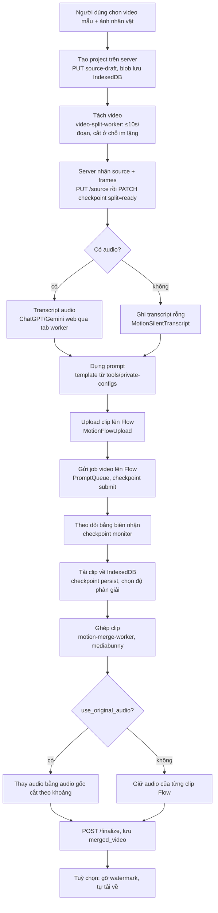
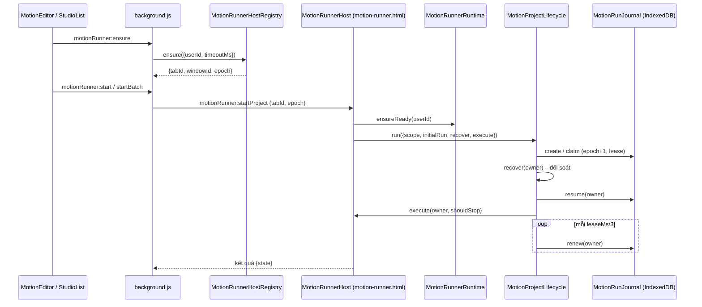
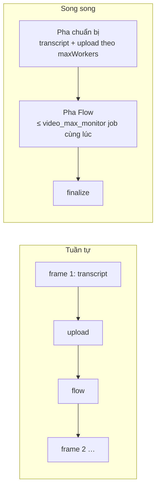
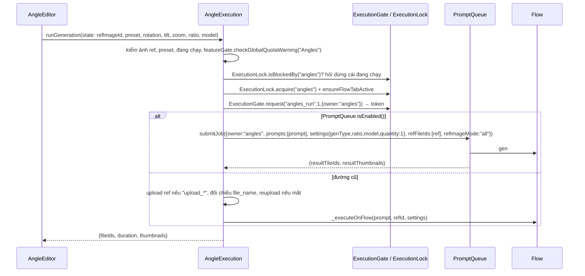

# 9. Motion Studio, Angles, Effects và công cụ video/ảnh trong trình duyệt

Mảng này gồm bốn nhóm. **Motion Studio** là pipeline chuyển chuyển động từ video mẫu sang nhân vật: tách video thành các đoạn ≤10 s, lấy transcript âm thanh qua ChatGPT hoặc Gemini web, dựng prompt, gửi từng đoạn lên Google Flow, theo dõi, tải kết quả về IndexedDB rồi ghép lại bằng `mediabunny` (có thể giữ audio gốc). **Angles** đổi góc máy của một ảnh bằng bộ ba quay/nghiêng/zoom. **Effects** áp hiệu ứng ảnh theo cường độ. Cuối cùng là các tiện ích media: tách video, lấy frame cuối, tắt tiếng video khi upload, chụp màn hình.

Mọi thứ chạy trong trình duyệt của người dùng. Extension **không tự sinh video hay ảnh**. Nó điều khiển Flow (qua DOM hoặc Flow API do server cấu hình) và dùng ChatGPT/Gemini web làm công cụ nhận dạng giọng nói. Mốc tham chiếu: bản 1.3.138. Phân tích tĩnh, không chạy extension, không gọi API.

> Quy ước: **[QS]** quan sát trực tiếp trong code/data · **[SL]** suy luận · **[?]** chưa rõ. Đường dẫn tính từ thư mục extension (`…/1.3.138_0/`). Code là bundle một dòng nên không có số dòng; dùng `file › Class.method` (+ `@offset` ký tự khi cần).

---

## 9.1 Bản đồ file

### Motion Studio (giao diện và điều phối)

| file | kích thước | vai trò |
|---|---|---|
| `motion-editor.html` | 35 KB | Trang editor của một project (nạp ~100 script, cuối cùng là `MotionEditor.js`) |
| `motion-runner.html` | 6 KB | Trang **host chạy nền** (cửa sổ/tab riêng), nạp `MotionRunnerHost.js` làm script cuối |
| `motion-worker.html` | 116 B | Trang trống (`<body></body>`), chỉ là tab-worker; không có logic [QS] |
| `src/motion/MotionEditor.js` | 376 KB | UI + điều phối chính: nạp video, cài đặt, chạy tuần tự/song song từ editor, resplit/recut, sửa kết quả từng frame, ghép và tải bản cuối |
| `src/motion/MotionStudioList.js` | 81 KB | Danh sách project: tạo, đổi tên, reset, xoá, chạy một/chạy tất cả, điều khiển batch, hiện lỗi |
| `src/motion/MotionBulkModal.js` | 39 KB | Hộp thoại tạo hàng loạt: chọn nhiều video, tham chiếu nhân vật/nền, giọng, tỷ lệ, ngôn ngữ |
| `src/motion/MotionBulkCreator.js` | 12.6 KB | Kiểm tra quota project, xử lý từng item (stage → project), idempotent theo `bulk_create_id` + `item_id` |
| `src/motion/MotionBulkVideoPicker.js`, `MotionBulkReferencePicker.js` | 12 / 9 KB | Chọn video và ảnh tham chiếu cho bulk |
| `src/motion/MotionFrameSteps.js`, `MotionFrameResultActions.js`, `MotionFailureNotice.js`, `MotionTimelineScroll.js`, `MotionEditorTheme.js` | 1–7 KB | Hiển thị bước của frame, thao tác trên kết quả (thay/xoá), thông báo lỗi, cuộn timeline, theme |
| `src/motion/*.css` | ~120 KB | `motion-editor.css`, `motion-studio.css`, `motion-ui-additions.css` (64 KB), picker, download modal |

### Motion Studio (runner nền, journal, phục hồi)

| file | kích thước | vai trò |
|---|---|---|
| `src/motion/MotionRunnerHost.js` | 38 KB | Singleton trong `motion-runner.html`: nhận lệnh `motionRunner:*`, giữ `_projects`, `_batch`, `_runs`, quiesce/unquiesce |
| `src/motion/MotionRunnerRuntime.js` | 33 KB | Khởi tạo môi trường (auth, SystemConfig, ExecutionConfig, Flow driver), `resolveExecutionMode`, vân tay cấu hình |
| `src/motion/MotionRunJournal.js` | 56 KB | **Journal chạy** trong IndexedDB `toolflow_motion_runs` (lease, epoch, operations, outbox transcript) |
| `src/core/MotionArtifactStore.js` | 43 KB | Kho blob trong IndexedDB `toolflow_motion_artifacts` + journal tách + journal bulk |
| `src/core/MotionRunnerHostRegistry.js` | 10 KB | Mở/xác minh/reload cửa sổ `motion-runner.html` qua `chrome.storage.session` |
| `src/core/MotionRunnerRecovery.js` | 4 KB | Bản ghi ý định phục hồi trong `chrome.storage.local["motionRunnerRecovery"]` |
| `src/core/MotionWebCapture.js` | 8 KB | Phiên tải file Flow qua `chrome.downloads` (cache tạm `ToolFlow/motion-cache/<id>.mp4`) |
| `src/motion/MotionProjectLifecycle.js` | 5 KB | Khoá `navigator.locks`, claim lease, gia hạn lease mỗi 1/3 thời hạn, recover → execute → release |
| `src/motion/MotionProjectRecovery.js` | 6.5 KB | Đối soát (reconcile) trạng thái dở dang trước khi chạy tiếp |
| `src/motion/MotionProjectRunner.js` | 11 KB | Điều phối tầng cao: chọn `sequential`/`parallel`, vòng retry, dừng/tạm dừng, finalize |
| `src/motion/MotionProjectExecution.js` | 28 KB | Gắn các stage vào runner thật (api, journal, Flow); `settingsFingerprint`, `correctSourceReceipt` |
| `src/motion/MotionParallelPreparation.js` | 7.6 KB | Pha chuẩn bị song song (transcript + upload) theo `maxWorkers` |
| `src/motion/MotionBatchCoordinator.js`, `MotionBatchPreflight.js`, `MotionBatchSnapshot.js` | 10.7 / 6 / 2.4 KB | Chạy nhiều project nối tiếp trong 1 Flow project; kiểm tra trước; phân loại snapshot từ server |

### Motion Studio (từng stage)

| file | kích thước | vai trò |
|---|---|---|
| `MotionProjectSplit.js` + `MotionSplitWorkerTask.js` | 12.6 + 7.4 KB | Tách video: lập kế hoạch, ack từng frame, ghi artifact, commit `source` lên server |
| `MotionFullAudioTranscript.js` | 6.8 KB | Transcript **một lần cho cả video** (manifest, parse JSON, validate) |
| `MotionTranscriptContract.js` | 11 KB | Hợp đồng dữ liệu transcript: timeline lời thoại, `prepareAudio`, `buildBatches`, `composePrompt`, `parseResponse` |
| `MotionTranscriptBatchRunner.js`, `MotionSequentialTranscript.js`, `MotionSilentTranscript.js` | 16.5 / 6.6 / 2.6 KB | Chạy transcript theo lô, tuần tự, hoặc ghi "không có lời" cho đoạn im lặng |
| `MotionTranscriptWorkerDriver.js`, `MotionTranscriptWorkerAttempt.js`, `MotionTranscriptReservation.js`, `MotionTranscriptOutbox.js`, `MotionTranscriptCommit.js` | 17.5 / 5 / 6 / 8 / 4.5 KB | Mở tab ChatGPT/Gemini, gửi audio, nhận kết quả; đặt chỗ (reserve) quota ở server; outbox đẩy transcript lên server |
| `MotionAudioRegenerator.js`, `MotionOriginalAudio.js` | 10.4 / 1.4 KB | Tạo lại audio cho frame; chuẩn bị audio gốc để ghép |
| `MotionProjectUpload.js` + `MotionFlowUpload.js` | 11.4 + 8.8 KB | Upload đoạn video lên Flow (API song song hoặc web theo slot) |
| `MotionPromptComposer.js` | 3 KB | Dựng prompt từ template do server cấp |
| `MotionFlowQueueRequest.js` | 13.6 KB | Dựng request đưa vào `PromptQueue` (ref, voice, ratio…), ghi history |
| `MotionProjectFlow.js` | 12.6 KB | Gửi job Flow cho một frame, ghi checkpoint `submit` |
| `MotionProjectMonitor.js` | 9 KB | Theo dõi kết quả bằng "biên nhận" (`apiReceipt` v1/v2, `webReceipt`) |
| `MotionProjectPersist.js` + `MotionFlowDownload.js` + `MotionResolutionPolicy.js` | 12.6 + 12.2 + 1.6 KB | Tải clip đã sinh về IndexedDB, chọn độ phân giải, fallback upscale |
| `MotionProjectFramePipeline.js` | 1.2 KB | Ghép Flow → Persist cho từng frame |
| `MotionContinuity.js` | 11 KB | Chế độ "liền mạch": frame sau dùng frame cuối của frame trước làm tham chiếu |
| `MotionProjectFinalize.js` + `MotionMergeTask.js` + `motion-merge-worker.js` | 12.9 + 2.6 + 12 KB | Ghép các clip thành video cuối trong Web Worker |

### Tiện ích video/ảnh

| file | kích thước | vai trò |
|---|---|---|
| `src/core/video-split-worker.js` | 20 KB | Worker tách video (chế độ thường và `motion`), tách/trích audio, chuẩn bị audio cho transcript |
| `src/core/video-last-frame-worker.js` | 1.2 KB | Worker lấy frame cuối của video → PNG |
| `src/core/VideoFrameExtractor.js` | 14 KB | Tải video, gọi worker, retry khi decode timeout, thông báo sidebar |
| `src/core/flow-video-mute-worker.js` | 1.7 KB | Worker bỏ track audio khỏi video (copy track video, không re-encode) trước khi upload lên Flow |
| `src/shared/VideoSplitTool.js` (+ `video-split-tool.css`) | 28 KB | Công cụ tách video độc lập cho người dùng (modal) |
| `src/capture/ScreenCapture.js` | 6 KB | Chụp một vùng màn hình, cắt, đưa vào hàng chờ upload |
| `vendor/mediabunny.js` | 730 KB | Thư viện demux/mux/transcode (xem 9.9) |

### Angles và Effects

| file | kích thước | vai trò |
|---|---|---|
| `angles-editor.html`, `angles-editor-init.js`, `angles-editor.css` | 5 / 5.7 / 16 KB | Trang và khởi tạo Angles |
| `src/angles/AngleEditor.js` | 48.6 KB | UI: chọn ảnh, preset, quỹ đạo quay/nghiêng/zoom, kết quả |
| `src/angles/AngleExecution.js` | 26.7 KB | Thực thi: kiểm quota, khoá, dựng prompt, gửi Flow |
| `effects-editor.html`, `effects-editor-init.js`, `src/effects/effects-editor.css` | 3.6 / 6 / 13 KB | Trang và khởi tạo Effects |
| `src/effects/EffectsEditor.js` | 40 KB | UI: lưới hiệu ứng theo danh mục, thanh cường độ |
| `src/effects/EffectsExecution.js` | 10 KB | Thực thi qua `PromptQueue` hoặc `runAutoPrompt` trực tiếp |

API server liên quan (qua `authManager._apiCall` / message `apiRequest`): `tools/motion-studio/projects*`, `tools/private-configs`, `angle-presets`, `image-effects`, `execution/provider-web/reserve`.

---

## 9.2 Motion Studio làm gì cho người dùng

**[QS]** Người dùng đưa một video mẫu (chuyển động, thoại) và ảnh nhân vật (tùy chọn ảnh nền). Motion Studio tạo ra một video mới, trong đó nhân vật làm lại chuyển động của video mẫu, có thể kèm giọng và phụ đề. Prompt dùng là `motion_character` hoặc `motion_character_background` (khi có ảnh nền).

Các tuỳ chọn người dùng lưu trong `data_json.preferences` của project (liệt kê từ `MotionEditor.js`):

| key | ý nghĩa |
|---|---|
| `ratio` | Tỷ lệ khung hình |
| `voice_enabled`, `voice_slug`, `voice_mode` (`character` / `lip_sync` / `narration`), `voice_description` | Thêm giọng và kiểu giọng |
| `subtitle_enabled` | Thêm phụ đề |
| `translate_enabled`, `target_language` | Dịch lời thoại |
| `transcription_provider` | `chatgpt` hoặc `gemini` (hai giá trị duy nhất được journal chấp nhận) |
| `use_original_audio` | Dùng audio gốc của video mẫu thay audio do Flow sinh |
| `continuity_enabled` | Frame sau lấy frame trước làm tham chiếu |
| `flow_download_resolution` | Độ phân giải tải về |
| `auto_download_final` | Tự tải video cuối |
| `remove_final_video_watermark` | Gỡ watermark video cuối (`VideoWmClient`) |
| `custom_prompt` | Prompt tuỳ chỉnh |

Tham chiếu (`data_json.references`): `mode`, `character[]`, `background[]`.

**Giới hạn theo gói [QS]:** trong `af_entitlements.json` của tài khoản Free, `motion_tool_enabled` có `value: null` và `motion_tool_max` `value: null`; teardown ghi `motion_tool_enabled` là tắt. `provider_web_motion_enabled` trong `af_execution_config` là `true`; `video_max_monitor` = 4. `af_system_settings.motion_bulk_staging_ttl_hours` = 1. `af_settings.motionDownloadFolder` = `"motion_studio"`. Số project tối đa lấy từ endpoint `tools/motion-studio/projects/quota` (`{used, limit, remaining}`, `limit = -1` là không giới hạn).

---

## 9.3 Pipeline tổng thể



Các bước và chỗ từng bước được lưu:

| # | Bước | Code | Nơi lưu / checkpoint |
|---|---|---|---|
| 1 | Chọn video | `MotionEditor`, `MotionBulkModal` | Blob trong artifact store (`source_video` hoặc "source draft"); server giữ `source_draft` |
| 2 | Tách | `MotionProjectSplit` → `MotionSplitWorkerTask` → `video-split-worker` | `source_clip`, `source_audio` trong IndexedDB; `split_journal`; server `stages.split` |
| 3 | Transcript | `MotionTranscriptBatchRunner` / `MotionSequentialTranscript` / `MotionFullAudioTranscript` | Outbox trong `toolflow_motion_runs`; server `frames[i].transcript` |
| 4 | Prompt | `MotionPromptComposer`, `MotionTranscriptContract.composePrompt` | Không lưu riêng; dựng khi gửi |
| 5 | Upload | `MotionProjectUpload`, `MotionFlowUpload` | `uploadReceipt` ngay trên bản ghi `source_clip`; server `stages.upload` |
| 6 | Gửi Flow | `MotionProjectFlow`, `MotionFlowQueueRequest` | Server `stages.submit`; journal `operations` |
| 7 | Theo dõi | `MotionProjectMonitor` | Server `stages.monitor` (`provider_operation_id`, `provider_media_id`) |
| 8 | Tải | `MotionProjectPersist`, `MotionFlowDownload` | `generated_clip` (theo `artifactRevision = input_revision`); server `stages.persist` |
| 9 | Ghép | `MotionProjectFinalize`, `MotionMergeTask` | `merged_video`; server `final` (`artifact_id`, `artifact_revision`, `frame_ids`) |

Các frame có id dạng `f0001`, `f0002`… Mỗi frame mang `run_id` (= `operationId` của lần tách) và `input_revision` (bắt đầu từ 1, tăng khi sửa kết quả hoặc cắt lại). Hầu hết kiểm tra "scope" trong code so khớp bộ bốn `(flow_project_id, source_revision, run_id, input_revision)` với bản server vừa đọc lại.

---

## 9.4 Từng bước chi tiết

### 9.4.1 Upload và tách video

`MotionProjectSplit.run` **[QS]** (`src/motion/MotionProjectSplit.js`):

1. Kiểm tham số. `profile.settings.max_split_clip_seconds` phải trong [1, 10], `profile.revision ≥ 1`.
2. Xin khoá `navigator.locks.request("motion-run:<userId>:<toolProjectId>", {ifAvailable:true})`. Không lấy được thì trả `{state:"busy", error:"PROJECT_ALREADY_RUNNING"}`.
3. Đọc project, so khớp `flow_project_id` và ngữ cảnh tab Flow (`tabId`, `projectId`, `driverKey`, `origin`) qua `MessageBridge.getTargetContext()`. Lệch thì `MOTION_SPLIT_SCOPE_CHANGED`.
4. Lấy `operationId` và `draftId` (dùng lại từ journal tách nếu có, nếu không thì `crypto.randomUUID()`). Ghi `beginSplitJournal`.
5. Nếu `source_revision == 0`: `PUT …/source-draft` (`draft_id, file_name, mime, size`), `POST …/split-attempt` với `state:"running"` (kèm `include_audio`).
6. Chạy `MotionSplitWorkerTask.run`, có vòng retry nếu `retryEnabled` và còn `maxRetries`.
7. Xác minh artifact (`verifyArtifacts`): mọi `source_clip` phải là `video/mp4`; mọi `source_audio` phải là `audio/wav` khi `audioState === "audio_present"`.
8. `PUT …/source` với `source{artifact_id:"source_1", file_name, mime, size, duration}` và `frames[]{frame_id, run_id, input_revision:1, start, end}`.
9. Với mỗi frame: `PATCH …/frames/<id>/checkpoint` `{stage:"split", state:"ready", artifact_id:"clip_1_<id>", audio_state, audio_artifact_id:"audio_1_<id>"|null}`.
10. Nếu chế độ parallel + `full_audio_transcription`, hoặc `use_original_audio`, mà có audio: tạo sẵn `source_full_audio` (`MotionFullAudioTranscript.audio`).
11. `POST …/split-attempt` `state:"complete"`, `markSplitCommitted`, xoá journal tách (trừ khi có `preparationSnapshot`).

Mỗi lệnh ghi lên server có `request_nonce: crypto.randomUUID()`. Nếu ghi lỗi, code đọc lại project và coi là thành công khi server **đã có đúng giá trị** (idempotent). Nếu không khớp mới ném lỗi. Đây là mẫu "ghi, lỗi thì đọc lại để đối chiếu" xuất hiện khắp nơi.

`video-split-worker.js` **[QS]**: 

| Hằng số | Giá trị |
|---|---|
| `MAX_BYTES` | 300 MB (video đầu vào) |
| `MAX_PARTS` | 120 đoạn |
| `MAX_CLIP_SECONDS` | 10 |
| `QUIET_BIN_SECONDS` | 0.02 |
| Tổng clip đầu ra | ≤ 500 MB |

Kế hoạch cắt (`planCuts`): giới hạn mỗi đoạn là `min(maxSeconds, 10) − 0.06`. Điểm cắt mục tiêu chia đều phần còn lại. Nếu video có audio decode được, hàm `findQuietCut` tính RMS theo khoảng 20 ms trong cửa sổ cho phép, chọn đoạn im lặng ≥ 0.16 s gần mục tiêu nhất làm điểm cắt (ngưỡng = `min(ref*0.35, max(ref*0.08, noiseFloor*1.5))`, `ref` là phân vị 90%). Không có thì cắt đều. Log `[MotionSplitPlan]` ghi số `quietCuts` / `balancedCuts`.

Mỗi đoạn (`motionVideoOf`): giải mã bằng `VideoSampleSink`, chuẩn hoá timestamp về 0, mã hoá lại H.264 (`codec:"avc"`, `QUALITY_HIGH`) ra MP4. Đoạn nào **có audio sẽ bị coi là lỗi** (`OUTPUT_HAS_AUDIO`): clip gửi Flow luôn là video câm, audio nằm ở file WAV riêng (`audioOf`, kiểm lệch ≤ 0.1 s, `AUDIO_BOUNDARY_MISMATCH`).

Giao thức Worker ↔ `MotionSplitWorkerTask`:

| Hướng | message | Ý nghĩa |
|---|---|---|
| →W | `split {mode:"motion", id, blob, maxSeconds, includeAudio, ackEachFrame:true, continueOnFrameError, maxFrameRetries}` | Bắt đầu |
| W→ | `plan {count, duration, boundaries[], audioState}` | Kế hoạch. Task kiểm: `count ≤ 120`, `boundaries[0] = 0`, đuôi bằng `duration ± 0.0015`, tăng dần |
| W→ | `clip` / `audio {index, blob, start, end, duration}` | Từng đoạn |
| →W | `frame_saved {index}` | Task đã ghi artifact + gọi `onFrame` xong → Worker mới làm đoạn tiếp (**backpressure**) |
| W→ | `frame_retry` → →W `frame_retry_ready` | Retry mức frame, task chờ `waitBeforeRetry` |
| W→ | `frame_error {stage:"split"|"audio", code}` | Lỗi mức frame khi `continueOnFrameError` |
| W→ | `progress`, `audio_diagnostic`, `media_diagnostic` | Tiến độ và chẩn đoán |
| W→ | `done {count}` | Task kiểm `next === plan.count`, nếu không `SPLIT_ARTIFACT_COUNT_MISMATCH` |
| →W | `cancel {id}` | Huỷ: huỷ `conversion` / `output` |

Worker chỉ chạy **một** tác vụ cùng lúc (`active`); message tới khi đang bận bị bỏ qua. Timeout tổng lấy từ `MotionMergeTask.timeoutMs()` = `ExecutionConfig.getTimeoutSec()*1000`; không hợp lệ thì `MOTION_MEDIA_TIMEOUT_CONFIG_INVALID`.

Ngoài `split`, worker còn có: `extract_audio` (một khoảng, < 10 s), `extract_full_audio` (cả video → WAV), `prepare_transcript_audio` (WAV mono, PCM s16, sample rate ≤ 16 kHz để giảm kích thước upload). **[QS]**

### 9.4.2 Transcript âm thanh

**Nơi chạy [QS]:** không gọi API bên thứ ba từ extension. Transcript lấy bằng cách **mở tab ChatGPT hoặc Gemini web** (`motionWorker:create` trong `background.js`), upload file WAV, gửi prompt, đọc câu trả lời. Selector DOM nằm trong `tool_provider_configs`, ví dụ nhóm `motion_audio_sent_file` (`user-query-file-preview [data-test-id="uploaded-file"] button[aria-label]`) và `motion_audio_user_turn` (`user-query`) của Gemini, priority P1.

Hai chế độ **[QS]**:

- **Tuần tự (`sequential`)**: mỗi frame một lượt chat (`MotionSequentialTranscript`).
- **Song song (`parallel`)**: tuỳ `profile.settings.full_audio_transcription`, nếu bật thì gửi **một** WAV cả video (`frame_full_source.wav`) và nhận một JSON cho tất cả frame (`MotionFullAudioTranscript`). Số tab tối đa theo `maxWorkers`.

`MotionTranscriptWorkerDriver.run` **[QS]**:

1. Lấy `ProviderDomLock`: `navigator.locks.request("toolflow-provider-web-dom")` — toàn bộ extension chỉ cho **một** tác vụ thao tác DOM provider web tại một thời điểm.
2. `_waitForWorkerReady`: `session.ensureReady({workerContext, waitForEditorMs})`, quá hạn thì `EDITOR_NOT_FOUND`.
3. `MotionTranscriptWorkerAttempt.run` điều phối các bước `journal_start → reserve → openWorker → authorize → dispatch → validate → store → cleanup → close`, mỗi bước có log `[MotionTranscriptAttempt]`.
4. **Reserve** quota ở server: `POST execution/provider-web/reserve {run_id, source:"motion", …}` (`MotionTranscriptReservation.reserve`). Lưu `token`, `expiresAt`, `retryLimit`, `retryEnabled` trong journal (`reservations`). Hết hạn thì `MOTION_RESERVATION_EXPIRED`; lệch snapshot retry thì `MOTION_RESERVATION_SNAPSHOT_MISMATCH`.
5. Kết quả đi qua **outbox** (`MotionTranscriptOutbox.flush`, khoá `motion-outbox:<user>:<project>`) và được `PATCH …/frames/<id>/transcript` lên server. Lỗi thì `PATCH …/transcription-failure`.

Hợp đồng dữ liệu **[QS]** (`MotionTranscriptContract`, `MotionFullAudioTranscript.validate`):

- Bọc JSON bằng marker `TOOL_MOTION_JSON_BEGIN` … `TOOL_MOTION_JSON_END` (hoặc code fence). Marker lặp hoặc có `{}[]` ngoài vùng marker thì `INVALID_TRANSPORT_FRAME`.
- Với cả video: khoá JSON phải đúng `audio_file,frames[,full_transcript]`; `audio_file` khớp tên file đã gửi; `frames.length` bằng manifest; mỗi frame có đúng các trường `detected_language, end_seconds, frame_id, has_speech, order, start_seconds, transcript, translated_text` (+ tuỳ chọn `speech_timeline`); `has_speech` phải đồng nhất với `transcript` không rỗng; độ dài ≤ 12 000; khi không dịch thì `translated_text` phải rỗng.
- `speech_timeline` (tối đa 120 dòng): mỗi dòng `{start_seconds,end_seconds,text,translated_text}`, tăng dần, nằm trong thời lượng frame; ghép lại (bỏ khoảng trắng) phải khớp `transcript` và `translated_text`. `formatTimeline` biến nó thành dòng `0.00–1.20s | SPEAK: "…"` / `PAUSE` để đưa vào prompt.
- Manifest (`MotionFullAudioTranscript.manifest`) bắt các frame liền nhau (lệch ≤ 0.0015 s), bắt đầu tại 0, kết thúc bằng `duration`, tối đa 120 frame.
- Biến thể prompt `legacy` hoặc `timeline` (`prompt_variant`). Journal ghi `profilePromptVariant`.

Đoạn không có audio: `MotionSilentTranscript.run` đọc `stages.split.audio_state ∈ {audio_track_absent, silent_verified}` rồi `PATCH …/transcript` với `has_speech:false` mà không mở tab chat nào.

### 9.4.3 Sinh prompt

Prompt **không nằm trong extension**. `ProtectedConfigClient` có `paths.motionTool = "tools/private-configs"`, gọi với `tool_key=motion_studio` và tuỳ chọn `profile_key` (regex `^[a-z0-9_]{1,64}$`), `prompt_variant` (`legacy|timeline`), `revision`. **[QS]** Kết quả là một `profile` có `revision`, `profile_key`, `prompts{…}`, `settings{…}`; `delivery_prompts` (khi có) tách theo `voiceMode`. `profile` bị **ghim** vào run (`profileRevision`) để một lần chạy không đổi prompt giữa chừng; lệch thì `MOTION_RUN_SNAPSHOT_CHANGED`.

`MotionPromptComposer.motion` **[QS]**:

```js
const key = hasBackgroundRefs ? "motion_character_background" : "motion_character";
sections = [render(prompts[key], values)];
if (continuity) sections.push(render(prompts.continuity_addon, values));
// có thoại: thêm delivery.voice (voice_addon / voice_narration_addon) và delivery.subtitle (subtitle_addon)
text = sections.join("\n\n")
```

`render` chỉ cho phép các biến sau, biến lạ ném `MOTION_TEMPLATE_VARIABLE_UNKNOWN`, thiếu thì `MOTION_TEMPLATE_VARIABLE_MISSING`:

`audio_manifest, source_motion_summary, transcript, translated_text, target_language, character_refs, background_refs, voice_slug, voice_description, ratio, clip_duration, frame_index, frame_count, continuity_ref, speech_timeline`

`continuity_addon` bắt buộc chứa `{continuity_ref}` (`MotionContinuity.validate`, không thì `MOTION_CONTINUITY_PROMPT_UNAVAILABLE`).

`MotionFlowQueueRequest.build` ghép prompt, ảnh tham chiếu (nhân vật, nền, và clip video của frame), giọng (`resolveVoice`), và `flowModeLock` (`web`/`api`) thành request cho `PromptQueue`. Kiểm giới hạn ảnh tham chiếu của model (`getMaxRefImages`, `getMaxRefVideos`, `getMaxRefImagesTotal`).

### 9.4.4 Upload lên Flow

`MotionFlowUpload` **[QS]**:

- Chế độ API song song: `getUploadConcurrency()` = `min(config.runtime.max_concurrent của Flow API v2, ExecutionConfig.getQueueVideoMaxMonitor())`. Không hợp lệ thì `MOTION_FLOW_CONFIG_INVALID`. `runBatch` chạy theo giới hạn này, lỗi đầu tiên chặn các item còn lại.
- Tên file upload `motion_f<N>.mp4`.
- `retryPreDispatch`: chỉ retry khi lỗi xảy ra **trước khi** lệnh được gửi đi (`dispatchStarted === false`).
- Biên nhận upload (`uploadReceipt`) lưu ngay trên bản ghi `source_clip` (`setUploadReceipt` / `clearUploadReceipt`); chuyển project Flow khác thì `MOTION_FLOW_PROJECT_RECEIPT_REQUIRED`.
- Tiện ích `flow-video-mute-worker.js` (xem 9.8) dùng khi cần bỏ audio khỏi video trước khi upload.

### 9.4.5 Gửi job và theo dõi

`MotionProjectFlow._run` **[QS]**:

1. Đọc lại project và kiểm tra: `MOTION_FLOW_PROJECT_CHANGED`, `MOTION_FLOW_SOURCE_CHANGED`, `MOTION_FLOW_MODE_CHANGED`, `MOTION_SOURCE_REQUIRES_RESPLIT`.
2. Frame phải có `stages.split.state === "ready"` và `stages.upload.state === "ready"`, nếu không `MOTION_PREPARATION_NOT_READY`.
3. **Chống gửi trùng:** nếu `stages.submit.state` đã có, hoặc journal đã có `operations` kiểu `flow` cho frame đó, trả `needs_review` với `MOTION_SUBMIT_RECONCILE_REQUIRED`. Ngoại lệ: lần trước thất bại với `MOTION_CANCELLED` hoặc `MOTION_FLOW_PRE_DISPATCH_FAILED` (chưa gửi) và còn lượt retry.
4. `buildRequest` → `queue.submitJob` (`PromptQueue`), ghi checkpoint `stages.submit`.

Giám sát bằng **biên nhận** thay vì dựa vào giao diện (`MotionProjectMonitor`):

| Chế độ | Cách theo dõi |
|---|---|
| API v2 | `FlowApiV2Driver._drainAccepted(...)` với `operationId`; kiểm `protocol.schema_version` và vân tay giao thức (`FlowApiV2CheckpointStore.fingerprint`) còn khớp, lệch thì `MOTION_MONITOR_PROTOCOL_CHANGED`. Cần `mediaId` UUID, không thì `MOTION_MONITOR_RESULT_UNVERIFIED` |
| API v1 | Poll `flow_poll_video` qua Bridge theo `poll_interval_ms`, hết hạn `video_timeout_ms` thì `MOTION_MONITOR_TIMEOUT` |
| Web | Đọc `flow_web_recovery_v1` trong `chrome.storage.local`, tìm bản ghi `snapshot._owner === "motion"` đúng `accountId`, dùng `flowV2CorrelationBroker` để đọc lại kết quả; có kiểm `expiresAt`, `expectedQuantity === 1`, `mediaType === "video"` |

Số job video đồng thời: `getVideoMonitorLimit()` (`video_max_monitor` = 4 trong data). Chế độ liền mạch ép giới hạn = 1.

### 9.4.6 Tải kết quả

`MotionProjectPersist.run` đọc `stages.monitor` (cần `provider_media_id` và `provider_operation_id`, hoặc `manual_result` khi người dùng thay tay), rồi tải clip về `generated_clip` trong IndexedDB. `MotionFlowDownload.persistWeb` / `persistApi`:

- Web: kích hoạt tab Flow, tra catalog media (`lookupFlowMediaCatalog`), đối chiếu `media_uuid`, rồi gửi `motion:storeFlowVideo` cho service worker. Với route `upscale` thì dùng `MotionWebCapture.prepare` để tải qua `chrome.downloads` vào `ToolFlow/motion-cache/<id>.mp4` (hết hạn 15 phút, alarm `motionWebCaptureCleanup` mỗi phút).
- Độ phân giải: `MotionResolutionPolicy.candidates(config, selected)` lấy `config.video[]` sắp theo `config.video_fallback_chain` (theo `menu_label`). Mỗi mục có `route` là `native` hoặc `upscale`. `resolveBest` thử từ mức chọn xuống thấp hơn. Chỉ fallback sau upscale khi `stage === "terminal"` hoặc (`dispatchStarted === false` và không mơ hồ). Trường hợp còn lại ném lỗi `noReplay` để không upscale hai lần.
- `generated_clip` ghi theo khoá `artifactRevision = input_revision`. `stageGenerated` / `promoteGenerated` / `rollbackGenerated` cho phép dàn dựng trước rồi mới "thăng cấp" để không mất bản cũ.

### 9.4.7 Ghép video và giữ audio gốc

`MotionProjectFinalize.run` lấy các `generated_clip` theo thứ tự `start`, gọi `MotionMergeTask.start(clips, onProgress, options)` rồi `POST …/finalize`. `autoDownloadFinal` phải được ghim trong run (boolean), không thì `MOTION_FINAL_SETTINGS_UNPINNED`. Tải bản cuối có `checkpointFinalDownload` với số lần thử `maxAttempts = 1 + transcriptMaxRetries` (khi bật retry).

`motion-merge-worker.js` **[QS]**:

- Đầu vào 1–500 blob. `inspect` kiểm từng clip: có track video decode được, có thời lượng hợp lệ.
- Đầu ra MP4: video H.264 `QUALITY_HIGH`; audio AAC 192 kbps nếu cần.
- Mỗi clip dịch timestamp bằng `offset` cộng dồn, frame đầu clip đánh dấu `keyFrame:true`.
- `normalizeVideo` (dùng khi gọi từ Workflow): nếu kích thước/rotation lệch, vẽ lại lên `OffscreenCanvas` nền đen, giữ tỷ lệ (letterbox).
- Mặc định bắt mọi clip **cùng layout audio** (`MERGE_AUDIO_LAYOUT_MISMATCH`); `allowMixedAudio` bỏ ràng buộc này.
- Class `MotionMergeAudio` chuyển audio về 48 kHz stereo bằng nội suy tuyến tính, có xuống-mix 4 và 6 kênh, giữ liên tục giữa các mẫu và lấp phần đuôi.
- Tiến độ gửi tối đa mỗi 200 ms.

**Giữ audio gốc [QS]:** khi `use_original_audio === true`, `MotionOriginalAudio.options` kiểm project (đúng `tool_project_id`, `flow_project_id`, `source_revision`, `duration > 0`; các khoảng `[start,end]` của frame tăng dần, không chồng, `end ≤ duration + 0.0015`), rồi lấy `source_full_audio` (từ cache hoặc trích bằng `extract_full_audio`; thiếu audio thì `MOTION_ORIGINAL_AUDIO_MISSING`). Trong worker merge, `replacingAudio` nghĩa là `inspect(blob, ignoreAudio=true)` bỏ audio của clip Flow, và audio gốc được cắt theo `originalAudioRanges` (bắt buộc cùng số phần tử với clips) rồi ghép vào. Nếu chỉ có 1 clip và không dùng audio gốc, bỏ qua bước ghép và dùng thẳng clip đó (`MotionEditor`).

`MotionMergeTask.start` tạo Worker mới cho mỗi lần ghép, có timeout `MOTION_MERGE_TIMEOUT`, `cancel()` gửi `{type:"cancel"}` và terminate.

### 9.4.8 Chế độ liền mạch (continuity)

`MotionContinuity` **[QS]**: khi `continuity_enabled`, frame i dùng đoạn cuối của frame i−1 làm tham chiếu. Frame i chỉ chạy được khi frame i−1 đã có `persist` và `monitor` đều `ready` (`MOTION_CONTINUITY_PREVIOUS_NOT_READY`). "Danh tính" cha gồm `frame_id, run_id, input_revision, artifact_id, media_id`; lệch thì `MOTION_CONTINUITY_SCOPE_CHANGED`. Runner song song vẫn chuẩn bị song song nhưng phần Flow bị ép giới hạn 1 và **dừng ngay khi một frame thất bại** (`halted`). Lấy frame cuối bằng `VideoFrameExtractor` (9.8).

---

## 9.5 Mô hình dữ liệu

### 9.5.1 Project (server, `data_json`)

Quan sát từ các truy cập trong `MotionEditor.js`, `MotionProject*.js`:

```text
project {
  tool_project_id (uuid), flow_project_id, revision (optimistic lock), name, position, ...
  data_json {
    source_revision      // 0 = chưa tách, 1 = đã tách; tăng khi resplit
    source_draft {draft_id, file_name, mime, size}
    split_operation {operation_id, draft_id, state: running|complete|failed, include_audio, error_code}
    source {artifact_id:"source_1", file_name, mime, size, duration}
    requires_resplit, paused, flow_run_mode: "web"|"api", batch_enabled
    preferences {…xem 9.2…}
    references {mode, character[], background[]}
    frames { "f0001": {
        run_id, input_revision, start, end,
        transcript {has_speech, text, translated_text, detected_language, speech_timeline?},
        stages { split, transcribe?, upload, submit, monitor, persist },
        result_edit {action:"replace", media_id, input_revision}
    } }
    final {artifact_id, artifact_revision, source_revision, frame_ids[], stale?}
    reset_id, frames_cleared, final_artifact_revision
  }
}
```

`stages.*.state` lấy các giá trị `ready`, `running`, `failed`, `needs_review`, `pending`. Chi tiết quan sát được:

| stage | trường [QS] |
|---|---|
| `split` | `artifact_id`, `audio_state` (`audio_present`, `audio_track_absent`, `silent_verified`, `audio_decode_unsupported`, `audio_not_requested`), `audio_artifact_id` |
| `submit` | `provider_operation_id`, `flow_mode`, `api_driver` (`v1`/`v2`), `protocol_revision`, `protocol_fingerprint`, `profile_revision`, `error_code`, `retry_exhausted`, `updated_at` |
| `monitor` | `provider_media_id`, `provider_operation_id`, `flow_mode`, `manual_result` |
| `persist` | `artifact_id`, `resolution`, bytes |

Biến thể tên trường server (snake_case) và journal local (camelCase) khác nhau; code luôn chuyển tay.

### 9.5.2 Artifact store (IndexedDB `toolflow_motion_artifacts`, version 2)

Object store `artifacts` (`keyPath:"key"`), chỉ mục `project`, `flow`, `source`, `frame`, `bulkJournal`. **[QS]** `KINDS` = `source_video`, `source_clip`, `source_audio`, `source_full_audio`, `generated_clip`, `merged_video`, `poster`. Ngoài ra có bản ghi không phải blob: `split_journal`, `bulk journal`, `source draft`, `bulk source`.

Bản ghi blob: `{key, projectScope, flowScope, sourceScope, frameScope, userId, toolProjectId, flowProjectId, sourceRevision, frameId, kind, artifactRevision, blob, mime, size, duration, hash, resolution, media_uuid|persistent_media_id, createdAt}`. `put` kiểm `flowProjectId` theo regex `^[A-Za-z0-9_-]{1,120}$`, blob không rỗng, `hash` 64 hex, `resolution` chỉ cho `generated_clip`. Ghi đè `generated_clip` / `merged_video` bị chặn nếu bản hiện có đang ở "giai đoạn dàn dựng" (`generatedStageOperationId`).

API đáng chú ý: `put/get/delete`, `listProject`, `usage` (dung lượng), `deleteProject`, `deleteFrameArtifacts`, `deleteSourceRevision`, `setContinuityReference`, `setUploadReceipt`, `clearUploadedSourceBlob`, `checkpointFinalDownload`, nhóm `*SplitJournal`, nhóm `*BulkJournalItem` / `*BulkSource` / `*SourceDraft`.

### 9.5.3 Run journal (IndexedDB `toolflow_motion_runs`, version 3)

Store `runs` (`keyPath:"key"` = `<userId>\0<toolProjectId>`, chỉ mục `user`) và store `outbox` (`keyPath:"eventId"`, chỉ mục `scope`, `user`). **[QS]** Bản ghi run khởi tạo bởi `MotionRunJournal.create`:

```text
{ key, userId, toolProjectId, flowProjectId, runId, sourceRevision, profileRevision,
  executionMode: "sequential"|"parallel",
  fullAudioTranscription, useOriginalAudio, continuityEnabled,
  taskKind?, transcriptFrameIds?, profileKey?, profilePromptVariant?, preparationSnapshot?,
  parentBatchId?, flowTarget {tabId, projectId, driverKey, origin, mode: web|api},
  transcriptionProvider, autoDownloadFinal, settingsSnapshot (sha-256 hex 64), 
  downloadResolution, downloadRatio, transcriptSettings{…},
  transcriptMaxRetries, retryEnabled,
  state: "paused"→…, epoch: 0, ownerId: null, leaseUntil: 0,
  operations: {}, failedOperations: {}, stopOrigin: null, previousRun? }
```

Các trường phát sinh khi chạy: `reservations`, `rejectedFlows`, `outboxSequence`, `rerunId`, `finalArtifactId`. Trạng thái run gặp trong code: `paused`, `running`, `pausing`, `stopping`, `needs_review`, `completed`.

Phương thức chính: `create` (từ chối nếu đã có run chưa `completed`, trừ `replaceDrained`), `claim` / `renew` / `release` / `yieldReview` (lease), `resume`/`pause`/`stop`, `markSubmitted`, `settle`, `complete`, `editFrameResult`, `supersedeFrameUpload`, `refreshSettings`, nhóm transcript (`prepareTranscriptReservation`, `beginTranscriptIntent`/`confirmTranscriptIntent`, `beginTranscriptSettlement`/`confirmTranscriptSettlement`, `storeTranscript`, `storeFullAudioTranscript`, `failTranscript`, `failClosedWorker`, `listTranscriptOutbox`, `ackTranscriptOutbox`), `hasPendingWork(userId)`.

Mọi thay đổi chạy qua `_readWrite`, một **transaction IndexedDB duy nhất** trên cả `runs` và `outbox`, có tuỳ chọn "chỉ ghi nếu outbox rỗng" (`MOTION_OUTBOX_PENDING`). Hàm `_owned(run, owner)` là hàng rào (fence): kiểm `ownerId`, `epoch`, `leaseUntil`. Sai thì thông báo `MOTION_RUN_FENCED`.

Mỗi sự kiện outbox có `eventId = key\0runId\0operationId\0state`, `sequence` tăng dần, mang đủ `frameRunId`, `inputRevision`, `retryCount` để server áp dụng **đúng một lần**.

### 9.5.4 Các nơi lưu khác

| Nơi | Key | Nội dung |
|---|---|---|
| `chrome.storage.local` | `motionRunnerRecovery` | Ý định phục hồi theo `<userId>:<projectId|batch:id>` |
| `chrome.storage.local` | `motion_batch:<userId>:<batchId>` | Bản ghi batch (hàng đợi project) |
| `chrome.storage.local` | `motionRunnerState` | Trạng thái runner để UI hiện lại [?] tên key thấy trong bundle, nội dung chưa đọc |
| `chrome.storage.local` | `flow_web_recovery_v1`, `FlowApiV2CheckpointStore.KEY`, `FlowApiAdapter.CHECKPOINT_KEY` | Biên nhận Flow web/API |
| `chrome.storage.session` | `MotionRunnerHostRegistry.KEY`, `.EPOCH_KEY`, `.CREATION_KEY` | Cửa sổ host hiện hành và epoch |
| `chrome.storage.local` | `af_settings.motionDownloadFolder` | Thư mục tải (`motion_studio`) |
| `chrome.storage.local` | `af_auth` | Đối chiếu tài khoản (mọi hàm kiểm `userId` khớp) |

---

## 9.6 Chạy bền vững: runner host, khoá, lease, phục hồi

### 9.6.1 Vì sao có runner host riêng

Chạy hàng phút đến hàng giờ, cần tab, worker và IndexedDB. Service worker MV3 bị tắt khi nhàn rỗi nên không thể giữ. Do đó có trang `motion-runner.html` chạy lâu dài trong một cửa sổ riêng, còn `background.js` chỉ định tuyến message và tạo/xác minh cửa sổ.



### 9.6.2 Các lớp khoá và hàng rào

| Cơ chế | Phạm vi | Chống gì |
|---|---|---|
| `navigator.locks` `motion-run:<user>:<project>` (`ifAvailable`) | Một project | Hai tab/hai host chạy cùng project (`PROJECT_ALREADY_RUNNING`). Dùng chung cho tách và lifecycle |
| `navigator.locks` `motion-transcript:<user>:<project>` | Ghi transcript | Ghi chồng transcript |
| `navigator.locks` `motion-outbox:<user>:<project>` (exclusive) | Đẩy outbox | Đẩy sự kiện hai lần |
| `navigator.locks` `motion-batch:<user>` (`ifAvailable`) | Batch | Hai batch cùng lúc (`MOTION_BATCH_ALREADY_RUNNING`) |
| `navigator.locks` `motion-recovery-intents`, `motion-runner-wake` | Ý định phục hồi | Tranh chấp khi thức dậy |
| `navigator.locks` `toolflow-provider-web-dom` | Toàn extension | Hai tác vụ thao tác DOM ChatGPT/Gemini/Flow |
| Lease + `epoch` trong journal | Một run | Chủ cũ (đã chết/treo) ghi đè chủ mới (`MOTION_RUN_FENCED`) |
| `request_nonce` + đọc lại sau lỗi | Mọi ghi server | Ghi trùng và mất phản hồi |
| `profileRevision` + `settingsSnapshot` + `preparationSnapshot` | Một run | Cấu hình/prompt thay đổi giữa lúc chạy |
| Kiểm `af_auth.user.id` + token | Mọi bước | Đổi tài khoản giữa chừng (`ACCOUNT_SCOPE_CHANGED`) |

`MotionProjectLifecycle.run` **[QS]** (`src/motion/MotionProjectLifecycle.js`):

1. Đọc journal. Chưa có, đã `completed`, hoặc `initialRun.replaceDrained` thì `create`.
2. So `userId, toolProjectId, flowProjectId, sourceRevision, executionMode` giữa run lưu và run mới; lệch thì `needs_review` với `MOTION_RUN_SNAPSHOT_CHANGED`.
3. `journal.claim({leaseMs})`; không `acquired` thì `busy`.
4. Đặt timer gia hạn mỗi `floor(leaseMs/3)`; gia hạn lỗi thì `lost = true` (nghĩa là coi như bị fence).
5. `recover(owner, claim)`: nếu không `ready` trả `needs_review` (hoặc `failed`) với `MOTION_RUN_RECONCILE_REQUIRED`.
6. So sánh snapshot (profile, settings, `flowTarget.*`); lệch thì `needs_review`.
7. `journal.resume` rồi `execute`.
8. `finally`: dừng timer; nếu không `lost` và chưa `completed`: còn `operations` thì `yieldReview` (nhường lại, giữ nguyên dấu vết), không thì `release`.
9. Nếu có lỗi mà vẫn còn outbox, `reservations` có token, hoặc `operations` thì kết quả là `needs_review`, không phải `failed`. Nguyên tắc: **không chắc thì dừng để người xem, không tự làm lại** (tránh sinh trùng tốn quota).

### 9.6.3 Phục hồi khi crash hoặc reload

Ba tầng:

**(a) Host chết hoặc treo.** `MotionRunnerHostRegistry` lưu `{userId, tabId, windowId, url, epoch}` trong `chrome.storage.session`. `_verify` kiểm tab và cửa sổ vẫn tồn tại, URL đúng `motion-runner.html` hoặc `?host=<uuid>`. `reloadUnresponsive(expected, timeoutMs)`: gửi `motionRunner:recoveryState`; nếu không có phản hồi đúng `epoch`, tăng `epoch` rồi `chrome.tabs.reload`. `_awaitReady` gửi `motionRunner:unquiesce` lặp mỗi ≤ 50 ms đến hạn để biết tài liệu đã nạp xong. Tab tạo mà hỏng sẽ bị `_discardCreated` đóng.

**(b) Ý định phục hồi.** `MotionRunnerRecovery.register` (khi bắt đầu) ghi `{userId, projectId, flowProjectId, runId, hostEpoch, state:"preparing", recoveries, maxRecoveries}` với `maxRecoveries = 1 + maxRetries` (hoặc kế thừa khi phục hồi tự động). `update` đổi sang `running`/`pausing`, hoặc **xoá bản ghi** khi trạng thái kết thúc. `recover` chạy dưới khoá `motion-runner-wake`: duyệt bản ghi của user, bỏ qua bản ghi con có `parentBatchId` nếu cha còn; `inspect(item)` cho biết `terminal` (→ đánh dấu `ready`), `alive`/`leaseActive` (→ giữ chờ), còn lại thì `restart`. Mỗi lần restart tăng `recoveries`; vượt `maxRecoveries` thì `onExhausted`. Restart gửi `motionRunner:startProject` (hoặc `resumeBatchHost`/`startBatchHost`) với `automaticRecovery:true` và `drainOnly`. `register` với `automaticRecovery` bị `MOTION_RECOVERY_FENCED` nếu `runId` hoặc `flowProjectId` đã đổi.

**(c) Đối soát khi vào lại run.** Sau khi claim lease, `recover` (trong `MotionProjectRecovery`) đối chiếu **ba nguồn**: journal local, artifact store, server. Quy tắc quan sát:
- Frame có `monitor = ready` nhưng chưa có `persist`: không gửi lại Flow, chỉ chạy `MotionProjectPersist` với `drainOperationId` (`MotionProjectFramePipeline`). Mơ hồ (nhiều operation, lệch `frameRunId`/`inputRevision`) thì `MOTION_FLOW_OPERATION_MISMATCH`.
- Frame có `submit` mà chưa `monitor`: không gửi lại; chuyển thẳng sang theo dõi bằng biên nhận.
- `persist = ready` và `generated_clip` còn trong IndexedDB: coi xong. Còn `persist` mà mất blob: phục hồi theo `restoreArtifactId` (`MOTION_PERSIST_CHECKPOINT_CHANGED` nếu lệch).
- Tách dở: `split_journal` ghi `completed[]` theo frame; chạy lại sẽ dùng `plan` đã lưu và chỉ bỏ qua những frame có artifact; thiếu thì `MOTION_SPLIT_RECONCILE_REQUIRED`.
- Outbox chưa đẩy: `MotionTranscriptOutbox.flush` đẩy theo thứ tự `sequence`, `MOTION_OUTBOX_SCOPE_MISMATCH` nếu sự kiện thuộc project khác.
- Quiesce: `motionRunner:quiesce` chỉ thành công khi host nhàn rỗi và `MotionRunJournal.hasPendingWork(userId)` là false; có việc dở thì host **không** bị đóng (`MotionRunnerHostRegistry.closeIdle`).

**(d) Reload trang editor.** Editor không giữ trạng thái chạy. Nó đọc lại project từ server và journal; `MotionStudioList._restoreRunnerStatuses` dựng lại trạng thái từ runner; `MotionRunnerHost` tồn tại độc lập.

### 9.6.4 Tạm dừng, dừng và đặt lại

| Hành động | Message | Hiệu ứng |
|---|---|---|
| Tạm dừng | `motionRunner:pause` / `pauseProject` / `pauseBatch` | `data_json.paused = true`, các stage kiểm `shouldStop()` và trả `paused`. Chỉ coi `pauseConfirmed` khi đã biết chắc chưa gửi lệnh |
| Dừng cứng | `motionRunner:stop` / `pauseProject {stop:true}` / `stopBatchHost` | Chạy không qua hàng đợi lệnh (`dispatch` bỏ qua `_commandTail`), huỷ worker, đặt `stopOrigin` |
| Đặt lại frame | `motionRunner:resetFrame` / `resetFrameHost` | Tăng `input_revision`, xoá artifact frame (`deleteFrameArtifacts`) |
| Reset project | `POST …/reset` | `reset_id`, `frames_cleared`, dọn `clearSplitJournalsAfterReset` |

`MotionFlowProjectOverlay`/`motionForceStopBtn` (id trong HTML) cung cấp nút dừng cưỡng bức. [SL]

### 9.6.5 Lệnh `dispatch` và hàng đợi lệnh

`MotionRunnerHost.dispatch(message, sender)` **tuần tự hoá** mọi lệnh qua `_commandTail`, trừ hai ngoại lệ phải chen ngay: dừng cứng một project đang chạy và dừng batch. `command` kiểm `sender`, `tabId`, `epoch` (`MOTION_RUNNER_OWNER_MISMATCH`), tài khoản (`MOTION_RUNNER_ACCOUNT_CHANGED`). `admit(runId)` giữ tập `_runs` để chặn `runId` trùng; khi `_quiesced` thì từ chối (`MOTION_RUNNER_QUIESCED`).

---

## 9.7 Chế độ chạy và hàng loạt

### 9.7.1 Tuần tự và song song

`MotionRunnerRuntime.resolveExecutionMode(profile, pinned)` trả `sequential` hoặc `parallel`; không hợp lệ thì `MOTION_PROFILE_UNPINNED`. Giá trị do server (profile) quyết định, không do người dùng.

`MotionProjectRunner.run` **[QS]**: sắp frame theo `start`, kiểm `frameId` duy nhất, `input_revision` ≥ 1, `end > start`, `stages.split.state === "ready"` (hoặc có `preparationError`).



- **Tuần tự:** mỗi frame đi `transcript → upload → flow`; mỗi stage có vòng retry (chỉ cho transcript) tối đa `transcriptMaxRetries` lần, cách nhau `waitBeforeRetry`. Stage nào không cần (`needs*` trả false) được đánh `skipped`. Lỗi một stage thì các stage sau của frame đó `skipped`; frame lỗi không chặn frame sau (trừ liền mạch). Kết thúc: có frame hỏng thì `failed`/`needs_review`, ngược lại gọi `finalize`.
- **Song song:** `MotionParallelPreparation` chuẩn bị mọi frame (transcript trên nhiều tab worker, upload theo `getUploadLimit`); xong rồi mới đẩy Flow với `limit = getVideoMonitorLimit()` (mỗi vòng đọc lại, nên thay đổi cấu hình có hiệu lực). `Promise.race` giữ tập `active`. Frame lỗi thì chạy tiếp các frame khác (trừ liền mạch), cuối cùng trả `failed` nếu có lỗi.
- Quy tắc phân loại lỗi: lỗi khi **chưa gửi** (`dispatchStarted === false`) thì `failed` (an toàn để làm lại); lỗi khi **đã gửi hoặc không rõ** thì `needs_review`.

### 9.7.2 Hàng loạt (bulk) và batch

Hai khái niệm khác nhau:

- **Bulk create** (tạo nhiều project từ nhiều video): `MotionBulkModal` + `MotionBulkCreator`. Mỗi video là một "item" với `bulkCreateId` (một lần tạo) và `itemId`. Journal bulk trong artifact store có các giai đoạn `selected → staged → (project tạo) → …`; `stageBulkSource`, `bindBulkSource`, `commitBulkSource`, `advanceBulkJournalItem`, `deleteCompletedBulkJournalItem`. `checkBatchAdmission` đếm số project **mới** cần (item `selected`, hoặc `staged` mà server chưa có `bulk-item`) rồi gọi `quota`. `canCreateMultiple(quota)` là `limit === -1 || limit > 1`. Blob đã stage giữ tối đa `motion_bulk_staging_ttl_hours` (1 giờ). Lỗi `QuotaExceededError` được đổi thành `MOTION_STORAGE_QUOTA_EXCEEDED`. Xử lý tuần tự từng item; `MOTION_BULK_STOPPED` thì dừng êm.
- **Batch run** (chạy nhiều project đã có): `MotionBatchCoordinator.run` với `entries` là snapshot từ `GET tools/motion-studio/projects/batch-snapshot?flow_project_id=…`. `MotionBatchSnapshot.classify` đưa mỗi project vào `eligible` hoặc `final_needs_review` (kiểm `final.source_revision`, `artifact_revision`, `frame_ids` và blob `merged_video` còn trong IndexedDB). `MotionBatchPreflight.inspect` kiểm từng project: `data_json.batch_enabled === true`, revision khớp, ảnh tham chiếu, giọng, sức chứa model, tình trạng ChatGPT/Gemini (`checkAgents`). Điều kiện thực thi: khoá `motion-batch:<user>` `ifAvailable`; lưu `motion_batch:<user>:<batchId>`; `position` duy nhất, `revision` ≥ 1, `projectId` duy nhất; chạy tuần tự từng project, `continueOnProjectFailure` cho phép đi tiếp. Message: `motionRunner:startBatch/resumeBatch/pauseBatch/stopBatch` (+ `*Host`). Endpoint `PATCH …/batch-enabled` bật/tắt từng project. [SL] về chi tiết `skipProjectId`/`canSkip` (dùng khi resume để bỏ qua project đã xong).

---

## 9.8 Tiện ích video và ảnh

### 9.8.1 Bảng worker

| Worker | Nạp bởi | Input | Output | Giới hạn / ghi chú |
|---|---|---|---|---|
| `video-split-worker.js` | `MotionSplitWorkerTask`, `MotionTranscriptContract.prepareAudio`, `VideoSplitTool`, `MotionEditor` (resplit/recut) | `split`, `extract_audio`, `extract_full_audio`, `prepare_transcript_audio` | MP4 câm (H.264), WAV | 300 MB vào, 120 đoạn, ≤10 s/đoạn, 500 MB ra. Một tác vụ một lúc |
| `motion-merge-worker.js` | `MotionMergeTask` | `merge {clips[≤500], originalAudio?, originalAudioRanges?, normalizeVideo?, allowMixedAudio?}`, `cancel` | MP4 (H.264 + AAC 192k) | Timeout theo `ExecutionConfig`. Resample 48 kHz stereo |
| `video-last-frame-worker.js` | `VideoFrameExtractor.extractLastFrameFromBlob` | `{id, blob, seekEpsilon}` | PNG `{blob,width,height}` | Lấy mẫu tại `duration − seekEpsilon` (0.04 s) bằng `VideoSampleSink.getSample`, vẽ vào `OffscreenCanvas` |
| `flow-video-mute-worker.js` | Upload video lên Flow [?] nơi gọi chính xác chưa lần ra | `{id, base64, type}` | `{base64,type}` hoặc `{unchanged:true}` nếu không có audio | `Conversion` với `copy:{mode:"forced"}` (không re-encode), bỏ audio; hỗ trợ MP4/WebM/MOV; lỗi → `FLOW_UPLOAD_MUTE_FAILED` |
| `video-wm-worker.js` (ngoài phạm vi, chỉ nhắc) | `VideoWmClient` | Gỡ watermark | | Xem chương xoá watermark |
| `motion-worker.html` | — | — | — | Trang rỗng, không có logic |

### 9.8.2 Thư viện `vendor/mediabunny.js` (chỉ ghi API được gọi) [QS]

Worker nạp bằng `importScripts("../../vendor/mediabunny.js")` và dùng qua `self.Mediabunny`.

| API | Dùng ở | Mục đích |
|---|---|---|
| `Input`, `BlobSource`, `ALL_FORMATS` | Mọi worker | Mở blob bất kể container |
| `input.getPrimaryVideoTrack()`, `getPrimaryAudioTrack()`, `getVideoTracks()`, `getAudioTracks()` | split, merge, mute, last-frame | Truy cập track |
| `track.canDecode()`, `getCodec()`, `getDecoderConfig()`, `computeDuration()`, `getSampleRate()` | split, merge | Kiểm khả năng decode, đo thời lượng |
| `VideoSampleSink` (`.samples(start,end)`, `.getSample(t)`) | split, merge, last-frame | Giải mã frame theo khoảng/điểm |
| `AudioSampleSink` (`.samples(from,to)`) + `sample.copyTo(..., {planeIndex, format:"f32-planar"})` | split (`findQuietCut`), merge | Đọc PCM để tìm chỗ im và để resample |
| `Output`, `Mp4OutputFormat`, `WebMOutputFormat`, `MovOutputFormat`, `WavOutputFormat`, `BufferTarget` | split, merge, mute | Mux ra bộ nhớ |
| `VideoSampleSource` (`codec:"avc"`, `QUALITY_HIGH`), `AudioSampleSource` (`codec:"aac"`, `Quality{bitrate}`), `output.addVideoTrack/addAudioTrack`, `start/finalize/cancel` | split, merge | Mã hoá lại |
| `Conversion.init({input, output, tracks, video, audio, trim, copy, showWarnings})` + `.execute()`, `.cancel()`, `.onProgress`, `.isValid`, `.utilizedTracks` | split (audio WAV, tách thường), mute | Chuyển đổi cấp cao; `trim:{start,end}`; `audio.process` để chỉnh timestamp âm |
| `AudioSample`, `VideoSample` (khởi tạo từ canvas), `sample.draw`, `setTimestamp`, `close` | split, merge, last-frame | Thao tác mẫu |

Ngoài ra dùng **WebCodecs** gốc: `AudioDecoder.isConfigSupported` để chẩn đoán lý do không decode được audio (`codec_unrecognized`, `decoder_config_missing`, `audio_decoder_unavailable`, `codec_configuration_unsupported`, `decoder_probe_rejected`). Kết quả đưa vào `audioState = audio_decode_unsupported`.

### 9.8.3 `VideoFrameExtractor` (frame cuối)

**[QS]** `extractLastFrame(videoUrl, opts)` tải video qua `_fetchVideoBlob` (thử từ trang, sau đó qua service worker; cả hai lỗi thì `FRAME_VIDEO_FETCH_FAILED`), kiểm MIME `video/*`, rồi `_grabLastFrame`. Mặc định `maxEdge 1280`, `quality 0.9`, `loadTimeoutMs 20000`, `seekEpsilon 0.04`. Khi `FRAME_VIDEO_DECODE_TIMEOUT`, thử lại trong "ngân sách" (`retryBudgetFor`, đọc từ `ExecutionConfig`); `shouldStop()` ném `MOTION_CANCELLED`. `extractLastFrameFromBlob` dùng `video-last-frame-worker`. Có `notifySidebar` hiện thông báo theo giai đoạn `extracting`, `retrying`, `uploading`, `ready`, `failed` (chuỗi i18n `lastFrameStatus.*`).

Lệnh MCP `extract_last_frame` (đã nêu trong teardown) và chế độ liền mạch của Motion Studio là hai nơi dùng nó.

### 9.8.4 `VideoSplitTool` (công cụ cho người dùng)

**[QS]** Modal độc lập: chọn hoặc kéo thả video, đặt số giây mỗi đoạn (ô `videoSplitSeconds`, chuẩn hoá về 1.0–10.0 s, bước 0.1), gửi `worker.postMessage({type:"split", id, blob, maxSeconds})` (chế độ thường, không `mode:"motion"`) rồi nhận `plan/progress/clip/done`. Với mỗi đoạn: xem trước, tải riêng/tải tất cả, cắt frame (`_captureFrame`, `_frameCrop`), và `_queueUpload`/`_uploadClip` để đẩy đoạn lên Flow. Lỗi gộp thành `SPLIT_FAILED`. Khác với chế độ motion, chế độ thường dùng `Conversion` (giữ định dạng gốc, bỏ audio) và kiểm `OUTPUT_HAS_AUDIO`.

### 9.8.5 `ScreenCapture`

**[QS]** `startCapture`: (1) `_startCropOnActiveTab` hiện lớp phủ chọn vùng trên tab hiện tại; (2) `_captureScreen` gửi `captureScreen` đến service worker; có thể trả `openFlow` (hỏi mở tab Flow, gửi `openFlowTab`) hoặc `requestCapturePermission` (xin `chrome.permissions.request({origins:["<all_urls>"]})` sau hộp thoại giải thích); (3) `_cropImage` cắt theo `cropRect` ra `File`; (4) đặt vào `window.pendingUploadFiles` với id `upload_capture_<time>_<rand>` kèm thumbnail để các editor khác (Angles/Effects) upload sau. Trả `{success:false, cancelled:true}` nếu người dùng huỷ.

---

## 9.9 Angles

**Làm gì [QS]:** từ một ảnh tham chiếu, sinh ảnh mới "cùng chủ thể nhưng góc máy khác". Người dùng chọn **preset**, rồi chỉnh ba số trên một bộ chọn quỹ đạo (`_renderOrbitPicker`): `rotation` (quay quanh, −180…180, các mốc −180/−135/−90/−45/0/45…), `tilt` (nghiêng) và `zoom`. Mỗi số được ánh xạ sang một cụm từ tiếng Anh gần nhất rồi thế vào prompt.

**Preset [QS]:** `AngleEditor._loadPresets` gọi `authManager._apiCall("GET","angle-presets")` khi đã đăng nhập (chấp nhận mảng thuần hoặc `{data:[…]}`). Không có thì dùng `DEFAULT_PRESET` cứng:

```js
{ id:0, name:"Portrait Re-angle", slug:"portrait-reangle",
  base_prompt:"Recreate this exact subject, camera positioned {angle_modifier}, {tilt_modifier}, {zoom_modifier}. Maintain identical appearance, clothing, colors, and all details. Same lighting and background style.",
  angle_modifiers:{ rotation_keywords:{"-180":"directly behind the subject, showing the back", …"0":"directly in front of the subject, frontal view facing the camera", …}, tilt_keywords:{…}, zoom_keywords:{…} } }
```

Preset có thể kèm `default_settings`, `media_type`, `ratio`, `model`.

**Dựng prompt:** `AngleExecution._buildPrompt` lấy từng giá trị, tìm khoá số gần nhất trong `rotation_keywords` / `tilt_keywords` / `zoom_keywords` (`_findNearestKey`, chọn `|giá trị − khoá|` nhỏ nhất) rồi thay `{angle_modifier}`, `{tilt_modifier}`, `{zoom_modifier}`; placeholder còn sót bị xoá. Bản xem trước ở `_updatePromptPreview`.

**Thực thi:**



- Kiểm tra trước: không có ảnh (`angles.errorNoRefImage`), không có preset (`angles.errorNoPreset`), đang chạy (`angles.errorRunning`), quota hết (`angles.errorQuotaExhausted`), Flow bận (`angles.errorFlowBusy`).
- `ExecutionGate.request("angles_run", 1, …)`: nếu `!gate.allowed` thì thông báo theo `reason` (`QUOTA_EXCEEDED`, `MODULE_DISABLED`, `FEATURE_LOCKED`). Xong gọi `ExecutionGate.complete(token, "success"|"failed", {error})`. Lỗi hạn mức được nhận ra bằng `QuotaErrorHandler.isQuotaError` hoặc bằng chuỗi tiếng Việt trong thông báo ("hết lượt", "bị khóa", "Không được phép") [QS].
- Ảnh tham chiếu: nếu id bắt đầu bằng `upload_` mà chưa upload thì gọi `window.uploadPendingFiles`; nếu còn thì `Failed to upload reference image` (`angles.errorUploadRef`). Có `refFileName` thì `MessageBridge.checkFilesExist` / `findTileByFileName`; mất thì `reuploadMissingFiles` (lỗi → `angles.errorRefNotFound`).
- Model/ratio mặc định lấy từ `af_settings` (`defaultGenType`, `defaultRatio` mặc định `9:16`, `defaultImageModel`, `defaultVideoModel`), rồi `ModelRegistry.getDefault("flow", …)`.
- Telemetry: `UsageSync.trackEvent("angles_start", {preset_id})`, `ExecutionLock.broadcastTracker({owner:"angles", phase: started|completed|error})`.
- Dừng: `stop()` đặt cờ, huỷ token của gate (chỉ ở đường cũ) và gọi `MessageBridge.stopExecution()`.
- Kết quả: lưu `af_angles_results` trong `chrome.storage.local`; thumbnail lấy bằng `MessageBridge.getThumbnailsByIds` hoặc quét lại (`_retryThumbnails`, `_fallbackScanResults` bằng `scanFlowImages`). Có "tải tất cả" (`_downloadAll`).

**Quota (tài khoản Free) [QS]:** `angles_enabled` = 1, `angles_run_max` = 5 lượt/ngày. `featureGate.canRunAnglesAsync()` chặn ở UI; hết quota hỏi nâng cấp (`openUpgradeModal`) hoặc yêu cầu đăng nhập khi dùng thử.

---

## 9.10 Effects

**Làm gì [QS]:** áp một hiệu ứng ảnh (ví dụ Cinematic Film, Vintage 70s, Film Noir, Golden Hour) lên một ảnh tham chiếu với **cường độ** do người dùng chọn. Hiệu ứng nhóm theo `category` (ví dụ Color Grading), có tab danh mục (`effects-category-tabs`).

**Nguồn hiệu ứng:** `EffectsEditor._fetchEffectsFromAPI` gửi `chrome.runtime.sendMessage({action:"apiRequest", method:"GET", endpoint:"image-effects"})`. Lỗi hoặc rỗng thì `_useHardcodedEffects()` (danh sách cứng trong code). Cấu trúc một hiệu ứng:

```js
{ id:1, name:"Cinematic Film", slug:"cinematic-film", category:"Color Grading",
  base_prompt:"Apply cinematic film color grading with orange and teal tones, {intensity} contrast, subtle film grain",
  intensity_keywords:{"25":"very subtle","50":"moderate","75":"strong","100":"intense dramatic"},
  default_intensity:75 }
```

**Dựng prompt:** `_buildPrompt` = `effect.base_prompt.replace("{intensity}", _findNearestKeyword(state.intensity, keywords))`. Không có từ khoá thì mặc định `"moderate"`. Thanh cường độ hiển thị `%`.

**Thực thi (`EffectsExecution.runGeneration`):** quota (`featureGate.checkGlobalQuotaWarning("Effects")`), `UsageSync.trackEvent("effects_start", …)`, `ExecutionLock` (owner `effects`), `ensureFlowTabActive`, `ExecutionGate` với thao tác `effects_run`, rồi một trong hai đường:

| Đường | Điều kiện | Gọi |
|---|---|---|
| `_runViaPipeline` | `PromptQueue` bật | `PromptQueue.submitJob` như Angles (`owner:"effects"`) |
| `_runDirect` | không | `MessageBridge.runAutoPrompt({prompts:[prompt], genType:"Image", aspectRatio, modelName, quantity:1, fileIds:[ref], fileIdMap, refImageMode:"all", delayBetweenMs, inputTimeoutMs, _owner:"effects", _label:"Effect: <tên>"})`; thiếu `resultTileIds` thì `FLOW_EFFECT_NO_RESULT` |

`aspectRatio` là `null` khi người chọn "Giữ nguyên" (`"Gi\u1EEF nguy\xEAn"`), còn lại qua `_ratioToFlow`. Tải xuống: `downloadImage` mở `DownloadHelper.showModal` (hoặc dùng `MessageBridge` + độ phân giải từ `ProviderConfigManager`). `addFileToPrompt` thêm ảnh vào prompt hiện tại.

**Lưu trữ:** `af_effects_results` (tối đa **50** kết quả gần nhất, `slice(0,50)`), `tool_gentab_state` đọc để lấy mặc định (`_loadDefaultSettings`). Có `_deleteResult`, `_clearResults`, `_downloadAll` (cách nhau 500 ms mỗi ảnh).

**Quota (Free) [QS]:** `effects_enabled` = 1, `effects_run_max` = 5 lượt/ngày.

**Khác biệt với Angles:** Effects không có bước tự kiểm `file_name` và reupload phức tạp như Angles trên đường cũ; đường pipeline và `runAutoPrompt` đã bao phần đó [SL].

---

## 9.11 Bảng message / action

| action | Hướng | Nơi xử lý | Ghi chú |
|---|---|---|---|
| `motionRunner:ensure` | UI → BG | `_motionRunnerEnsure` | Mở/xác minh cửa sổ host |
| `motionRunner:start`, `resume`, `pause`, `stop`, `resetFrame` | UI → BG | `background.js` @232656 | BG chuyển tiếp thành `*Project` hoặc `*Host` |
| `motionRunner:startBatch`, `resumeBatch`, `pauseBatch`, `stopBatch` | UI → BG | idem | |
| `motionRunner:startProject`, `pauseProject`, `resetFrameHost`, `startBatchHost`, `resumeBatchHost`, `pauseBatchHost`, `stopBatchHost` | BG → Host | `MotionRunnerHost.dispatch` | Kèm `tabId`, `epoch` |
| `motionRunner:quiesce`, `unquiesce`, `recoveryState`, `closeIdle` | BG/Registry → Host | `MotionRunnerHost.command`, `MotionRunnerHostRegistry` | Kiểm host sống, nhàn rỗi |
| `motionRunner:transcribe` | Host → BG | `background.js` @259561 | Cùng handler với `motion:transcribe` nhưng không cần sender là editor |
| `motion:transcribe`, `motion:cancelTranscript`, `motion:cleanupTranscript` | Editor → BG | idem | Sender phải là `motion-editor.html` (không thì `MOTION_SENDER_INVALID`) |
| `motionWorker:create`, `close`, `focus`, `restoreFocus`, `beforeSend`, `submitted`, `textProgress`, `verify`, `reconcile`, `releaseLayout` | Host/Driver → BG | `_motionWorkerCreate`… | Quản lý tab ChatGPT/Gemini dành cho transcript |
| `motion:storeFlowVideo` | Editor/Host → BG | `background.js` @387550 | Lưu video Flow; kiểm `artifactRevision ≥ 1`, URL `https://` và nằm trong `_isAllowedUrl` nếu không dùng `webCapture` |
| `motion:webCaptureControl` + `webCapture.prepare/read/release` | Editor/Host → BG | `MotionWebCapture` | Chỉ nhận từ `motion-editor.html` / `motion-runner.html` (`MOTION_WEB_CAPTURE_SCOPE`) |
| `motion_video_fetch` | → BG | `background.js` | Tải video để tách/ghép [?] chưa đọc handler |
| `i2p:checkProviders`, `i2p:openProviderLogin` | Editor → BG | `background.js` | Kiểm đăng nhập ChatGPT/Gemini; `excludeWorkerTabs` khi parallel |
| `ensureFlowTabActive`, `checkFlowTabOpen`, `openFlowTab`, `fetchImageAsBase64`, `chromeDownload`, `openSettings`, `getWatermarkConfig` | Editor → BG | `background.js` | Dùng chung |
| `captureScreen`, `openFlowTab` | `ScreenCapture` → BG | `background.js` | Chụp tab, xin quyền `<all_urls>` |
| `apiRequest {method, endpoint}` | Effects → BG | `background.js` | Gọi API server (`image-effects`) |
| `openUpgradeModal`, `showUpgradeModal` | Angles/Effects → BG/UI | | Nâng cấp khi hết quota |

Các message nội bộ giữa tab worker và page chủ (`motionWorker:*`) đều mang `{hostEpoch, workerId, tabId, epoch, runId, toolProjectId, attemptId}` (`ownerMessage` trong `MotionTranscriptWorkerDriver`).

## 9.12 Endpoint và config

| Endpoint (qua `authManager._apiCall`) | Phương thức | Dùng cho |
|---|---|---|
| `tools/motion-studio/projects?per_page=…&page=…` (+ `include_deleted=1`) | GET | Danh sách |
| `tools/motion-studio/projects` | POST | Tạo project [SL] |
| `tools/motion-studio/projects/quota` | GET | `{used, limit, remaining}` |
| `tools/motion-studio/projects/bulk-item?bulk_create_id=&item_id=` | GET | Idempotency khi tạo bulk |
| `tools/motion-studio/projects/batch-snapshot?flow_project_id=` | GET | Danh sách đủ điều kiện chạy batch |
| `tools/motion-studio/projects/{id}` | GET / PATCH(`rename`) / DELETE | Đọc, đổi tên, xoá |
| `…/{id}/source-draft` | PUT | Khai báo video nguồn |
| `…/{id}/split-attempt` | POST | `state: running|complete|failed` |
| `…/{id}/source` | PUT | Chốt `source` + danh sách frame |
| `…/{id}/frames/{fid}/checkpoint` | PATCH | Ghi stage (`split`, `upload`, `submit`, `monitor`, `persist`) |
| `…/{id}/frames/{fid}/transcript` | PATCH | Lưu transcript |
| `…/{id}/frames/{fid}/transcription-failure` | PATCH | Báo lỗi transcript |
| `…/{id}/frames/{fid}/recut`, `/rerun`, `/result`, `/source` | POST | Cắt lại, chạy lại, thay kết quả, nguồn riêng frame |
| `…/{id}/finalize`, `/rerun`, `/reset` | POST | Chốt video cuối, chạy lại, đặt lại |
| `…/{id}/batch-enabled` | PATCH | Bật/tắt batch |
| `tools/private-configs?tool_key=motion_studio&profile_key=&prompt_variant=&revision=` | GET | Profile prompt/settings (qua `ProtectedConfigClient.fetchConfig("motionTool")`) |
| `execution/provider-web/reserve` | POST | Đặt chỗ quota cho transcript web |
| `angle-presets` | GET | Preset Angles |
| `image-effects` | GET | Danh sách Effects |

Config server chi phối:

| Key | Nơi | Tác dụng |
|---|---|---|
| `profile.settings.max_split_clip_seconds` | private-configs | 1–10 s |
| `profile.settings.execution_mode` | private-configs | `sequential` / `parallel` |
| `profile.settings.full_audio_transcription` | private-configs | Một lần transcript cho cả video (chỉ parallel) |
| `profile.settings.flow_model` | private-configs | Model Flow, quyết định giới hạn ảnh/video tham chiếu |
| `profile.prompts.motion_character`, `motion_character_background`, `continuity_addon`, `voice_addon`, `voice_narration_addon`, `subtitle_addon` | private-configs | Template (biến ở 9.4.3) |
| `profile.delivery_prompts[voiceMode]` | private-configs | Prompt thoại theo `character`/`lip_sync`/`narration` |
| `video_max_monitor` (=4), `queue.video_max_monitor` | `af_execution_config` | Số job video đồng thời |
| `provider_web_motion_enabled` (=true) | `af_execution_config` | Cho phép transcript qua provider web |
| `motion_bulk_staging_ttl_hours` (=1) | `af_system_settings` | Thời gian giữ blob staged |
| `ExecutionConfig.getTimeoutSec()` | | Timeout split, merge, trích audio |
| Flow API v2 `runtime.max_concurrent`, `poll_interval_ms`, `video_timeout_ms`, `video[]`, `video_fallback_chain` | `fetchFlowApiV2Configs` | Upload song song, poll, độ phân giải |
| Entitlement `motion_tool_enabled`, `motion_tool_max`, `angles_enabled`, `angles_run_max`, `effects_enabled`, `effects_run_max` | `af_entitlements` | Cổng tính năng |

## 9.13 Bảng mã lỗi hay gặp

| Mã | Ý nghĩa |
|---|---|
| `PROJECT_ALREADY_RUNNING` / `MOTION_BATCH_ALREADY_RUNNING` | Khoá bận |
| `MOTION_RUN_FENCED` | Lease/epoch đã đổi, người chạy cũ bị chặn |
| `MOTION_RUN_SNAPSHOT_CHANGED` | Profile/settings/flowTarget đổi giữa chừng |
| `MOTION_*_RECONCILE_REQUIRED` | Trạng thái mơ hồ, cần người xác nhận |
| `MOTION_SUBMIT_RECONCILE_REQUIRED` | Đã có `submit` hoặc operation `flow` cho frame, không gửi lại |
| `MOTION_TRANSCRIPT_RETRY_EXHAUSTED` | Hết số lần retry transcript (cờ `terminal`) |
| `ACCOUNT_SCOPE_CHANGED` | Đổi tài khoản |
| `MOTION_CANCELLED` | Dừng bởi người dùng/`shouldStop` |
| `MOTION_SPLIT_*`, `TOO_MANY_PARTS`, `INVALID_VIDEO_SIZE`, `VIDEO_CODEC_UNSUPPORTED`, `AUDIO_DECODE_UNSUPPORTED`, `OUTPUT_HAS_AUDIO`, `OUTPUT_TOO_LARGE` | Lỗi tách |
| `MERGE_AUDIO_LAYOUT_MISMATCH`, `MERGE_VIDEO_CODEC_UNSUPPORTED`, `MOTION_MERGE_TIMEOUT` | Lỗi ghép |
| `FLOW_DOWNLOAD_RESOLUTION_UNAVAILABLE`, `FLOW_UPSCALE_RECONCILE_REQUIRED` | Lỗi tải/upscale |
| `FRAME_VIDEO_*` | Lỗi trích frame cuối |

Mã lỗi được chuẩn hoá để không lọt dữ liệu lạ: nhiều nơi lọc `raw` bằng regex `^[A-Za-z][A-Za-z0-9_:-]{0,99}$`, không khớp thì dùng mã mặc định (tránh đẩy lên server hay log nội dung tuỳ ý).

---

## 9.14 Điểm đáng học / Điểm yếu

**Điểm đáng học**

- **Mọi bước đều có checkpoint hai nơi** (server + IndexedDB) và mọi thao tác ghi đều idempotent (`request_nonce`, đọc lại khi lỗi để xem server đã nhận chưa). Nhờ vậy crash ở bất kỳ điểm nào cũng chỉ làm lại được phần chưa chắc, không làm lại phần đã tốn quota.
- **Phân biệt "chưa gửi" và "đã gửi/không rõ"** (`dispatchStarted`), từ đó chọn `failed` (an toàn làm lại) hay `needs_review` (dừng chờ người). Đây là cách chống sinh trùng video tốn tiền rất gọn.
- **Lease + epoch fencing** trong IndexedDB thay cho khoá phân tán; tự gia hạn mỗi 1/3 thời hạn.
- **Backpressure trong worker**: `frame_saved` ack khiến worker không chạy trước quá xa so với tốc độ ghi IndexedDB; giữ bộ nhớ thấp khi video dài.
- **Cắt tại khoảng lặng** bằng RMS theo bin 20 ms: tránh cắt giữa câu, giúp transcript và lip-sync của từng đoạn gọn hơn.
- **Transcript không cần API key**: dùng tab ChatGPT/Gemini của chính người dùng, bọc JSON bằng marker và validate rất chặt (số frame, khoá, đồng nhất `has_speech`/`transcript`).
- **Cấu hình/prompt luôn do server cấp và được ghim theo revision** cho từng lần chạy.
- **Một khoá DOM toàn cục** (`toolflow-provider-web-dom`) ngăn nhiều tác vụ giẫm lên nhau trên cùng giao diện web.

**Điểm yếu / rủi ro**

- **Phụ thuộc DOM của ChatGPT/Gemini** cho transcript. Selector nằm ở `tool_provider_configs` nên sửa được từ server, nhưng thay đổi giao diện vẫn làm hỏng transcript; sai lệch phát hiện muộn.
- **Quota lưu trữ trình duyệt**: video 300 MB + nhiều clip + clip sinh ra + `merged_video` đều ở IndexedDB. Chỉ có xử lý riêng cho `QuotaExceededError` ở bulk (`MOTION_STORAGE_QUOTA_EXCEEDED`); không thấy chiến lược dọn tự động ngoài `deleteProject`/`deleteSourceRevision` [?].
- **Trạng thái ở ba nơi** (server, journal, artifact store) nên logic đối soát rất dài (MotionProjectPersist/Split dài vài trăm dòng), khó bảo trì. Mã `needs_review` nhiều đồng nghĩa người dùng phải xử lý tay.
- **Logic trọng yếu nằm ở server** (prompt, profile, `execution_mode`, quota). Không có server thì Motion Studio không chạy được; không thể tái tạo từ extension.
- **Tên miền lỗi cứng bằng tiếng Việt** trong nhận diện quota của Angles (`"hết lượt"`, `"bị khóa"`): nếu đổi chuỗi thông báo thì nhánh nhận diện hỏng.
- **Lấy frame cuối bằng `seekEpsilon` 0.04 s**: nếu video có frame cuối kéo dài hoặc VFR, có thể lấy frame hơi lệch.
- Giới hạn cứng: 120 đoạn × ≤10 s ≈ 20 phút video; 300 MB đầu vào; ghép tối đa 500 clip.

## 9.15 Câu hỏi mở

1. Tên key chính xác và nội dung của `motionRunnerState`, `motionRunnerUploadControls` trong storage: trong bundle chỉ thấy id/tên, chưa đọc nơi ghi. **[?]**
2. `flow-video-mute-worker.js` được gọi từ đâu (upload ảnh/video tham chiếu của Workflow hay của Motion)? Chỉ xác nhận cách hoạt động của worker. **[?]**
3. Danh sách thật của `profile.prompts` / `profile.settings` (ngoài các key đã thấy được tham chiếu) và hai profile `profile_key` hiện có trên server. Phụ thuộc `tools/private-configs` (không có trong dữ liệu storage đã che). **[?]**
4. Cơ chế chọn `prompt_variant = timeline` so với `legacy`: do server hay do cờ tài khoản? **[?]**
5. Handler `motion_video_fetch` và `motionWorker:*` trong `background.js` (nằm ngoài phạm vi đọc kỹ ở đây): cách tab ChatGPT/Gemini được tạo, đặt cửa sổ (`releaseLayout`, `focus`). **[?]**
6. Tài khoản Free không có `motion_tool_enabled`: thông báo khoá hiển thị ở đâu (`MotionStudioList.showAccessModal`, `gateForAction`)? Chưa chạy để xác nhận. **[SL]**
7. `video-wm-worker.js` / `VideoWmClient` có tham gia vào `remove_final_video_watermark` sau bước ghép không? Thuộc chương xoá watermark; ở đây chỉ thấy cờ preference và script được nạp. **[SL]**
