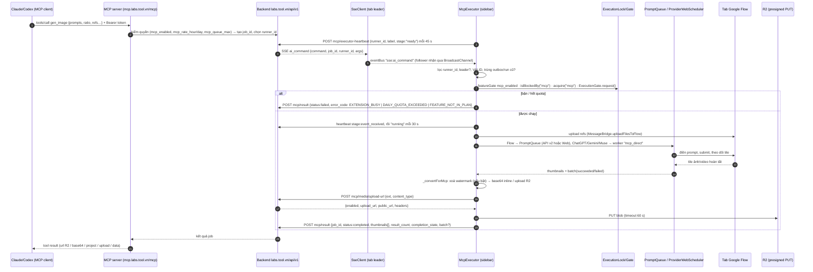
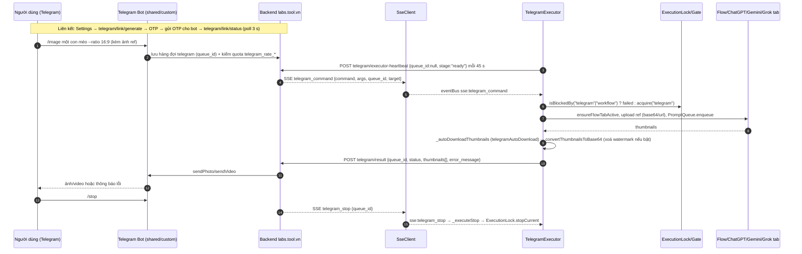
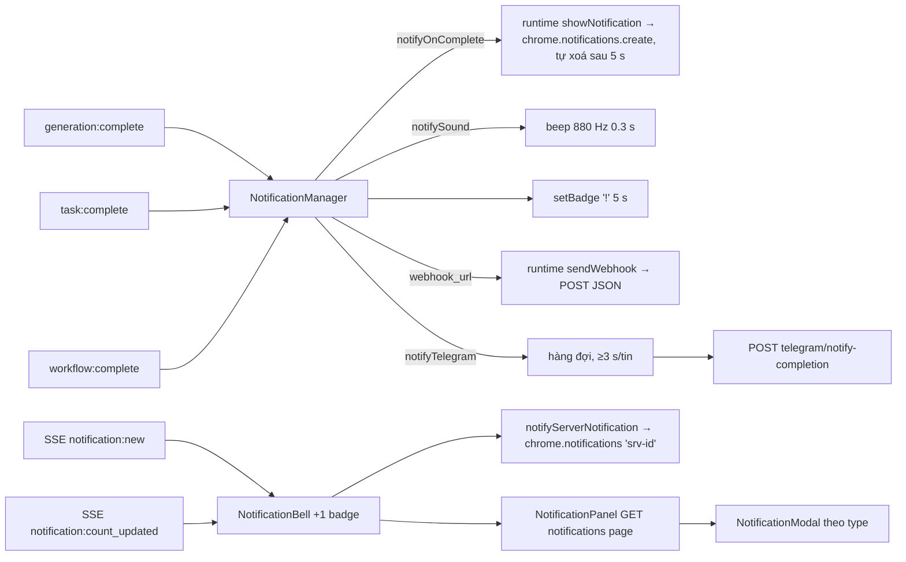
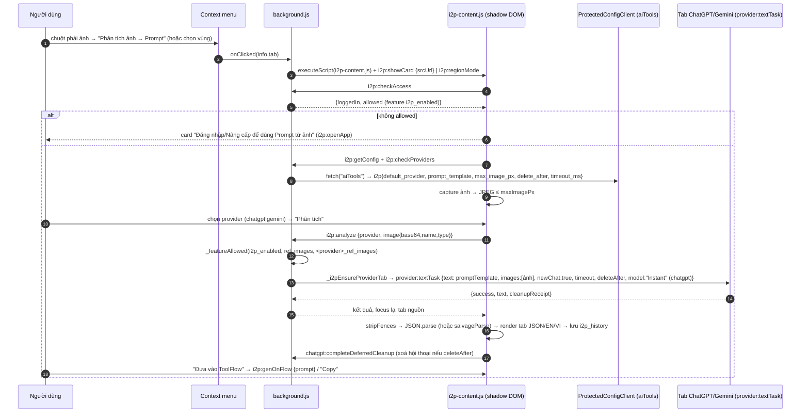
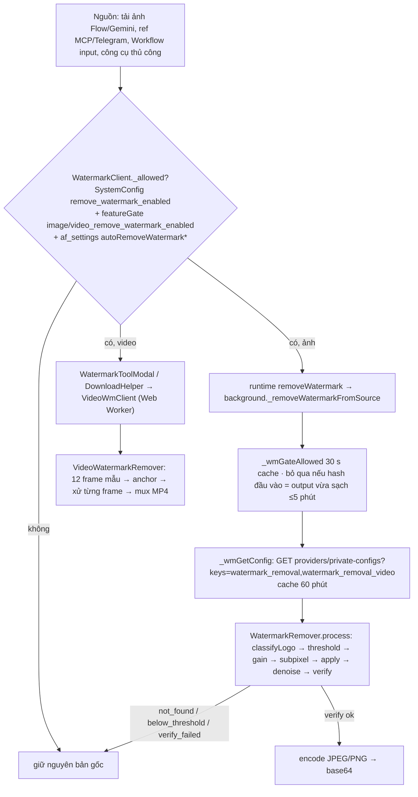
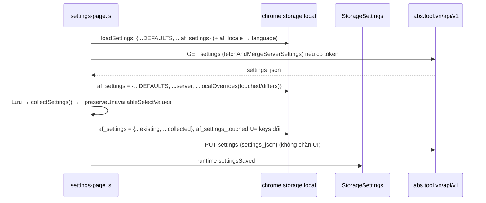
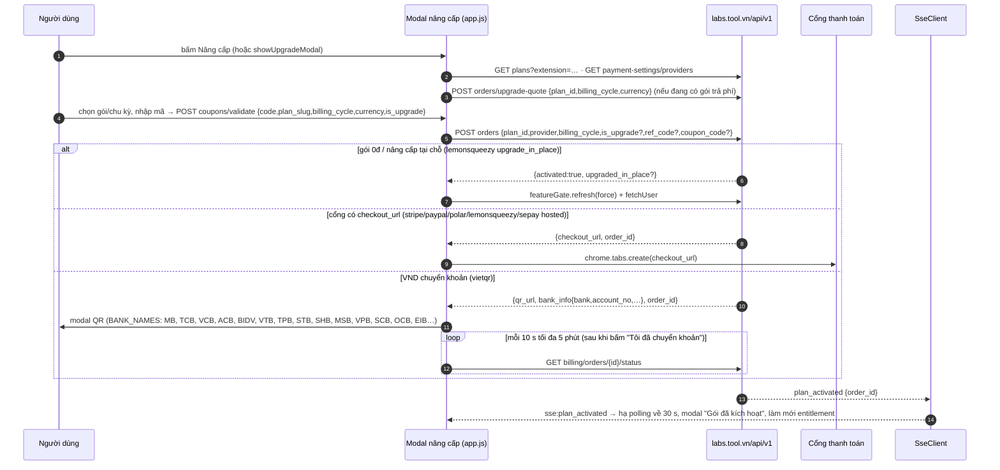

# 10. Điều khiển từ xa, thông báo, Image→Prompt, xoá watermark, Prompt Assistant và Settings

Tài liệu này mô tả nhóm tính năng "ngoài Gen/Workflow" của ToolFlow v1.3.138 (MV3): (1) **MCP** cho phép AI agent (Claude, Codex, agent khác) điều khiển extension qua server `https://mcp.labs.tool.vn/mcp`; (2) **Telegram bot** gửi lệnh `/image`, `/video`, `/workflow`, `/stop`; (3) **thông báo** (browser, âm thanh, Telegram, webhook, chuông trong app); (4) **Image→Prompt (I2P)** chạy qua context menu, dùng ChatGPT/Gemini web để mô tả ảnh; (5) **xoá watermark** hoàn toàn phía client bằng alpha map + NCC; (6) **Prompt Assistant**; (7) **trang Settings** cùng luồng nâng cấp/thanh toán/referral/affiliate.

Nguồn: extension giải nén ở `…/iicjfgdnngmpfocfanpiammedafmomin/1.3.138_0/` (viết tắt `ext/`) và dữ liệu storage thật trong `docs/research/_work/storage/`. Chỉ phân tích tĩnh; không chạy extension, không gọi API. Mọi token, email, IP đã bị lược khỏi tài liệu.

Nhãn độ tin cậy: **[QS]** quan sát trực tiếp trong code/data · **[SL]** suy luận · **[?]** chưa rõ.

---

## 1. Bản đồ file

| file | kích thước | vai trò |
|---|---|---|
| `src/core/McpExecutor.js` | 240 345 B | Nhận lệnh `ai_command` từ SSE, chạy 27 command MCP, heartbeat, hủy, trả kết quả (`mcp/result`), outbox, upload media R2 |
| `src/core/TelegramExecutor.js` | 40 982 B | Nhận `telegram_command` (/image /video /workflow /stop), chạy trên Flow/ChatGPT/Gemini/Grok, trả `telegram/result` |
| `src/core/NotificationManager.js` | 7 381 B | Lắng nghe `generation:complete`/`task:complete`/`workflow:complete` → thông báo trình duyệt, beep, webhook, Telegram |
| `src/core/NotificationBell.js` | 13 772 B | Chuông + badge, poll `notifications/unread-count` mỗi 90 s, nhận SSE `notification:new` |
| `src/core/NotificationPanel.js` | 25 797 B | Danh sách thông báo (`notifications?page=&per_page=20`), đánh dấu đã đọc |
| `src/core/NotificationModal.js` | 31 838 B | Modal theo `type`: payment, order_*, account_expiring, workflow_shared, feature_announcement, … |
| `i2p-content.js` | 41 833 B | Content script I2P: card nổi (shadow DOM), chọn vùng, history, gọi `i2p:*` |
| `background.js` | 521 791 B | Handler `i2p:*`, `pa:*`, `removeWatermark`, `getWatermarkConfig`, `sendWebhook`, `showNotification`, context menu |
| `src/core/WatermarkRemover.js` | 19 620 B | Lõi thuật toán xoá watermark (alpha map, NCC, gain search, subpixel, verify) |
| `src/core/WatermarkClient.js` | 4 281 B | Façade phía sidebar/page: gate + gọi `removeWatermark` qua background |
| `src/core/VideoWatermarkRemover.js` | 8 777 B | Xoá watermark video từng frame bằng Mediabunny (WebCodecs), re-encode MP4 |
| `src/core/VideoWmClient.js` | 1 793 B | Chạy `VideoWatermarkRemover` trong Web Worker, fallback in-page |
| `src/core/video-wm-worker.js` | 623 B | Worker: `importScripts(mediabunny, WatermarkRemover, VideoWatermarkRemover)` |
| `src/shared/WatermarkToolModal.js` | 27 212 B | Công cụ xoá watermark thủ công (kéo thả PNG/JPEG/MP4) trong sidebar |
| `src/chat/PromptAssistantModal.js` | 88 714 B | Modal Prompt Assistant: dựng meta-prompt, gọi ChatGPT/Gemini, parse kết quả, đổ vào Gen |
| `settings.html` | 148 815 B | Khung trang Settings (5 tab, 3 sub-tab) |
| `settings-page.js` | 216 993 B | Logic Settings: load/collect/save, gate entitlement, MCP tokens, Telegram link, devices, storage |
| `settings-orders.js` | 10 468 B | Sub-tab "Đơn hàng": liệt kê, thanh toán lại, hủy đơn/hủy gia hạn |
| `src/settings/StorageSettings.js` | 21 647 B | `window.storageSettings`: defaults + server `default-settings` + merge cloud/local |
| `src/core/LocalStorageUsage.js` | 10 893 B | Quét/xoá dung lượng IndexedDB provider-web (batch/workflow/other) |
| `src/app.js` (một phần) | 413 967 B | Modal nâng cấp, thanh toán, coupon, referral, affiliate (ngoài phạm vi file nhưng cần để mô tả luồng) |
| `img/settings.png` | — | Ảnh chụp tab "Cài đặt › Chung" |

---

## 2. MCP (Claude/Codex → MCP server → extension → Flow → kết quả)

### 2.1 Kiến trúc và cách người dùng kết nối

- **MCP server** là dịch vụ riêng của Tool: `https://mcp.labs.tool.vn/mcp` (hằng trong `settings.html`, `#mcpServerUrl`) [QS]. Extension **không** là MCP server; nó là *executor* nhận lệnh do server đẩy xuống qua SSE của backend `labs.tool.vn/api/v1` [QS].
- Xác thực MCP client bằng **token** (Bearer) do người dùng tạo trong Settings › MCP: `POST mcp/tokens {label}` (token chỉ hiện 1 lần, "Copy ngay"), `GET mcp/tokens` (liệt kê: label, last_used_at, expires_at, expired), `DELETE mcp/tokens/{id}` (thu hồi). Mỗi lần tạo/thu hồi ghi `tool_mcp_token_revision` vào storage để các context khác làm mới [QS] `settings-page.js › handleMcpCreateToken/handleMcpRevokeToken`.
- Cấu hình client, hard-code trong `settings.html` [QS]:

| client | icon | cấu hình |
|---|---|---|
| Claude (Desktop) | `icons/mcp-claude.svg` | `claude_desktop_config.json`: `{"mcpServers":{"toolflow":{"command":"npx","args":["-y","mcp-remote","https://mcp.labs.tool.vn/mcp","--header","Authorization:Bearer <token>"]}}}`. Guide 3 bước: copy token → Settings › Developer › Edit Config → dán, thay `<token>`, restart |
| Codex | `icons/mcp-codex.svg` | `export TOOLFLOW_MCP_TOKEN='<token>'` và `~/.codex/config.toml`: `[mcp_servers.toolflow] url="https://mcp.labs.tool.vn/mcp" bearer_token_env_var="TOOLFLOW_MCP_TOKEN" enabled=true`; kiểm tra bằng `codex mcp list` hoặc `/mcp` |
| Agent khác (tab "Agent khác") | `icons/mcp-antigravity.svg` (logo orbit gồm Codex, Claude, Antigravity) | Một "prompt cài đặt đầy đủ" để dán cho agent; agent tự cài khi được cấp quyền |
| Gemini / ChatGPT / Grok | `mcp-gemini.svg`, `mcp-chatgpt.png`, `mcp-grok.svg` | Chỉ là icon provider *đích* (orbit "Flow, ChatGPT, Grok, Muse"); **không có tab hướng dẫn Gemini riêng** [QS] |

- Tài liệu "ảnh tham chiếu": ảnh local chỉ dùng được với Claude Code/Codex CLI (đọc file theo quyền); Claude Desktop không gửi được file local; hoặc **URL public** mở trực tiếp được (không cần login/cookie) [QS] (`settings.mcpRefLocalDesc/mcpRefUrlDesc`).
- Cổng quyền: tab "MCP" ẩn nếu entitlement `agent_bot_enabled`=0 (`_gateAgentBotTab`); khu token/hướng dẫn chỉ hiện khi `mcp_enabled`=1, ngược lại hiện "Kết nối AI Agent cần gói Premium" + nút nâng cấp [QS]. Tài khoản Free trong data: `mcp_enabled=null` ⇒ khoá (tab MCP có biểu tượng vương miện trong `img/settings.png`).

### 2.2 Danh sách command (VALID trong `_execute`)

27 command, kiểm tra bằng `VALID.includes(command)` — ngoài danh sách trả `GEN_FAILED "Lệnh không hỗ trợ"` [QS]. Tham số lấy từ `args.*` / destructuring trong từng `_execute*`:

| command | tham số (`args`) | hành vi / kết quả |
|---|---|---|
| `gen_image` / `gen_video` | `provider` (flow\|chatgpt\|gemini\|grok\|muse, mặc định flow), `prompt` hoặc `prompts[]`, `ratio`, `model`, `count` (≤4 ảnh/prompt; worker Web bắt buộc =1), `refs[]`, `refs_per_prompt[][]`, `ref_mode` (`none` tắt ref), `reuse_refs[]`, `saved_refs[]`/`saved_refs_per_prompt`, `workflow_refs[]`/`workflow_refs_per_prompt`, `batch_name`, `duration`, `video_input_type` (Ingredients\|Frames), `voice`, `character`, `gen_mode`, `run_mode`, `image_quality` (Grok) | Sinh ảnh/video. `thumbnails[]` + `batch` (khi >1 prompt) trong `mcp/result`. Flow Frames tối đa 2 ảnh; chain video: tối đa 2 frame đầu + 1 ảnh/prompt sau |
| `upload_ref` | `image` (base64 / data URL / URL https public) | Upload ảnh lên Flow, trả `upload:{file_id, file_name?, thumbnail_url?}`. Tải URL qua background `fetchBlob`; chỉ chấp nhận jpeg/png/webp/gif; **tự xoá watermark ref** với `scope:"input"` nếu người dùng bật |
| `extract_last_frame` | `provider`, `tile_id`, `video_url`, `file_name` | Lấy frame cuối video để làm ref |
| `create_project` / `open_project` | `project_id` (open) | Tạo/mở Flow project; trả `project:{project_id, project_name}` |
| `get_context` | — | Đọc project Flow hiện tại (`PROJECT_NOT_READY` nếu chưa mở) |
| `get_provider_status` | `provider`/`providers[]`, `media_type` | Trả ready/reason mỗi provider; Flow kèm trạng thái API/Web; `feature_disabled:<key>` nếu gói không có |
| `get_characters` | — | Danh sách nhân vật Flow |
| `delete_chat` | `provider` | Xoá hội thoại ChatGPT/Gemini/Muse |
| `clear_flow_cookies` | `project_id`, `confirm:true`, `provider?="flow"` | Khôi phục phiên: xoá cookie+cache Flow, reload. Yêu cầu **Flow API mode đang bật**, `BridgeClient.supportsFlowCookieRecovery`, tab đúng project; trả `{cookies_cleared, cache_cleared, reloaded, auto_resumed:false}`. Lỗi: `VALIDATION_ERROR`, `FLOW_API_NOT_ACTIVE`, `FLOW_SESSION_RECOVERY_UNAVAILABLE`, `COOKIE_RECOVERY_PROJECT_MISMATCH`, `COOKIE_RECOVERY_FAILED` — comment: "Generation data is retained; do not automatically retry" |
| `run_workflow` | `wf_id`, `node_ids[]?` | Chạy workflow (hoặc tập node); `workflowExecutor.execute`, `_historySource="mcp"`, `manualSubmitMode:false`; thu media từ event `node:completed`; nếu chỉ có text trả `data.outputs` |
| `run_node` | `wf_id`, `node_id` | Chạy một node |
| `get_workflow_results` | `wf_id`, `node_ids`, `output`, `include_media`, `limit`, `offset` | Đọc kết quả workflow đã lưu |
| `upload_workflow_result_ref` | `workflow_refs[0]` | Dùng kết quả node làm ref |
| `list_saved_results` | `provider` (flow/chatgpt/gemini/muse), `batch_id`, `expected_prompt_count`(1–100), `include_refs`, `limit` (1–100, mặc định 50), `offset`, `media_type`, `query` | Liệt kê kết quả đã lưu trong Batch List của project hiện tại; trước đó `genBatchListModal.syncMcpHistory()` |
| `get_saved_media` | `provider`, `results[]` (1–20), `delivery` (`browser`\|trả về MCP), `batch_name` | Trả media đã lưu, hoặc tải thẳng bằng trình duyệt (`DownloadHelper`) |
| `add_saved_results_to_refs` / `upload_saved_result_ref` | `provider`, `results[]` | Đưa kết quả đã lưu vào kho ref / upload lên Flow |
| `list_saved_batches` | `provider`, `query`, `created_at`, `include_runs`, `limit`, `offset` | Liệt kê batch |
| `get_saved_batch` | `provider`, `batch_id` | Chi tiết từng prompt + `revision` |
| `edit_saved_flow_prompt` | `prompt`, `prompt_index`, `expected_revision` | Sửa prompt đã lưu (khoá lạc quan) |
| `rerun_saved_flow_prompt` / `rerun_saved_flow_batch` | `confirm:true`, `expected_revision`, `prompt_index` (chỉ prompt) | Chạy lại; idempotent theo marker `tool_mcp_saved_rerun_<job_id>` (trạng thái dispatching→persisted→accepted) |
| `manage_saved_web_batch` | `provider` (chatgpt/gemini/muse), `batch_source` (web_batch\|web_run), `operation` (edit\|rerun\|resume\|stop), `batch_id`, `expected_revision`, `run_id`, `prompt`, `prompt_index`, `failed_pending_only`, `confirm` | Điều khiển batch provider-web; marker `mcp_saved_web_action:<user>:<job>` |
| `rename_saved_batch` / `delete_saved_batch` | `batch_id`, `batch_source`, `name`, `expected_revision`, `confirm` | Đổi tên/xoá batch |

Các command ghi (không phải read-only) đều đòi `confirm:true` và/hoặc `expected_revision` ⇒ thiết kế chống agent làm hỏng dữ liệu [QS]. Read-only (`list_saved_results`, `list_saved_batches`, `get_saved_batch`, `get_provider_status`, `manage_saved_web_batch` với `stop`) **không** lấy `ExecutionLock` và vẫn chạy khi extension bận [QS].

### 2.3 Sequence: Claude → MCP → extension → Flow → kết quả



### 2.4 Chi tiết `McpExecutor`

**Trạng thái và định danh** [QS]
- Static: `_currentJobId`, `_isExecuting`, `_cancelRequested`, `_wasStopped`, `_currentProvider`, `_currentExecutionToken`, `_currentOwnedRun`.
- **runner_id**: `crypto.randomUUID()` lưu `tool_mcp_runner_id`; `tool_mcp_runner_owner` = user id. Đổi tài khoản ⇒ sinh runner mới. Mọi `ai_command`/`ai_cancel` phải có `runner_id` trùng, nếu không bỏ qua ⇒ **mỗi trình duyệt/profile là một runner riêng**; server chọn runner.
- `label` = `"<Google Chrome|Microsoft Edge|Opera|Browser> - <Windows|macOS|Android|Linux>"` (từ userAgent), hiển thị cho server để người dùng biết agent đang nói chuyện với máy nào.
- Chỉ **tab leader** (`SseBroadcastManager._role`) thực thi; follower bỏ qua (`follower context → skip`).

**Heartbeat** `POST mcp/executor-heartbeat` [QS]
- Trường: `runner_id`, `label`, `job_id`, `stage`, `context` (pathname), `request_nonce`, `workflow_scoped_execution:true`, `workflow_data_access:true`, `batch_data_access:true`, `flow_batch_control:true` (khai báo capability cho server), `active_workflow:{wf_id, run_id, execution_mode}` (nếu `af_running_workflow` mới <5 phút).
- Lịch: `ready` mỗi **45 s** (và khi `auth:login`, `sse:connected`, `broadcast:became_leader`, `online`, `focus`, tab visible); khi có job: `event_received` rồi `running` mỗi **30 s**; `duplicate_ignored` nếu nhận lại cùng job. Timeout = `SystemConfig.api_timeout_ms` (60 000 ms trong data); thiếu config ⇒ `MCP_HEARTBEAT_TIMEOUT_CONFIG_UNAVAILABLE`.
- Phản hồi `recoverable_job_id` ⇒ `_recoverOwnedMcpJob` (chạy lại job đã sở hữu bởi worker Web sau reload).

**Điều kiện từ chối** (trả `mcp/result status:failed` + `error_code`) [QS]
| code | khi nào |
|---|---|
| `GEN_FAILED` | command lạ, thiếu prompt, lỗi chung |
| `FEATURE_NOT_IN_PLAN` | `featureGate.canUse("mcp_enabled")===false`; hoặc `<provider>_enabled`/`<provider>_mcp_enabled` tắt |
| `EXTENSION_BUSY` | `ExecutionLock.isBlockedBy("mcp"|"workflow")` (đang Prompt/Task/Workflow/Angles/Effects/Queue) hoặc đang chạy job MCP khác |
| `DAILY_QUOTA_EXCEEDED` | `ExecutionGate.request` từ chối (message: "kh retry ngay") |
| `EXECUTION_GATE_UNAVAILABLE` | không có token gate/offline fallback |
| `CANCELLED` | `_wasStopped` |
| `VALIDATION_ERROR`, `CONFIG_UNAVAILABLE`, `PROVIDER_TAB_NOT_READY`, `PROJECT_NOT_READY`, `PROJECT_MISMATCH`, `UPLOAD_FAILED`, `REF_FETCH_FAILED`, `RESULT_MEDIA_UNAVAILABLE`, `RESULT_DELIVERY_REJECTED`, … | xem danh sách ~100 mã `[A-Z_]` trong file; `_mcpErrorCode` chỉ cho mã khớp `^[A-Z][A-Z0-9_]{0,79}$` đi ra ngoài |

**Hạn mức: mcp_rate_*, mcp_queue_max** — **không có trong `McpExecutor.js`** (grep không có `mcp_rate`/`mcp_queue`) [QS]. Chúng là *entitlement* do server giữ và enforce: `mcp_rate_hour`, `mcp_rate_day`, `mcp_queue_max`, `mcp_max_tokens`, `mcp_workflow_create_rate_day`, `mcp_enabled`, `mcp_workflow_enabled`, `chatgpt_mcp_enabled`, `gemini_mcp_enabled`, `grok_mcp_enabled`, `muse_mcp_enabled` (`af_entitlements.json`, tài khoản Free: toàn bộ `null`/`0`) [QS]. Phía extension chỉ có hai lớp: `featureGate.canUse` (boolean) và `ExecutionGate` (quota ngày theo action `generate`/`chatgpt_run`/`gemini_run`/`grok_run`/`muse_run`). Server là nơi trả `429`/từ chối trước khi lệnh tới extension [SL].

**Hủy lệnh** (`sse:ai_cancel`) [QS]
- Payload phải có `runner_id`. Nhánh: `flow_batch_control:true` → `_handleFlowBatchControl`; có `workflow_id`+`workflow_run_id` → `_handleWorkflowStop`; còn lại `{job_id}` hoặc `{all:true}` (cancel_all) khớp `_currentJobId`.
- Thực hiện: `_cancelRequested=_wasStopped=true` → `_stopOwnedMcpRun("MCP_CANCEL"|"MCP_CANCEL_ALL")` → `MuseSession.abort` (nếu muse) → `ExecutionLock.stopCurrent()` → emit `queue:stop_all {stopOrigin:"user", stopReason:"USER_CANCELLED"}`.
- Kết quả gửi `status:failed, error_code:"CANCELLED"` kèm phần đã làm được (`partial` quota khi có thumbnail). Nút "dừng thủ công" trên UI (`execution:force_stopped`) đi cùng đường `MCP_FORCE_STOP`.

**Trả kết quả** `POST mcp/result` [QS] `_sendResult`
- Body: `job_id`, `status` (`completed`|`failed`), `runner_id`; completed thêm một trong `project` | `upload` | `data` | `thumbnails[]`+`result_count`+`completion_state` (`full`|`partial` khi `batch.failed>0`) + `batch`; failed thêm `batch`, `error_code`, `error_message` (cắt 1000 ký tự).
- `batch` do `_buildBatch`: `{succeeded, failed, failed_prompts[≤200]{index,prompt≤500,error}}`; bỏ qua nếu 1 prompt không lỗi.
- Với `gen_image/gen_video/run_*/get_saved_media` mà `thumbnails.length==0` ⇒ đổi thành `failed RESULT_MEDIA_UNAVAILABLE` ("Provider đã xử lý nhưng không thể chuyển media kết quả về MCP client").
- Mỗi thumbnail (`_convertForMcp`): ảnh → xoá watermark (nếu `WatermarkClient.enabled`) → thử upload R2 (`storage:"r2"`, `url`, `downloadable:true`) → nếu không có R2 thì base64 inline (`storage:"inline"`); URL provider giữ nguyên (`storage:"provider"`, `downloadable:false`) khi chưa clean; blob local lớn >8 MB hoặc tổng inline >19 MB → `storage:"local"`; tổng inline >20 MB ⇒ `CONFIG_UNAVAILABLE`. Video → fetch blob (30 s) → `DownloadHelper.cleanMediaBlob` → R2 (`video_url`) + `poster` PNG ≤512 px (đã xoá watermark); `require_durable` mà không lưu được R2 ⇒ `RESULT_MEDIA_UNAVAILABLE`.
- **R2**: `POST mcp/media/upload-url {ext, content_type}` → `{enabled, upload_url, public_url, headers}` → `PUT` (timeout 60 s); `enabled:false` hoặc PUT lỗi ⇒ `null` (fallback inline/URL provider).

**Giao hàng tin cậy (outbox)** [QS]
- `_deliverResultBody`: tối đa 3 lần, backoff 750 ms · 2^n (750, 1500 ms); retry khi HTTP `0/408/409/429/≥500`; còn lại coi là bị từ chối.
- Với run do worker Web sở hữu (`ownedRun`): ghi `af_mcp_result_outbox` trước, flush rồi mới `settleOwned`. Outbox giữ tối đa 50 mục legacy; mục legacy bỏ sau 24 h hoặc ≥10 lần thử; mục `ownedRun` giữ mãi tới khi giao được. Flush khi login/SSE connected/become leader/online/focus/visible và sau 30 s. Nếu server từ chối payload `completed` ⇒ gửi `failed RESULT_DELIVERY_REJECTED`.
- Toast hoạt động `#toolflow-mcp-activity` hiển thị nhãn VI từ `mcpActivity.*` ("Tạo ảnh", "Chạy quy trình", "Xóa cookie Flow", …) với trạng thái Đang thực hiện/Hoàn tất/Đã dừng/Thất bại.

**Hai đường thực thi** [QS]
- **Flow** → `_executeFlowGen`: bắt buộc `PromptQueue.isEnabled()` (pipeline queue, xem Settings `queueEnabled`), resolve ratio/model qua `ModelRegistry`, `_ensureFlowProjectContext` (cần tab Flow đúng project, `PROVIDER_TAB_NOT_READY`), upload ref, rồi xếp hàng PromptQueue.
- **ChatGPT/Gemini/Muse** → `_prepareOwnedMcpGen`: nếu `ExecutionConfig.getProviderWebSurface("mcp_direct", provider).surfaceEnabled` (`provider_web_mcp_direct_enabled:true` trong `af_execution_config.json`) thì tạo run "owned" cho `ProviderWebScheduler` (tối đa `provider_web_max_concurrent_workers=2`); không thì đường legacy `_execute{ChatGPT,Gemini,Muse,Grok}Gen`. Worker chỉ hỗ trợ `count=1`, không `reuse_refs`; ChatGPT chỉ ảnh.

**Storage liên quan**
| key | nội dung |
|---|---|
| `tool_mcp_runner_id`, `tool_mcp_runner_owner` | runner định danh |
| `af_mcp_result_outbox` | hàng đợi kết quả chưa giao |
| `tool_mcp_token_revision` | dấu thời gian đổi token |
| `tool_mcp_saved_rerun_<job_id>`, `mcp_saved_web_action:<user>:<job>` | marker idempotent rerun |
| `af_running_workflow` | cờ workflow đang chạy (đưa vào heartbeat) |

**Message/endpoint**
| loại | tên | ghi chú |
|---|---|---|
| SSE (vào) | `ai_command`, `ai_cancel` | qua eventBus `sse:ai_command`, `sse:ai_cancel` |
| HTTP (ra) | `POST mcp/executor-heartbeat`, `POST mcp/result`, `POST mcp/media/upload-url`, `GET/POST mcp/tokens`, `DELETE mcp/tokens/{id}`, `GET entitlements` | prefix `labs.tool.vn/api/v1` |
| runtime | `ensureFlowTabActive`, `activateFlowTabForExecution`, `checkFlowTabOpen`, `fetchBlob` | tới background |

---

## 3. Telegram

### 3.1 Cấu hình và liên kết

- Bot chung `telegram_shared_bot_username` = `ToolFlow_bot` (`af_system_settings`); hoặc **bot riêng** (custom bot, gói có `telegram_custom_bot`): người dùng dán token bot → `POST telegram/custom-bot {token}` [QS].
- Liên kết (`settings-page.js › handleTelegramLink`): đăng nhập bắt buộc → (nếu custom) lưu token → `POST telegram/link/generate {bot_type:"shared"|"custom"}` trả `{code, bot_url}` (OTP) → UI hiện mã + đếm ngược (hết hạn ⇒ quay về "chưa liên kết") → người dùng gửi mã cho bot → extension poll `GET telegram/link/status?bot_type=` **mỗi 3 s** cho tới `linked:true` → hiện `telegram_username`, `bot_username`, loại bot. Huỷ: `POST telegram/unlink`. `_checkTelegramLinkStatus` dùng `GET telegram/link/status` để ẩn/hiện dòng "Thông báo qua Telegram" [QS].
- Cổng: section Telegram bị khoá khi `telegram_enabled`≠1 (Free: `0`) ⇒ `opacity .5`, mọi nút `disabled`, hiện crown; bot riêng cần `telegram_custom_bot` [QS]. Quota hiển thị: "Lệnh/giờ" (`telegram_rate_hour`) và "Lệnh/ngày" (`telegram_rate_day`), `-1`/`unlimited` ⇒ ∞; gợi ý nâng cấp khi plan `free|trial`. Entitlement khác: `telegram_queue_max`, `telegram_ref_image`, `telegram_workflow`, `grok_telegram_enabled/rate_hour/rate_day` — server giữ hạn mức [QS].



### 3.2 `TelegramExecutor` [QS]

- Init lắng nghe 3 sự kiện SSE: `telegram_command`, `telegram_cancel`, `telegram_stop`. Heartbeat `POST telegram/executor-heartbeat {queue_id, stage, context}`: `ready` 45 s; `event_received`/`running` 30 s; `workflow_resolved`, `execution_started`, `completed`, `failed`, `duplicate_ignored`. (Khác MCP: **không** có `runner_id`/`label`/capability; bất kỳ tab leader nào cũng nhận.)
- Lệnh (`switch`): `/image`|`image`, `/video`|`video`, `/workflow`|`workflow`, `/stop`|`stop`; lệnh khác ⇒ `telegram.unsupportedCommand`. `/video` = `_executeGenerate({...args,count:1,genType:"Video"})`.
- Bận (`_isExecuting` hoặc `ExecutionLock`) ⇒ `failed` với "Extension đang bận…". Cổng quota: `ExecutionGate.request(action, min(count,4), {owner:"telegram"})`; hết quota ⇒ tin nhắn upsell ("Đã hết lượt… Gõ /quota"), tính năng khoá ⇒ "Gõ /plan"; lỗi gate khác ⇒ `EXECUTION_AUTHORIZATION_UNAVAILABLE`.
- Chọn provider: `args.provider || data.target || telegramDefaultProvider`. Setting từng provider từ `_getProviderSettings`: Flow (ratio, model ảnh, videoModel, videoDuration, videoInputType), ChatGPT (ratio, model), Gemini (ratio, model), Grok (ratio, duration, resolution, imageQuality). Giá trị `telegram*` xem bảng Settings §9.
- Flow: `args` gồm `prompt, ratio, model, count (≤4; video =1), ref_image_url, ref_image_base64, ref_images_base64[], genType, video_duration, frames, autoDownload`. Upload ref lỗi ⇒ `REF_UPLOAD_FAILED[:n]`. Bắt buộc `PromptQueue.isEnabled()`.
- `/workflow`: tìm theo `workflow_id` rồi `wf_name` (khớp chính xác, sau đó chứa chuỗi, không phân biệt hoa thường); `workflowExecutor.execute`; gom thumbnails từ `node:completed` (nếu rỗng thì lấy từ cache workflow); không media ⇒ `telegram.workflowCompletedNoMedia`. i18n còn có `telegram.workflowNotSupported` ("chưa được hỗ trợ đầy đủ") `[?]` đường dùng.
- **Gửi kết quả** `POST telegram/result {queue_id, status, thumbnails[], error_message}`; thumbnail → base64: ảnh `{type:"image", base64, file_name, mime_type}` (qua `WatermarkClient.cleanBase64` nếu người dùng bật), video **>5 MB không gửi** — thay bằng `{type:"text_only", message:"…too large… check Google Flow"}`; `text_only` pass-through. Khác MCP: không có R2/outbox/retry — lỗi gửi chỉ `console.error` (không retry) [QS].
- `_autoDownloadThumbnails`: `args.autoDownload` ghi đè `telegramAutoDownload`, AND với entitlement `auto_download`; thư mục `telegramDownloadFolder`; Gemini ảnh dùng `geminiDownloadImageNative` (full-size, tuỳ chọn xoá watermark).
- Hủy: `telegram_cancel` (khớp `queue_id`) hoặc `telegram_stop` (bất kỳ job đang chạy) ⇒ `ExecutionGate.cancel` + `ExecutionLock.stopCurrent()`.

### 3.3 `notify-completion` và `send-workflow-images`

- `POST telegram/notify-completion {event_type, label, completed_count, failed_count}` do `NotificationManager._processTelegramQueue` gửi: `event_type ∈ {generation, task, workflow}`; điều kiện `af_settings.notifyTelegram` + đã đăng nhập; **hàng đợi nội bộ giãn ≥3 s/tin**, gặp lỗi khớp `/too many|rate limit|429/i` thì đợi 10 s rồi thử lại tin đó (đẩy lại đầu hàng); lỗi khác bị bỏ [QS].
- **`send-workflow-images`: không tồn tại** trong extension 1.3.138 (grep toàn cây = 0) [QS]. Ảnh workflow gửi Telegram đi qua `/workflow` → `telegram/result` như trên. Nếu server có endpoint đó thì extension này không gọi `[?]`.

---

## 4. Thông báo



- `NotificationManager` [QS]: `notifyOnComplete` (mặc định true) → browser notification; `notifySound` (mặc định false) → beep; cache cập nhật qua `chrome.storage.onChanged`. Webhook: `GET webhook-settings` → `webhook_url`; sự kiện gửi `{event: "generation:complete"|"task:complete"|"workflow:complete", timestamp, …}` (`prompt/resultCount`, `taskId/taskName`, `workflowId/workflowName`) qua background `sendWebhook`, **chỉ chấp nhận URL http(s) công khai** (`_isAllowedUrl` chặn localhost, `.local`, dải private/CGNAT/loopback/link-local IPv4/IPv6). **Không có UI cấu hình webhook** trong `settings.html`/`settings-page.js` (0 lần `webhook-settings`) — URL do server/web dashboard đặt `[SL]`.
- `NotificationBell`: poll `notifications/unread-count` mỗi **90 s** (chỉ leader; follower dừng), debounce 5 s; SSE `notification:new` (+1 badge, toast `showNotification` 6 s trừ `workflow_shared|account_expiring|renewal_reminder`) và `notification:count_updated`. `account_expiring`/`renewal_reminder` còn mở modal gia hạn nếu `plan_expires_at` hiện tại chưa vượt hạn trong thông báo.
- `NotificationPanel`: `GET notifications?page=N&per_page=20`, `POST notifications/{id}/read`, `POST notifications/mark-all-read`. `NotificationModal`: nội dung theo `type` — `payment`, `order_paid`, `order_failed`, `order_admin_notify`, `account_expiring`, `renewal_reminder`, `affiliate_commission`, `creator_template_reviewed`, `feature_announcement`, `workflow_shared` (nút accept/acceptAndCopy/reject), `system`, mặc định.
- `notifyAffiliateCommission` (true) có trong `af_settings` nhưng **không có consumer** trong code (loại thông báo `affiliate_commission` do server đẩy qua chuông) `[?]`.

---

## 5. Image→Prompt (I2P)

### 5.1 Điểm vào và chọn vùng ảnh [QS]

- `_i2pSetupContextMenu` (background) tạo menu cha `toolflow-i2p-parent` ("<app_name> Tools", context `image`) với 3 mục: `toolflow-i2p-analyze` ("Phân tích ảnh → Prompt"), `toolflow-i2p-region` ("Chọn vùng → Prompt"), `toolflow-i2p-send-gen` ("Gửi ảnh → Tạo (ảnh tham chiếu)"), thêm `toolflow-i2p-region-page` (context `page|frame|selection|link`). `documentUrlPatterns: http(s)://*/*`; tiêu đề 4 ngôn ngữ vi/en/ja/th; cập nhật khi `af_locale`/`af_system_settings.app_name` đổi.
- `contextMenus.onClicked`: Send-gen → mở side panel + `_sendImageToGenTab(srcUrl)`; còn lại → `scripting.executeScript(i2p-content.js)` rồi `tabs.sendMessage({action:"i2p:showCard", srcUrl})` hoặc `{action:"i2p:regionMode"}`.
- **Chọn vùng**: lớp phủ `position:fixed` toàn trang, kéo chuột (≥8×8 px), `Esc` huỷ; ẩn lớp phủ 2 frame rồi `i2p:captureRegion` → background `chrome.tabs.captureVisibleTab` (PNG) → crop theo `rect×dpr` → scale để cạnh dài ≤ `maxImagePx` → JPEG q=0.85 qua `OffscreenCanvas` (nền trắng). Với menu ảnh: `captureImage(srcUrl)` thử `Image(crossOrigin)` → `` có sẵn trong DOM → `fetch(cors)` → fallback `i2p:fetchImage` (background fetch không CORS); lỗi ⇒ `errCapture` "Không lấy được ảnh (CORS)".

### 5.2 Sequence



### 5.3 Chi tiết [QS]

- **Provider phân tích**: chỉ `chatgpt` hoặc `gemini` (giá trị khác ⇒ `gemini`). Dùng **tab web đã đăng nhập** (không dùng API key): `_i2pEnsureProviderTab` mở/kích hoạt tab, `_i2pSendAnalyze` gửi `tabs.sendMessage` thử lại (6 lần, hoặc 25 lần nếu tab vừa tạo; 600/1200 ms). Nếu `PROVIDER_NOT_READY` mà tab cũ ⇒ reload + thử lại một lần; ChatGPT còn có retry `SUBMIT_LOST`/lỗi trước-submit đúng một lần. Model ChatGPT cố định `"Instant"`.
- **Prompt template và tham số lấy từ server** (`ProtectedConfigClient.fetch("aiTools").i2p`): `default_provider` (mặc định `chatgpt`), `prompt_template` (rỗng ⇒ `CONFIG_MISSING`/"Chưa tải được cấu hình"), `max_image_px` (1536), `delete_after`, `timeout_ms` (180 000). Extension không nhúng template.
- **Đầu ra** — 3 tab `JSON` (mặc định), `English`, `Tiếng Việt`. JSON có (ít nhất) `recreation_prompt_en`, `recreation_prompt_vi`, `subject` (khoá mà `salvageParse` cứu khi JSON bị cắt). Ghi chú UI: bản VI chỉ để đọc ("tiếng Việt gen ảnh kém, nên gen bằng JSON hoặc English"). Nút: Copy, "Đưa vào ToolFlow" (`i2p:genOnFlow` → `chrome.storage i2p_pending_prompt` + runtime `i2p:setGenPrompt`), "Gửi ảnh sang tab Tạo".
- **Lịch sử**: `chrome.storage.local["i2p_history"]`, tối đa **20** bản ghi `{ts, provider, raw, parsed, thumb(96 px JPEG q.7)}`; xoá từng mục / tất cả.
- **Trạng thái provider**: `i2p:checkProviders` đọc selector composer từ `tool_provider_configs`; trả `{tabOpen, ready, error?}`; `SELECTOR_CONFIG_UNAVAILABLE` nếu thiếu. Card poll 3 s, tối đa 12 lần, có `autoAnalyzeOnReady`.
- **Cổng gói**: `i2p_enabled` (Free: 1), cộng `ref_images` và `chatgpt_ref_images`/`gemini_ref_images` vì ảnh được gửi như ref. Lỗi → `FEATURE_LOCKED` ⇒ card chuyển `gate` login/upgrade.
- **Huỷ**: `i2p:cancel` → `<provider>:abort` tới tab provider.

---

## 6. Xoá watermark

### 6.1 Sơ đồ tổng



### 6.2 Nguồn alpha map và tham số — **từ server, không nhúng** [QS]

- `_wmGetConfig`: `GET {api}/providers/private-configs?keys=watermark_removal,watermark_removal_video` (có `Authorization` + `X-Extension-Id`, ký bằng `_signedFetch`; trước đó `ProtectedConfigClient.ready()`). Phản hồi `data.flow.configs.watermark_removal` (ảnh) và `.watermark_removal_video` gắn vào `cfg.video`. Cache bộ nhớ **60 phút** (`_WM_CONFIG_TTL_MS`), có `epoch` chống ghi đè cũ (`STALE`), `_wmInvalidate` xoá cache + `_wmMaskCache`.
- Mã lỗi cấu hình: `AUTH_REQUIRED`, `HTTP_xxx`/mã server, `PLAN_REQUIRED` (gói không được cấp), `CONFIG_MISSING` (được cấp nhưng thiếu row), `STALE`, `NETWORK`. Ghi chú trong code: gói có quyền video nhưng thiếu quyền ảnh thì video thiếu tham số chung (nằm ở row ảnh).
- Alpha map: mỗi *variant* có `alpha_png_b64` (PNG base64); `loadAlphaMap` decode bằng `createImageBitmap`, lấy `max(R,G,B)/255` thành `Float32Array` (alpha) kèm `mean`, `std`. Video: `cfg.video.logo_types[]` với `base_short_side` (mặc định 720), `margin_formula`.
- Không có hằng số ngưỡng/gain nào trong client: `REQUIRED_DETECT = [ncc_threshold, search_margin_min, search_margin_max]`, `validate.min_ncc_after`, `detect.gain_search.{min,max,steps}` — thiếu field ⇒ `config_incomplete`, **không xoá** (an toàn khi hỏng cấu hình). **Giá trị thật không có trong dữ liệu local** `[?]` (private config; không có trong `tool_provider_configs.json`).

### 6.3 Thuật toán (`WatermarkRemover.process`) [QS]

Mô hình: watermark Flow/Gemini là logo bán trong suốt composite `I = α·255 + (1-α)·B` (logo màu trắng) ⇒ có thể **đảo ngược** nếu biết α từng pixel.

1. **Chọn variant** `classifyLogo`: duyệt các variant theo `priority`; với ảnh, nếu `base_short_side>0` và ảnh khác kích thước chuẩn >1% thì `_resizeMask` (nội suy song tuyến) theo `k = shortSide/base`. Mỗi variant gọi `locate` để tìm vị trí + NCC, lấy NCC cao nhất; hoà thì ưu tiên priority thấp hơn (độ lệch `variant_priority_eps`).
2. **Dò vị trí** `locate` — NCC (zero-mean normalized cross-correlation) giữa **độ sáng** vùng ảnh (`Y=0.299R+0.587G+0.114B`, cache `_lumaCache`) và alpha map: `ncc = Σ(Y−Ȳ)(α−ᾱ) / (σY·σα)`.
   - Ảnh: `_locateByTable` nếu có `detect.margin_by_short_side[cạnh ngắn]`: vị trí kỳ vọng `x = W−mw−m, y = H−mh−m` quét lân cận ±`table_slack` (mặc định **8 px**) lấy NCC lớn nhất, `anchor:"table"`. Nếu NCC bảng < `ncc_threshold` ⇒ trả kết quả và **bỏ qua** (comment: "không quét: dễ dương giả"); nếu cạnh ngắn không có trong bảng ⇒ **quét** toàn vùng lề `[search_margin_min..max]` (X) × `[search_margin_min_y..max_y]` (Y).
   - Video / variant có `margin_formula`: lề tính theo công thức (`2*size` hoặc `short_side/N`) ±8 px, `byFormula`.
3. **Ngưỡng**: `ncc ≥ detect.ncc_threshold`; video dùng `video.detect.ncc_threshold`; ảnh `anchor:"table"` có thể dùng `exact_anchor_ncc_threshold` nhưng chỉ với `exact_anchor_variant_ids`. Dưới ngưỡng ⇒ `{applied:false, reason:"below_threshold"}`; không tìm thấy ⇒ `not_found` (cả hai được `WatermarkClient.isNoWatermarkReason` coi là "ảnh không có watermark" cùng `already_clean_output`).
4. **Ước lượng gain** `estimateGain` (`detect.gain_search {min,max,steps(2..30),enabled}`): thử các gain `g`, đảo ngược trên patch `α' = min(0.97, α·g)`, đo `|NCC(patch đã đảo, α)|`; chọn `g` làm **tương quan còn lại nhỏ nhất** (tức đã triệt dấu logo). Tìm thô-tinh 3 vòng (thu hẹp quanh best ±step, dừng khi khoảng <1e-4).
5. **Tinh chỉnh dưới-pixel** (`detect.subpixel`, bật mặc định, `window` mặc định 3 ⇒ span ±1): `_refineByRoughness` dịch mask `dx,dy` với bước **0.25 px** (nội suy song tuyến `_shiftMask`), chọn dịch chuyển làm patch đã đảo **mịn nhất** (`_roughness` = trung bình |gradient| ngang+dọc); nếu đổi thì tính lại gain.
6. **Áp dụng** `apply`: với mỗi pixel `α'=min(0.97, α·gain)`, bỏ qua `α'≤0.002`; `C = clamp((C − α'·255)/(1−α'))` cho R,G,B. Backup patch trước (`_snapshot`).
7. **Lọc nền tối** (chỉ ảnh) `adaptiveDarkDenoise` (`postprocess.dark_denoise`): đo độ sáng nền quanh logo (pixel có `α ≤ background_alpha_max`); nếu `< luma_threshold` thì lọc **bilateral** (bán kính `radius`, `sigma_space`, `sigma_range`) chỉ trên pixel `α>alpha_floor`, pha trộn `blend = min(max_blend, α^0.8·strength)` với `strength = max_blend·(1−luma/threshold)`. Mục đích: đảo ngược khuếch đại nhiễu ở vùng tối. Thiếu/sai cấu hình ⇒ bỏ qua (`config_invalid`).
8. **Kiểm chứng** `verify`: đo NCC giữa patch **hiện tại** (sau khi đã đảo; `_applyToPatch(...,gain=0)` không đảo thêm) và α. Nếu `|nccAfter| > validate.min_ncc_after` (dấu logo còn rõ) ⇒ **hoàn tác** (`_restore` từ snapshot) và trả `verify_failed`, giữ ảnh gốc.
9. Kết quả: `{applied:true, variantId, ncc, nccAfter, gain, touched, denoise, pos{x,y,w,h}, timings}`; encode: giữ JPEG (chất lượng `output.jpeg_quality` mặc định 0.95) nếu input JPEG và `output.format!=="png"`, còn lại PNG. Hash output ghi vào `_wmRecentCleanHashes` (5 phút) để tránh xử lý lại byte đã sạch (`already_clean_output`).
10. `smoothEdges` (làm mượt viền, `radius/strength/passes/alpha_floor`) **có trong lõi nhưng chỉ video gọi** (`video.edge_cleanup`); `process` ảnh không gọi `[QS]`.

Tóm tắt "alpha map / detect / gain_search / ngưỡng": alpha map = PNG server; *detect* = NCC trên luma tại vị trí theo bảng/lề; *gain_search* = tìm hệ số cường độ logo để triệt tương quan; *ngưỡng* = `ncc_threshold` (phát hiện), `min_ncc_after` (xác nhận), đều do server.

### 6.4 Video [QS]

- `VideoWatermarkRemover.process(blob,cfg,opt)`: `MAX_INPUT_BYTES=300 MB` (`TOO_LARGE`), lấy **12 frame mẫu** (`SAMPLE_FRAMES`) tại `duration·(i+.5)/12`, `classifyLogo(…,"video")` chọn anchor NCC cao nhất; dưới `video.detect.ncc_threshold` ⇒ không áp dụng. Ước gain → tinh chỉnh dưới-pixel → thêm `estimateGainBySurround` (so khớp độ sáng viền quanh logo; thắng khi patch mịn hơn).
- Lặp từng frame (WebCodecs qua `vendor/mediabunny.js`): `verify` NCC; nếu < ngưỡng ⇒ **dò lại** (`redetects`), cảnh báo nếu >25% frame phải dò lại ("Flow có thể đã đổi cách đặt watermark"); `apply` (gain cố định) → `adaptiveDarkDenoise` (nếu `video.postprocess.dark_denoise`) → `smoothEdges` (nếu `video.edge_cleanup`) → encode.
- Encode MP4 `avc` (hoặc `hevc` nếu nguồn HEVC), bitrate = `opt.bitrate` ‖ bitrate đo từ nguồn ‖ `W·H·0.1·30`; **audio được copy gói (packet) không re-encode**, bù lệch timestamp âm.
- Chạy trong Worker (`video-wm-worker.js`), hủy qua `postMessage({type:"cancel"})` (poll mỗi 250 ms); Worker lỗi ⇒ `_workerBroken`, chạy in-page. Tiến độ `sampling → processing(frame,ratio) → audio → finalizing → complete`.
- Hiệu quả công bố trong UI: ảnh "Hiệu quả 90%", video Omni "~68%", cảnh báo chậm (chuỗi i18n) [QS].
- `WatermarkToolModal` (sidebar): kéo thả/chọn `image/png,image/jpeg,video/mp4`, nhiều file; ảnh → `removeWatermark {base64,mime}`; video → `getWatermarkConfig {mediaType:"video"}` rồi `VideoWmClient.process`; trạng thái `waiting/running/done/kept(không có watermark)/error`; lỗi map: `NOT_ALLOWED/PLAN_REQUIRED`→"Tính năng của gói Premium", `AUTH_REQUIRED`, `NO_CONFIG/CONFIG_MISSING`, `TOO_LARGE` ("Clip quá lớn, trần 300 MB"), `CANNOT_DECODE`; nút xem so sánh gốc/sạch, tải (`chromeDownload`), dừng.
- Nơi áp dụng tự động: tải ảnh (`autoRemoveWatermark`), tải video Omni (`autoRemoveWatermarkVideo`), input Workflow (`autoRemoveWatermarkInput`, `scope:"input"`), kết quả MCP (ảnh/poster), ảnh gửi Telegram, ref upload MCP, `_fetchImageAsBase64` của I2P gửi-sang-Gen (`_wmCleanBlob`). Network-layer: `wm:getInterceptConfig` trả `intercept.url_patterns/timeout_ms/image_timeout_ms` từ server để chặn/xử lý tầng mạng; thiếu patterns ⇒ không chặn. Gate admin `remove_watermark_enabled` (system) + quyền gói `image/video_remove_watermark_enabled` (Free: image=1, video=null).

---

## 7. Prompt Assistant (`PromptAssistantModal`)

- Mở: `featureGate.canUse("prompt_assistant_enabled")` (Free: 1), nếu không ⇒ `showModuleBlockedDialog`. State gồm `provider` (chatgpt|gemini), `idea`, `images[]`, `settings`, `formats`, `config`.
- Nạp song song: `pa:getConfig` (server `aiTools.pa`: `default_provider`, `delete_after`, `prompt_template`, `max_count` mặc định 50, `defaults{media_type, count, language, style, aspect_ratio, detail_level, clip_duration, total_duration, seconds_per_image, numbered, sequential, consistency, auto_script, render_sub}`), `i2p:checkProviders`, `pa:getFormats` (`GET pa-content-formats`, cache 60 s; SSE `pa_content_formats_updated`/`pa:formats_updated` và `entitlements_changed` làm tải lại). "Format" áp `defaults` lên form (bỏ trống ⇒ quay về baseline).
- **Form**: loại (Ảnh/Video/Cặp ảnh→video), số lượng (`auto` hoặc 1..`max_count`), ngôn ngữ (en/vi/theo input), độ chi tiết (concise 20–50 từ / detailed 50–80 từ / cinematic), style, tỷ lệ, ánh sáng, góc máy, chuyển động camera, clip/tổng thời lượng (≤600 s), giây/ảnh (slideshow), âm thanh, giọng đọc, `numbered`, `sequential` (storyboard liền mạch), `consistency`, "Tự viết kịch bản + phụ đề" (`auto_script`), "Chèn phụ đề lên ảnh/video" (`render_sub`), `negative`, ảnh tham chiếu.
- **SRT**: nếu ý tưởng khớp `HH:MM:SS,mmm --> …` ⇒ `_parseSrt` → ép **đúng N cue = N prompt**, mỗi prompt minh hoạ ý nghĩa cue; video thì chọn thời lượng clip ≈ cue (làm tròn 4/6/8/10 s); nếu có audio dialogue và không `render_sub`, thêm dòng `VOICEOVER: "<text>"` cuối mỗi khối.
- **Meta-prompt** `_buildMetaPrompt` = template server + danh sách ràng buộc (số lượng, danh sách ⇒ mỗi mục thuộc *danh mục khác nhau*, storyboard, motion, audio…) và **khung truyền tải**: kết quả bọc `TOOL_PA_BEGIN … TOOL_PA_END`, các prompt ngăn bằng dòng `<<<TOOL_PA_NEXT>>>` (thiếu một đầu marker ⇒ `[]`, bị từ chối vì mơ hồ).
- **Gửi**: `_onGenerate` hiện hộp xác nhận, `pa:activateTab`, rồi `pa:generate {provider, metaPrompt, images[], deleteAfter, timeout:600000}`; background kiểm `prompt_assistant_enabled` + (nếu có ảnh) `ref_images`/`<p>_ref_images`, mở tab provider, `provider:textTask` (ChatGPT dùng `af_settings.chatgptModel`), retry giống I2P; `UsageSync.trackEvent("pa_generate")`.
- **Parse** `_parsePrompts`: bỏ fence ```` ``` ````, cắt khung transport, nếu không có thì tách theo `---` hoặc danh sách đánh số; loại dòng nhãn tên file (từ `sourceFileNames`); `_splitSub` tách `VOICEOVER/Narration/Lời dẫn/On-screen subtitle` thành `sub`; `_mergeSubBlocks`. Kết quả hiển thị, nút "Đổ vào ToolFlow" (`window._setGenPromptInternal`, đổi `genType` Image/Video, thêm ref qua `GenTab.addUploadRefImages`).

---

## 8. Trang Settings

### 8.1 Cấu trúc tab và sub-tab [QS] (`settings.html`, nhãn từ `tool_i18n_vi.json`)

| tab (`data-tab`) | nhãn VI | nội dung |
|---|---|---|
| `settings` | Cài đặt | 3 sub-tab `general` (Chung), `ai` (Nền tảng AI), `advanced` (Nâng cao) + sub-tab ẩn `orders` (Đơn hàng — chỉ hiện nếu có đơn) |
| `ai` | MCP (👑) | sub-tab `mcp` (Token MCP, kết nối client, lưu file gen qua MCP) và `telegram` (Bot) — tab ẩn nếu `agent_bot_enabled=0`; hash `#mcp`/`#telegram`/`#advanced`/`#general` điều hướng thẳng |
| `devices` | Thiết bị | "Thiết bị extension": danh sách `GET extension-devices`; tự `ExtensionDeviceManager.claim()` nếu thiết bị hiện tại chưa đăng ký; `PATCH` đổi tên, `DELETE extension-devices/{id}` gỡ (không gỡ được thiết bị hiện tại); mã lỗi hiển thị `EXTENSION_DEVICE_LIMIT_REACHED/UNCONFIGURED/REVOKED`. Free: `extension_device_max=1` |
| `storage` | Bộ nhớ | Thống kê hôm nay (UTC), tổng quan, Chrome Storage / Web Storage / IndexedDB, dọn dẹp |
| `info` | Giới thiệu | Phiên bản, link hỗ trợ/điều khoản, danh sách provider đang hỗ trợ, 4 lợi ích sáng tạo |

Nút "Lưu tất cả cài đặt" (`#saveAllSettingsBtn`) cố định đáy trang (xem `img/settings.png`: header "Cài đặt", email + badge `FREE`, tab Cài đặt/MCP/Thiết bị/Bộ nhớ/Giới thiệu, sub-tab Chung/Nền tảng AI/Nâng cao, section Tài khoản, Upload lên Flow, Tự động tải về…).

### 8.2 Luồng lưu/đồng bộ [QS]



- `StorageSettings` (`window.storageSettings`): `defaults` cứng + `GET default-settings` (retry 3 lần, timeout 4/6/8 s, backoff 500·n ms, 429 ⇒ dừng retry) phủ lên; lần cài đầu ghi thẳng defaults server vào `af_settings`. `af_settings_owner` đảm bảo settings local không rò sang tài khoản khác (`_validateLocalOwner`); `af_settings_touched` đánh dấu khoá người dùng đã chỉnh để merge cloud không ghi đè. Version poller `_updateFromVersion` nạp lại khi server đổi. Đổi tên khoá: `autoRemoveWatermarkChain → autoRemoveWatermarkInput`. Prune khoá cũ i2p/PA (`i2pMode, i2pDefaultProvider, … paPromptTemplate…`) vì giờ nằm ở server `aiTools`.
- Khi `apiModeEnabled===true` lưu ⇒ ép `queueEnabled=true` (Flow API cần pipeline queue).
- Xuất/nhập: `exportData` chỉ ghi `{version:"2.1.0", type:"settings", exportedAt, data:{af_settings}}` → file `toolflow-settings-<ts>.json`; `importData` đòi `data` và `version`, chỉ ghi lại `af_settings`. Khối "Quản lý dữ liệu" **ẩn khi đã đăng nhập** (đã đồng bộ cloud). "Xóa bộ nhớ đệm" xoá `af_thumbnail_cache`, `af_temp_*` và IndexedDB `autoflow_pro`.

### 8.3 Bảng đầy đủ các tuỳ chọn Settings

Cột "mặc định": giá trị trong `DEFAULTS` của `settings-page.js` (và `StorageSettings.defaults`, trùng hầu hết) · **QS** = giá trị thực trong `af_settings.json` của tài khoản Free (đã được server `default-settings`/người dùng ghi đè nên có thể khác mặc định code, ví dụ `language:"en"`, `defaultImageRatio:"9:16"`, `autoDownload:true`, `queueEnabled:true`). Cột "tác dụng" kèm *(sub-tab)*.

| key | nhãn (id control) | mặc định · QS | tác dụng |
|---|---|---|---|
| `language` | Ngôn ngữ (`#languageSelect`) | `vi` · QS: `"en"` | Ngôn ngữ UI (vi/en/th/ja). Lưu vào `af_locale` + `af_settings.language`; gọi `I18n.setLocale` nếu đổi. Cũng đổi tên context menu I2P. *(Chung › Giao diện)* |
| `theme` | Theme (`#themeSelect`) | `dark` · QS: `"dark"` | `dark`/`light`/`system`. `StorageSettings.applyTheme`. *(Chung › Giao diện)* |
| `autoMuteFlowVideoUpload` | Tự động tắt tiếng khi upload video lên Flow (`#autoMuteFlowVideoUploadToggle`) | `(server default-settings)` · QS: `true` | Tắt tiếng bản video gửi lên Flow (Gen/Tasks/Workflow), file gốc giữ âm. Chỉ ghi khi control chưa `disabled`. Timeout theo `flow_video_upload_mute_timeout_ms`. *(Chung › Upload lên Flow)* |
| `autoRemoveWatermark` | Auto xoá watermark cho ảnh của Flow/Gemini (Hiệu quả 90%) (`#autoRemoveWatermarkToggle`) | `false` · QS: `false` | Tự xoá watermark ảnh Flow/Gemini khi tải về. Cần `image_remove_watermark_enabled` + `remove_watermark_enabled`. *(Chung › Flow – No Watermark)* |
| `autoRemoveWatermarkVideo` | Auto xóa watermark cho Omni video khi tải về (Hiệu quả ~68%) (`#autoRemoveWatermarkVideoToggle`) | `false` · QS: `false` | Tự xoá watermark video Omni khi tải (chậm, ảnh hưởng tiến độ multi-prompt). Cần `video_remove_watermark_enabled`. *(Chung › Flow – No Watermark)* |
| `autoRemoveWatermarkInput` | Xoá watermark ảnh đầu vào (Workflow) (`#autoRemoveWatermarkInputToggle`) | `false` · QS: `false` | Xoá watermark ảnh đầu vào của node tiếp theo trong Workflow (`scope:"input"`). Gate theo quyền ảnh. Tên cũ `autoRemoveWatermarkChain` được migrate. *(Chung › Flow – No Watermark)* |
| `autoDownload` | Tự động tải ảnh/video sau khi tạo xong (`#autoDownloadToggle`) | `false` · QS: `true` | Tự tải ảnh/video sau khi tạo. Cần entitlement `auto_download`; bật thì các field tải bên dưới được kích hoạt (`_toggleDownloadSettings`). *(Chung › Tự động tải về)* |
| `flowApiAutoOpenTrackerGrid` | Tự mở lưới kết quả khi gen bằng Flow API (`#flowApiAutoOpenTrackerGrid`) | `true` · QS: `true` | Tự mở lưới kết quả (tracker grid) khi gen bằng Flow API. `!== false` ⇒ mặc định bật. *(Chung › Tự động tải về)* |
| `downloadFolder` | Tên thư mục (`#downloadFolder`) | `toolflow_output` · QS: `"toolflow_output"` | Thư mục con trong Downloads cho kết quả Gen/Task/Workflow. *(Chung › Tự động tải về)* |
| `motionDownloadFolder` | Thư mục tải Motion (`#motionDownloadFolder`) | `(trống → server)` · QS: `"motion_studio"` | Thư mục tải của Motion Studio (`.trim()`). *(Chung › Tự động tải về)* |
| `fileNameProject` | Tên project (`#fileNameProject`) | `` · QS: `""` | Giá trị cho biến `[Project]` trong mẫu tên file. *(Chung › Tự động tải về)* |
| `fileNameTemplate` | Mẫu tên file (`#fileNameTemplate`) | `[Date]_[Project]_[Prompt]_[Index]` · QS: `"[Index]_[Prompt]_[Project]_[Date]"` | Mẫu tên file; biến `[Date] [Time] [Project] [Prompt] [Index]`. *(Chung › Tự động tải về)* |
| `downloadResolution` | Độ phân giải ảnh (`#downloadResolution`) | `1k` · QS: `"1k"` | Độ phân giải ảnh khi tải (`1k`…; option từ `ProviderConfigManager.getDownloadResolutionsSync` – server). *(Chung › Tự động tải về)* |
| `videoDownloadResolution` | Độ phân giải video (`#videoDownloadResolution`) | `720p` · QS: `"720p"` | Độ phân giải video khi tải (`720p`…; option từ server). *(Chung › Tự động tải về)* |
| `notifyOnComplete` | Thông báo khi hoàn thành (prompt, task, workflow) (`#notifyOnComplete`) | `true` · QS: `true` | Thông báo trình duyệt khi hoàn thành prompt/task/workflow (`NotificationManager.notify`). *(Chung › Thông báo)* |
| `notifySound` | Phát âm thanh thông báo (`#notifySound`) | `false` · QS: `true` | Phát beep 880 Hz/0.3 s (WebAudio) khi thông báo. *(Chung › Thông báo)* |
| `notifyTelegram` | Thông báo qua Telegram khi hoàn thành (`#notifyTelegram / notifyTelegramInTab`) | `false` · QS: `false` | Gửi `telegram/notify-completion` khi xong. Hai checkbox (Chung + tab Telegram) cùng ghi một key; `notifyTelegramInTab` ưu tiên. *(Chung › Thông báo + MCP › Telegram)* |
| `defaultProvider` | Provider mặc định khi tạo mới (`#defaultProvider`) | `flow` · QS: `"flow"` | Provider chọn sẵn khi mở Gen / Multi Task (flow/chatgpt/grok/gemini/muse). *(Nền tảng AI)* |
| `defaultGenMode` | Chế độ gen Flow (`#flowGenMode`) | `"auto"` · QS: `"auto"` | Chế độ gen Flow: `ui` (DOM), `auto` (thử API, lỗi → Web), `api` (ToolBridge). Section chỉ hiện khi bật. *(Nền tảng AI › Flow)* |
| `apiModeEnabled` | Max Speed (`#flowApiModeEnabled`) | `false` · QS: `false` | Toggle "Max Speed" (Flow API). Bật ⇒ ép `queueEnabled=true`. Cần `flow_api_enabled`; khoá nếu `flow_api_driver=="disabled"` (bảo trì). *(Nền tảng AI › Flow)* |
| `defaultGenType` | Loại mặc định (`#defaultGenType`) | `Image` · QS: `"Image"` | `Image`/`Video` mặc định cho Flow. *(Nền tảng AI › Flow)* |
| `defaultImageRatio` | Tỷ lệ ảnh mặc định (`#defaultImageRatio`) | `16:9` · QS: `"9:16"` | Tỷ lệ ảnh mặc định (option từ server). *(Nền tảng AI › Flow)* |
| `defaultVideoRatio` | Tỷ lệ video mặc định (`#defaultVideoRatio`) | `16:9` · QS: `"9:16"` | Tỷ lệ video mặc định. *(Nền tảng AI › Flow)* |
| `defaultImageModel` | Model ảnh mặc định (`#defaultImageModel`) | `null` · QS: `"Nano Banana 2.1"` | Model ảnh Flow; canonicalize qua `ModelRegistry.getCanonicalValue`. *(Nền tảng AI › Flow)* |
| `defaultVideoModel` | Model video mặc định (`#defaultVideoModel`) | `null` · QS: `"Omni 1.1 Flash"` | Model video Flow. *(Nền tảng AI › Flow)* |
| `defaultVideoDuration` | Thời lượng video mặc định (`#defaultVideoDuration`) | `6s` · QS: `"6s"` | Thời lượng video; option theo `duration_tier` của model. *(Nền tảng AI › Flow)* |
| `chatgptDefaultRatio` | Tỷ lệ ChatGPT mặc định (`#chatgptDefaultRatio`) | `story` · QS: `"story"` | Tỷ lệ ChatGPT (story/square/…). *(Nền tảng AI › ChatGPT)* |
| `chatgptModel` | Model ChatGPT mặc định (`#chatgptDefaultModel`) | `null` · QS: `"Instant"` | Model ChatGPT; cũng được `pa:generate` dùng. *(Nền tảng AI › ChatGPT)* |
| `chatgptAutoClose` | Tự đóng tab ChatGPT sau khi tạo xong (`#chatgptAutoClose`) | `false` · QS: `false` | Đóng tab ChatGPT sau khi xong. *(Nền tảng AI › ChatGPT)* |
| `chatgptDeleteAfterGen` | Xóa tin nhắn sau khi gen thành công (`#chatgptDeleteAfterGen`) | `false` · QS: `true` | Xoá tin nhắn/hội thoại sau khi gen thành công. *(Nền tảng AI › ChatGPT)* |
| `chatgptFallbackPrefix` | Prompt prefix fallback (khi image mode fail) (`#chatgptFallbackPrefix`) | `Generate an image of: ` · QS: `"Generate an image of:"` | Tiền tố prompt khi image mode fail. *(Nền tảng AI › ChatGPT)* |
| `geminiModel` | Model Gemini mặc định (`#geminiDefaultModel`) | `null` · QS: `"Flash"` | Model Gemini mặc định. *(Nền tảng AI › Gemini)* |
| `geminiVideoRatio` | Tỷ lệ video Gemini mặc định (`#geminiVideoRatio`) | `null` · QS: `"16:9"` | Tỷ lệ video Gemini. *(Nền tảng AI › Gemini)* |
| `geminiAutoClose` | Tự đóng tab Gemini sau khi tạo xong (`#geminiAutoClose`) | `false` · QS: `false` | Đóng tab Gemini sau khi xong. *(Nền tảng AI › Gemini)* |
| `geminiDeleteAfterGen` | Xóa cuộc trò chuyện Gemini sau khi gen thành công (`#geminiDeleteAfterGen`) | `false` · QS: `true` | Xoá cuộc trò chuyện Gemini sau gen. *(Nền tảng AI › Gemini)* |
| `museDefaultRatio` | Default Muse ratio (nhãn cứng EN) (`#museDefaultRatio`) | `null` · QS: `"9:16"` | Tỷ lệ Muse; option chỉ lấy từ provider config server. *(Nền tảng AI › Muse)* |
| `museDeleteAfterGen` | Xóa chat Muse sau khi gen ảnh thành công (`#museDeleteAfterGen`) | `false` · QS: `false` | Xoá chat Muse sau khi gen ảnh thành công (cũng quyết định `museWorkerDownload` trong `_prepareOwnedMcpGen`). *(Nền tảng AI › Muse)* |
| `grokDefaultMode` | Mode mặc định (`#grokDefaultMode`) | `image` · QS: `"image"` | `image`/`video`. Ẩn/hiện field video qua `_toggleGrokVideoFields`. *(Nền tảng AI › Grok)* |
| `grokDefaultRatio` | Tỷ lệ mặc định (`#grokDefaultRatio`) | `widescreen` · QS: `"story"` | story 9:16 · portrait 2:3 · square 1:1 · landscape 3:2 · widescreen 16:9. *(Nền tảng AI › Grok)* |
| `grokDefaultDuration` | Thời lượng video (`#grokDefaultDuration`) | `6s` · QS: `"6s"` | 6s/10s. *(Nền tảng AI › Grok)* |
| `grokDefaultResolution` | Độ phân giải video (`#grokDefaultResolution`) | `720p` · QS: `"720p"` | 480p/720p. *(Nền tảng AI › Grok)* |
| `grokDefaultImageQuality` | Chất lượng ảnh (`#grokDefaultImageQuality`) | `speed` · QS: `"speed"` | `speed`/`quality`. *(Nền tảng AI › Grok)* |
| `grokAutoClose` | Tự động đóng tab Grok sau khi xong (`#grokAutoClose`) | `false` · QS: `false` | Đóng tab Grok sau khi xong. *(Nền tảng AI › Grok)* |
| `inputTimeout` | Input timeout (`#inputTimeout`) | `1200` · QS: `1000` | Timeout nhập liệu (ms), min 100 / max 60000 / step 100; `parseInt||1200`. *(Nâng cao › Thực thi)* |
| `blobMaxAgeDays` | Lưu blob ảnh album (`#blobMaxAgeDays`) | `7` · QS: `7` | Số ngày giữ blob ảnh album: 1/3/7/14/30. *(Nâng cao › Thực thi)* |
| `queueEnabled` | Bật Pipeline Queue (`#queueEnabled`) | `false` · QS: `true` | Pipeline Queue (đa tác vụ). Tắt ⇒ cảnh báo: retry/tải/khôi phục kém ổn định và **Flow API không chạy**. Gate `pipeline_queue_enabled`. `_executeFlowGen` của MCP và Telegram đều yêu cầu `PromptQueue.isEnabled()`. *(Nâng cao › Pipeline Queue)* |
| `randomDelayMin` | Nghỉ random (giây) (`#randomDelayMin`) | `3` · QS: `5` | Nghỉ ngẫu nhiên tối thiểu (giây) giữa prompt; 0–60. *(Nâng cao › Chống Ban)* |
| `randomDelayMax` | Nghỉ random (giây) (`#randomDelayMax`) | `10` · QS: `15` | Nghỉ ngẫu nhiên tối đa (giây); 1–120. *(Nâng cao › Chống Ban)* |
| `humanizedMode` | Humanized mode (`#humanizedMode`) | `false` · QS: `false` | Gõ từng ký tự, delay ngẫu nhiên. Gate `humanized_mode`. *(Nâng cao › Tự động hoá)* |
| `humanizedSpeed` | Tốc độ gõ (`#humanizedSpeed`) | `.5` · QS: `0.5` | Hệ số tốc độ gõ 0.2–2.0 (step 0.1); 0.5 = chậm/tự nhiên. *(Nâng cao › Tự động hoá)* |
| `manualSubmitMode` | Chế độ Manual Submit (Flow) (`#manualSubmitMode`) | `false` · QS: `false` | Chế độ Manual Submit (Flow): ToolFlow điền prompt + ref, người dùng tự bấm gửi. MCP luôn ép `manualSubmitMode:false` khi chạy workflow. *(Nâng cao › Tự động hoá)* |
| `mcpAutoDownload` | Tự động tải về máy khi AI gen qua MCP (`#mcpAutoDownload`) | `false` · QS: `true` | Tự tải file khi AI gen qua MCP (`_getMcpDownloadSettings`, AND với `auto_download`). *(MCP)* |
| `mcpDownloadFolder` | Thư mục lưu file (`#mcpDownloadFolder`) | `toolflow_mcp` · QS: `"toolflow_mcp"` | Thư mục con; thêm `/<slug batch_name ≤30 ký tự>` nếu có `batch_name`. *(MCP)* |
| `mcpDownloadResolution` | Độ phân giải ảnh (`#mcpDownloadResolution`) | `1k` · QS: `"1k"` | Độ phân giải ảnh tải qua MCP. *(MCP)* |
| `mcpVideoDownloadResolution` | Độ phân giải video (`#mcpVideoDownloadResolution`) | `720p` · QS: `"720p"` | Độ phân giải video tải qua MCP. *(MCP)* |
| `telegramDefaultProvider` | Nền tảng mặc định (`#telegramDefaultProvider`) | `flow` · QS: `"flow"` | Provider khi gửi `/image` hoặc `/video` không chỉ định. *(MCP › Telegram)* |
| `telegramFlowRatio` | Tỷ lệ khung hình (`#telegramFlowRatio`) | `16:9` · QS: `"9:16"` | Tỷ lệ Flow qua Telegram. *(MCP › Telegram)* |
| `telegramFlowModel` | Model (`#telegramFlowModel`) | `null` · QS: `"Nano Banana 2.1"` | Model ảnh Flow qua Telegram. *(MCP › Telegram)* |
| `telegramFlowVideoModel` | Video Model (chưa có i18n VI) (`#telegramFlowVideoModel`) | `null` · QS: `"Omni 1.1 Flash"` | Model video Flow qua Telegram. *(MCP › Telegram)* |
| `telegramFlowVideoDuration` | Video Duration (chưa có i18n VI) (`#telegramFlowVideoDuration`) | `6s` · QS: `"6s"` | 4s/6s/8s. *(MCP › Telegram)* |
| `telegramFlowVideoInputType` | Video Input Type (chưa có i18n VI) (`#telegramFlowVideoInputType`) | `Ingredients` · QS: `"Ingredients"` | `Ingredients` hoặc `Frames` (→ `isFrames` khi `args.frames` thiếu). *(MCP › Telegram)* |
| `telegramChatgptRatio` | Tỷ lệ khung hình (`#telegramChatgptRatio`) | `square` · QS: `"story"` | Tỷ lệ ChatGPT qua Telegram. *(MCP › Telegram)* |
| `telegramGeminiRatio` | Tỷ lệ khung hình (`#telegramGeminiRatio`) | `null` · QS: `""` | Tỷ lệ Gemini qua Telegram. *(MCP › Telegram)* |
| `telegramGeminiModel` | Model (`#telegramGeminiModel`) | `null` · QS: `""` | Model Gemini qua Telegram. *(MCP › Telegram)* |
| `telegramGrokRatio` | Tỷ lệ khung hình (`#telegramGrokRatio`) | `widescreen` · QS: `"story"` | Tỷ lệ Grok qua Telegram. *(MCP › Telegram)* |
| `telegramGrokImageQuality` | Chất lượng ảnh (`#telegramGrokImageQuality`) | `speed` · QS: `"speed"` | speed/quality. *(MCP › Telegram)* |
| `telegramGrokDuration` | Thời lượng video (`#telegramGrokDuration`) | `6s` · QS: `"6s"` | 6s/10s. *(MCP › Telegram)* |
| `telegramGrokResolution` | Độ phân giải (`#telegramGrokResolution`) | `720p` · QS: `"720p"` | 480p/720p. *(MCP › Telegram)* |
| `telegramAutoDownload` | Tự động tải khi chạy từ Telegram (`#telegramAutoDownload`) | `true` · QS: `true` | Tự tải khi chạy từ Telegram; `args.autoDownload` ghi đè. *(MCP › Telegram)* |
| `telegramDownloadFolder` | Thư mục lưu file (`#telegramDownloadFolder`) | `toolflow_bot` · QS: `"toolflow_bot"` | Thư mục con cho file Telegram. *(MCP › Telegram)* |
| `telegramDownloadResolution` | Độ phân giải ảnh (`#telegramDownloadResolution`) | `1k` · QS: `"1k"` | Độ phân giải ảnh tải. *(MCP › Telegram)* |
| `telegramVideoDownloadResolution` | Độ phân giải video (`#telegramVideoDownloadResolution`) | `720p` · QS: `"720p"` | Độ phân giải video tải. *(MCP › Telegram)* |
| `defaultRatio` | — (không có control trong trang Settings) | `9:16` · QS: `"9:16"` | Còn trong `DEFAULTS`/`StorageSettings.defaults`; trang Settings không đọc/ghi, `[?]` consumer ở GenTab. |
| `defaultVideoInputType` | — (không có control; `StorageSettings.defaults` = `Ingredients`) | `Ingredients` · QS: `"Ingredients"` | Kiểu input video Flow mặc định (Ingredients/Frames); chỉ đi qua `_preserveUnavailableSelectValues`/GenTab, không có ô trên Settings. |
| `notifyAffiliateCommission` | — | (không có trong code) · QS: `true` | Chỉ thấy trong `af_settings.json` (server `default-settings`). `grep` toàn cây extension **không có consumer** ⇒ khoá thừa/chuẩn bị cho server. `[?]` |

Ghi chú gate (control bị `disabled` + crown nếu thiếu quyền) [QS `checkFeatureEntitlements`]: `autoDownload`←`auto_download`; `autoRemoveWatermark`/`Input`←`image_remove_watermark_enabled`; `autoRemoveWatermarkVideo`←`video_remove_watermark_enabled`; cả khối watermark ẩn nếu `SystemConfig.remove_watermark_enabled` không bật; `queueEnabled`←`pipeline_queue_enabled`; `humanizedMode`←`humanized_mode`; `apiModeEnabled`/`defaultGenMode`←`flow_api_enabled` (+ `flow_api_driver`); Telegram←`telegram_enabled`, bot riêng←`telegram_custom_bot`; MCP←`mcp_enabled`. `execRetries` và `retry_on_fail` còn trong code nhưng không có control trong `settings.html` hiện tại.

Các phần UI không phải khoá `af_settings`:

| mục | id | tác dụng |
|---|---|---|
| Tài khoản | `userProfileContent` | email, plan, badge Cloud/Local, đổi mật khẩu, liên kết Google (`auth.user.google_id`), Nâng cấp, Hồ sơ, Đăng xuất; referral & affiliate (xem §9) |
| Giọng đọc Flow | `#resyncFlowVoicesBtn` | "Quét lại Voices": `MessageBridge.syncFlowVoices()` mở tab Flow scrape giọng (cả giọng tự tạo); admin còn upload lên server làm *promotion candidates*; trạng thái local/uploaded |
| Mở cài đặt Chrome | `#openChromeDownloadSettings` | hướng dẫn tắt "Hỏi nơi lưu từng tệp"; `#openChromeExtensions` hướng dẫn tắt extension tải khác xung đột |
| Token MCP | `#mcpTokenLabel`, `#mcpCreateTokenBtn`, `#mcpTokenCopyBtn` | tạo/copy/thu hồi token (§2.1) |
| Telegram | `#telegramLinkBtn`, `#telegramCustomBotToken`, `#telegramOtpCopyBtn`, `#telegramOtpCancelBtn`, `#telegramUnlinkBtn` | liên kết/huỷ liên kết (§3.1) |
| Thiết bị | `#extensionDeviceList` | đăng ký/đổi tên/gỡ (§8.1) |
| Bộ nhớ | `#storageRefreshBtn`, `#storageCleanupBtn`, `#storageClearAllBtn`, `#batchStorageZoneDelete`, `#workflowStorageZoneDelete` | xem dưới |

**Tab Bộ nhớ** [QS]: (a) *Thống kê hôm nay* (UTC): mức dùng prompt/Tasks/Workflow từ `af_entitlements` (`prompt_submit_max`, `tasks_run_max`, `workflows_run_max` `usage_today`) hoặc `af_daily_stats`/`af_local_usage`, và prompt lỗi (ghi tại thiết bị). (b) *Chrome Storage*: danh sách `CHROME_STORAGE_DEFS` (`af_settings`, `af_auth`, `af_entitlements`, `af_tasks`, `af_workflows`, `af_nodes`, `af_edges`, `af_user_prompts`, `tool_gentab_state`, `presets` legacy, …) với nhãn "an toàn xoá" (`safe:true`: entitlements, edges) hoặc cảnh báo "Dữ liệu quan trọng"; khoá lạ vẫn liệt kê. (c) *Web Storage / IndexedDB*: `autoflow_pro`, `toolflow_gen_batches`, `toolflow_provider_web_batches` (phân vùng `batch` / `workflow` / `other`/MCP bằng `LocalStorageUsage.classifyProvider`), `toolflow_workflow_muse_videos`, `toolflow_motion_artifacts`, `toolflow_device_identity`; nút xoá theo vùng Batch list / Workflow local data (dry-run trước). (d) "Xóa tất cả dữ liệu local": xoá mọi khoá `af_*` **trừ** `af_settings` và `af_auth`, các IndexedDB trên, video Muse, Web Storage trang extension, cache upload, kết quả Angles; giữ cài đặt, đăng nhập và dữ liệu đã đồng bộ server. (e) Thanh quota trình duyệt `navigator.storage.estimate()` (cảnh báo ≥80%, nặng ≥95%).

---

## 9. Nâng cấp, thanh toán, referral, affiliate (`src/app.js`, `settings-orders.js`)



- **Nhà cung cấp**: `payment-settings/providers` trả `{providers[], labels{}, behavior{}}`. Hiển thị theo tiền tệ (`LocationCache.getCurrency()`): **VND** ⇒ `vietqr`, `sepay`; **ngoại tệ** ⇒ `stripe`, `paypal`, `polar`, `lemonsqueezy`. Nút `#payVietQR/#paySePay/#payStripe/#payPayPal/#payPolar/#payLemonsqueezy` ẩn/hiện, nhãn có thể bị server ghi đè (`labels`). **Sepay** dùng chung `handlePayment("sepay")`; code client không phân biệt: server trả `checkout_url` hoặc `qr_url`; modal QR dùng `qr_url` + `bank_info` `[SL]` sepay/vietqr khác phía server (webhook ngân hàng), không thấy mã riêng cho Sepay ở client `[?]`.
- **Quote nâng cấp**: nếu đang có gói trả phí còn hạn và không phải lifetime ⇒ `orders/upgrade-quote` trả `{from_plan,to_plan,credit,final_amount,currency}`; `is_upgrade:true` chỉ khi `credit>0`, cùng chu kỳ, cùng tiền tệ; lỗi `PRORATION_USE_RENEWAL_FLOW` ⇒ dùng luồng gia hạn. Lemon Squeezy `upgrade_in_place` hỏi xác nhận "trừ tiền ngay".
- **Coupon/mã giới thiệu** một ô nhập duy nhất → `coupons/validate`: `kind:"coupon"` ⇒ `{code, discount_amount, type, value}`; `kind:"referral"` ⇒ giảm `%` (`value`) và lưu `ref_code`; lỗi `reason_code`: `NOT_FOUND, INACTIVE, NOT_STARTED, EXPIRED, USED_UP, USER_LIMIT, MIN_AMOUNT, PLAN_MISMATCH, CYCLE_MISMATCH, CURRENCY_MISMATCH`. Ghi chú UI: "áp dụng ưu đãi tốt nhất", "referral vẫn được tính". Mã ref lưu `tf_ref {code, expires}` (từ link web) và được `_tryAutoApplyStoredRef` kiểm tra bằng `affiliate/validate-ref` → `discount_percent`.
- **Đơn hàng** (`SettingsOrders`): `GET orders?cursor=` (phân trang cuộn vô hạn, `meta.next_cursor`, `meta.current_plan`); thẻ hiển thị plan, hoá đơn, provider (Lemon Squeezy), ngày, chu kỳ, trạng thái, tiền (`Intl.NumberFormat`, VND không lẻ). Menu ⋮: sao chép số hoá đơn, **Thanh toán** (`can_pay` → `POST orders/{id}/checkout` → bắt buộc `https` và cùng origin `ApiBaseConfig.getWebBase()` mới mở tab: `CHECKOUT_URL_INVALID` nếu không), **Huỷ đơn** (`can_cancel` → `POST orders/{id}/cancel`), **Huỷ gia hạn** (`can_cancel_renewal` → `POST orders/{id}/cancel-renewal`, giữ quyền tới hết kỳ). Sub-tab Đơn hàng ẩn nếu chưa có đơn.
- **Referral**: `GET referral/code` (`referral_code`), `GET referral/stats` (`total_registered`, `total_converted`), nút copy mã.
- **Affiliate**: `GET affiliate/dashboard` (`profile_status` none/pending/active/rejected, `link`, `commission_percent`, `earnings{pending,approved,paid}`, `payout_method`, `min_payout_vnd`‖500000 / `min_payout_usd`‖20, `can_publish_templates`); `POST affiliate/apply` (kênh, audience, đồng ý điều khoản) ⇒ `active` ngay hoặc chờ admin; rút tiền: `POST affiliate/payout-method {payout_method:"bank_vn"|"paypal", payout_account}` rồi `POST affiliate/payout-request`; nút rút bị khoá tới ngưỡng tối thiểu; link web `…/dashboard/affiliate`. Phát `affiliate:updated {status,can_publish}` (mở khoá đăng template Creator).
- Gate `show_upgrade_ui` (system) = false ⇒ thêm class `hide-upgrade-ui` ẩn mọi giao diện nâng cấp.

---

## 10. Bảng message/action, storage key, config key tổng hợp

**Runtime message (chrome.runtime.sendMessage)**
| action | từ → tới | ghi chú |
|---|---|---|
| `i2p:getConfig/checkProviders/checkAccess/analyze/cancel/captureRegion/fetchImage/genOnFlow/sendImageToGen/openApp/openProviderLogin/invalidateConfig` | content/sidebar → background | I2P |
| `i2p:showCard`, `i2p:regionMode` | background → content | mở card/chế độ vùng |
| `pa:getConfig/getFormats/invalidateFormats/activateTab/generate` | sidebar → background | Prompt Assistant |
| `removeWatermark`, `getWatermarkConfig`, `wm:canRemove`, `wm:getInterceptConfig` | sidebar/content → background | watermark |
| `showNotification`, `setBadge`, `sendWebhook` | NotificationManager → background | thông báo |
| `settingsSaved`, `openUpgradeModal`, `showUpgradeModal`, `openUpgradeSidePanel`, `apiRequest`, `PROTECTED_CONFIG_STATUS` | settings → background/sidebar | |
| SSE | `ai_command`, `ai_cancel`, `telegram_command`, `telegram_cancel`, `telegram_stop`, `notification:new`, `notification:count_updated`, `plan_activated`, `entitlements_changed`, `pa_content_formats_updated`, `default_settings_updated` | SseClient → eventBus `sse:*` |

**Storage key**
`af_settings`, `af_settings_owner`, `af_settings_touched`, `af_locale`, `af_auth`, `af_entitlements`, `af_system_settings`, `af_mcp_result_outbox`, `tool_mcp_runner_id`, `tool_mcp_runner_owner`, `tool_mcp_token_revision`, `i2p_history` (≤20), `i2p_pending_prompt`, `_pendingLocalToGenTab`, `tf_ref`, `af_thumbnail_cache`, `af_temp_*`, `af_daily_stats`, `af_local_usage`, `af_running_workflow`, `tool_provider_configs` (selector composer cho I2P), `tool_gentab_state`.

**Config key từ server**
| key | nơi dùng |
|---|---|
| `SystemConfig`: `remove_watermark_enabled`, `show_upgrade_ui`, `api_timeout_ms` (60 000), `flow_api_driver`, `telegram_shared_bot_username`, `sse_*`, `flow_video_upload_mute_timeout_ms` (30 000), `image_timeout_ms`/`video_timeout_ms`/`chatgpt_timeout_ms` | watermark gate, heartbeat, MCP/Telegram |
| `ExecutionConfig.parallel`: `provider_web_mcp_direct_enabled`, `provider_web_enabled_providers` (muse, chatgpt, gemini), `provider_web_max_concurrent_workers` (2), `provider_web_<p>_startup_timeout_ms` (60 000; I2P/PA kẹp 10 000–120 000) | MCP worker, I2P/PA |
| `ProtectedConfig aiTools`: `i2p{default_provider,prompt_template,max_image_px,delete_after,timeout_ms}`, `pa{…}` | I2P, PA |
| `private-configs`: `watermark_removal`, `watermark_removal_video` (+`intercept`, `output`, `postprocess`, `validate`, `detect`) | watermark |
| Entitlements (Free trong data): `mcp_enabled=null`, `mcp_rate_*`/`mcp_queue_max`=null, `telegram_enabled=0`, `telegram_rate_*=0`, `i2p_enabled=1`, `prompt_assistant_enabled=1`, `image_remove_watermark_enabled=1`, `video_remove_watermark_enabled=null`, `extension_device_max=1`, `auto_download=1`, `agent_bot_enabled=1` | gate |

---

## 11. Điểm đáng học / Điểm yếu

**Đáng học**
- Tách bạch **thực thi (extension)** và **điều phối/quota (server)**: runner_id theo profile, heartbeat khai báo capability, `ai_command` chỉ tới đúng runner; hạn mức MCP không nằm ở client nên không bypass được bằng sửa extension.
- **Giao kết quả tin cậy**: outbox bền vững + retry theo mã HTTP + marker idempotent cho rerun + `recoverable_job_id`; các lệnh phá huỷ cần `confirm` + `expected_revision`.
- Watermark: đảo ngược composite bằng α **kèm kiểm chứng NCC sau xử lý và hoàn tác nếu không sạch** ⇒ không bao giờ trả ảnh hỏng; mọi tham số/alpha ở server nên cập nhật khi Flow đổi logo không cần phát hành extension; video xử lý bằng WebCodecs, copy nguyên gói audio.
- I2P/PA tận dụng tab đã đăng nhập (không cần API key), template ở server, khung `TOOL_PA_BEGIN/END` + `<<<TOOL_PA_NEXT>>>` để parse chắc chắn; ép số prompt = số cue SRT.
- Settings có mô hình merge cloud/local rõ ràng (`touched`, `owner`) và gate hiển thị theo entitlement.

**Điểm yếu / rủi ro**
- Telegram: `_sendResult` không retry/outbox, video >5 MB bị thay bằng text; hai executor (MCP vs Telegram) trùng nhiều logic và khác cơ chế định danh (Telegram không có `runner_id` ⇒ nhiều profile cùng online có thể cùng nhận lệnh `[SL]`).
- MCP và Telegram yêu cầu tab Flow đúng project đang mở và sidebar sống; `ExecutionLock` làm mọi lệnh khi đang chạy tác vụ khác trả `EXTENSION_BUSY` (client agent phải tự retry).
- Token MCP ở dạng Bearer dán vào cấu hình plaintext (`mcp-remote --header`); chỉ có thu hồi thủ công, không scope theo quyền ngoài gói.
- Watermark: phụ thuộc hoàn toàn server config + đăng nhập + gói; cho phép video tới 300 MB xử lý từng frame trong trình duyệt (chậm, ~68% hiệu quả); `smoothEdges` bị bỏ khỏi đường ảnh; nếu server đổi vị trí logo, bảng tra sẽ báo dưới ngưỡng và ảnh được giữ nguyên (an toàn nhưng silent).
- Webhook: không có UI cấu hình trong extension; `notifyAffiliateCommission` là khoá mồ côi.
- Settings: một số nhãn hardcode EN (`Muse`, Telegram Video Model/Duration/Input Type), một số khoá (`defaultRatio`, `defaultVideoInputType`) không có control; `DEFAULTS` hai nơi (`settings-page.js`, `StorageSettings`) dễ lệch (`telegramFlowModel` null vs "").

---

## 12. Câu hỏi mở

1. Giá trị thật của `watermark_removal` (ngưỡng `ncc_threshold`, `min_ncc_after`, `gain_search`, `margin_by_short_side`, `variants[].priority/base_short_side`) — private config, không nằm trong dữ liệu local.
2. Hành vi server-side của `mcp_rate_hour/day`, `mcp_queue_max`, `mcp_max_tokens`, chọn runner khi một tài khoản có nhiều profile online, và danh sách chính xác tool MCP mà server phơi bày (tên tool có khớp 1–1 với 27 command không).
3. Endpoint `telegram/send-workflow-images` có tồn tại ở backend nhưng không được client 1.3.138 gọi? Danh sách lệnh Telegram đầy đủ (`/help`, `/quota`, `/plan`, …) nằm ở server.
4. Sepay: server trả `checkout_url` hay `qr_url`? Client chỉ có nhánh chung; không thấy xử lý callback riêng.
5. `i2p_pending_prompt` / `i2p:setGenPrompt` được `src/app.js` tiêu thụ thế nào (chỉ xác nhận có tham chiếu), và `notifyAffiliateCommission` có consumer ở web dashboard không.
6. Nguồn dữ liệu của `webhook-settings` (dashboard web?) — extension chỉ đọc.
7. `settings-page.js` còn tham chiếu `execRetries`/`retry_on_fail` nhưng HTML hiện tại không có control: tính năng bị gỡ hay ẩn?
