# 12. Bản đồ giao diện

Ảnh trong tài liệu này được chụp ngày 05/11/2026 trên một **bản sao** Profile 1, mở bằng Chrome 156 trên màn hình bot `:20` và điều khiển qua CDP. Tài khoản là gói **Free**, không mở tab Google Flow, và không generate gì. Riêng ảnh tab Gen/Workflow được chụp sau khi ẩn overlay "Google Flow tab not open" để thấy được control bên dưới. [QS]

Giao diện có 3 bề mặt:

| Bề mặt | Ở đâu | Dùng để |
|---|---|---|
| **Side panel** | `sidebar.html`, mở bằng nút extension hoặc Alt+S | Điều khiển chính, chạy song song với tab Flow |
| **Trang editor riêng** | Workflow, Motion, Angles, Effects, Settings, Run window | Thao tác lớn, toàn màn hình |
| **Overlay trên trang provider** | `floating-tracker-flow.js`, `floating-tracker-chat.js` | Tracker tiến độ ngay trên trang Flow, ChatGPT, Grok… |

Có thêm overlay **Image → Prompt** trên mọi trang (`i2p-content.js`).

---

## 12.1 Side panel: khung chung

- **Header:** logo, huy hiệu gói (`FREE`), các icon Hướng dẫn, Changelog, $ (nâng cấp/affiliate), Ngôn ngữ, Cài đặt, Thông báo (chuông) và chấm trạng thái kết nối (xanh khi kết nối OK).
- **Thanh tab:** `Gen` · `Workflow` · `Studio` (NEW) · `Tasks`, cùng 4 icon `templates` · `photos` · `tools` · `history`. Các giá trị `data-tab` là `tab-gen, tab-workflow, tab-studio, tab-tasks, tab-templates, tab-photos, tab-tools, tab-history`.
- **Footer luôn hiện:** `Nâng cấp` · `Max Speed V2` 👑 · `MCP` 👑 · công tắc `No Watermark`. Vương miện nghĩa là tính năng trả phí.
- **Overlay hệ thống:** "Mất kết nối server" có nút Thử lại (`showOfflineOverlay`, khi `config:service_unavailable`), "Google Flow tab not open", đăng nhập/đăng ký, "Extension không hợp lệ" (clone), giới hạn thiết bị, tính năng bị khoá.

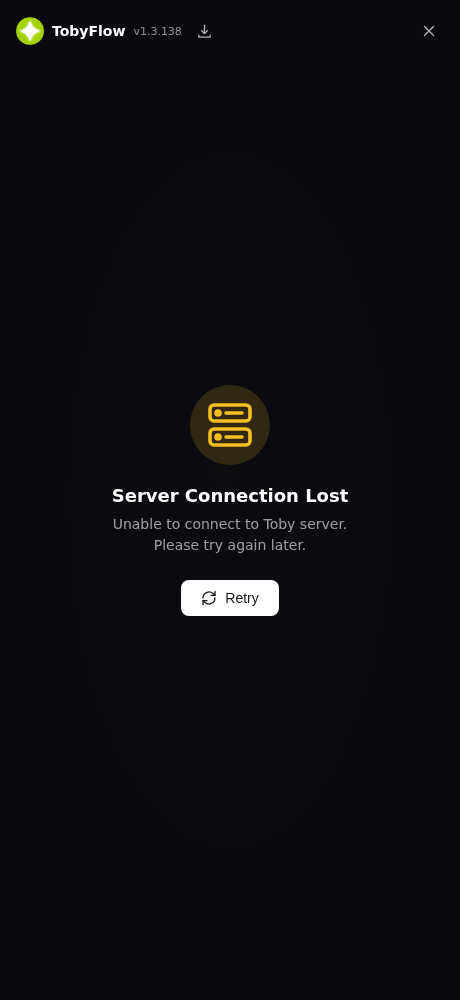

## 12.2 Tab Gen: tạo hàng loạt
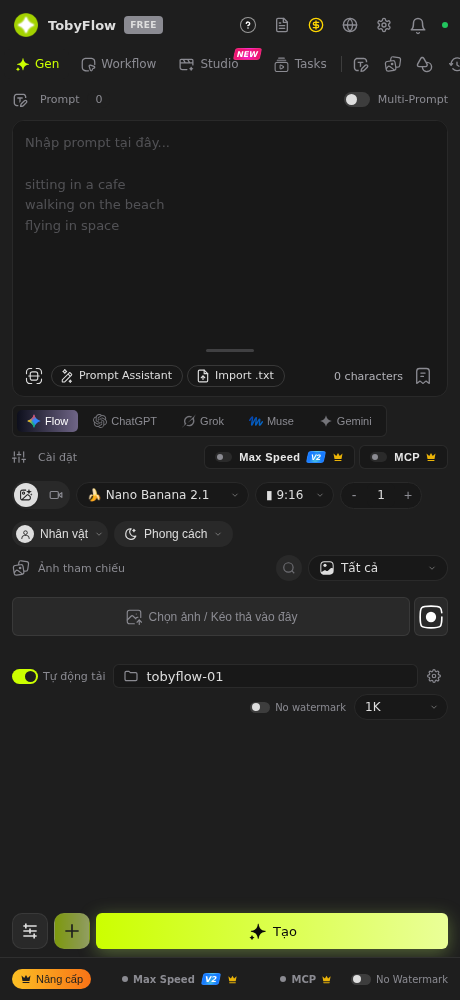

Từ trên xuống:
1. **Prompt:** bộ đếm, công tắc `Multi-Prompt`. Textarea nhận mỗi dòng là một prompt. Có nút `Prompt Assistant`, `Import .txt`, nút scan/OCR, bộ đếm ký tự và nút thư viện prompt.
2. **Chọn provider:** `Flow · ChatGPT · Grok · Muse · Gemini`.
3. **Cài đặt chạy:** `Max Speed V2` (Flow API) và `MCP`.
4. **Thông số generate:** chọn ảnh hoặc video, model (`🍌 Nano Banana 2.1`…), tỉ lệ (`9:16`), số lượng `− 1 +`.
5. `Nhân vật` (character @mention) và `Phong cách` (style/addon-prompt).
6. **Ảnh tham chiếu:** tìm kiếm, chế độ gán (`Tất cả` / Thứ tự / @Mention / Không dùng), vùng `Chọn ảnh / Kéo thả`, chụp màn hình.
7. `Tự động tải` cùng thư mục (`toolflow-01`) và ⚙, `No watermark`, độ phân giải `1K`.
8. **Đáy:** bộ lọc, nút `+` (thêm vào hàng đợi) và nút lớn **`Tạo`**.

Chi tiết: [07](07-gen-batch-queue-tasks.md).

## 12.3 Tab Workflow
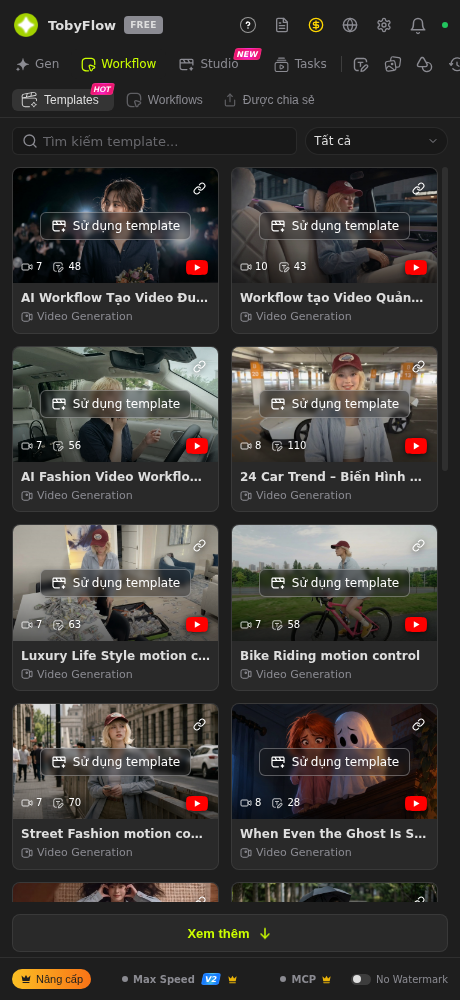

Có 3 tab con:
- `Templates` (HOT): 42 template public, lọc theo loại. Mỗi thẻ có số node, lượt dùng, link YouTube hướng dẫn và nút **Sử dụng template**.
- `Workflows`: workflow của user.
- `Được chia sẻ`: workflow người khác share.

Mở một workflow sẽ vào `workflow-editor.html`:

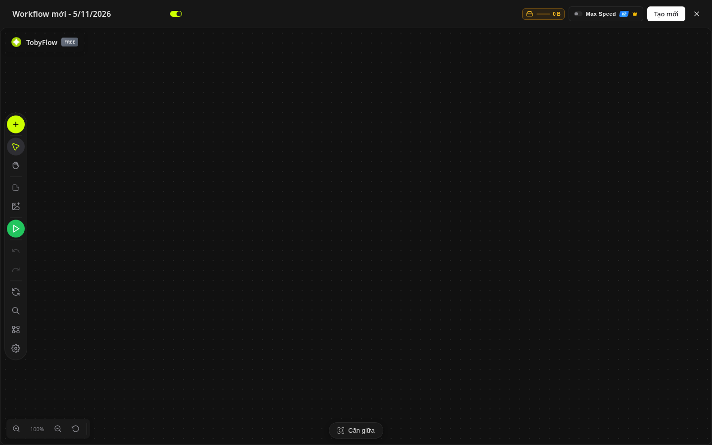

- **Thanh dọc bên trái:** `+` (thêm node), chọn, kéo canvas, file, ảnh, ▶ chạy, undo/redo, làm mới, tìm, auto-layout, cài đặt.
- **Góc trên phải:** dung lượng media, `Max Speed V2`, `Tạo mới`.
- **Đáy:** zoom và `Căn giữa`.

Chi tiết: [08](08-workflow-builder-executor.md).

`run-window.html` là cửa sổ "Run Workflow" có nút Stop và log chi tiết, dùng khi chạy workflow từ template hoặc MCP:

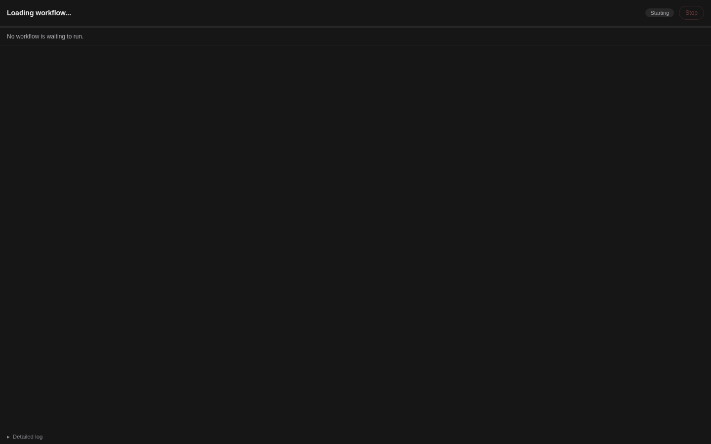

## 12.4 Tab Studio (Motion)
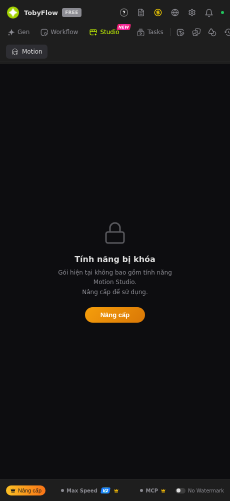

Gói Free thấy màn **"Tính năng bị khoá"** kèm nút Nâng cấp, vì `motion_tool_enabled = null`. Trang `motion-editor.html` cũng báo "Không tải được Motion Studio" (access check thất bại, đúng như log `[Motion Studio] Access check failed`). Khi mở khoá, editor chia 3 bước: `01 Video gốc → 02 Tạo chuyển động → 03 Xuất video`. Chi tiết: [09](09-motion-studio-angles-effects-video.md).

## 12.5 Tab Tasks
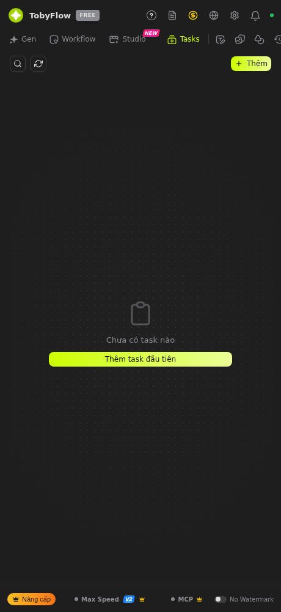

Danh sách task, gồm ô tìm kiếm, làm mới, nút `+ Thêm` và "Thêm task đầu tiên". Task là một batch được đặt tên và lưu lại để chạy lại (Free được 2 task). Chi tiết: [07](07-gen-batch-queue-tasks.md).

## 12.6 Tab Templates (prompt)
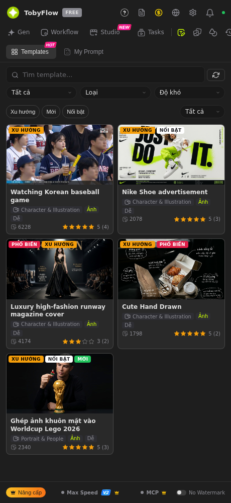

Tab con `Templates` (HOT) và `My Prompt`. Lọc theo Loại, Độ khó, Xu hướng, Mới, Nổi bật. Mỗi thẻ có ảnh, nhãn (XU HƯỚNG / PHỔ BIẾN / NỔI BẬT / MỚI), danh mục, lượt dùng và sao. Dùng template sẽ đổ prompt vào tab Gen (`templates/{id}/use`, `rate`).

## 12.7 Tab Photos
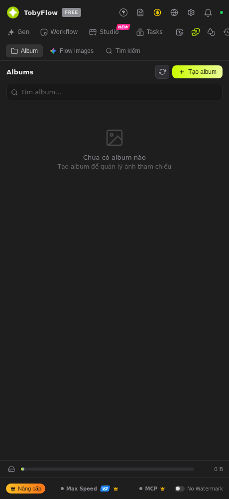

Có `Album`, `Flow Images` (ảnh trong project Flow) và `Tìm kiếm`. Có nút `+ Tạo album`. Album lưu trong IndexedDB `autoflow_pro` và dùng làm nguồn ảnh tham chiếu. Thanh dung lượng ở đáy.

## 12.8 Tab Tools
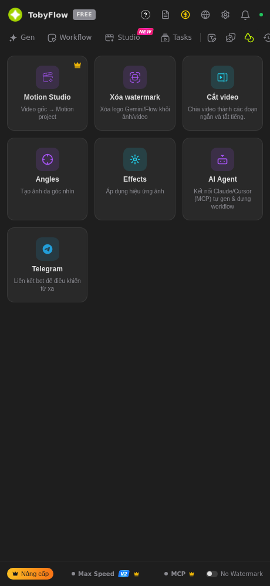

Các thẻ công cụ:

| Thẻ | Mô tả |
|---|---|
| `Motion Studio` 👑 | Video gốc → Motion project |
| `Xoá watermark` | Xoá logo Gemini/Flow khỏi ảnh hoặc video |
| `Cắt video` | Chia video thành đoạn và tắt tiếng |
| `Angles` | Tạo ảnh đa góc nhìn |
| `Effects` | Áp hiệu ứng lên ảnh |
| `AI Agent` | Kết nối Claude/Cursor (MCP) để gen và dựng workflow |
| `Telegram` | Liên kết bot để điều khiển từ xa |

**Angles** (`angles-editor.html`):

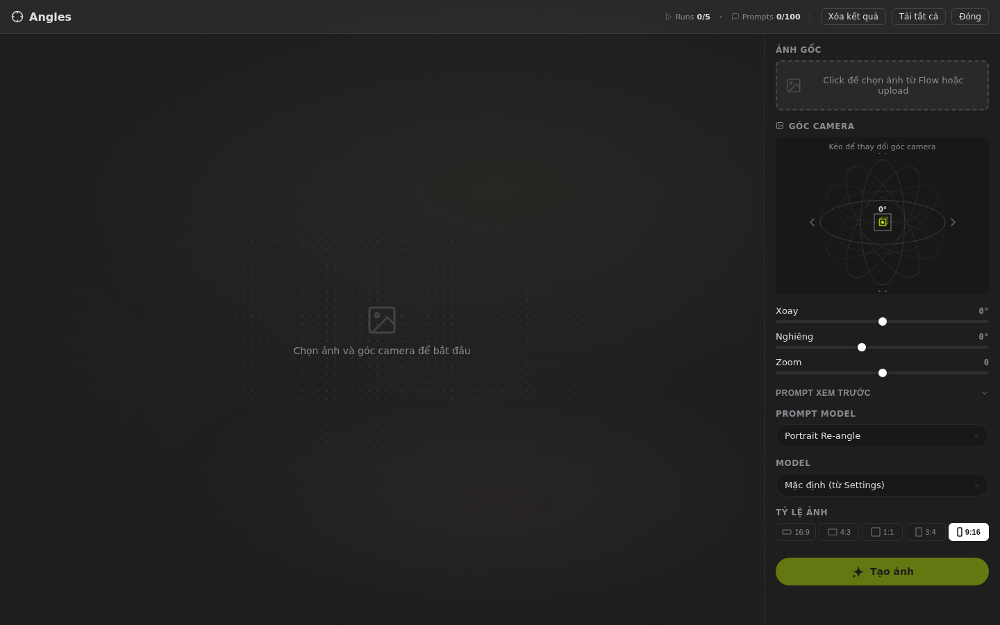

- Chọn ảnh gốc từ Flow hoặc upload.
- **Quả cầu kéo để đổi góc camera:** slider `Xoay`, `Nghiêng`, `Zoom`.
- `Prompt xem trước`, `Prompt model` (vd *Portrait Re-angle*), Model và Tỷ lệ.
- Nút `Tạo ảnh`. Bộ đếm `Runs 0/5`, `Prompts 0/100`.
- **[SL]** Góc xoay/nghiêng được dịch thành câu prompt mô tả góc máy rồi gửi lên Flow.

**Effects** (`effects-editor.html`):

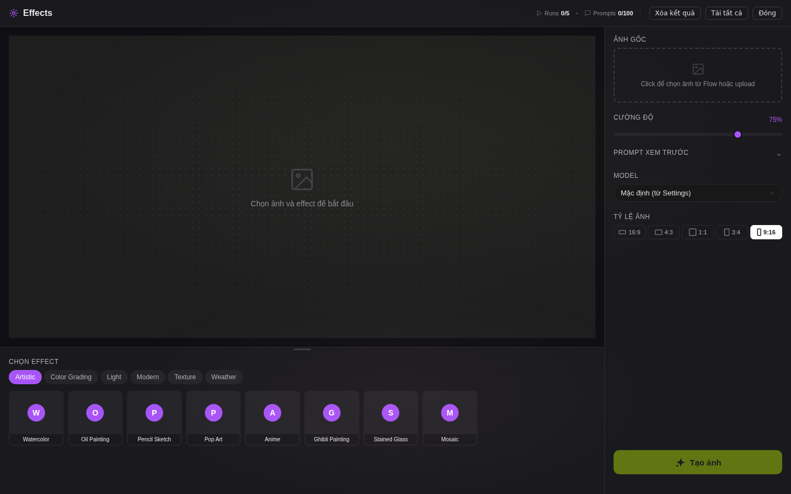

Thư viện effect theo nhóm `Artistic, Color Grading, Light, Modern, Texture, Weather` (Watercolor, Oil Painting, Pencil Sketch…), áp lên ảnh đã chọn. Giới hạn `Runs 0/5`.

## 12.9 Tab History
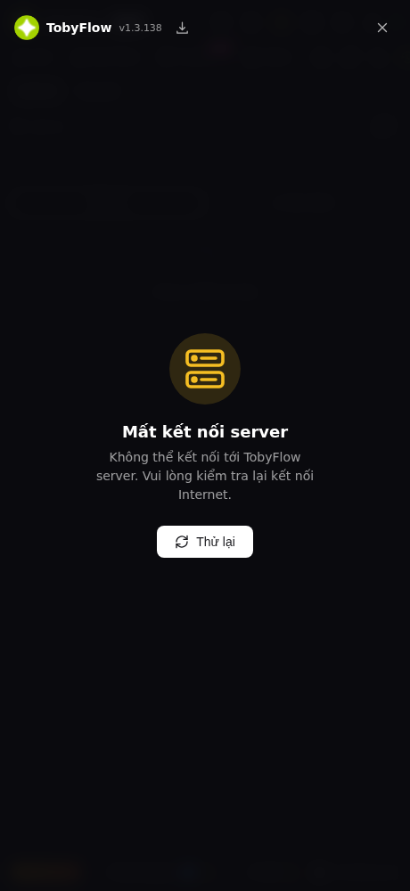

`Lịch sử` (lọc Tất cả hoặc Yêu thích, tìm kiếm) và `Hàng đợi`. History được đồng bộ server qua `history`, `history/{id}/favorite`, giới hạn `history_max = 20` với gói Free.

## 12.10 Settings
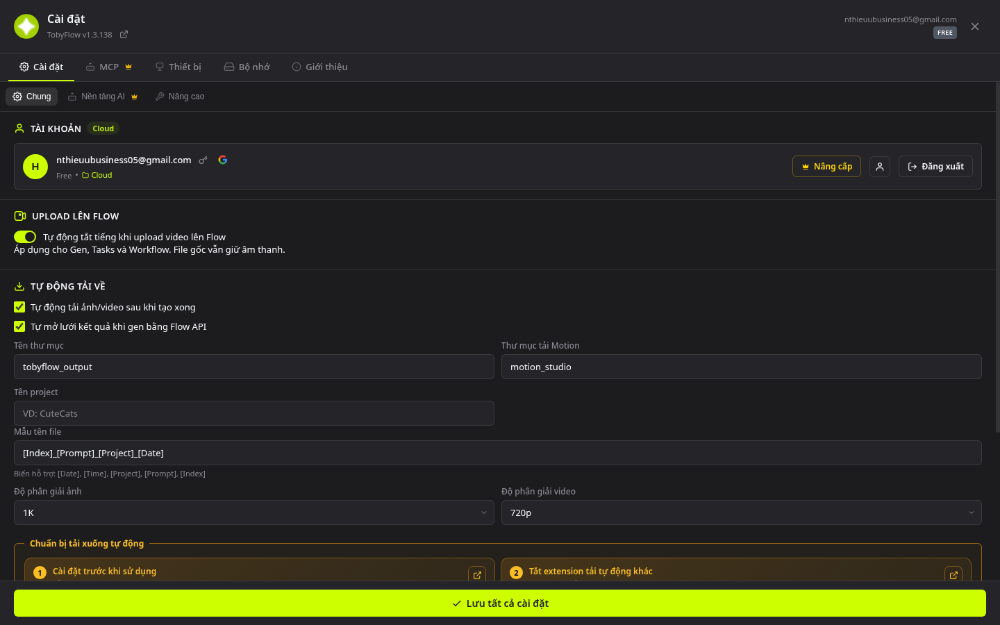

Tab: `Cài đặt` (`Chung` · `Nền tảng AI` 👑 · `Nâng cao`) · `MCP` 👑 · `Thiết bị` · `Bộ nhớ` · `Giới thiệu`. Bảng tuỳ chọn đầy đủ: [10](10-mcp-telegram-i2p-watermark-settings.md) và [11 §11.3](11-du-lieu-va-luu-tru.md).

## 12.11 Website labs.tool.vn
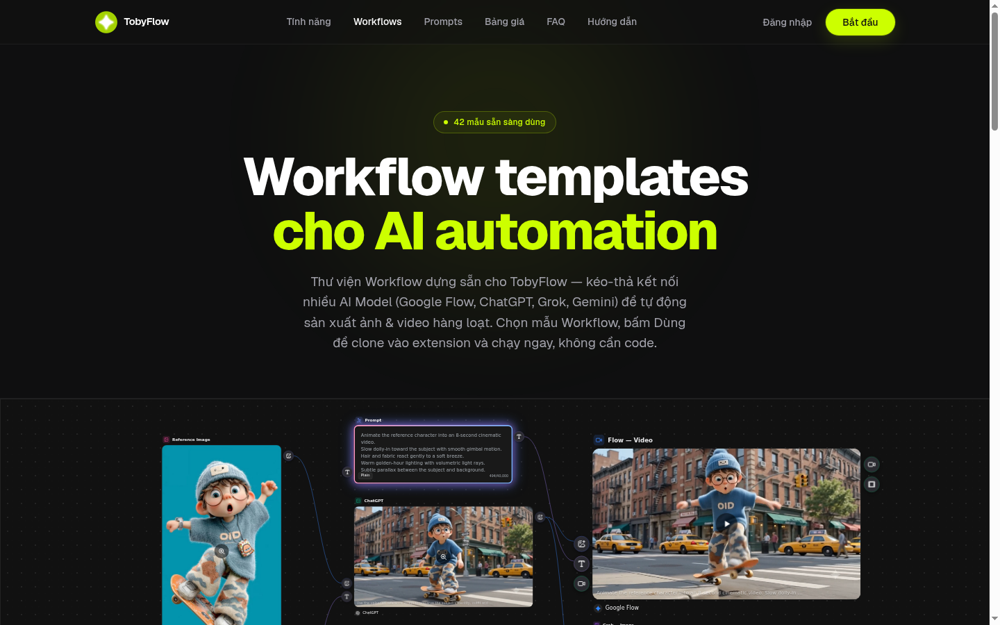 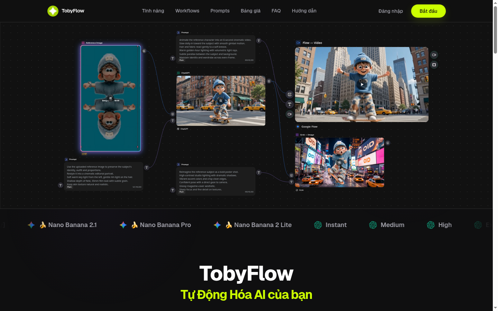

- **Menu:** Tính năng, Workflows, Prompts, Bảng giá, FAQ, Hướng dẫn, Đăng nhập, Bắt đầu.
- Trang `/workflows` (42 mẫu) có nút "Use" để **đẩy template sang extension** (qua `ref-bridge.js`, `externally_connectable`).

---

## Tóm tắt luồng điều hướng
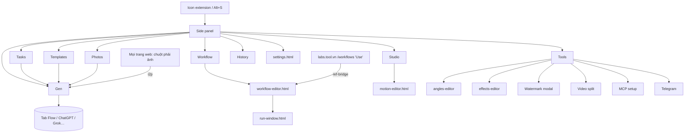
