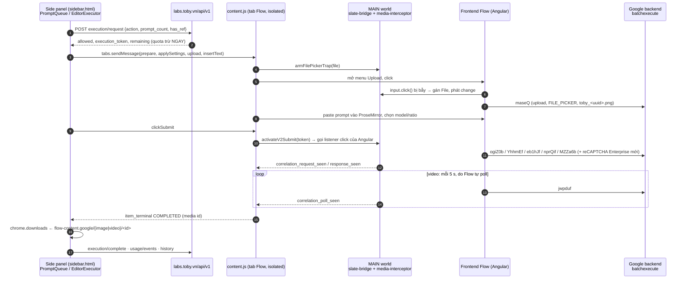

# 18. Extension tham chiếu điều khiển Google Flow thế nào — kiểm chứng sống 1.3.142 (06/11/2026)

Chương này trả lời ba câu: **nó hoạt động ra sao**, **vì sao bấm trong tool mà Flow tạo ra media**, **nó điều khiển Flow cụ thể thế nào**. Mọi kết luận gắn với bằng chứng chạy thật trên Chrome Profile 2 (gói Free, Web Mode). ChatGPT không nằm trong lượt này vì chưa đăng nhập.

Nhãn: **XÁC NHẬN** = thấy trong capture/ảnh màn hình · **TĨNH** = đọc từ mã (chương 01/04/07/08) · **CHƯA KIỂM**.

Bằng chứng: [lượt video đầu](../tobyflow/evidence/live-2026-11-06-video-frames/FINDINGS.md) · [quét tính năng F1–F11](../tobyflow/evidence/live-2026-11-06-features/FINDINGS.md) · [ledger](../tobyflow/evidence/live-2026-11-06-features/LEDGER.md).

## 1. Một câu trả lời ngắn

Ở Web Mode (gói Free), extension **không tự tạo ảnh/video và không gọi API riêng của Flow**. Nó là một robot bấm hộ trên chính trang `flow.google.com` đang đăng nhập của người dùng. Các bước:

1. Gõ prompt vào ô soạn của Flow.
2. Gắn ảnh bằng hộp chọn file của Flow.
3. Bấm nút Generate của Flow.
4. "Nghe lén" request/response mà frontend Flow tự gửi, để biết media nào thuộc prompt nào.
5. Tải file về.

Media được tạo bằng **tài khoản và credit Flow của người dùng**. Server của extension chỉ cấp phép và đếm lượt, đồng thời nhận lịch sử (XÁC NHẬN F1–F9).

## 2. Ba tầng tham gia

| Tầng | Nằm ở đâu | Việc chính | Nguồn |
|---|---|---|---|
| Bộ não | Side panel `sidebar.html` | Hàng đợi, thứ tự bước, retry, ghép kết quả, tải file | TĨNH 01 §1.3, 07; XÁC NHẬN qua `usage/events` |
| Tay chân | `content.js` + `FlowV2Driver` trong tab Flow | Thao tác DOM: dọn composer, chọn model/ratio, chèn text, gắn ref, bấm | TĨNH 04 §3–4; XÁC NHẬN `text_insert → editor_verified → click_ack` |
| Tai mắt | Script MAIN world (`slate-bridge.js`, `media-interceptor.js`) | Bấm "tin cậy" (gọi thẳng listener Angular), bẫy file picker, đọc request/response của Flow | TĨNH 04 §4.3, §7.2, §9; XÁC NHẬN Initiator `media-interceptor.js` trong HAR |
| Văn phòng | `labs.toby.vn/api/v1` | Cổng quota, telemetry, lịch sử, config selector, workflow | XÁC NHẬN toby-*.timeline.json |

## 3. Vì sao bấm trong tool mà Flow tạo ra media

- **Phiên đăng nhập là của Flow.** Request tạo media đi ra từ chính tab `flow.google.com` (cookie + reCAPTCHA Enterprise do JS của Google sinh mỗi lần). Extension không giữ hay tự dựng token Google (XÁC NHẬN `clientCtx` chứa token ~2.6k ký tự, có `recaptcha/enterprise/reload → clr` ngay trước mỗi lệnh tạo).
- **Bấm "như người".** Angular của Flow bỏ qua `element.click()` không tin cậy. Vì vậy extension phát `pointerdown/mousedown`, chờ paint, rồi nhờ `slate-bridge.js` ở MAIN world gọi trực tiếp listener click của nút (TĨNH 04 §4.3; XÁC NHẬN `click_ack` ≈0.5 s trước `correlation_request_seen`).
- **Gắn file không cần hộp thoại hệ điều hành.** Bridge MAIN world thay tạm `HTMLInputElement.prototype.click` / `showOpenFilePicker`, nhét `File` vào input rồi phát `change`. Vì thế Flow ghi nhận `FLOW_UPLOAD_SOURCE=FILE_PICKER` (TĨNH 04 §7.2; XÁC NHẬN `WuwhI FLOW_UPLOAD`, tên `toby_<uuid>.png`).
- **Biết kết quả nào của prompt nào.** Trước mỗi lần bấm, extension "arm" một correlation. Interceptor thấy request RPC đi ra rồi thấy response có media id + prompt gốc, nên ghép đúng prompt ↔ media kể cả khi chạy nhiều prompt (XÁC NHẬN F6: 3 prompt → `001/002/003` đúng thứ tự).
- **Server extension chỉ là cổng phép.** `execution/request` trả `allowed` + `execution_token` (300–4080 s) + `remaining`. Không có phép này thì không chạy. Media không đi qua server extension, nhưng **prompt đầy đủ, model, id media Flow và URL thumbnail đã ký** được gửi lên `POST /history` (XÁC NHẬN).

## 4. Bản đồ RPC Flow thấy được (do frontend Flow gửi)

| Chế độ trong tool | RPC tạo | Model key quan sát | Theo dõi | Credit Flow | Bằng chứng |
|---|---|---|---|---|---|
| Ảnh, text→ảnh | `ogiZ0b` | `HARBOR_SEAL` (= Nano Banana 2 Lite), seed ngẫu nhiên | Đồng bộ ~10 s, không poll | 0 | F1, F6, F8, F9 |
| Ảnh + ref | `maseQ` → `ogiZ0b` (ref list trong args) | `HARBOR_SEAL` | Đồng bộ | 0 | F2 |
| Video Ingredients 0 ref (= text→video) | `YhhmEf` | `veo_3_1_t2v_lite` | `jwpduf` 5 s: 6→2→3 | 10 | F3 |
| Video Frames START | `maseQ` → `eb1hJf` | `veo_3_1_i2v_lite` | `jwpduf` | 10 | lượt đầu, F7 |
| Video Frames START+END | `maseQ`×2 → `nprQif` | `veo_3_1_interpolation_lite` | `jwpduf` | 10 | F4 |
| Video Ingredients có ref | `MZZa6b` | `veo_3_1_r2v_fast_portrait` | `jwpduf`; lỗi = status 4 + `…GENERATION_FILTERED` | 20 | F5 |
| Phụ trợ | `as29s` resolve URL · `nzlxg` số dư credit · `HTrJv` danh sách model · `UpteDb` project · `ngNC2` tool/project · `WuwhI` telemetry Google | | | | mọi lượt |

So với bản đồ tĩnh ở [chương 17](17-flow-native-public-frontend.md): `eb1hJf`, `nprQif`, `MZZa6b`, `YhhmEf`, `maseQ`, `as29s` **khớp**. Bổ sung từ live: `ogiZ0b` (ảnh), `jwpduf` (poll video, thay vì `bOKtO`), `nzlxg` (số dư). Model ảnh đi bằng tên mã (`HARBOR_SEAL`), không phải tên hiển thị.

## 5. Từng tính năng (Flow, gói Free)

| Tính năng | Kết quả | Điều rút ra |
|---|---|---|
| Gen ảnh / ảnh + ref (F1, F2) | OK | Ref chỉ upload lúc chạy; ảnh đã upload được tái dùng (`as29s` kiểm id) |
| Video text / Frames / Ingredients (F3–F5) | OK | UI không có mode "text-only": Frames thiếu START bị chặn ở client (không tốn gì); text→video = Ingredients 0 ref |
| Tự retry (F5) | Có | Thấy `GENERATION_FILTERED` thì sau ~0.2 s chạy lại toàn bộ presubmit và submit lần 2. **Không tốn thêm lượt Toby, nhưng tốn thêm 1 submit Flow** |
| Multi-Prompt (F6) | OK | 1 lượt quota cho 3 prompt. Dù chọn "Song song", Web Mode vẫn **tuần tự** trong một composer, có nghỉ ngẫu nhiên 5–15 s ("Chống ban") |
| Chain khung cuối (F7) | **Treo** | Video 1 xong nhưng không có `item_terminal`, không trích/upload khung cuối; video 2 không gửi. Nguyên nhân CHƯA KIỂM |
| Manual submit (F8) | OK | Tool điền prompt + ref rồi chờ người bấm. Interceptor vẫn bắt được request do người bấm nên vẫn ghép và tải được. Quota bị trừ ngay khi bấm Chạy |
| Workflow (F9) | OK | Đồ thị lưu **trên server** (`bulk-save`). Server trả kế hoạch thực thi (`/workflows/{id}/execute`: thứ bậc, phụ thuộc). Executor chạy trong side panel; node `generate` đi đúng đường Gen Web Mode (1 `ogiZ0b`) |
| Studio / Motion, Angles, Effects (F10) | Khoá / chưa chạy | `GET /tools/motion-studio/projects` → 403 trên Free |
| Tasks, Hàng đợi, Templates, Album, History, Settings, tracker nổi (F11) | Đã xem | Hàng đợi nằm local (không gọi server). Task/Template/History/Settings là CRUD trên server |

## 6. Quota và chi phí quan sát được

- **Quota Toby** = số lượt bấm Chạy (`execution/request`), không theo số prompt. Free: 20/ngày theo module (`remaining`), kèm `remaining_global` 100. Lượt bị trừ ngay khi request; `execution/complete` trả `refund_count` (lượt này = 0).
- **Credit Flow** = tài khoản Google của người dùng: 1028 → 978 trong phiên (video Lite 10, Fast + ref 20, Nano Banana ảnh 0). Có `nzlxg` để đọc số dư.

## 7. 1.3.138 → 1.3.142: có gì đổi

- So file: 1 file mới (`src/motion/MotionTextFieldLimits.js`), 36 file đổi, 0 file xoá. Phần lớn là Motion Studio. Ngoài Motion là các sửa ổn định: `ProviderWorkerRegistry` (focus/reveal cửa sổ worker, kiểm `userId`), `WorkflowExecutor` (phục hồi run đã checkpoint, review lỗi ChatGPT/Gemini/Muse), `ConfigAccessUI` (overlay offline cho `motion-editor`), `ProviderWebQueueStore` (điều kiện "lỗi trước submit"), `chat-content-chatgpt.js` (nhịp reveal kết quả).
- Driver Flow (`content.js`, `FlowV2Driver`, `v2/*`, `slate-bridge.js`, `media-interceptor.js`) **không đổi**, nên [chương 04](04-google-flow-dom-v1.md) vẫn đúng cho 1.3.142.
- REA (`analyze-javascript-application`) trên 1.3.142: partial evidence `ev_b97aa46b…`. Parse 240/279 file JS, 1 855 findings, 149 quan sát kiểm sender. Riêng `GenTab.js` (462 KB) và `WorkflowExecutor.js` (600 KB) vượt deadline dù nâng lên 25 phút; hai file này dùng diff mức câu lệnh + chương 07/08 thay thế.

## 8. Ý nghĩa cho ToolFlow

- Hướng **Flow DOM-driving** là thực tế: chính extension tham chiếu dùng nó ở Free. Ba khối khó nhất là bấm tin cậy (MAIN world), bẫy file picker và correlation qua interceptor. Các khối đó đã có mô tả mã ở chương 04 và bằng chứng sống ở đây.
- Không tự gọi RPC Flow: mỗi lệnh tạo cần reCAPTCHA Enterprise mới do trang sinh.
- Có thể làm tốt hơn tham chiếu ở ba điểm: tín hiệu hoàn tất của chain (F7 treo); minh bạch retry tốn credit Flow (F5); "Song song" thật sự là gì.
- ToolFlow không cần server cấp phép. Nếu có history thì nên giữ local, không đẩy prompt/URL đã ký ra ngoài.

## 9. Còn mở

- F7 chain: cơ chế trích khung cuối chưa quan sát được; lý do treo chưa rõ.
- DevTools service worker chưa mở được. Các call `labs.toby.vn` thấy qua DevTools của side panel (fetch từ `background.js` hiện ở đó), nhưng traffic từ context khác (editor popup, motion-runner) chưa kiểm.
- Angles/Effects/Xoá watermark/Cắt video/Import .txt/Prompt Assistant: mới xem UI.
- ChatGPT: chưa đăng nhập, chưa kiểm sống.
